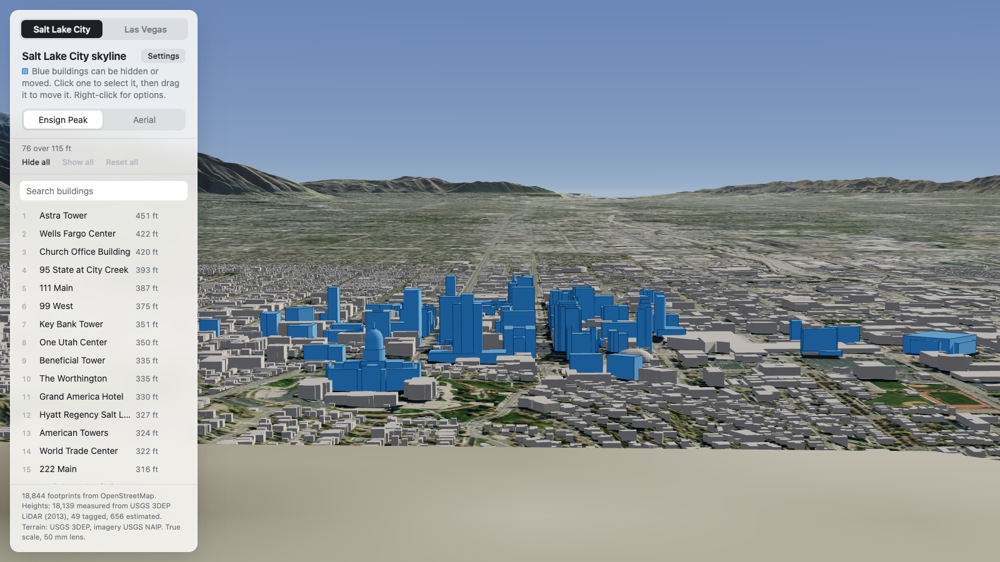
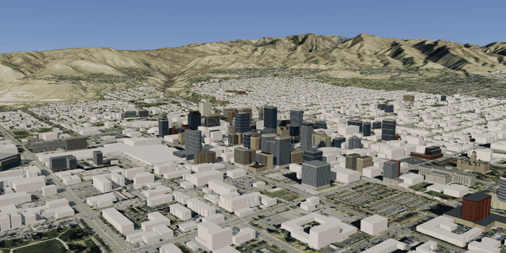
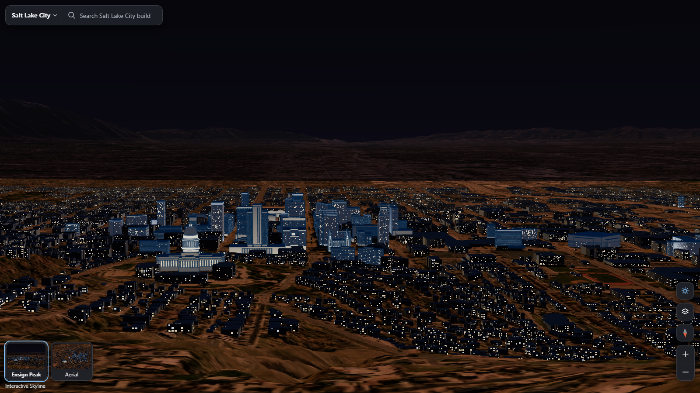
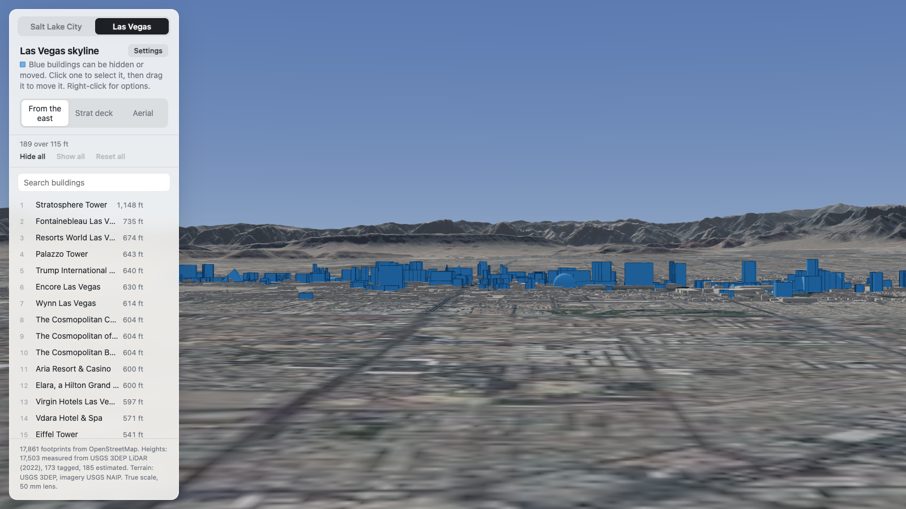
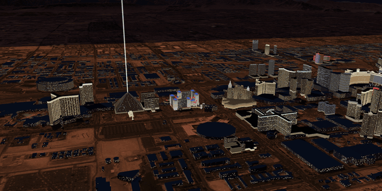
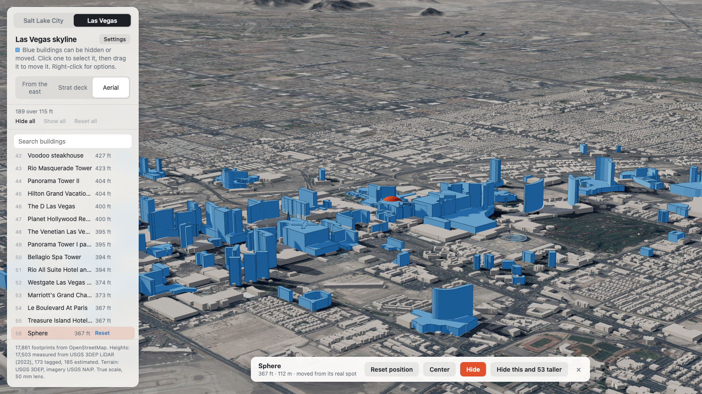
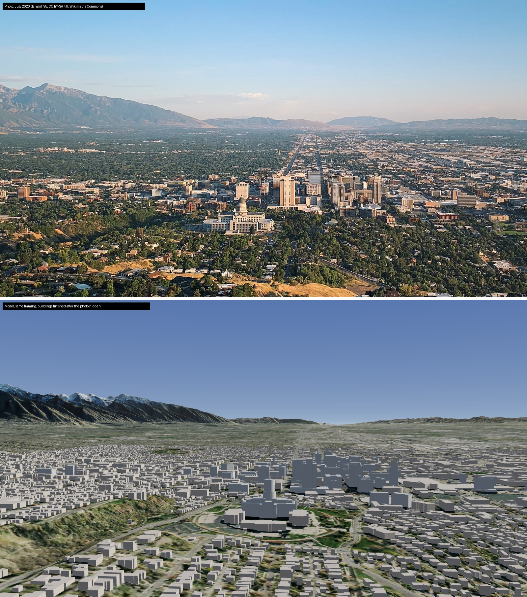

# Interactive Skyline

**[interactive-skyline.vercel.app](https://interactive-skyline.vercel.app)**

A true-scale 3D model of the Salt Lake City and Las Vegas skylines, built with three.js. Hide or move the tall buildings to see what each skyline would look like without them, or with them somewhere else. In Las Vegas you can also drive into the city on three real freeways.











## What you can do

- **Hide a building.** Click a blue building to select it, then press Hide. Right-click gives the same option, plus "Hide this and everything taller".
- **Move a building.** Drag a selected building along the ground. Its real footprint stays marked so you can see where it came from.
- **Undo and reset.** Cmd+Z undoes the last change. "Put back" returns one building to its real spot, and "Reset" restores everything.
- **Find a building.** Click the search box to list the tall buildings, tallest first. Click a row to fly to it.
- **Move around like a map.** Drag to slide the view, right-drag (or hold Cmd or Ctrl and drag) to rotate and tilt, scroll to zoom. The buttons in the corner zoom and face north.
- **Switch city and viewpoint.** Each city has an eye-level view and an aerial one.
- **Change the picture.** The moon button switches to night: windows light up and the hand-modelled landmarks of both cities glow with their own lighting. Map options set the aerial photo, the blue color, how tall a building must be to count, and the units.
- **Watch the Strip.** In Las Vegas the Bellagio fountains run their show and the High Roller turns.
- **Drive in.** In Las Vegas, Drive takes you into the city along one of three freeways, from the driver's seat, by day, at dusk, at night or in rain. See below.



## Drive into Las Vegas

In Las Vegas, the Drive button beside the search box puts you in a car on a real freeway into the city, from the driver's seat, at true scale. The drive runs on rails: the car keeps its lane at the posted speed while you look around, scrub along the road, change the time of day and bring rain. Hidden and moved buildings stay hidden and moved, and you can still click a building to hide or move it on the way in.

<!-- Screenshots for this section, to be captured (none are in the repository yet):
     1. docs/drive-reveal.png: I-15 north from the cabin at dusk, just after the Strip comes into view (km 42.7).
     2. docs/drive-night.png: the same road at night, street lamps, traffic lamps and the lit city ahead.
     3. docs/drive-rain.png: heavy rain at night, wet road with reflected lamps and spray.
     4. docs/drive-dam.png: US-93 by day leaving Hoover Dam, Black Canyon on the finer ground.
     5. docs/drive-clean.png: the clean view (no car) on I-15 south by day, signs and billboards.
     6. docs/drive-phone.png: Drive on a phone in portrait, route bar and cabin.
     7. docs/drive-picker.png: the route picker open, three cards with their outline maps. -->

What you see:

- **The road.** Lanes, shoulders, tapers, ramps and gores, bridges that cross overhead, concrete barriers, guardrail, walls and delineators. The pavement has wheel-path wear, rumble strips and joints on the bridge decks.
- **Signs.** Green guide signs before every exit, overhead where the road is wide, speed limits, route shields and mile markers, lettered with the real exit numbers and destinations.
- **The roadside.** About 50,000 buildings along the three routes, beyond the modelled core, and 408 billboards.
- **Traffic.** Sedans, crossovers, pickups, vans, tractor-trailers and coaches on both carriageways, as many as the 2025 counts give for that hour of that day of the week. Beyond 4 km they become a ribbon of light per lane, and the rest of the valley's freeways and main roads carry ribbons of their own.
- **Night.** Your headlights light the road and make the signs and lane lines shine back. Street lamps light up through dusk, sodium ones warming up orange. Other vehicles carry head, tail and stop lamps. Towers over 61 m carry red obstruction lights, and the Sphere lights its surroundings.
- **The car.** The default view is from the driver's seat of a generic crossover, with speed and time on the cluster, a route display, three working mirrors and a windshield that hazes around a low sun and oncoming lamps. The car rides the road's texture and the bridge joints. The clean view drops the car and puts the eye 1.2 m above the road.
- **Rain.** Light rain, rain and heavy rain darken and gloss the road, put streaks of reflected lamps on it, grey out the distance and throw spray behind vehicles.

### The three routes

| Route | From | To | Length | The Strip comes into view |
| --- | --- | --- | --- | --- |
| I-15 north from Primm | California state line | Spaghetti Bowl | 68.4 km | at km 42.7 |
| I-15 south from Apex | US-93 junction | Russell Road | 45.3 km | at km 7.5 |
| US-93 from Hoover Dam | Hoover Dam bypass bridge | Spaghetti Bowl | 59.5 km | at km 25.4 |

Each route can start before the view opens (the default), from its start, or through the city. The default moment is today, timed so the car reaches the view in mid civil twilight.

### Controls

| | Mouse and keyboard | Touch |
| --- | --- | --- |
| Look around | Drag; W A S D (5 degrees a press) | Drag with one finger |
| Zoom | Scroll; + and -; the zoom buttons | Pinch; the zoom buttons |
| Look ahead again | Double-click; R; the compass button | Double-tap; the compass button |
| Glance | 1 ahead, 2 left mirror, 3 right mirror, 4 rear-view mirror (hold to stay) | The view popover's mirror buttons |
| Cabin or clean view | C; the wheel button in the route bar | The wheel button |
| Play and pause | Space; the play button | The play button |
| Move along the road | Left and right arrows (10 s, with Shift 60 s); drag the track | Drag the track |
| Playback rate | Comma and full stop, or the arrows beside the rate: 0.25x to 16x | The arrows |
| High beam | H | |
| Close a popover | Escape | Tap outside it |

The route bar also holds the time and the next exit. The clock opens the time popover: a slider for the local time of day, three jumps (Dusk, the route's default moment; Noon; Night, 3 a.m.) and the weather (Clear, Light, Rain, Heavy: about 1, 4 and 12 mm of rain an hour). The jumps keep the car where it is. The padlock is the hold-position lock: while it is closed the car holds its place, and the running clock, the arrow keys and the time slider change only the time; while it is open, changing the time moves the car to where it would be then. The view popover holds Cabin or Clean, the mirror glances and the drive's own Reduce motion, which holds the eye still.

The address bar follows the drive, so a link opens the same place, time, route, view and weather:

```
?city=lv&mode=drive&route=i15n&s=42150&t=2026-11-14T01:07:30Z&view=cabin&yaw=-12&pitch=2&lens=28&rain=heavy
```

`s` is metres along the route, `t` simulation time in UTC, `rain` one of `light`, `moderate` or `heavy` (or a rate in mm an hour). Everything but `mode` is optional.

### What is real and what is assumed

- **Roads and lanes** come from OpenStreetMap: the route relations, lane counts, speed limits, exits and their destinations, and mapped barriers. The road's height is set by rule over the coarse elevation the app already has: the highest ground under the pavement plus 0.3 m, smoothed under a 6 % grade limit, with a fixed embankment down to the ground. Interchanges and the bridges over the road take their heights by rule too. Around Hoover Dam a finer patch of ground (20 m posts, 6 m imagery) gives Black Canyon its walls, and the road is carved into it, because the elevation data predates the highway.
- **Signs** are placed by the MUTCD's rules and carry the real exit numbers and destinations. Route numbers sit in plain shields of this project's drawing, and no legend carries a trade name: a deny-list (`data/sign_denylist.txt`) is checked on every build.
- **Billboards** stand where OpenStreetMap and the City of Las Vegas and Clark County billboard layers put them. Their faces are generated abstract patterns, with no words, letters or marks.
- **Buildings** along the routes are OpenStreetMap footprints, plus Overture Maps footprints (from Microsoft's) for tall buildings OpenStreetMap lacks. Heights are OpenStreetMap's where tagged, else Overture's, else a guess by type and area; 13 resort towers and grandstands that both sources get wrong have hand-set heights (`data/corridor_overrides.json`; 24 outlines in the report). Of 49,859 buildings, 41,285 take Overture's height and 8,441 are guesses (`data/derived/lv/corridor_report.json`). Those 20 m and taller cannot be hidden or moved.
- **Traffic** comes from 2025 counts: FHWA's hourly counts at the permanent stations, as published in the national transportation atlas, and NDOT's annual counts between them, with NDOT's 2023 truck shares. The road's capacity (2,300 cars an hour a lane) and the speed of each lane are assumed. Your car does not slow in a queue; the counts show none on these routes.
- **Street lamps** are the agencies' own inventories (Clark County, the City of Las Vegas, Henderson, Boulder City), with OpenStreetMap's, and a rule only where no inventory reaches: 196,300 lamps, 13 % of them placed by rule (`data/derived/lv/lights_report.json`).
- **Your headlamps' beams** are shaped by hand inside the test points of the US vehicle lighting standard (FMVSS 108), because the published survey of real beam patterns could not be fetched. Other vehicles' lamps take their intensities from the same standard's ranges.
- **The car and the vehicles** are generic shapes with no badge or brand.

Stand-ins until the sky and weather plan (plan 01) lands: the dusk is a blend between the app's day and night looks by the sun's height, the exposure is fixed (lights are described in physical units and mapped to the scene by one constant per unit), and the rain is four presets rather than real weather. The city's glow is not yet fitted to satellite night lights.

The plan behind all this, with what is done and what is not, is `docs/plans/02-vegas-drive.md`.

## Run it

```sh
pnpm install
pnpm dev
```

The built data in `public/data` and the models in `public/models` are checked in, so the app runs without the data pipeline.

## How the model is built

One unit is one meter. Every building sits on real terrain at its real position.

| Layer | Source |
| --- | --- |
| Footprints, names, tagged heights | OpenStreetMap, via the Overpass API |
| Measured heights | USGS 3DEP LiDAR point clouds (Salt Lake City 2013, Las Vegas 2022) |
| Terrain | USGS 3DEP elevation, via AWS Terrain Tiles |
| Ground imagery | USGS NAIP aerial photography |

Each building's height comes from the most trustworthy source available, in this order:

1. An explicit `height` tag in OpenStreetMap.
2. Roof minus ground, measured from the LiDAR point cloud.
3. Floor count times 3.2 m, when LiDAR is missing or predates the building.
4. A flat 4 m guess when nothing is known.

Most buildings use LiDAR: 18,136 of 18,844 in Salt Lake City and 17,506 of 17,861 in Las Vegas.

Two things keep the LiDAR honest around towers. The Las Vegas survey files every return above roughly 150 m as noise, which cuts the top off the tallest towers, so the build takes those returns back where they are dense enough to be a roof. And a low building that touches a tower is measured without the tower's footprint, so a podium does not inherit the height of the tower standing on it.

The pipeline is four Python scripts, run with [uv](https://docs.astral.sh/uv/). Each takes a city id from `data/cities.json`:

```sh
uv run scripts/fetch_lidar.py lv       # download and rasterize the point cloud (slow, about 1 GB)
uv run scripts/build_terrain.py lv     # terrain height grids
uv run scripts/build_imagery.py lv     # aerial photo draped on the terrain
uv run scripts/build_buildings.py lv   # footprints + heights -> public/data/lv/buildings.json
```

`pnpm data` runs all four for both cities. The raw OpenStreetMap extract for each city is expected at `data/raw/<city>/osm-buildings.json`; the scripts do not download it.

To add a city, add an entry to `data/cities.json` (origin, bounding box, LiDAR dataset, terrain extents and viewpoints) and run the pipeline for it.

## Rebuilding the drive's data

The drive's built data is checked in too (`public/data/lv/`, `public/data/drive/`, `public/models/drive/`), with a report for each step in `data/derived/lv/`. Downloads are cached under `data/raw/lv/`, which is not committed; a rerun with a warm cache makes no requests. The routes and the terrain grids are configured in `data/cities.json`. In order:

```sh
uv run scripts/fetch_osm.py lv              # route relations, interchanges and barriers from Overpass -> data/raw/lv/osm-<ref>.json, -x.json, -barriers.json
uv run scripts/build_terrain.py lv wide dam # the wide grid and the Hoover Dam patch (AWS Terrain Tiles) -> terrain-wide.bin, terrain-dam.bin, water-dam.json, terrain.json
uv run scripts/build_imagery.py lv wide dam # NAIP imagery for them -> ground-wide.jpg, ground-dam.jpg
uv run scripts/build_roads.py lv            # RoadNets and the reveal -> roadnet[-i15s|-us93].json/.bin, routes.json, data/derived/lv/roads_report*.json
uv run scripts/build_roadside.py lv i15n    # signs, barriers, delineators (also i15s, us93) -> signs[-R].json, barriers[-R].json
uv run scripts/build_traffic.py lv          # 2025 counts -> traffic/<route>.json, traffic_report.json
uv run scripts/build_valley_traffic.py lv   # the valley's ribbons -> traffic/valley.json/.bin
uv run scripts/build_corridor.py lv         # buildings beyond the core (OSM, Overture through DuckDB) -> corridor/
uv run scripts/build_billboards.py lv       # OSM and the city's and county's layers -> billboards.json
python3 scripts/pack_lamps.py --city lv     # data/derived/lv/lamps.bin -> lamps-drive.bin/.json
uv run scripts/make_beam.py                 # headlamp candela maps -> public/data/drive/beam_low.bin, beam_high.bin, beam.json
```

The dam patch carves the road along US-93's plan, so it needs a RoadNet first: after changing the patch, rebuild US-93's road with `build_roads.py lv --route us93 --heights-moved`. Each build checks its acceptance numbers, writes them to its report and exits non-zero when one is missed.

The lamp inventory itself (`data/derived/lv/lamps.bin`, `lamps.json`, `lights_report.json`) is built by `scripts/build_lights.py` on plan 01's data branch (`t3/sky-weather-data-pipelines`); this branch keeps a copy of its output and packs it.

The caches in `data/raw/lv/`: the Overpass answers (`osm-*.json`, including `osm-corridor*.json`, `osm-valley-roads.json`, `osm-water-dam.json`), the Overture extract (`overture/heights.parquet`), the billboard layers (`billboards-*.geojson`, `billboards-osm.json`) and the traffic counts (`traffic/`: the TMAS extract in FHWA's pipe-delimited format, the atlas downloads in `ntad/`, NDOT TRINA stations per route).

The cabin and the six vehicle bodies are built in headless Blender, like the landmarks:

```sh
python .claude/skills/blender-landmark-model/scripts/run_blender.py models/drive/cabin/build_cabin.py
python .claude/skills/blender-landmark-model/scripts/run_blender.py models/drive/vehicles/build_vehicles.py -- --out public/models/drive
```

They write `public/models/drive/cabin.glb`, `cabin-low.glb`, `cabin.json`, `vehicles.glb` and `vehicles.json`, with a mesh report beside each script in `models/drive/`.

## Tests

`pnpm test` runs the unit tests and the browser suites; `pnpm test:data` tests the Python pipeline. What each command covers, the golden images, the performance budgets and the manual screenshot scripts are in [tests/README.md](tests/README.md).

## Hand-modelled landmarks

In Las Vegas, 131 buildings are low-poly models made by hand instead of extruded footprints: the hotels and casinos of the Strip and downtown, the Strat, the Eiffel Tower, the Sphere, and the Luxor pyramid with its sphinx and obelisk. Three structures that are not buildings in the map data are modelled too: the Fremont Street canopy, the High Roller (its rim turns and its cabins stay level) and the Luxor Sky Beam at night. In Salt Lake City, all 76 buildings over the 35 m cutoff are modelled the same way, from Astra Tower and the Wells Fargo Center down to the mid-rise towers and historic office blocks of downtown. They include the Church Office Building, the Utah State Capitol with its dome, the Salt Lake Temple with its six spires, the City and County Building with its clock tower, and the Delta Center arena. Every building model stands on its real OpenStreetMap footprint at its measured height, and every model carries its own night lighting.

The models are GLB files with one folder per city, `public/models/lv/` and `public/models/slc/`, listed in `public/models/models.json`. Each one is made by a Python script run in Blender, and the scripts are in `landmarks/<city>/<model>/` with what they were made from:

| File | What it is |
| --- | --- |
| `build_<model>.py` | The build script. Every dimension is in it, with its source. |
| `footprint.json` | The OpenStreetMap outline, in meters around the building. |
| `<model>.report.json` | Mesh checks from the last build: triangles, closed solids, materials. |
| `research/`, `refs/` | Dimensions and notes, and where the reference photos came from. The photos themselves are not in the repo. |

Footprints and heights are measured. Most facades are estimated from a few public photos, and a few Salt Lake City buildings with no usable public photos have estimated colors and bands. Logos, signs and brand names are left off on purpose.

To rebuild a model and put it in the app (with [Blender](https://www.blender.org/) installed; these were made with Blender 5.2):

```sh
python .claude/skills/blender-landmark-model/scripts/run_blender.py landmarks/lv/wynn/build_wynn.py -- --out landmarks/lv/wynn
python .claude/skills/blender-landmark-model/scripts/skyline_tool.py install --repo . --city lv --id w205501268 --glb landmarks/lv/wynn/wynn.glb --offset 0,0
```

The build writes the `.blend`, the GLB and the report next to the script. Of these, only the report is committed. The Strat's script is the worked example inside the skill, in `.claude/skills/blender-landmark-model/assets/examples/strat/`.

## Claude Code skills

The models were made with two [Claude Code](https://claude.com/claude-code) skills. They are in `.claude/skills/` and are available whenever Claude Code runs in this repo.

- **blender-landmark-model** builds a new model. It looks up the building's footprint and height, gathers reference photos (Wikimedia Commons, plus Pixabay when `PIXABAY_API_KEY` is set) and published dimensions, then writes the build script and runs it in Blender. It checks the mesh, installs the GLB, and screenshots the building in the app by day and night. Ask for something like "model the Wynn for the skyline".
- **blender-landmark-refine** is a second pass on existing models. It compares renders with the photos and fixes proportions, rooflines and facade detail, then reinstalls the model only if it still passes the same checks.

Both run Blender headless, in its own process, so they never touch a Blender window you have open. The scripts need Python 3.10+, Blender, and Chrome or Edge for the screenshots in the app.

The skill's `flyover.py` recorded the GIFs above, rendering frame by frame in headless Chrome and encoding with ffmpeg:

```sh
python .claude/skills/blender-landmark-model/scripts/flyover.py --repo . --out docs/las-vegas-night.gif --night \
  --key "1700,-2300,700:-250,-1700,90" --key "2500,1200,700:1100,3000,120" \
  --seconds 8 --fps 8 --width 640 --colors 128
python .claude/skills/blender-landmark-model/scripts/flyover.py --repo . --city slc --out docs/salt-lake-city-day.gif \
  --key=-900,-1750,330:150,-420,70 --key=350,-2050,300:150,-380,70 --key=1450,-1350,280:150,-280,70 \
  --seconds 8 --fps 8 --width 640 --colors 128
```

## How accurate it is

Checked for Salt Lake City:

- **Heights.** Nine of the ten tallest buildings listed by CTBUH are within 0.5% of the listed height. The LiDAR independently agrees with the tagged heights to within about 5% for towers that existed in 2013, with one exception: it reads Beneficial Tower about 9% low.
- **Datum.** LiDAR ground and the terrain model differ by a constant 17.2 m (the two use different vertical datums), with a spread of under half a meter. The build corrects for it.
- **View.** A render matched to a 2020 photo from Ensign Peak shows the same mountain profile, street axis and tower order. The camera position was estimated, so this is a visual check only.



Las Vegas was checked against Wikipedia's list of its tallest buildings, matched by location. All 44 buildings on the list are within 6% of the published height except Marriott's Grand Chateau (114 m against 128 m) and Panorama Tower I (120 m against 128 m), where the model follows the LiDAR. With the noise returns restored, the LiDAR independently agrees with the tagged heights of the tallest towers (Fontainebleau, the Palazzo, Encore, the Cosmopolitan, Aria) to within about 3%. Las Vegas has not had a photo check.

Known limits:

- Apart from the hand-modelled landmarks (131 in Las Vegas, all 76 tall buildings in Salt Lake City), buildings are extruded footprints. Pyramids and domes are drawn where OpenStreetMap tags them; everything else has a flat roof.
- The hand-made models have measured footprints and heights, but most of their facades are estimated from a few photos. The Strat's pod, crown and mast are sized from the LiDAR and its legs are estimated. The Las Vegas Eiffel Tower's height and the position of its four feet are real, and its platforms follow the proportions of the original.
- Buildings finished after the LiDAR survey have estimated heights unless OpenStreetMap tags one. They are marked "est." in the list.
- Hand corrections to wrong or missing OpenStreetMap data are listed, with reasons, in `data/overrides.json`.
- In the map, 3D buildings cover only the core of each city. Beyond that the ground is imagery. Drive adds the buildings along its routes, but not to the map.

## License

The code is released under the [MIT License](LICENSE).

The data and images are not covered by it and keep their own terms:

- `public/data/*/buildings.json` is derived from OpenStreetMap and is available under the [Open Database License](https://opendatacommons.org/licenses/odbl/).
- Terrain and ground imagery in `public/data` come from USGS sources in the public domain.
- `docs/photo-match.png` includes a CC BY-SA 4.0 photo, credited below.
- The footprints in `landmarks/**/footprint.json` are OpenStreetMap data under the Open Database License, and the models in `public/models/` are built on them.
- The drive's roads, signs, barriers and roadside buildings in `public/data/lv/` (`roadnet*`, `signs*`, `barriers*`, `corridor/`, `billboards.json`, `traffic/valley.*`) are derived from OpenStreetMap, and the roadside buildings also from Overture Maps; they are available under the Open Database License.
- The street-lamp positions in `public/data/lv/lamps-drive.*` come from the Clark County, City of Las Vegas, Henderson and Boulder City street-light layers, which name no licence, and from OpenStreetMap. They are used with the credit below.
- The traffic files in `public/data/lv/traffic/` are derived from FHWA and Nevada DOT counts; the repository records no licence for those sources.

## Credits

- Building, road, sign, barrier and billboard data © [OpenStreetMap](https://www.openstreetmap.org/copyright) contributors, available under the Open Database License.
- LiDAR, elevation and NAIP imagery from the U.S. Geological Survey, public domain. Elevation via AWS Terrain Tiles.
- Drive: building heights and some footprints from the [Overture Maps Foundation](https://docs.overturemaps.org/attribution/) (© OpenStreetMap contributors, Overture Maps Foundation; footprints from Microsoft Global ML Building Footprints), under the Open Database License.
- Drive: hourly traffic counts from FHWA's Travel Monitoring Analysis System (2025), via the BTS National Transportation Atlas; annual counts and truck shares from the Nevada Department of Transportation.
- Drive: street lights from Clark County Public Works, the City of Las Vegas, the City of Henderson (via its lighting contractor's public layer) and Boulder City; billboard positions from the City of Las Vegas and Clark County, Nevada.
- The app lists the same sources, with links, under Map options > About the data, or from the OpenStreetMap credit in the corner.
- Comparison photo: "Salt Lake City skyline (2020) from Ensign Peak" by Iansmh98, [CC BY-SA 4.0](https://creativecommons.org/licenses/by-sa/4.0/), via Wikimedia Commons.
- The models in 41 of the `landmarks/` folders were drawn from public reference photos, which are not included. Their sources are in each model's `landmarks/lv/<model>/refs/` folder: `sources.json` gives author and license, and `commons_candidates.json` gives the Wikimedia Commons pages of the thumbnails a model was compared with. The other models were built from the map data and published figures alone.
