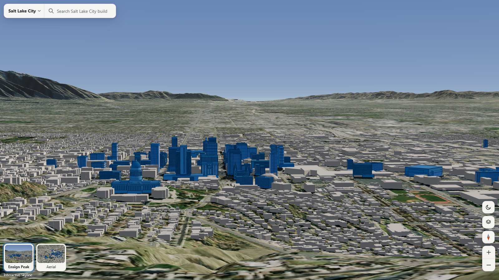
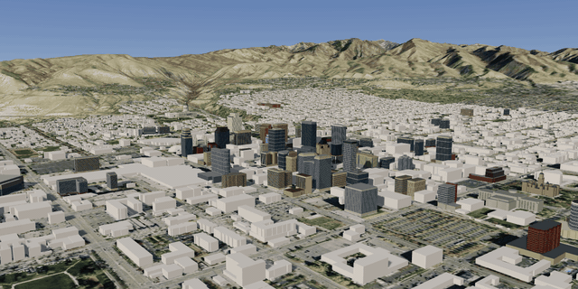
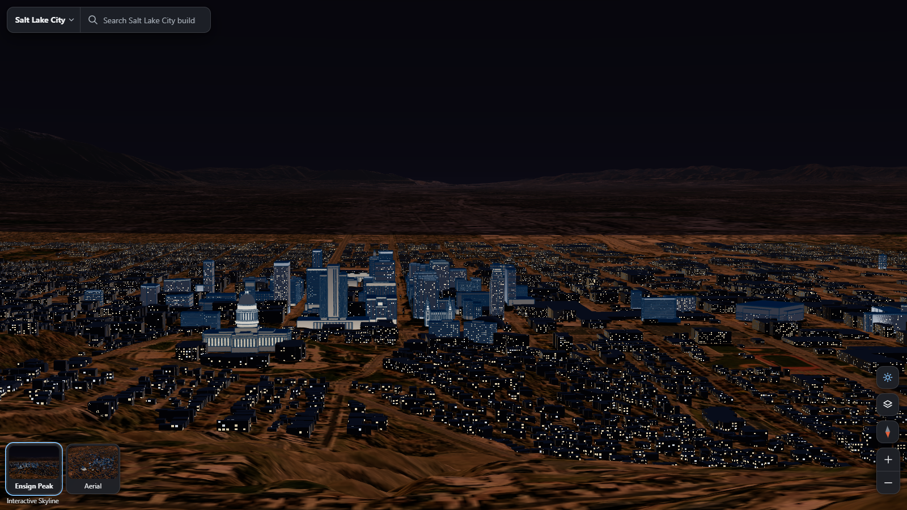
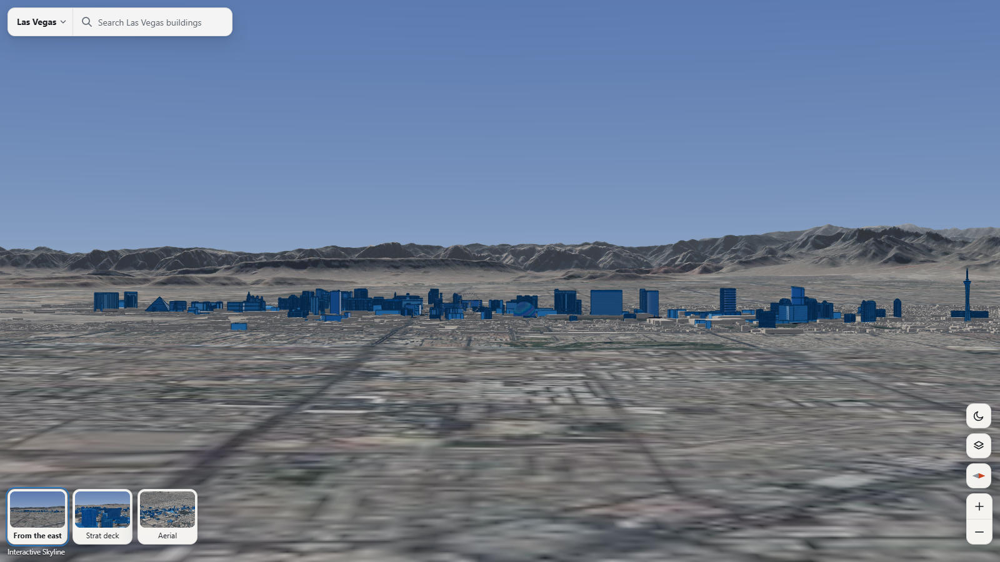
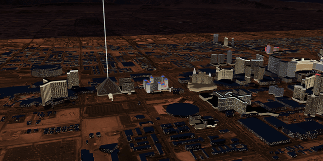
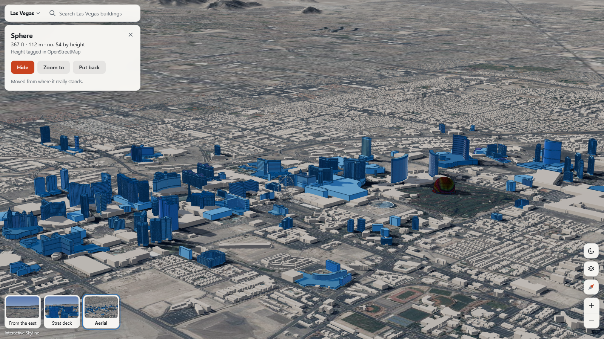
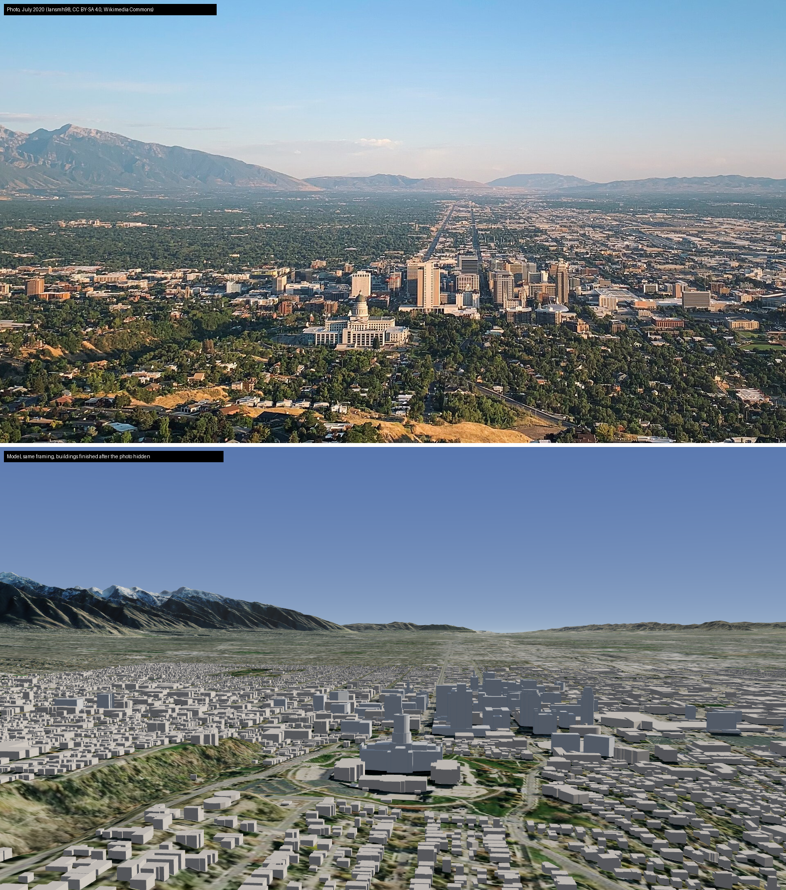

# Interactive Skyline

**[interactive-skyline.vercel.app](https://interactive-skyline.vercel.app)**

A true-scale 3D model of the Salt Lake City and Las Vegas skylines, built with three.js. Hide or move the tall buildings to see what each skyline would look like without them, or with them somewhere else.











## What you can do

- **Hide a building.** Click a blue building to select it, then press Hide. Right-click gives the same option, plus "Hide this and everything taller".
- **Move a building.** Drag a selected building along the ground. Its real footprint stays marked so you can see where it came from.
- **Undo and reset.** Cmd+Z undoes the last change. "Put back" returns one building to its real spot, and "Reset" restores everything.
- **Find a building.** Click the search box to list the tall buildings, tallest first. Click a row to fly to it.
- **Move around like a map.** Drag to slide the view, right-drag (or hold Cmd or Ctrl and drag) to rotate and tilt, scroll to zoom. The buttons in the corner zoom and face north.
- **Switch city and viewpoint.** Each city has an eye-level view and an aerial one.
- **Change the picture.** The moon button switches to night: windows light up and the hand-modelled landmarks of both cities glow with their own lighting. Map options set the aerial photo, the blue color, how tall a building must be to count, and the units.
- **Watch the Strip.** In Las Vegas the Bellagio fountains run their show and the High Roller turns.



## Run it

```sh
pnpm install
pnpm dev
```

The built data in `public/data` is checked in, so the app runs without the data pipeline.

## How the model is built

One unit is one meter. Every building sits on real terrain at its real position.

| Layer | Source |
| --- | --- |
| Footprints, names, tagged heights | OpenStreetMap, via the Overpass API |
| Measured heights | USGS 3DEP LiDAR point clouds (Salt Lake City 2013, Las Vegas 2022) |
| Terrain | USGS 3DEP elevation, via AWS Terrain Tiles |
| Ground imagery | USGS NAIP aerial photography |

Each building's height comes from the most trustworthy source available, in this order:

1. An explicit `height` tag in OpenStreetMap.
2. Roof minus ground, measured from the LiDAR point cloud.
3. Floor count times 3.2 m, when LiDAR is missing or predates the building.
4. A flat 4 m guess when nothing is known.

Most buildings use LiDAR: 18,136 of 18,844 in Salt Lake City and 17,506 of 17,861 in Las Vegas.

Two things keep the LiDAR honest around towers. The Las Vegas survey files every return above roughly 150 m as noise, which cuts the top off the tallest towers, so the build takes those returns back where they are dense enough to be a roof. And a low building that touches a tower is measured without the tower's footprint, so a podium does not inherit the height of the tower standing on it.

The pipeline is four Python scripts, run with [uv](https://docs.astral.sh/uv/). Each takes a city id from `data/cities.json`:

```sh
uv run scripts/fetch_lidar.py lv       # download and rasterize the point cloud (slow, about 1 GB)
uv run scripts/build_terrain.py lv     # terrain height grids
uv run scripts/build_imagery.py lv     # aerial photo draped on the terrain
uv run scripts/build_buildings.py lv   # footprints + heights -> public/data/lv/buildings.json
```

`pnpm data` runs all four for both cities. The raw OpenStreetMap extract for each city is expected at `data/raw/<city>/osm-buildings.json`; the scripts do not download it.

To add a city, add an entry to `data/cities.json` (origin, bounding box, LiDAR dataset, terrain extents and viewpoints) and run the pipeline for it.

## Hand-modelled landmarks

In Las Vegas, 131 buildings are low-poly models made by hand instead of extruded footprints: the hotels and casinos of the Strip and downtown, the Strat, the Eiffel Tower, the Sphere, and the Luxor pyramid with its sphinx and obelisk. Three structures that are not buildings in the map data are modelled too: the Fremont Street canopy, the High Roller (its rim turns and its cabins stay level) and the Luxor Sky Beam at night. In Salt Lake City, all 76 buildings over the 35 m cutoff are modelled the same way, from Astra Tower and the Wells Fargo Center down to the mid-rise towers and historic office blocks of downtown. They include the Church Office Building, the Utah State Capitol with its dome, the Salt Lake Temple with its six spires, the City and County Building with its clock tower, and the Delta Center arena. Every building model stands on its real OpenStreetMap footprint at its measured height, and every model carries its own night lighting.

The models are GLB files with one folder per city, `public/models/lv/` and `public/models/slc/`, listed in `public/models/models.json`. Each one is made by a Python script run in Blender, and the scripts are in `landmarks/<city>/<model>/` with what they were made from:

| File | What it is |
| --- | --- |
| `build_<model>.py` | The build script. Every dimension is in it, with its source. |
| `footprint.json` | The OpenStreetMap outline, in meters around the building. |
| `<model>.report.json` | Mesh checks from the last build: triangles, closed solids, materials. |
| `research/`, `refs/` | Dimensions and notes, and where the reference photos came from. The photos themselves are not in the repo. |

Footprints and heights are measured. Most facades are estimated from a few public photos, and a few Salt Lake City buildings with no usable public photos have estimated colors and bands. Logos, signs and brand names are left off on purpose.

To rebuild a model and put it in the app (with [Blender](https://www.blender.org/) installed; these were made with Blender 5.2):

```sh
python .claude/skills/blender-landmark-model/scripts/run_blender.py landmarks/lv/wynn/build_wynn.py -- --out landmarks/lv/wynn
python .claude/skills/blender-landmark-model/scripts/skyline_tool.py install --repo . --city lv --id w205501268 --glb landmarks/lv/wynn/wynn.glb --offset 0,0
```

The build writes the `.blend`, the GLB and the report next to the script. Of these, only the report is committed. The Strat's script is the worked example inside the skill, in `.claude/skills/blender-landmark-model/assets/examples/strat/`.

## Claude Code skills

The models were made with two [Claude Code](https://claude.com/claude-code) skills. They are in `.claude/skills/` and are available whenever Claude Code runs in this repo.

- **blender-landmark-model** builds a new model. It looks up the building's footprint and height, gathers reference photos (Wikimedia Commons, plus Pixabay when `PIXABAY_API_KEY` is set) and published dimensions, then writes the build script and runs it in Blender. It checks the mesh, installs the GLB, and screenshots the building in the app by day and night. Ask for something like "model the Wynn for the skyline".
- **blender-landmark-refine** is a second pass on existing models. It compares renders with the photos and fixes proportions, rooflines and facade detail, then reinstalls the model only if it still passes the same checks.

Both run Blender headless, in its own process, so they never touch a Blender window you have open. The scripts need Python 3.10+, Blender, and Chrome or Edge for the screenshots in the app.

The skill's `flyover.py` recorded the GIFs above, rendering frame by frame in headless Chrome and encoding with ffmpeg:

```sh
python .claude/skills/blender-landmark-model/scripts/flyover.py --repo . --out docs/las-vegas-night.gif --night \
  --key "1700,-2300,700:-250,-1700,90" --key "2500,1200,700:1100,3000,120" \
  --seconds 8 --fps 8 --width 640 --colors 128
python .claude/skills/blender-landmark-model/scripts/flyover.py --repo . --city slc --out docs/salt-lake-city-day.gif \
  --key=-900,-1750,330:150,-420,70 --key=350,-2050,300:150,-380,70 --key=1450,-1350,280:150,-280,70 \
  --seconds 8 --fps 8 --width 640 --colors 128
```

## How accurate it is

Checked for Salt Lake City:

- **Heights.** Nine of the ten tallest buildings listed by CTBUH are within 0.5% of the listed height. The LiDAR independently agrees with the tagged heights to within about 5% for towers that existed in 2013, with one exception: it reads Beneficial Tower about 9% low.
- **Datum.** LiDAR ground and the terrain model differ by a constant 17.2 m (the two use different vertical datums), with a spread of under half a meter. The build corrects for it.
- **View.** A render matched to a 2020 photo from Ensign Peak shows the same mountain profile, street axis and tower order. The camera position was estimated, so this is a visual check only.



Las Vegas was checked against Wikipedia's list of its tallest buildings, matched by location. All 44 buildings on the list are within 6% of the published height except Marriott's Grand Chateau (114 m against 128 m) and Panorama Tower I (120 m against 128 m), where the model follows the LiDAR. With the noise returns restored, the LiDAR independently agrees with the tagged heights of the tallest towers (Fontainebleau, the Palazzo, Encore, the Cosmopolitan, Aria) to within about 3%. Las Vegas has not had a photo check.

Known limits:

- Apart from the hand-modelled landmarks (131 in Las Vegas, all 76 tall buildings in Salt Lake City), buildings are extruded footprints. Pyramids and domes are drawn where OpenStreetMap tags them; everything else has a flat roof.
- The hand-made models have measured footprints and heights, but most of their facades are estimated from a few photos. The Strat's pod, crown and mast are sized from the LiDAR and its legs are estimated. The Las Vegas Eiffel Tower's height and the position of its four feet are real, and its platforms follow the proportions of the original.
- Buildings finished after the LiDAR survey have estimated heights unless OpenStreetMap tags one. They are marked "est." in the list.
- Hand corrections to wrong or missing OpenStreetMap data are listed, with reasons, in `data/overrides.json`.
- 3D buildings cover only the core of each city. Beyond that the ground is imagery.

## License

The code is released under the [MIT License](LICENSE).

The data and images are not covered by it and keep their own terms:

- `public/data/*/buildings.json` is derived from OpenStreetMap and is available under the [Open Database License](https://opendatacommons.org/licenses/odbl/).
- Terrain and ground imagery in `public/data` come from USGS sources in the public domain.
- `docs/photo-match.png` includes a CC BY-SA 4.0 photo, credited below.
- The footprints in `landmarks/**/footprint.json` are OpenStreetMap data under the Open Database License, and the models in `public/models/` are built on them.

## Credits

- Building data © [OpenStreetMap](https://www.openstreetmap.org/copyright) contributors, available under the Open Database License.
- LiDAR, elevation and NAIP imagery from the U.S. Geological Survey, public domain.
- Comparison photo: "Salt Lake City skyline (2020) from Ensign Peak" by Iansmh98, [CC BY-SA 4.0](https://creativecommons.org/licenses/by-sa/4.0/), via Wikimedia Commons.
- The models in 41 of the `landmarks/` folders were drawn from public reference photos, which are not included. Their sources are in each model's `landmarks/lv/<model>/refs/` folder: `sources.json` gives author and license, and `commons_candidates.json` gives the Wikimedia Commons pages of the thumbnails a model was compared with. The other models were built from the map data and published figures alone.
