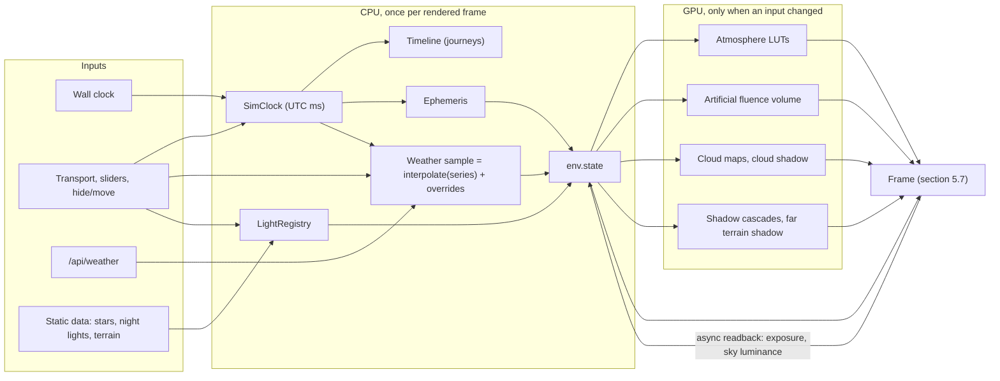
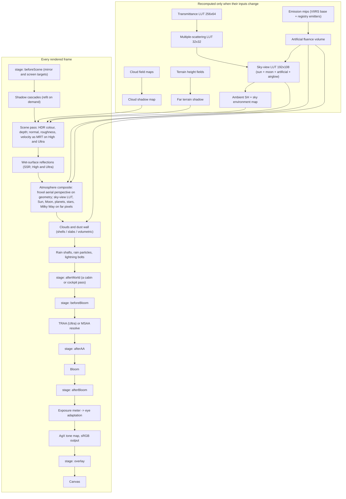
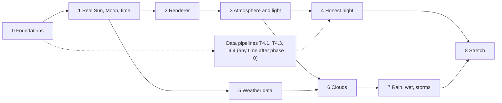

# Plan 01 — Sun, Moon, stars, sky and weather

Status: plan only, no code. Written 10 November 2026 against the working tree as it stood at 00:35 that night: `HEAD` at `c725477` plus uncommitted work up to integration v5 of the landmark skill (`src/attractions.js`, `src/fountain.js`). The tree was still changing; section 3 says exactly what was read. This is the foundation plan: the drive plan and the window-seat plan take all their light, time and weather from the interfaces in section 11.

How to read it: sections 1–4 say what will be built and what the user sees; 5–7 say how; 8–9 say how it is proven and what it may cost; 10 is the work, phase by phase; 11 is the contract with the other two plans; 12–13 are risks, licences and sources. Claims about three.js were checked in the installed r187 source; claims about data services were checked by calling them; anything not checked is marked as such in section 13.

---

## 1. Executive summary

### 1.1 What the user will see

- **The real sky, now.** The app opens on Las Vegas as it is at this minute: the Sun or Moon where they really are, the weather from the airport's current observation, the clock running. One bar scrubs through the day; a date field reaches back to 1940.
- **A day that behaves like a day.** Shadows sweep, the Spring Mountains throw theirs across the valley before sunset, the sky reddens and darkens through twilight, windows and signs come on one by one, the Moon rises with the right phase and tilt.
- **An honest night.** On the Strip: a glowing dome, the planets, a few dozen stars. Drive toward Primm or climb, and the sky deepens. A **City lights** slider dims the city and the desert sky comes back: thousands of stars, the Milky Way, zodiacal light. A readout states the sky brightness it is showing.
- **Glow that is made of the city.** Sky glow is computed from satellite-measured ground emission plus each tower's own light. Hide Luxor and its beam and its share of the glow go with it; the toast says how much, even when the honest answer is "no measurable change".
- **Weather.** Haze and dust from measured aerosol data; cumulus, cirrus and overcast placed from the observation, lit orange from below at night; rain shafts and virga; wet asphalt mirroring the signs; monsoon cells with lightning and a dust wall. Live, any past date, or presets and sliders.
- **Three quality levels chosen automatically**, on WebGPU where the browser has it and WebGL2 elsewhere. The physics, the data and the honesty are identical on all three.

### 1.2 Key decisions

| # | Decision | One-line reason |
|---|---|---|
| D1 | One renderer for everyone: three's `WebGPURenderer`, which runs on WebGPU or on its own WebGL2 backend. All shading in TSL. | It is the only route in r187 that gives WebGPU with a WebGL2 fallback from one code base; two renderers would mean writing every effect twice. |
| D2 | `night.js` and the fountain's `ShaderMaterial` are ported to TSL node materials; `_GLOW`, `_WINDOWS` and LED surfaces keep their meaning. This is integration v6, shipped together with the landmark skill. | `onBeforeCompile` and `ShaderMaterial` do not run under `WebGPURenderer`; the landmark models and the Blender skills must keep working. |
| D3 | Photometric units end to end, pre-exposure into a 16-bit float target, auto-exposure with a physically predicted prior, AgX tone mapping, bloom. | Day and night differ by more than ten million times in luminance; nothing hand-tuned survives that range. |
| D4 | The atmosphere is our own TSL implementation of Hillaire 2020, adapted from two MIT code bases (`@pmndrs/sky` and Hillaire's reference), with every parameter a uniform and every table filled by a fragment pass. takram's three-geospatial and `@pmndrs/sky` serve as test oracles, not as runtime dependencies. | Moonlight, city glow, airglow, clouds and data-driven aerosols all have to enter the scattering integrals, on both backends. takram compiles its parameters into the shaders and its clouds are WebGL-only; `@pmndrs/sky` needs true WebGPU compute for aerial perspective. |
| D5 | The whole world, terrain, clouds and atmosphere, sits on the one refraction-adjusted sphere the app already uses for terrain. | The haze band, cloud decks and terrain horizon stay aligned from a car and from a window seat. |
| D6 | Positions from `astronomy-engine`; stars from the Yale Bright Star Catalogue; which stars are visible is decided by a published limiting-magnitude relation applied to the modelled sky luminance. | Measured agreement with JPL Horizons is 0.001°; a display cannot reproduce the eye's threshold, so it is modelled. |
| D7 | Sky glow is a 3D field of artificial light computed from NASA Black Marble radiance, the public street-lamp inventories and a registry of building emitters, scattered by the same atmosphere, calibrated against National Park Service and Globe at Night measurements around Las Vegas. | It is the only form in which hiding a building, the lights-out slider, haze, clouds lit from below and the view from a distance can all be right at once. |
| D8 | One normalized weather state; one Vercel function that fuses Open-Meteo with airport observations behind the CDN cache, history served by month; the browser falls back to Open-Meteo directly. | METAR has no CORS; Open-Meteo's terms warn that requests from Vercel's shared addresses are rate-limited early, so the function must send almost nothing upstream. |
| D9 | One cloud field, three renderers: shells (Low), slabs (High), ray-marched volumes (Ultra). | Weather, shadows and lighting must not depend on the preset; only the drawing does. |
| D10 | One UTC simulation clock. Journeys are functions of it; everything random is a function of seed and time. | Play, scrub, reverse, deep links and tests then agree by construction. |
| D11 | Shadows: cascades that follow the camera, a far terrain shadow computed from the height field, a cloud shadow map; all refreshed only on change. | Works on the Strip, 60 km down I-15 and from the air, and keeps render-on-demand. |
| D12 | Tests read physical quantities (luminance, illuminance, magnitudes) through probes; golden images are secondary. | Physics can be checked against JPL, published tables and measurements; pictures cannot. |

---

## 2. Locked decisions & assumptions

### 2.1 Decisions that apply to all three plans (verbatim)

- Hardware: **scalable presets Low / High / Ultra, picked automatically** (user can override). Ultra adds volumetric clouds, light shafts, sharper shadows. **WebGPU where the browser has it, WebGL2 otherwise.**
- Control for drive and flight: **on rails** — the real path; the user controls time (play, pause, scrub, speed) and where they look.
- Las Vegas first; nothing hard-wired to it, so Salt Lake City can follow.
- Simulations are modes inside the existing app; hiding/moving buildings keeps working in every mode.
- Every plan includes tests and realism validation against ground truth.

### 2.2 Decisions for this plan (verbatim)

- **Night sky: honest by default** — sky brightness follows real light-pollution data (the Strip is ~Bortle 9: only the brightest stars, no Milky Way; darker skies appear as you leave the city, e.g. at Primm or at altitude). **Plus a "lights-out" what-if slider** that dims the city's artificial light to reveal the desert sky, and **hidden buildings stop contributing to sky glow** — this must tie into the app's hide/move identity, so city glow has to be a real modeled light source, not a backdrop.
- **Weather coverage:** always clear sky, haze, aerosols/desert dust, humidity; plus **clouds** (cumulus, cirrus, overcast; sunlit by day, lit orange from below by the city at night), **rain & wet surfaces** (rain streaks, wet asphalt mirroring the Strip, puddles; you must expose wetness/rain state so the drive plan can do windshield drops and wipers and the flight plan can do window droplets), and **monsoon storms** (July–Sept thunderstorms: lightning, virga, outflow dust walls/haboobs). **Winter (snow on the Spring Mountains, inversion haze) is OUT of scope** — note it as a future extension only.
- **Weather data sources:** **live now** (Open-Meteo + KLAS METAR) through **a small Vercel serverless function** (caching, CORS, keys in env if any — the app is fully static today, so plan this addition carefully), **any date in history** (hourly ERA5 reanalysis back to 1940 via Open-Meteo's archive + archived KLAS observations, e.g. Iowa Environmental Mesonet), **manual presets & sliders** (also used to pin deterministic test scenes). **Satellite cloud maps (GOES) are OUT of scope.**

### 2.3 Decisions relayed after planning (user, 10 November 2026)

Relayed by the planning coordinator while this plan was being written; the drive plan records the same two under "Decisions after planning". They override anything below that conflicts with them.

1. **Street-light inventories.** The Clark County, City of Las Vegas, Boulder City and Henderson street-light inventories (about 131,000 lamps with wattage and lamp type) are to be treated as public domain and can be shipped as derived data. They may be used freely in the sky-glow model. Section 7.8 uses them to split the satellite's total into street lamps and everything else, to colour the glow, and to correct for what the satellite cannot see.
2. **High-resolution terrain tiles are deferred.** No USGS/NAIP tile pyramid and no Cloudflare R2 hosting for now. Atmosphere and shadows at long range assume the terrain already in `public/data/<city>/` plus a coarse fallback outside it (sections 7.6 and 11.9).

### 2.4 Assumptions this plan adds (each is a recommended decision, flagged where it could be overturned)

| # | Assumption | Why | If wrong |
|---|---|---|---|
| A1 | The project stays non-commercial (no ads, no paid tier). | Open-Meteo's free tier is for non-commercial use, and so is Vercel's Hobby plan (sections 6.1 and 6.3). | Set `OPEN_METEO_API_KEY` in Vercel; the function switches to the paid host. No code change elsewhere. |
| A2 | `three` stays on r187 for the duration of phases 2–4, then moves forward one release at a time. | `WebGPURenderer`, TSL and the addons used here change between releases; r187 is what is installed, is the newest release on npm, and is what every API in this plan was checked against (`node_modules/three`, version 0.187.0). | Re-verify the APIs listed in section 7.1 before upgrading. |
| A3 | One observer for celestial positions: the city origin in `cities.json`. | Lunar parallax changes by 0.045° over 300 km; the Sun's by nothing visible. | Per-camera observer is a one-line change in `sky/ephemeris.js`. |
| A4 | The whole world, geometry and atmosphere, lives on one sphere of radius `EFFECTIVE_RADIUS = 6371 km × 7/6` (the value `main.js:25` already uses for terrain). | A single radius keeps the haze band, the cloud decks and the terrain horizon parallel at any distance from the origin (section 7.4). | The radius is one constant in `src/core/earth.js`. |
| A5 | The uncommitted work in the tree is committed before phase 0 starts: integration v5 (`src/night.js`, `src/customModels.js`, `src/attractions.js`, `src/fountain.js`), `public/models/`, and the edits to `index.html` and `src/main.js`. | Phase 0 moves that code into modules; doing it on a dirty, still-changing tree invites lost work. | Phase 0 cannot start. |
| A6 | From the renderer migration on (integration v6), the repo owns its four integration files, and the landmark skill is updated in the same change (T2.10). | The skill copies its own versions of those files into `src/` and its checker's import map knows only `three`, `three/addons/` and `three-mesh-bvh` (section 3.3). A build that imports `three/webgpu` cannot load in the checker until the skill learns that specifier. | Phase 2 cannot merge without breaking `skyline_tool.py check`. Phases 0 and 1 are unaffected. |

---

## 3. Current state

The tree was changing while this plan was written. Everything below describes the working tree as of 10 November 2026, 00:35 local time: `HEAD` is `c725477`, with integration v5 of the landmark skill applied but uncommitted. Line numbers are from that snapshot; each is given with the symbol it points to, so a moved line can be found again by name.

### 3.1 What exists

| Area | Where | What it does today |
|---|---|---|
| Renderer | `src/main.js:48-55` | `WebGLRenderer`, MSAA, `preserveDrawingBuffer`, ACES Filmic, exposure fixed at 1.0, one PCF shadow map, `shadowMap.autoUpdate = false`. |
| Day/night look | `src/main.js:57-62` | Two hand-tuned constant sets, `DAY` and `NIGHT` (haze, zenith, hemisphere, sun colour and power, tint, street glow). |
| Fog | `src/main.js:63-64` | `FogExp2(HAZE, 0.000014)`. One colour, one density, no altitude dependence. |
| Camera | `src/main.js:66` | `PerspectiveCamera(27, 1, 5, 150000)`; `resize()` (`:427-438`) holds a 39.6° horizontal field and applies a view offset of 158 px for the panel. |
| Sky | `src/main.js:84-93` | A `BackSide` sphere of radius 120 km with a two-colour `ShaderMaterial` gradient. |
| Lights | `src/main.js:95-109` | `HemisphereLight` plus one `DirectionalLight` fixed at azimuth 245°, elevation 32°. Its shadow camera is a fixed square from `city.shadow` (`cities.json:42`, `:119`). |
| Earth curvature | `src/main.js:25`, `:112` | `EARTH_R = 6371000 * 7/6`; `curveDrop(x, z) = (x² + z²) / (2·EARTH_R)` lowers distant terrain. |
| Terrain material | `src/main.js:162` | `MeshLambertMaterial({ map })`; at night its `emissiveMap` is the aerial photo tinted `STREET_GLOW` (`:880-884`). |
| Building materials | `src/main.js:287`, `:352` | `MeshLambertMaterial` wrapped by `lightAtNight()`. |
| Night shader | `src/night.js` (v5, 171 lines) | Shared uniforms `night` (0 or 1, `:15`) and `clock` (seconds, `:17`). `lightAtNight()` (`:157-171`) injects GLSL through `onBeforeCompile`: lit windows (`nightGlow`, `:75-91`), baked `glow`, animated LED surfaces (`ledGlow`, `:93-118`), and a day façade grid with a Schlick sky reflection that reads `fogColor` as the sky (`facadeDay` and the injected body, `:123-151`). |
| Landmark models | `src/customModels.js:38-62` | GLBs flattened to loose triangles; `_GLOW` and `_WINDOWS` become the `glow` and `windows` attributes, and faces whose material is named `Led…` get `led = 1` (`main.js:254-256`). `public/models/models.json` lists 100 Las Vegas building models at this snapshot (72 an hour earlier). |
| Extras | `src/attractions.js` (v5, 226 lines) | Models that are not buildings, from `models.json` `extras`: the Fremont Street canopy, the High Roller, and a **"Luxor Sky Beam"** mesh drawn additively and only when `settings.night` is true. They are static and cannot be hidden. |
| Fountain show | `src/fountain.js` (v5, 328 lines) | The Fountains of Bellagio as one `InstancedMesh` whose **`ShaderMaterial`** (`:311`) animates every jet in the vertex shader from `clock`, with `fog: true`. A "Fountain show" setting (`DEFAULTS`, `main.js:37`). |
| Night switch | `src/main.js:37`, `:868-886`; `index.html:70` | Boolean `settings.night`, applied by `applyNight()`; a checkbox in Settings. `paint()` reads `NIGHT.tint`/`DAY.tint` (`:468`); `attractions.js` reads it for night-only extras. |
| Frame loops | `src/main.js:79-81`, `:957-963`; `src/attractions.js:175-190` | The app renders only when `dirty` is set. A second `requestAnimationFrame` loop in `attractions.js` advances `clock` from the page-load time and calls `invalidate()` up to 30 times a second while a fountain is within 4 km, or an LED surface within 3 km, and in view. |
| Test hooks | `src/main.js:966-983`; `src/attractions.js:202-224` | `window.__skyline` exposes `tall, renderer, scene, camera, controls, sun, invalidate, settings, setSetting, …`, plus `attractions` (`ready`, `find`, `freeze(seconds)`, `animating`, `summary`). |
| Data pipeline | `scripts/*.py` | Four uv scripts with PEP 723 inline metadata; each takes a city id and reads `public/data/cities.json`. |
| Deployment | — | Static Vite build on Vercel. No `vite.config.js`, no `vercel.json`, no `api/`, no test runner, no CI. |

Measured from the checked-in data: Las Vegas has 17,861 buildings, 182 of them at or above the 35 m cutoff (the removable set), covering 14.2 km² of footprint. The two ground textures decode to 3,283 × 5,040 and 3,900 × 3,600 pixels (read from the files), 163 MB of GPU memory with mipmaps, before anything in this plan is added.

### 3.2 What must change

| Today | Problem for this plan | Change |
|---|---|---|
| `WebGLRenderer` + `onBeforeCompile` + two `ShaderMaterial`s (sky dome, fountain) | `WebGPURenderer` does not run `onBeforeCompile`, `ShaderMaterial` or `RawShaderMaterial`; it reports `NodeBuilder: Material "…" is not compatible.` (`three/src/nodes/core/NodeBuilder.js:3632`). | One `WebGPURenderer` for every device; `night.js`, the fountain and the sky dome are rewritten in TSL (section 7.1, 7.12). |
| Boolean `night` | Lights cannot fade in at dusk; the sky cannot follow the clock. | A simulation clock drives everything; `night` survives as a compatibility alias (section 5.6). |
| Fixed sun | No time of day, no moon, shadows never move. | Ephemeris-driven sun and moon; shadows that follow the light and the camera (section 7.6). |
| `FogExp2` + gradient dome | Not physical, wrong from altitude, cannot respond to aerosols or light pollution. | Physically based atmosphere with aerial perspective (section 7.4). |
| ACES, exposure 1.0, LDR-tuned light values | Day and night differ by more than ten million times in luminance; nothing adapts. | Photometric units, pre-exposure, auto-exposure, AgX, bloom (section 7.2, 7.3). |
| Street glow = the aerial photo as an emissive map | Lights the desert as much as the Strip; unrelated to real emission. | Emissive ground driven by the VIIRS night-lights grid (section 7.8). |
| The Luxor beam is a static additive mesh | It stays when Luxor is hidden or moved, ignores haze, and adds nothing to sky glow. | A beam of scattered light tied to the building and to the atmosphere (T4.9). |
| `city.shadow` fixed square | Covers the core only; useless along a 60 km drive or from the air. | Cascades that follow the camera, plus a far terrain shadow and a cloud shadow map (section 7.6). |
| Two unrelated frame loops; `clock` counts seconds since page load | A running simulation clock, clouds, rain and eye adaptation also need frames without input; shows are not reproducible. | One frame scheduler in which every subsystem, the fountain included, votes for frames (section 5.5); show time derived from the simulation clock. |
| `main.js` is 986 lines holding everything | Three plans cannot all edit one file. | Phase 0 extracts it into modules with no behaviour change (section 5.2). |
| No tests | Nothing protects the refactor or the physics. | Vitest and Playwright from phase 0 (section 8). |
| Fully static | Live METAR has no CORS (section 6.1) and sources need fusing and caching. | One Vercel function, `api/weather.js` (section 6.3). |

### 3.3 A constraint found while reading: the landmark skill owns part of `src/`

`~/.claude/skills/blender-landmark-model/scripts/skyline_tool.py` (integration 5, updated the same night) builds, installs and checks landmark models, extras and fountain shows against this app. Four of its behaviours constrain phases 0 and 2:

1. **It owns four source files.** `ensure_integration` (`:340-383`) copies `night.js`, `attractions.js` and `fountain.js` from the skill's `assets/skyline/` into `src/` whenever a file is missing or its `// skyline-integration: vN` marker is lower than the tool's (`:372-377`); `customModels.js` likewise (`:392-394`). A file whose marker is *higher* than the tool's is left alone.
2. **It reads and edits `src/main.js` by text.** If `main.js` contains `loadCustomModels`, `upgrade_main` (`:239-291`) looks for a line containing `setAttribute('windows'`, a line containing `setAttribute('led'`, a line containing `from './attractions.js'`, and a line that starts with `initAttractions(`. When all are present it changes nothing. When some are missing it inserts them, anchored on the `from './night.js'` import, the `toGeometry` lines and `const DEFAULTS = {`, and it stops with an error if those anchors or top-level declarations of `cityId, scene, camera, renderer, settings, invalidate, groundY, tall` are not found.
3. **Its checker serves `src/` with no bundler.** `check` injects an import map that knows only `three`, `three/addons/` and `three-mesh-bvh` (`:606-618`), from `node_modules` or from jsDelivr. A source file that imports `three/webgpu`, `three/tsl` or any new package, or uses a Vite-only import (`?raw`, `?url`, `import.meta.env`), stops the app from loading there.
4. **It drives `window.__skyline`.** The probe (`:499-590`) uses `settings` (and `'night' in settings`), `setSetting('night' | 'highlight', bool)`, `tall[].data`, `tall[].mesh.geometry` (bounding box, `position.count`, presence of `glow`), `scene.traverse`, `controls`, `camera`, `invalidate()`, and `attractions.freeze(seconds)`, `.ready`, `.summary()`, `.find(name)`; it hides the elements `loading, panel, tip, menu, card, toast`. It screenshots with headless Chrome or Edge under `--enable-unsafe-swiftshader --virtual-time-budget=45000` (`:684-687`).

Consequences, each turned into a task:

- **Phase 0** keeps `main.js` recognisable to the tool: the real `import { initAttractions } from './attractions.js'` and the real `initAttractions({...})` call stay in `main.js`, and one comment line carries the other three strings, so `upgrade_main` finds everything and edits nothing (T0.3). The four skill-owned files are not moved or edited in phases 0 and 1.
- Source stays buildless-clean, with a test (T0.6); the hooks, `attractions` included, are a tested contract (T0.5).
- New on-canvas UI lives inside `#panel` by default, so the checker's screenshots stay clean (section 4.2).
- **Phase 2 is integration v6.** The four files are rewritten for the new renderer in the repo and marked v6, which the v5 tool will not overwrite; but its checker cannot load `three/webgpu`, so the skill's import map, probe and assets move to v6 in the same change (T2.9, T2.10). The renderer must also come up correctly on software WebGL2 under a virtual-time budget (T2.9).

---

## 4. Experience spec

### 4.1 What a visitor sees on opening the app

- **The live sky.** The clock follows wall time and the weather is the current KLAS observation fused with the Open-Meteo model. Until the weather request returns (target under one second from the CDN) the scene uses the clear-sky preset, then cross-fades over two seconds so nothing pops.
- **If it is night in Las Vegas, the app opens at night**, honestly dark, with the city lit. A one-time toast says: "This is the Las Vegas sky right now. Drag the time bar to change it." A "Noon" quick jump is one click away.
- **Offline or API failure:** the weather chip reads "Preset: clear (no live data)". Sun, moon and stars are unaffected because they are computed in the browser.
- **Deep links** reproduce a scene exactly: `?t=2025-07-14T19:42-07:00&wx=live&lights=1&q=auto&seed=1`. `t=now` (default) follows the wall clock. Section 8.6 lists every parameter.
- **`prefers-reduced-motion`:** the clock never runs faster than real time on its own, star twinkle is off, and lightning is drawn as a soft glow with no full-screen flash. Independently of that preference, lightning flashes are capped at three per second and at a bounded screen-luminance step (WCAG 2.3.1).

### 4.2 Controls in the existing panel

Everything new sits inside `#panel` by default. That keeps the canvas clean, matches the brief ("UI placement in the existing panel"), and keeps the landmark checker's screenshots unchanged because it hides `#panel` (section 3.3).

**A compact Sky block** goes into `#browse`, between `.views` (`index.html:24`) and `.bar` (`index.html:26`). Five rows at most, about 120 px tall:

```
+----------------------------------------------+
| [play] Live . Mon 9 Nov, 9:42 PM PST   [Now] |  1  play/pause, readout (click to type a date and time), Now
| ####======----........----======####  s  m   |  2  24-hour scrubber; the track is shaded day / civil /
|                                              |     nautical / astronomical / night; ticks at sunrise,
|                                              |     sunset, moonrise, moonset
| Clear . 10 mi . 61 F . NW 5 mph      [Sky >] |  3  weather chip with its source; opens the Sky sheet
| City lights  =====================o  100 %   |  4  lights-out slider (shown when the Sun is below -6 deg)
| Zenith 16.7 mag/arcsec2 . Bortle 9 . 60 stars|  5  honest-sky readout, computed, not hard-coded
+----------------------------------------------+
```

**A Sky sheet** opens from a "Sky" button beside "Settings" in the header (`index.html:17`). It reuses the existing pattern (`.settings-open`, `style.css:57-59`) with a `.sky-open` class and replaces the building list while open:

| Group | Controls |
|---|---|
| Time | Date (1 Jan 1940 to seven days ahead), time, speed (paused, 1×, 1 min/s, 10 min/s, 1 h/s), quick jumps: Now, Sunrise, Noon, Sunset, Dusk, Midnight, Next full moon, Next new moon, "Classic afternoon" (see section 5.6). |
| Weather | Source: Live, This date in history, Preset. Presets: Clear, Hazy, Dusty, Fair-weather cumulus, High cirrus, Overcast, Rain, Monsoon storm, Haboob, Virga at sunset. Sliders, each with a "follow data" reset: low cloud, high cloud, cloud base, haze, dust, humidity, wind speed, wind direction, rain, lightning. |
| Night sky | City lights slider and the readout from row 5. |
| Display | Quality: Auto (shows the detected tier), Low, High, Ultra. Exposure: Eye or Camera, with ±3 EV compensation. Reduce flashes. |

The Night checkbox in Settings (`index.html:70`) is removed; time replaces it. The "Fountain show" checkbox that `attractions.js` adds beside it stays.

**Every override is visible.** When a slider or preset departs from data, a chip appears in row 3 ("Preset: Monsoon storm", "City lights 20 %") with a one-click "Back to real". Screenshots therefore describe themselves, and the default state is always the honest one.

### 4.3 The shared transport bar

`#transport` is a bottom-centre bar to the right of the panel, above `#dock` (which moves up by the bar's height when it is shown; `style.css:137`). It is hidden in the default explore mode and appears when a journey is active (drive or flight), or when the user presses `T` or the expand button on row 1.

| Element | Behaviour |
|---|---|
| Journey scrubber | Present only while a journey is active. 0 to the journey's duration, with the journey's own markers ("Primm", "Jean", "Top of descent"). Dragging it moves the simulation clock (section 5.4). |
| Play / pause, speed | The same clock controls as row 1. Journeys add 2×, 4× and 8×. |
| Depart at | Date and time-of-day for the start of the journey. Changing it keeps the current position along the journey and moves the sky. A recorded flight shows "Real date and time" as the default choice. |
| Now | Returns to the live clock (in a journey: sets the departure so that the current position is "now"). |
| Slot above | An empty container directly above the bar, where a mode mounts its own controls (the drive plan's route bar). |

### 4.4 The lights-out slider

- **What it is:** a single factor from 0 to 1 on every artificial light in the model: windows, façade and sign glow, the ground's emission, the Luxor beam, the lights the drive plan adds. Sky glow and the glow under clouds are computed from those sources, so they follow without a separate control.
- **Default 100 %, labelled "Real".** It is not persisted; a reload is always honest. Double-click resets it.
- **Readout (row 5), recomputed as the slider moves:** zenith sky brightness in mag/arcsec² at the camera (for scale: readings taken a mile east of the Strip on a clear night in 2011 were 16.6 to 17.0), the approximate Bortle class, the number of catalogue stars currently above the horizon and brighter than the local limiting magnitude, and "Milky Way visible" once the criterion in section 7.7 is met.
- **What the user sees while dragging down:** signs and windows dim, the dome over the Strip sinks, the exposure adapts over three to five seconds, and stars appear in order of brightness. At 0 % the scene is lit by the moon if it is up, otherwise by starlight and airglow, and the Milky Way is visible on a moonless night.
- **Hide and move stay honest too.** Hiding a tower removes its light from the model and the toast reports the computed change: "Hidden: Luxor Las Vegas. Sky glow overhead −0.4 %". For most single buildings the true answer is "no measurable change", and the toast says so.

### 4.5 Keyboard

`Space` play or pause; `,` and `.` step ten minutes back or forward (`Shift`: one hour, `Alt`: one day); `[` and `]` slower or faster; `N` now; `T` transport bar. All are ignored while typing in an input, and none collides with the existing `Esc`, `Cmd/Ctrl+Z`, `Delete` and `Backspace` handlers (`main.js:723-728`).

### 4.6 What each preset shows

Section 7.14 has the full matrix. In one line each: **Low** shows the same sky, light, weather state and honest night with flat cloud layers, screen-space rain and no screen-space reflections; **High** adds relief-shaded cloud slabs, particle rain, wet reflections and three shadow cascades; **Ultra** adds ray-marched volumetric clouds, light shafts, four sharper cascades and temporal anti-aliasing.

---

## 5. Architecture

### 5.1 Principles

1. **One renderer, one shading language.** `WebGPURenderer` from `three/webgpu` on every device; every custom shader is a TSL node graph, which three compiles to WGSL (WebGPU backend) or GLSL ES 3.0 (WebGL2 backend). No effect is written twice.
2. **Contract first.** The public surface that the drive and flight plans use (section 11) exists from phase 1 with simple implementations behind it, so the three plans can proceed in parallel.
3. **A CPU truth beside every GPU look.** Each physically meaningful quantity (sun illuminance, sky luminance, sky-glow brightness, limiting magnitude, wetness) has a small pure-JS implementation used by the UI, the exposure prior and the unit tests. The GPU path mirrors it and an automated probe compares the two (section 8.5).
4. **Determinism.** Anything random is a pure function of `(seed, simulation time, stable id)`. Reaching a moment by playing, scrubbing or deep link gives the same frame.
5. **Buildless-clean source.** `src/` stays valid browser ESM: bare specifiers only for packages listed in the import map (T0.6), no Vite-only import suffixes, no `import.meta.env`. Workers are created with `new Worker(new URL('./x.js', import.meta.url), { type: 'module' })`.
6. **Pay only for what is on screen.** Night-only modules (stars, Milky Way, sky glow) and storm-only modules (lightning, dust, particles) are dynamic imports, loaded when first needed.

### 5.2 Module map

`(move)` = code extracted from `main.js` in phase 0 with no behaviour change. Everything else is new.

```
api/
  weather.js               Vercel function: live and historical weather, normalized (section 6.3)
src/
  main.js                  bootstrap only: pick city, build AppContext, start the loop, call initAttractions (< 150 lines)
  contracts.d.ts           the types in section 11, shared by all three plans (types only, no build step)
  night.js  customModels.js  attractions.js  fountain.js
                           the four integration files the landmark skill installs (section 3.3). Not moved or edited
                           in phases 0-1; rewritten for the new renderer as integration v6 in phase 2
  app/
    context.js             createApp(): { city, renderer, scene, camera, controls, events, settings, clock, timeline, env, quality, loop, modes }
    settings.js    (move)  DEFAULTS, load/save, setSetting, change events            main.js:36-46, 915-931
    hooks.js       (move)  window.__skyline                                          main.js:965-983
    modes.js               mode registry: 'explore' (today's app), later 'drive', 'flight'
    events.js              tiny typed emitter
  core/
    earth.js       (move)  EARTH_RADIUS, REFRACTION_K, EFFECTIVE_RADIUS, curveDrop, planetCenter, altitudeOf, local <-> geodetic   main.js:23-25, 112
    units.js               photometry: EV100, mag <-> lux, mag/arcsec2 <-> cd/m2; colour from a temperature and from a spectrum
    rng.js                 counter-based hash RNG: rand(seed, ...keys)
    time.js                UTC <-> zoned wall time through Intl; Julian date
  city/
    terrain.js     (move)  heightField, terrainMesh, groundY                         main.js:111-165, 377
    extrude.js     (move)  ring, extrude, toGeometry                                 main.js:167-258
    buildings.js   (move)  buildCity, groundMarker, tall[] entries                   main.js:287-374
    views.js       (move)  viewpoints, setView, resize                               main.js:376-439
  interaction/     (move)  edits.js (hide/move/undo), picking.js, focus.js           main.js:441-642, 730-840
  ui/              (move)  list.js, menu.js, card.js, toast.js, settingsPanel.js     main.js:644-728, 842-936
    skyBlock.js            the compact Sky block (section 4.2)
    skySheet.js            the Sky sheet
    transport.js           the shared transport bar and its slot for a mode's own bar (section 4.3)
  sim/
    clock.js               SimClock
    timeline.js            journeys bound to the clock
  render/
    renderer.js            createRenderer(): WebGPURenderer, backend choice, capabilities
    quality.js             presets, auto-detection, dynamic resolution, governor
    frameLoop.js           idle / ambient / animated / continuous scheduler
                           (replaces main.js:79-81, 957-963 and the tick in attractions.js)
    pipeline.js            RenderPipeline graph and its stages (section 5.7)
    exposure.js            metering, eye adaptation, prior
    shadows.js             cascades, far terrain shadow, cloud shadow, local cascades
    capture.js             render-to-target screenshot (replaces preserveDrawingBuffer)
    reflections.js         wet-surface reflections (SSR and the Low fallback)
    bench.js               ?bench=1 script and per-pass timings
    materials/
      buildingMaterial.js  TSL port of night.js: windows, glow, LED surfaces, facade grid, sky reflection
      fountainMaterial.js  TSL port of the fountain's ShaderMaterial
      terrainMaterial.js   aerial photo + emission from the night-lights grid
      surfaceLayers.js     shared TSL layers: wetness, cloud shadow, emissive in physical units
  sky/
    ephemeris.js           astronomy-engine wrapper -> CelestialState
    atmosphere/            params.js, transmittanceLut.js, multiScatterLut.js, skyViewLut.js,
                           froxels.js, composite.js, lightNode.js, cpu.js
    sun.js  moon.js  stars.js  planets.js  milkyWay.js  naturalSky.js (airglow, zodiacal light)
    visibility.js          limiting magnitude from background luminance
    nightlights.js         the VIIRS grid and its samplers (section 11.7)
    lightRegistry.js       every artificial emitter, with hide/move and the lights-out factor
    skyglow.js             artificial fluence volume (GPU); skyglow.cpu.js is its CPU twin
    beam.js                the Luxor Sky Beam as scattered light
    lighting.js            key light, ambient SH, sky environment map
    legacySky.js   (move)  today's dome, fog, DAY/NIGHT tables; deleted in phase 3        main.js:57-64, 83-109, 868-886
  weather/
    schema.js              WeatherSample, WeatherSeries, validation
    normalize.js           upstream JSON and CSV -> common units and names (pure; also imported by api/weather.js)
    interpolate.js         sampling a series at a time
    service.js             fetch, cache, overrides
    presets.js             named scenes and scripted sequences
    derive.js              AOD -> aerosol coefficients, visibility -> extinction, METAR layers -> cloud layers
    cloudField.js          layers, weather maps, storm cells; shared by all cloud renderers
    clouds/                shells.js (Low), slabs.js (High), volumetric.js (Ultra), noise.js, shadowMap.js
    precipitation.js       rain shafts, virga, particles, screen-space layers
    wetness.js             film and puddle state from the precipitation history
    lightning.js           strike schedule, bolts, flash light
    dust.js                outflow dust wall
  env/
    environment.js         the facade: composes sim, sky and weather into env.state (section 11)
    nodes.js               the TSL nodes other plans' materials import
scripts/
  build_nightlights.py     VIIRS Black Marble -> public/data/<city>/nightlights-*.bin and data/derived/<city>/nightlights.npy
  build_stars.py           Yale BSC5 -> public/data/sky/stars.bin
  build_sky_textures.py    Milky Way and Moon maps -> public/data/sky/
  calibrate_skyglow.py     runs the sky-glow model at reference sites, writes data/skyglow_report-<city>.json
  build_aerosol_climatology.py   monthly aerosol optical depth -> public/data/<city>/aerosol.json
  fetch_test_fixtures.py   JPL Horizons, METAR, IEM and Open-Meteo samples -> tests/fixtures/
tests/
  unit/  e2e/  fixtures/  reference/
```

### 5.3 Data flow



### 5.4 Internal interfaces

Signatures are written as TypeScript declarations because that is the most compact unambiguous notation; the code is JavaScript with JSDoc types that import from `src/contracts.d.ts`. The public contracts (clock, timeline, `env`, nodes, shadows, quality) are in section 11 and are not repeated here.

```ts
// src/app/context.js
interface AppContext {
  cityId: string; city: CityConfig;
  renderer: WebGPURenderer; scene: Scene; camera: PerspectiveCamera; controls: OrbitControls;
  events: Emitter<AppEvents>; settings: Settings;
  clock: SimClock; timeline: Timeline; env: Environment; quality: Quality; loop: FrameLoop; modes: ModeRegistry;
}
interface AppEvents {
  'buildings:changed': { hidden: ReadonlySet<string>; moved: ReadonlyMap<string, { dx: number; dz: number }> }; // emitted by interaction/edits.js
  'buildings:rebuilt': { tall: TallEntry[] };            // height cutoff changed (rebuild(), main.js:850)
  'settings:changed': { key: string; value: unknown };
  'mode:changed': { from: string; to: string };
}

// every subsystem in sky/, weather/ and render/ implements this
type Demand = 'idle' | 'ambient' | 'animated' | 'continuous';
interface Subsystem {
  init(ctx: AppContext): void | Promise<void>;
  update(f: FrameInfo): void;          // CPU work for this frame; set uniforms; flag LUTs dirty
  demand(): Demand;                    // vote for the next frame (section 5.5)
  setQuality(p: QualityProfile): void;
  dispose(): void;
}

// src/sky/ephemeris.js  (pure, no three.js; unit-tested against JPL Horizons)
function createEphemeris(observer: { lat: number; lon: number; elevationM: number }): {
  at(timeMs: number): CelestialState;                          // memoised to 1 s of simulation time
  events(dayStartMs: number): DayEvents;                       // sunrise, sunset, twilights, moonrise, moonset for the scrubber
  eqjToScene(timeMs: number): Matrix3;                         // J2000 equatorial -> scene axes, for stars and the Milky Way
};
interface BodyState { dir: Vector3; azDeg: number; altDeg: number; trueAltDeg: number; distanceM: number; angularRadiusRad: number; magnitude: number }
interface CelestialState {
  sun: BodyState & { eclipsedFraction: number };
  moon: BodyState & { phaseFraction: number; phaseAngleDeg: number; libration: { lonDeg: number; latDeg: number };
                      orientation: Matrix3 /* moon-fixed -> scene */; umbra: number /* 0..1 during a lunar eclipse */ };
  planets: Record<'mercury' | 'venus' | 'mars' | 'jupiter' | 'saturn', BodyState>;
}

// src/sky/atmosphere/index.js
function createAtmosphere(ctx: AppContext): Subsystem & {
  uniforms: AtmosphereUniforms;                                // every medium parameter is a uniform (section 7.4)
  luts: { transmittance: Texture; multiScatter: Texture; skyView: Texture; skyViewCloudy: Texture; froxels: Texture };
  nodes: {
    sky(dirWorld: Node): Node;                                 // vec3 luminance toward infinity
    aerialPerspective(posWorld: Node): Node;                   // vec4: rgb in-scattered luminance, a transmittance
    transmittanceToLight(posWorld: Node, lightDir: Node): Node;
    composite(color: Node, depth: Node): Node;                 // the post node
  };
  cpu: { lightAt(altitudeM: number, lightDir: Vector3, e0Lux: number): { illuminanceLux: number; color: Color } };
};

// src/sky/lightRegistry.js  (section 7.8)
type Distribution = 'garstang' | 'facade' | 'upward' | 'beam';
interface Emitter {
  id: string; buildingId?: string;                             // buildingId links the emitter to hide and move
  position: [number, number, number];                          // world metres
  intensityCd: number;                                         // peak luminous intensity
  distribution: Distribution; color?: [number, number, number];
  inSatellite: boolean;                                        // true: subtracted from the VIIRS base so it is not counted twice
}
interface LightRegistry {
  register(e: Emitter | Emitter[]): () => void;
  setBuildingState(buildingId: string, s: { visible: boolean; dx: number; dz: number }): void;
  readonly version: number;                                    // bumps on any change; sky glow recomputes when it moves
  totals(): { lumens: number; byBuilding: Map<string, number> };
}

// src/sky/skyglow.js
function createSkyglow(ctx: AppContext): Subsystem & {
  fluence: Texture;                                            // rgb: flux vector, a: scalar fluence (lux at cityFactor = 1)
  cpu: { luminance(posWorld: Vector3, dir: Vector3): number;   // cd/m2, artificial part only
         zenith(posWorld: Vector3): { cdM2: number; magArcsec2: number } };
};

// src/weather/service.js
interface WeatherService extends Subsystem {
  setSource(s: { kind: 'live' } | { kind: 'history' } | { kind: 'preset'; id: string }): void;
  setOverride(key: OverrideKey, value: number | null): void;   // null = follow data
  sample(timeMs: number): WeatherSample;                       // interpolated, overrides applied (section 6.4)
  readonly status: { kind: string; observedAtMs: number | null; station: string | null; stale: boolean; attribution: string[] };
}

// src/render/pipeline.js
type StageAt = 'beforeScene' | 'afterScene' | 'afterWorld' | 'beforeBloom' | 'afterAA' | 'afterBloom' | 'overlay';
interface Pipeline {
  render(): void;
  setCamera(camera: Camera): void;      // the active view; shadows, atmosphere and exposure follow it
  addStage(s: { id: string; at: StageAt;
                render?: (renderer: WebGPURenderer, f: FrameInfo) => void;      // draw into your own targets, or run a pass of your own
                node?: (input: { color: Node; depth: Node; bloom: Node }) => Node }): () => void;
  readonly sceneColor: Node;  readonly sceneDepth: Node;  readonly bloom: Node;
  probe(ndcX: number, ndcY: number): Promise<{ luminanceCdM2: number; rgb: [number, number, number] }>;  // scene-referred, before exposure
}
```

### 5.5 Frame order and scheduling

Per rendered frame, in this order (the numbers are the `order` argument of `loop.add`):

| Order | Step | Owner |
|---|---|---|
| 0 | `clock.advance(dtWall)` | sim |
| 10 | `timeline.update()` → each journey's `onProgress(progressS)` | sim; the callback belongs to the drive or flight plan |
| 20 | active mode updates the camera and reports its velocity | mode |
| 30 | `controls.update()` (explore mode only) | interaction |
| 40 | `env.update(frame)`: ephemeris, weather sample, light registry, uniforms, dirty flags, exposure prior | env |
| 50 | shadows: choose key light, refit cascades if the light or camera moved | render |
| 60 | `pipeline.render()` | render |
| 70 | queue async readbacks (exposure meter, sky-view LUT) | render, env |

`FrameLoop` replaces both of today's loops, the `dirty` flag (`main.js:79-81`, `:957-963`) and, from integration v6, the tick in `attractions.js` (`:175-190`), with four tiers. Each subsystem votes; the loop uses the highest vote.

| Tier | Meaning | Who asks for it |
|---|---|---|
| idle | Render only on `invalidate()`; exactly today's behaviour. | Everything, when the clock is paused, nothing is animating and the camera is still. |
| ambient | Render twice a second. | Clock running at up to 60×; clouds drifting; a storm in view with no active flash. |
| animated | Render 30 times a second. | A fountain show within 4 km or an LED surface within 3 km, in view (today's rule in `attractions.js`, kept). |
| continuous | Every animation frame. | Scrubbing; clock faster than 60×; a journey playing; rain at the camera; an active lightning flash; eye adaptation not yet settled; temporal anti-aliasing still converging (16 frames after any change); star twinkle on. |

The loop stops completely while `document.hidden`. `loop.settle()` returns a promise that resolves when no LUT, texture, weather request or readback is pending and the tier has fallen back to idle; tests and `capture.js` await it.

### 5.6 How it plugs into `main.js`

**Phase 0** moves code only (the `(move)` rows in 5.2) and adds the event bus. Four seams are introduced then because every later phase needs them:

1. `interaction/edits.js` emits `buildings:changed` from the two places that change what stands where: `apply()` (`main.js:533-548`) and `place()` (`main.js:552-559`), plus `buildings:rebuilt` from `rebuild()` (`main.js:850-860`). The light registry and the shadow system subscribe. The drive plan calls the same seam `whatif.on('change')`; it is one emitter.
2. `sky/legacySky.js` holds today's dome, fog, lights and `applyNight()` behind a three-function interface (`init`, `apply(state)`, `dispose`), so phase 1 can drive it from the clock and phase 3 can delete it in one commit.
3. `app/hooks.js` builds `window.__skyline` from the context and is covered by a Playwright contract test (T0.5).
4. `main.js` keeps what the landmark tool looks for (section 3.3): the real `initAttractions` import and call, and one marker comment. `attractions.js` keeps its own animation tick, which only calls `invalidate()`, until integration v6 folds it into the scheduler (T2.11).

**Compatibility that is kept on purpose:**

| Kept | How |
|---|---|
| `settings.night` and `setSetting('night', bool)` | An alias. Writing `true` pins the scene to a reference night (19 March 2026 05:00 UTC, 10 pm PDT on the 18th: new Moon, Sun 37° below the horizon, clear, seed 1); `false` pins it to the "Classic afternoon". Both pause the clock. Reading it returns whether the Sun is more than 6° below the horizon, which is what `attractions.js` (night-only extras) and `paint()` use it for. The alias is what the landmark checker calls. |
| "Classic afternoon" | 23 March 2026 23:08 UTC (4:08 pm PDT). astronomy-engine puts the Sun at azimuth 245.00°, altitude 32.05° then, within 0.05° of today's hard-coded light (`main.js:99`); 19 September at 22:56 UTC is the other solution. Day screenshots stay comparable across the migration. |
| `__skyline.sun` | Still the key `DirectionalLight` (in phase 3 the atmosphere-aware light, same class). |
| `__skyline.attractions`, `attractions.freeze(seconds)` | Unchanged. From integration v6 (T2.11) the shared `clock` uniform (`night.js:17`) is computed from the simulation clock (seconds into the show's loop) while time runs at up to real speed, and from wall time above that, so a given instant always shows the same jets and the same LED frame. |
| `geometry.attributes.glow`, `.windows`, `.led` | Unchanged names and meaning; the TSL materials read the same attributes. |
| The four integration files | Stay at their paths. Their markers stay at v5 through phases 0 and 1 and move to v6 together with the skill (T2.10). |

### 5.7 Render pipeline



Two rules for anyone writing a pass in this graph:

- **Reconstruct view rays from the camera's inverse projection matrix, never from `fov` and `aspect`.** `resize()` applies a view offset (`main.js:435`), so the frustum is not symmetric.
- **Everything written to the HDR target is luminance in cd/m² multiplied by the current exposure** (pre-exposure, section 7.2). A pass that adds light multiplies by `env.nodes.exposure`; a pass that only attenuates does not.

---

## 6. Data sources and pipelines

"Live call" below means the endpoint was called for Las Vegas while writing this plan (10 November 2026) and the stated fields and headers were observed in the response.

### 6.1 Runtime sources (weather)

| Source | Endpoint | Gives | History | CORS | Limits and terms | Checked |
|---|---|---|---|---|---|---|
| **Open-Meteo Forecast** | `https://api.open-meteo.com/v1/forecast` | `current` and `hourly`: `temperature_2m`, `relative_humidity_2m`, `dew_point_2m`, `surface_pressure`, `cloud_cover`, `cloud_cover_low/mid/high`, `visibility`, `wind_speed_10m`, `wind_direction_10m`, `wind_gusts_10m`, `precipitation`, `rain`, `showers`, `weather_code`, `cape`, `lifted_index`, `convective_inhibition`, `freezing_level_height`, `boundary_layer_height`, `is_day`, pressure-level winds such as `wind_speed_700hPa`. `timeformat=unixtime`, `wind_speed_unit=ms`. | `past_days` up to 92; `forecast_days` up to 16 (this plan uses 7) | `access-control-allow-origin: *` | Free tier: "Less than 10'000 API calls per day, 5'000 per hour and 600 per minute", non-commercial use only, data under CC BY 4.0. Calls are weighted: the response carried `X-RateLimit-Cost: 3.2`, `X-RateLimit-Limit: 600`, `X-RateLimit-Window: 60`. | Live call; terms page |
| **Open-Meteo Historical** | `https://archive-api.open-meteo.com/v1/archive` | The same hourly names. Returned for 1940-01-01, 1955-07-14 and 2023-07-21: temperature, humidity, dew point, pressure, total and low/mid/high cloud cover, wind, gusts, precipitation, `weather_code`, `boundary_layer_height`. **Null on every date tried: `visibility`, `cape`, `lifted_index`, `freezing_level_height` and every pressure-level variable.** `weather_code` never reports a thunderstorm here, and `showers` stays zero in convective rain. | "data dating back to 1940"; ERA5 0.25° "Daily with 5 days delay"; ERA5-Land 0.1° from 1950; ECMWF IFS 9 km from 2017; default "Best Match" blends them | `*` | Same terms. Cost 1.8 per one-day call. | Live calls; docs |
| **Open-Meteo Historical Forecast** | `https://historical-forecast-api.open-meteo.com/v1/forecast` | Archived forecast-model output with the forecast API's variable set. Non-null at Las Vegas: visibility, CAPE, lifted index and freezing level from July 2018; pressure-level winds from July 2021; boundary-layer height only recently (null in 2023, present in 2025). | "Coverage starts around 2022" in the docs; older model runs reach back to 2018 | `*` | Same terms. | Live calls; docs |
| **Open-Meteo Air Quality** | `https://air-quality-api.open-meteo.com/v1/air-quality` | `aerosol_optical_depth` ("at 550 nm of the entire atmosphere"), `dust` (µg/m³ near the surface), `pm10`, `pm2_5` | CAMS global, 0.4°, "August 2022 onwards". Null on dates tried in 2013, 2020 and early 2022; the first non-null hour is 2022-08-04T00:00. Forecast 5 days. | `*` | Same terms; CAMS attribution required. | Live calls; docs |
| **aviationweather.gov Data API** | `https://aviationweather.gov/api/data/metar?ids=KLAS&format=json&hours=N` | Per observation: `obsTime`, `temp`, `dewp`, `wdir`, `wspd` (kt), `wgst`, `visib` (statute miles, `"10+"` when censored), `altim` (hPa), `wxString`, `clouds[{cover, base}]` (ft above ground), `rawOb`, `elev` (662 m). `wdir` can be the string `"VRB"`; `clouds[]` drops the `CB` and `TCU` suffixes, which survive only in `rawOb`. | "up to the previous 30 days" | **None.** "Cross-origin resource sharing is not permitted at this time." No CORS header was returned. | "All requests are rate limited to 100 requests per minute"; a custom User-Agent is requested; at most 400 rows per call; an unknown query parameter is an HTTP 400. `cache-control: max-age=60`. Public domain (US government). | Live call; docs |
| **NWS API** (fallback for live observations) | `https://api.weather.gov/stations/KLAS/observations/latest` | `visibility`, `cloudLayers`, `presentWeather`, `rawMessage`, temperature, wind, pressure | About a week | `access-control-allow-origin: *` | Requires a User-Agent (an empty one is a 403). Decoded fields can stay null for a while after an observation, so `rawMessage` is parsed. `cache-control: public, max-age=282, s-maxage=300` observed. Public domain. | Live call |
| **Iowa Environmental Mesonet ASOS archive** | `https://mesonet.agron.iastate.edu/cgi-bin/request/asos.py?station=LAS&data=all&year1=…&tz=Etc/UTC&format=onlycomma&report_type=3&report_type=4` | CSV: `valid, tmpf, dwpf, relh, drct, sknt, p01i, alti, mslp, vsby, gust, skyc1-4, skyl1-4, wxcodes, metar` (the raw report with remarks) | Station LAS, network NV_ASOS: "Archive Begin: 1948-12-18". No rows for July 1940 or July 1948; hourly rows for July 1950, 1960, 1975, 2023. Uneven: three-hourly only in 1965–72, almost nothing in 1988, no cloud heights before 1973, visibility capped at 10 miles from 1996. | `Access-Control-Allow-Origin: *` | "A 1 second per-IP throttle is now in place"; cap of "1,000 station years" per request; scripted use is documented at `asos.py?help`. Its disclaimer calls the data "in the public domain" and says attribution "would be appreciated". | Live calls; station page |

Seven findings shape the design:

1. **The archive is thin.** For past dates it has no visibility, no convective indices, no freezing level and no winds aloft, and neither history API ever reports a thunderstorm code at Las Vegas. Visibility and thunder therefore come from the archived observation (which before 1996 is not capped at 10 miles: July 1975 reports "35SM"; and whose remarks carry lines such as `TCU DSNT NE-SE`). Winds aloft come from the Historical Forecast API from mid-2021 and are otherwise extrapolated from the surface wind; they only steer cloud drift.
2. **Aerosol optical depth exists only from 4 August 2022.** Earlier dates use a monthly climatology built from the same source (T5.4). Its seasonal means so far are 0.07 in winter, 0.11 in spring, 0.10 in summer and 0.07 in autumn (median 0.07, 90th percentile 0.15); the nearest AERONET site, Frenchman Flat 104 km to the north-west, gives 0.04, 0.08, 0.09 and 0.06 at 500 nm for 2006–2015. The chip labels it "aerosols: climatology".
3. **The aerosol feed does not see dust storms.** Its dust value was zero during the blowing-dust event of 8 September 2022. Dust walls come from observations and presets only.
4. **Observations begin on 18 December 1948 and are uneven.** From 1940 to 1948 the state is reanalysis only, with cloud bases estimated from the model's level fractions; the same applies to any later hour without a report, and the chip says so.
5. **The forecast model changes under the same name.** At Las Vegas "best match" is the HRRR model today; Open-Meteo's docs say "the HRRR and NAM weather models will be discontinued at the end of November 2026", and its replacement reads about 2 °C cooler and 40 % lower in visibility; beyond 48 hours forecast visibility is pinned at 24,140 m. The normalizer therefore never assumes a model, visibility is derived from aerosols whenever no observation gives it, and tests run on recorded fixtures.
6. **Open-Meteo warns about exactly this hosting setup.** Its terms say: "If you are using providers like Vercel, Netlify, Render, or Google Sheets you might be rate-limited earlier then expected", because limits are applied per IP address and a function shares its addresses with other tenants. Section 6.3 is designed around that sentence.
7. **Las Vegas, for presets and defaults.** The Weather Service's south-western offices define the monsoon as 15 June to 30 September, and its Las Vegas office notes that in southern Nevada it "typically begins around early July". The 1971–2000 normals give 12.8 thunderstorm days a year, 3.8 in July and 3.7 in August. Thunderstorm cloud bases at the airport have a median of 8,500 ft above ground and are "most often identified with virga". Summer humidity at 4 pm is 11 to 18 %; the sun shines 85 % of the possible time; and from 1950 to 1995, when observers still reported it, daytime visibility was 30 miles or more in 92 % of reports.

### 6.2 Build-time data (checked in, like today's terrain)

All scripts follow the existing convention: PEP 723 inline dependencies, run with `uv run scripts/<name>.py <city>`, read `public/data/cities.json`, cache downloads under `data/raw/` (git-ignored), write small binary grids with a JSON sidecar.

| Product | Source and licence | Script → output | Size |
|---|---|---|---|
| **Night lights** | NASA Black Marble **VNP46A4**, "VIIRS/NPP Lunar BRDF-Adjusted Nighttime Lights Yearly L3 Global 15 arc second Linear Lat Lon Grid": yearly, moonlight- and atmosphere-corrected radiance in nW·cm⁻²·sr⁻¹ in the Day/Night Band (0.5–0.9 µm). HDF5, 2,400 × 2,400 cells per 10° tile (about 464 m × 375 m at Las Vegas; the sensor's own footprint is 742 m). Collection 2 (archive set 5200), 2012 to 2025. Layers used: `NearNadir_Composite_Snow_Free` (view zenith 0–20°), `OffNadir_Composite_Snow_Free` (40–60°) and `AllAngle_Composite_Snow_Free`, each with `_Num`, `_Quality` (0 good, 1 poor, 2 gap-filled) and `_Std`, under `HDFEOS/GRIDS/VIIRS_Grid_DNB_2d/Data Fields/`. Fill value −999.9; radiances under 0.5 are stored as zero. Download `https://ladsweb.modaps.eosdis.nasa.gov/archive/allData/5200/VNP46A4/<year>/001/<file>` with an Earthdata bearer token (valid 60 days) in `EARTHDATA_TOKEN`; directory listings are public (append `.json`). Licence CC0; citation requested (doi:10.5067/VIIRS/VNP46A4.002). | `build_nightlights.py` → `nightlights-metro.bin`, `nightlights-region.bin`, `nightlights.json`; and, for the drive plan's pipeline, `data/derived/<city>/nightlights.npy` + `.json` | about 0.3 MB each, gzipped |
| **Street lamps** | The Clark County, City of Las Vegas, Boulder City and Henderson street-light inventories (about 131,000 lamps with wattage and lamp type), treated as public domain by the decision in section 2.3. The drive plan owns their ingest (`scripts/build_lights.py`, its section 6.6). | This plan reads that pipeline's per-cell summary: street-lamp lumens by lamp class on the night-lights grid (section 11.7) | about 50 kB |
| **Stars** | Yale Bright Star Catalogue, 5th revised edition (Hoffleit and Warren 1991; CDS catalogue V/50): "9110 objects, of which 9096 are stars", "brighter than magnitude 6.5"; B1900 and J2000 positions, proper motions, V, B−V; `catalog.gz` is 561 kB. Its ReadMe states no licence or restriction. | `build_stars.py` → `public/data/sky/stars.bin`, `stars.json` | 109 kB |
| **Faint sky** | NASA SVS "Deep Star Maps 2020" (item 4851): the `milkyway` layer (no star brighter than about V 11.5) and the `hiptyc` bright-star layer, celestial coordinates, OpenEXR half float, linear, 4K to 64K (35 MB and 20 MB at 4K). "All of our content is in the public domain (unless otherwise noted)"; credit "NASA/Goddard Space Flight Center Scientific Visualization Studio" and, for the Gaia data inside, ESA/Gaia/DPAC. | `build_sky_textures.py` → `milkyway-2k.jpg`, `milkyway-4k.jpg` (both layers composed, section 7.7), `sky.json` (encoding and calibration scale) | 0.5 MB, 2 MB |
| **Moon** | NASA SVS "CGI Moon Kit" (item 4720): colour map from Lunar Reconnaissance Orbiter data at 2k to 16k, centred on 0° longitude. Public domain, credit requested. | `build_sky_textures.py` → `moon-1k.jpg` | 150 kB |
| **Aerosol climatology** | Open-Meteo Air Quality (CAMS), August 2022 onward, fetched once at build time | `build_aerosol_climatology.py` → `public/data/<city>/aerosol.json` | 1 kB |
| **Sky-glow calibration** | Measured zenith brightness around Las Vegas from the National Park Service's night-sky programme (Duriscoe et al. 2007 and 2018) and from Globe at Night (CC BY 4.0), listed in section 8.3. Optional second opinion: the world atlas raster of Falchi et al. 2016 (a 2.9 GB GeoTIFF on a 30″ grid, artificial zenith brightness in mcd/m², CC BY-NC 4.0, obtained by a data request to GFZ; build-time use only, never committed). | `calibrate_skyglow.py` → constants in `lights.json`, report in `data/skyglow_report-<city>.json` | — |
| **Test fixtures** | JPL Horizons API (`https://ssd.jpl.nasa.gov/api/horizons.api`: no key, one request at a time, no browser use), the US Naval Observatory API (`https://aa.usno.navy.mil/api/rstt/oneday`), plus recorded responses from the sources in 6.1 | `fetch_test_fixtures.py` → `tests/fixtures/` | about 1 MB |

**`build_nightlights.py` in detail.**

1. Tiles: `h = floor((lon + 180) / 10)`, `v = floor((90 − lat) / 10)`. Las Vegas (36.11° N, 115.17° W) is in **h06v05**, which spans 120–110° W and 30–40° N and therefore also holds the whole ±420 km region; the 2023 file is `VNP46A4.A2023001.h06v05.002.<production time>.h5`, 115 MB. Salt Lake City (40.77° N) sits near the v04/v05 and h06/h07 boundaries, so the script mosaics up to four tiles.
2. Read `NearNadir_Composite_Snow_Free` as radiance R and `OffNadir_Composite_Snow_Free` as R₄₀₋₆₀, with their `_Quality` layers; where near-nadir quality is poor, fall back to `AllAngle_Composite_Snow_Free`. Take the median of the three most recent full years to suppress construction and outages.
3. Resample from the 15″ grid to local metres with the same transverse Mercator projection string that `terrain.json` records.
4. Encode as `uint16` with a square-root curve, `R = (v / 256)²`. One integer then spans the product's whole range, from its 0.5 floor to far beyond 6,553.5 nW·cm⁻²·sr⁻¹, which collection 2 can hold because it stores floats.
5. Write a second channel, the off-nadir to near-nadir ratio, clipped to 0–4 and stored as `uint8`. It is the satellite's own evidence of how much light leaves at low angles (lit façades, signs) and sets the Garstang parameter F per cell (section 7.8).
6. Sidecar: grid origin, step, encoding, product, years, tiles, overpass time (about 01:30 local), band, citation.
7. For the drive plan's lamp fit, which runs in Python: `data/derived/<city>/nightlights.npy` (float32, rows south to north, 500 m cells, covering at least x −60 to 50 km and y −65 to 50 km for Las Vegas) with a `nightlights.json` carrying the keys that plan reads: `product, year, units, x0, y0, cell, nx, ny, frame, overpassLocal, band`.

### 6.3 The serverless function

**Design goal:** one small function that gives every visitor the same fused, normalized weather, while sending almost nothing upstream from Vercel's shared addresses.

**File and runtime.** `api/weather.js`, a web-standard handler (`export default { fetch(request) { … } }`, the form Vercel's docs recommend for projects without a framework; `"type": "module"`, which the repo's `package.json` already has, is what makes a `.js` function an ES module). Node.js runtime, the default; Vercel now recommends it over Edge. No `vercel.json` is needed. One file is one function, and the Hobby plan allows 12 per deployment; this plan uses one. Hobby's limits (2 GB, 300 s, a 4.5 MB response body, a million invocations a month) are far above what this needs; `export const config = { maxDuration: 15 }`. Hobby is for "non-commercial, personal use only", the same condition as assumption A1.

**Endpoints.**

| Request | Returns | CDN cache |
|---|---|---|
| `GET /api/weather?city=lv&live=1` | Observations for the last 6 hours, model hours from −24 h to +48 h, aerosols | `Cache-Control: public, max-age=60, s-maxage=300, stale-while-revalidate=900, stale-if-error=86400` |
| `GET /api/weather?city=lv&month=1975-07` | One calendar month (UTC) of hourly model data and every archived observation | Month closed more than 90 days ago: `s-maxage=31536000`. Otherwise `s-maxage=86400` (reanalysis is revised for a few months). |

History is served **by month**, not by day: a visitor scrubbing through a year costs twelve upstream requests, each cached for every later visitor, instead of 365. A month of the fields in 6.4 is an estimated 100 to 150 kB gzipped; the client keeps it in memory. For months from July 2021 the function also asks the Historical Forecast API for what the archive lacks (winds aloft, freezing level, convective indices).

**What it does.**

1. Validate. `city` must be a key of `cities.json` (imported at build time); `month` must match `^\d{4}-\d{2}$` and lie between 1940-01 and the current month. Anything else is a 400. No request value is ever placed in an upstream URL except through that allow-list, which rules out request forgery.
2. Fetch upstreams in parallel, each with a 4-second timeout and its own `try/catch`: Open-Meteo (forecast or archive, and air quality), observations (aviationweather for live, falling back to the NWS API; IEM for history). A descriptive `User-Agent` without personal data is sent to the government APIs. Requests to the Iowa archive are serialized, because it throttles to one a second per address; the aviationweather URL is built from a fixed template, because it rejects any parameter it does not know.
3. Normalize units and names with the shared pure functions in `src/weather/normalize.js` (also used by the browser fallback and the unit tests). The function does **no** fusion or interpretation; that lives in `src/weather/derive.js` so live, history and fallback behave identically.
4. Respond with the envelope the repo's API convention asks for:

```ts
interface WeatherResponse {
  success: boolean;
  data: { city: string; fromMs: number; toMs: number; model: ModelHour[]; observations: Observation[]; aerosol: AerosolHour[] } | null;
  error: string | null;
  meta: { sources: { id: 'open-meteo' | 'open-meteo-air' | 'aviationweather' | 'nws' | 'iem'; ok: boolean; reason?: string; fetchedAtMs: number }[];
          attribution: string[]; generatedAtMs: number };
}
```

**Failure and rate-limit behaviour.**

- Each source fails alone: a missing source sets `ok: false` and the rest is still returned with `success: true`. All sources failing returns 502 with `success: false`, which the CDN does not cache; `stale-if-error` keeps serving the last good answer for a day.
- If Open-Meteo answers 429 to the function (the shared-address case its terms warn about), the response says so in `meta`, and **the browser then asks Open-Meteo directly**. That path is open (`access-control-allow-origin: *`), is counted against the visitor's own address, which is the use the free tier is meant for, and runs through the same normalizer. The function remains the first choice because a CDN hit is one fast request that gives all visitors identical data, which shared links and tests need.
- Upstream volume from Vercel, worst case per region with traffic: live, 12 requests per hour per city (weighted cost about 5 each against 5,000 per hour); history, one per city-month ever requested per deployment. The CDN cache is keyed by the request URL within one deployment, and is regional and best-effort ("it may be evicted"), and is cleared by a new deployment, so these are upper bounds per region, not global.
- Secrets: none today. If the project ever becomes commercial, `OPEN_METEO_API_KEY` in Vercel's environment switches the function to the paid host and the browser fallback is disabled so the key never reaches the client.

**Local development.** `vite.config.js` gets a twenty-line dev middleware that routes `/api/weather` to the same handler, so `pnpm dev` works without the Vercel CLI. Tests call the handler directly with a mocked `fetch`.

### 6.4 The normalized weather state

SI units throughout; times in UTC milliseconds; heights in metres above mean sea level unless suffixed `Agl`.

```ts
interface WeatherSample {               // one instant, after fusion (derive.js) and overrides
  t: number;
  source: { surface: 'metar' | 'model' | 'preset'; clouds: 'metar' | 'model' | 'preset'; aerosol: 'cams' | 'climatology' | 'preset' };
  tempC: number; dewPointC: number; rh: number;            // rh 0..1
  pressureHPa: number;
  wind: { dirDeg: number; speedMs: number; gustMs: number };          // at 10 m; dirDeg is where the wind comes from
  windAloft: { level: 850 | 700 | 500 | 300; dirDeg: number; speedMs: number }[];
  visibilityM: number; visibilityCensored: boolean;        // true when the report said "10SM" or more
  aerosol: { aod550: number; angstrom: number; dustUgM3: number; pm25UgM3: number; layerHeightM: number };
  clouds: CloudLayer[];                                    // at most four, lowest first
  precip: { rateMmH: number; kind: 'none' | 'drizzle' | 'rain' | 'virga' | 'hail'; convective: boolean; virgaBaseM: number | null };
  storm: { thunder: boolean; flashRatePerMin: number; cells: number; capeJKg: number | null };
  dustWall: { active: boolean; bearingDeg: number; distanceM: number; speedMs: number; heightM: number } | null;
  wxCodes: string[];                                       // raw present-weather groups and decoded remarks, for the chip and for debugging
}
interface CloudLayer { genus: 'cu' | 'tcu' | 'cb' | 'sc' | 'st' | 'ac' | 'as' | 'ci' | 'cs'; baseM: number; topM: number; cover: number /* 0..1 */ }
interface WeatherSeries { city: string; fromMs: number; toMs: number; model: ModelHour[]; observations: Observation[]; aerosol: AerosolHour[] }
```

**Fusion rules** (`derive.js`), applied at the sample time:

| Quantity | Rule |
|---|---|
| Temperature, dew point, pressure, wind | Observation if one lies within 40 minutes (within 100 minutes in the three-hourly years), linearly interpolated between observations; else model. A `VRB` wind keeps the previous direction. |
| Winds aloft | Model levels where they exist (forecasts, and history from July 2021); otherwise the surface wind turned 20° clockwise and scaled with height by a power law. Used only for cloud drift. |
| Visibility | Observation when below 10 miles or uncensored; otherwise derived from aerosols (section 7.5). |
| Cloud layers up to 3.7 km above ground | Observation: `FEW` 0.19, `SCT` 0.44, `BKN` 0.75, `OVC` 1.0 at the reported base (bases are in the record from 1973; before that only the amount). Automated stations report `CLR` for "nothing below 12,000 ft", so `CLR` says nothing about higher cloud. |
| Higher cloud | Observation if a staffed report includes it (today's 07:56Z report reads `BKN250`); otherwise the model's mid and high cover as altocumulus near 5 km and cirrus near 10 km. |
| Genus and tops | From base height, cover, season and convective evidence: `TCU` or `CB` in the raw report or its remarks (the decoded layers drop them), thunder, or model `showers` > 0 give convective genera with tops from the freezing level and layer depth, and a base of 2.6 km above ground (the airport's median for thunderstorm reports) when none is reported; stable low layers give stratus or stratocumulus. |
| Aerosols | CAMS when available, else climatology; `layerHeightM` from the model's boundary-layer height, clamped to 300–4,500 m. |
| Rain | Observation code and hourly `p01i` for occurrence and amount; the model's `precipitation` for the rate curve within the hour. `VIRGA` in remarks, or rain aloft with a dew-point depression over 20 °C and no gauge total, gives `kind: 'virga'`. |
| Thunder | `TS`, `VCTS` or `LTG` in the report: flash rate 1 (distant), 6 (at the station) or 20 per minute (`+TSRA`). In forecasts, CAPE over 800 J/kg with precipitation, or `weather_code` 95–99 if it ever appears (the history APIs never report one here). |
| Dust wall | `DS`, `SS`, or `BLDU` with gusts over 18 m/s while thunder is reported nearby; otherwise only from presets. The aerosol feed's dust value is not used for this. |

**Interpolation** between hours: linear for scalars; shortest arc for directions; cloud layers matched by height band and cross-faded; codes held until the next report. **Overrides** are a sparse layer on top (`setOverride('aod550', 0.4)`), never written into the data. **Presets** are complete `WeatherSample`s, optionally with a scripted timeline (the monsoon sequence). **Seed:** everything stochastic downstream (cloud placement, cells, strikes, puddles) derives from `rand(seed, …)`; the seed defaults to a hash of the UTC date so a given day always looks the same, and `?seed=` or `env.freeze` pins it.

---

## 7. Techniques

Each subsection gives the chosen technique, why, what was rejected, and anything an implementer must not miss. The feature matrix by preset is in 7.14.

### 7.1 Renderer: one `WebGPURenderer`, two backends, TSL everywhere

**Chosen.** `WebGPURenderer` from `three/webgpu` for every visitor. It uses its WebGPU backend when `navigator.gpu` yields a hardware adapter and falls back to its own WebGL2 backend otherwise; the fallback is built in (`three/src/renderers/webgpu/WebGPURenderer.js:57-73`, which logs "WebGPU is not available, running under WebGL2 backend"). All custom shading is written once in TSL and compiled by three to WGSL or GLSL.

Checked in the installed r187 source and examples:

| Need | r187 facility | Where |
|---|---|---|
| Force a backend | `new WebGPURenderer({ forceWebGL: true })` | `WebGPURenderer.js:41` |
| HDR by default | `outputBufferType = HalfFloatType` | `renderers/common/Renderer.js:144` |
| Depth precision over 0.1 m to 600 km | `reversedDepthBuffer: true`; on WebGL2 it needs `EXT_clip_control`, else three warns and falls back, and this plan then enables `logarithmicDepthBuffer` | `webgl-fallback/WebGLBackend.js:268-284`; examples `webgpu_reversed_depth_buffer`, `webgpu_camera_logarithmicdepthbuffer` |
| Precision far from the origin | `renderer.highPrecision = true` (CPU-composed model-view matrices) | `Renderer.js:1539-1567` |
| Post-processing graph | `RenderPipeline` (named `PostProcessing` before r183; the old name warns) | `renderers/common/RenderPipeline.js`, `PostProcessing.js:5` |
| Shadows refreshed on demand | per light: `light.shadow.autoUpdate = false`, then `light.shadow.needsUpdate = true`. The global `renderer.shadowMap.autoUpdate` used today (`main.js:55`) does not exist here; `shadowMap` has only `enabled`, `transmitted`, `type` | `nodes/lighting/ShadowNode.js:806-824`; `Renderer.js:807-811` |
| Cascades | `CSMShadowNode` (N cascades; `practical`, `uniform`, `logarithmic` or `custom` splits; fade; texel-snapped centres) | `examples/jsm/csm/CSMShadowNode.js:73-112`, `:566-568` |
| Bloom, TRAA, SSR, light shafts, FXAA/SMAA | `BloomNode`, `TRAANode`, `SSRNode`, `GodraysNode`, `FXAANode`, `SMAANode` | `examples/jsm/tsl/display/` |
| Tone mapping | ACES Filmic, AgX, Neutral as TSL functions | `nodes/display/ToneMappingFunctions.js:86`, `:138`, `:173` |
| GPU readback | `renderer.readRenderTargetPixelsAsync()` | `Renderer.js:3576` |
| Lambert, Basic, Line materials | converted to node materials automatically; `MeshLambertNodeMaterial` etc. for custom nodes | `materials/nodes/` |

**What happens to today's custom shaders.** None of them can run as they are: `onBeforeCompile` is never called by `WebGPURenderer`, and `ShaderMaterial` is rejected (section 3.2). `night.js` (windows, glow, LED surfaces, façade detail) and the fountain's `ShaderMaterial` (`fountain.js:311`) are ported to TSL node materials (7.12). The gradient sky dome (`main.js:84-93`) is replaced, first by a TSL equivalent for parity in phase 2, then by the atmosphere in phase 3.

**Who gets which backend.** WebGPU is on by default in Chrome and Edge since 113 (Windows, macOS, ChromeOS; Android 12+ since 121; Linux only on Intel Gen12+ since 144 and NVIDIA on Wayland since 147), in Safari since 26.0 (macOS 26 and iOS 26), in Firefox on Windows since 141 and on Apple-silicon Macs since 147. Firefox on Linux, Android and Intel Macs has not shipped it. caniuse counts 86.8 % of global use with full support. Everyone else, roughly one visitor in eight, runs the WebGL2 backend, so it is a first-class target and not an afterthought.

**What three itself says.** The r187 manual still describes `WebGPURenderer` as "in an experimental state although its maturity level has been greatly improved", adds that with it "you will encounter missing features or a better performance with `WebGLRenderer`", and calls `WebGLRenderer` "the recommended choice for pure WebGL 2 applications" with "no plans to add larger new features". That is the honest price of the locked decision, and why phase 2 starts with a measured spike (T2.0) and keeps the classic renderer reachable until phase 3.

**Rejected.**

| Alternative | Why not |
|---|---|
| Keep `WebGLRenderer` for everyone, with its newer `setEffects()` and half-float output (r182), takram's WebGL atmosphere and clouds, and pmndrs `postprocessing` | This is the path three's own `webgl_loader_3dtiles` example takes today and the shortest route to a physically based sky. It is WebGL only, which the locked decision rules out; pmndrs `postprocessing` (6.39.6, Zlib, peer `three >= 0.168.0 < 0.188.0`) has no `WebGPURenderer` path ("will move to WebGPU when the `WebGPURenderer` officially replaces the `WebGLRenderer`", its maintainer); and it keeps the app on `onBeforeCompile` string patching, which breaks silently when three's shader chunks change. |
| Two renderers: `WebGLRenderer` for WebGL2 devices, `WebGPURenderer` for the rest | Two post-processing stacks, so every effect in this plan is written and validated twice. `WebGLNodesHandler` (r184) lets node materials run inside the classic renderer, but its header lists "WebGPU postprocessing stack not supported", "MRT not supported" and "Fog / environment do not automatically update", and the post stack is most of this plan. |

**Backend selection** (`render/renderer.js`), in this order: `?backend=webgl|webgpu` if present; no `navigator.gpu` → WebGL2, decided synchronously; `requestAdapter()` returns null or a fallback (software) adapter → WebGL2; otherwise WebGPU. A device-lost event rebuilds the renderer once on WebGL2 and shows a notice.

**Differences between the backends that this plan designs around.** The WebGL2 backend has no storage textures and only transform-feedback "compute", so nothing here requires a compute shader: every LUT, volume and simulation is a fragment pass into a render target, with a 2D atlas wherever a 3D target would be needed (froxels, sky-glow volume). Where a compute path is clearly better (3D noise generation, a luminance histogram) it is an optional WebGPU-only fast path behind the same interface. Timestamp queries exist only on WebGPU with the `timestamp-query` feature; on WebGL2 the bench falls back to frame deltas.

### 7.2 HDR pipeline, light units, exposure

**Chosen.** A scene-referred pipeline in photometric units with pre-exposure.

- **Units.** Illuminance in lux, luminance in cd/m², intensity in candela, flux in lumens. `core/units.js` is the only place conversion constants live. Anchors from the Frostbite notes, used as sanity checks throughout: the Sun's disc about 1.6 × 10⁹ cd/m², a clear sky about 8,000, an overcast sky about 2,000, the Moon's disc about 2,500; sunlight on a perpendicular surface about 123,000 lux and skylight 14,000 to 29,000 lux in their summer measurement.
- **Pre-exposure.** The HDR target is 16-bit float, whose largest value is 65,504, while the Sun's disc is about 1.6 × 10⁹ cd/m² and a moonless sky about 2 × 10⁻⁴: thirteen orders of magnitude. Everything that emits or reflects light is therefore multiplied by the current exposure before it is written (`env.nodes.exposure`; light intensities are scaled on the CPU each frame). The buffer then holds values near 1 for whatever the eye is adapted to, at day or night, and tone mapping runs with exposure 1.
- **Exposure value.** `EV100 = log2(L_avg · 100 / 12.5)`, so `L_avg = 2^(EV100 − 3)` cd/m²; `exposure = 1 / (1.2 · 2^EV100)`. These are equations 67 and 69 and listing 28 of Lagarde and de Rousiers' Frostbite course notes (K = 12.5; `maxLuminance = 1.2 · 2^EV100`), the same relations as behind the ANSI exposure table (sunlit scene EV 15, heavy overcast 12, just after sunset 9 to 11, bright night street 8, distant lit buildings 2, landscape under a full moon −3 to −2, Milky Way −11 to −9).
- **Metering.** After the atmosphere and clouds and before bloom, the frame is reduced to a 64 × 64 log-luminance image with centre weighting and a clamp at eight stops above the mean, so a few signs cannot drag the exposure. Its mean is read back asynchronously (one pixel, one or two frames late, both backends). On WebGPU a 64-bin histogram in a compute pass replaces the mean (optional fast path); Frostbite and Unreal both meter from a histogram.
- **Prior.** The CPU already knows the Sun's and Moon's illuminance, the sky's ambient illuminance, cloud cover and the city's emission at the camera, so it predicts the exposure a meter would choose: `L_prior = 0.2 · (E_key · max(sin(alt), 0) + E_sky + E_city) / π`. The prior is the exposure for the first frame after any seek (no flash, no pumping while scrubbing) and bounds the metered value to within −3 and +2 EV of itself.
- **Adaptation.** Exponential approach to the target: 0.6 s when the scene brightens, 3 s when it darkens; instantaneous when the clock runs faster than 60× or on a seek. Real dark adaptation takes minutes (Pattanaik et al. model time constants of 110 s for cones and 400 s for rods); the short time constant is a deliberate usability choice and is one named constant.
- **Eye and Camera modes.** *Camera* maps the adapted average to middle grey at every light level, which is how a long-exposure photograph looks. *Eye* (default) lowers the key as the scene darkens, from 0.18 at EV 9 and above to about 0.05 at EV −4 and below, and shifts toward blue-grey as luminance falls through the mesopic range (about 4 down to 0.01 cd/m², after Jensen et al.'s night rendering), so that night is rendered as dark as it is perceived. The curve and the scotopic tint are a perceptual model with tunable constants, not a measurement; the default look is checked against the reference photo boards (section 8).

**Rejected.** Fixed exposure tables per time of day (cannot cope with a lit Strip next to a dark desert, or with the lights-out slider). A fixed scene scale without pre-exposure (a half-float target cannot hold both the Sun and starlight). Metering only (pumps when the camera turns from signs to sky; unstable in the first frames after a seek).

### 7.3 Tone mapping, bloom, anti-aliasing

- **Tone mapping: AgX**, with a mild contrast and saturation lift after it so daylight does not look flat. Night Las Vegas is saturated emitters far above white: neon, LED walls, sodium light. ACES Filmic (today's choice, `main.js:51`) skews such colours towards a few hues as they clip; AgX takes them to white smoothly while keeping hue. Khronos PBR Neutral is designed to preserve base colour under ordinary lighting and compresses only the top of the range, which leaves too little room for a scene dominated by emitters. All three are one line to switch (`ToneMappingFunctions.js`), so this is a default, not an architecture.
- **Bloom: three's `BloomNode`**, which mirrors the classic `UnrealBloomPass`: a bright pass, then five mips blurred with separable Gaussians (fixed in the node). It is used with threshold 0 and a small strength, mixed rather than added, so energy is conserved and only truly bright sources (the Sun, signs, lightning, the Moon against a dark sky) show a halo. Presets change its resolution scale, not its mip count. If its cost on Low proves too high, the replacement is the 13-tap downsample and tent upsample chain from Jimenez's 2014 *Call of Duty* talk, behind the same node interface.
- **Anti-aliasing.** Low: MSAA 2× on the scene pass. High: MSAA 4×. Ultra: `TRAANode` with jitter, which also stabilizes the ray-marched volumes; `TRAANode` requires MSAA off. Building outlines are thin `LineSegments` (`main.js:355`), which temporal methods tend to shimmer, so TRAA stays an Ultra choice that the user can turn off, and High does not depend on it.
- **Upscaling.** On a 4K canvas Ultra renders at up to 2560 × 1440 internally and upscales with three's `TAAUNode` (temporal) or `FSR1Node` (spatial); both ship in r187. This is the "upscaler" the drive plan's budget assumes.

### 7.4 Atmosphere: Hillaire 2020 in TSL, adapted from existing MIT code

**Chosen.** Implement Sébastien Hillaire's "A Scalable and Production Ready Sky and Atmosphere Rendering Technique" (EGSR 2020) in TSL inside this repo, adapting two MIT code bases instead of starting from the paper: `@pmndrs/sky`, which is the same method already written in TSL, and Hillaire's own reference implementation (`sebh/UnrealEngineSkyAtmosphere`); the raw-WebGPU port `JolifantoBambla/webgpu-sky-atmosphere` is a third reading. Four small look-up tables, all filled by fragment passes so they run on both backends, with **every medium parameter a uniform**:

| LUT | Size here | In the paper (Table 2, PC) and the reference code | Rebuilt when |
|---|---|---|---|
| Transmittance (altitude × zenith cosine) | 256 × 64, RGBA16F | 256 × 64, 40 samples, 0.01 ms | a medium parameter changes |
| Multiple scattering | 32 × 32 | 32 × 32, 20 samples, 0.07 ms | a medium parameter changes |
| Sky view (azimuth from the key light × non-linear latitude) | 192 × 108 (Ultra 384 × 216) | 200 × 100 in the paper, 192 × 108 R11G11B10F in the code (`Game.cpp:439-441`), 30 samples, 0.05 ms | light, camera altitude, medium, city light or cloud cover changes |
| Aerial-perspective volume | 32³ as a 256 × 128 atlas (Low 16³, Ultra 64³), slices spaced quadratically to 400 km | 32 × 32 × 32 RGBA16F, 30 samples, 0.04 ms; "32 depth slices over a depth range of 32 kilometers" in the paper, 4 km per slice in the code (`RenderSkyRayMarching.hlsl:270-271`) | the camera or anything above changes |

**Why this method.** It was designed for exactly the requirements here: time of day and atmospheric properties that change continuously, viewpoints from the ground to high altitude, and low-end hardware. The tables are tiny, so the WebGL2 backend and the Low preset run the same code as Ultra. The paper reports 0.31 ms for all four on a GTX 1080 at 1280 × 720 and about 1 ms with volumetric shadows, and on an iPhone 6s a 96 × 50 sky view and a 32 × 32 × 16 volume. By the same paper's measurement, refreshing all of Bruneton's tables costs 250 ms, which is why that method cannot follow a changing atmosphere.

**The medium** (uniforms; defaults are the values in Bruneton's and Hillaire's implementations, as also carried in takram's `AtmosphereParameters.ts`):

| Component | Coefficient at sea level, for 680 / 550 / 440 nm | Vertical profile | Driven by |
|---|---|---|---|
| Rayleigh scattering | 5.802, 13.558, 33.1 × 10⁻⁶ m⁻¹ | exponential, 8 km scale height | fixed |
| Ozone absorption | 0.650, 1.881, 0.085 × 10⁻⁶ m⁻¹ | tent centred at 25 km, ±15 km | fixed |
| Aerosol scattering and extinction | from optical depth, Ångström exponent and single-scattering albedo | exponential from the ground with the mixing-layer height, plus a thin free-troposphere background | weather (7.5) |
| Aerosol phase | Cornette–Shanks, asymmetry g | — | weather (7.5) |
| Ground albedo | 0.3 | — | city config |
| Planet | radius `EFFECTIVE_RADIUS`, atmosphere top 100 km above it | — | `core/earth.js` |

**Absolute units come from the model.** The solar irradiance at the three wavelengths (1.474, 1.8504, 1.91198 W·m⁻²·nm⁻¹) and Bruneton's radiance-to-luminance factors (98,242.8, 69,954.4, 66,475.0 for the Sun) give a top-of-atmosphere illuminance of 0.2126 × 144,808 + 0.7152 × 129,444 + 0.0722 × 127,100 = **132,500 lux** (Darula, Kittler and Gueymard derive 133,334 lux for a solar constant of 1366.1 W/m²). Nothing is normalized away afterwards, so the sky comes out in cd/m² and the ground in lux.

**Additions to the published method** (each is one extra term in the same integrals):

1. **Two lights.** The sky-view and froxel marches sum the Sun and the Moon, each with its own illuminance and transmittance. The Moon is the Sun's spectrum times a reddish lunar reflectance, scaled to its magnitude.
2. **City light.** A source term `β_s(p) · F(p) · P` from the artificial fluence volume (7.8).
3. **Airglow.** A thin emitting shell at 85–100 km; integrating through it yields its brightening toward the horizon without a formula for it.
4. **Local media.** Rain shafts and the dust wall add extinction and scattering inside the froxel march (7.10).
5. **Shadowed in-scattering.** The Sun term is multiplied by the far-terrain shadow and the cloud shadow in the froxel march (7.6), which is what produces mountain shadows in haze and crepuscular rays.
6. **Twilight geometry correction.** Section 7.4.1.

**Limits the paper states, and what is done about them.** "The larger the phase g value, the less accurate it is" (the multiple-scattering term assumes isotropic secondary light): g is kept at or below 0.82, and deep twilight, where the approximation is weakest, is tested against a published illuminance table and against a Bruneton-style oracle (section 8.2). "When using very high scattering coefficients, the hue can be lost": the dust wall and rain are separate local media, not a thickening of the global one. "The sun disk is not rendered as part of that texture": the Sun's disc and innermost aureole are evaluated per pixel. Shadows "cannot represent soft shadows cast by clouds: we must ray march": the froxel march samples the cloud and terrain shadow maps, on a 64³ volume on Ultra, with `GodraysNode` for near shafts. Its loss of accuracy seen from space does not arise at 11 km.

**Decision on existing libraries** (checked on GitHub, npm and their docs, 10 November 2026):

| Library | Facts | Consequence |
|---|---|---|
| `@pmndrs/sky` 0.6.0, MIT | Hillaire's method in TSL for three r186 and later, "checked against his reference code and Bruneton's precomputed scattering": a sky baked to a cube, image-based lighting refiltered "in one compute pass", aerial-perspective haze with optional light shafts, stars and a Milky Way, live atmosphere setters. Published 13 October 2026; the repository is four months old, with breaking changes in 0.4, 0.5 and 0.6. Its docs say it "targets Three.js's WebGPU renderer" and that the aerial-perspective compute pass "specifically needs true WebGPU"; supporting a WebGL fallback means switching aerial perspective off. One sun; brightness is an art-directed `exposure` scale with "sky grades". | The closest thing to what this plan needs and the best reference code for it. Not usable as it stands: aerial perspective on the WebGL2 backend is required here, and moonlight, city light, airglow, clouds and local media have to enter its integrals. |
| `@takram/three-atmosphere` 0.19.1, MIT (with BSD-3, Epic MIT and Apache notices) | Bruneton's 4D table with Hillaire's multiple-scattering term, node-based, `three >= 0.182`, with table generators for both backends. Parameters are compiled into the shaders as constants (`atmosphereParametersStruct({...}).toConst(...)` in `AtmosphereContextBase.ts`); table regeneration is asynchronous over idle callbacks ("TODO: Race condition"); moonlight is "preliminary" (`intensity * 2.5e-6 // TODO: Consider moon phase`). One maintainer, "Beta", breaking changes in 0.18 and 0.19, last push 27 May 2026. | Usable for a clear sky on both backends. Aerosols that follow data while the user scrubs would mean shader rebuilds and stale tables. |
| `@takram/three-clouds` 0.7.6, MIT | Built on pmndrs `postprocessing` and `WebGLRenderer`; "WebGPU is not supported"; the port sits on an unmerged branch (last commit 10 April 2026). | Not usable for clouds here. |

**Adapt, do not depend.** The atmosphere lives in this repo as fragment-pass TSL, taking structure and tested formulas from `@pmndrs/sky` and from Hillaire's reference under their MIT licences, with attribution in the source. Both libraries become dev dependencies used as numerical oracles in T3.0 and T3.8: `@pmndrs/sky` on the WebGPU backend, takram's on both. The foundation of three plans then rests on no young runtime dependency, and nothing that already exists is rewritten blind. The bake-off T3.0 can reverse this if the numbers say so.

**Also rejected.** three's `SkyMesh` (the Preetham model, the only sky in three's own WebGPU examples): ground-level daylight only, and in Bruneton's 2017 evaluation of eight sky models against measurements Preetham's error is the largest (RMSE 88.1, against 41.5 for Hosek–Wilkie and 11 to 15 for Bruneton's own). Bruneton's full method written from scratch: accurate, but too slow to refresh, as above. Hosek–Wilkie and the Prague sky model: fitted data sets (Prague's is 2.4 GB and stops at 15 km altitude and at a Sun 4.2° below the horizon), not a medium that haze, city light and clouds can be added to.

#### 7.4.1 One sphere, and the twilight correction

The app lowers distant terrain by `d² / (2 · R_eff)` with `R_eff = 7/6 × 6,371 km` (`main.js:25`), the standard surveying allowance for terrestrial refraction: light bends, so the Earth looks about one seventh flatter than it is. That is a deliberate realism choice and it stays.

- **Everything shares that sphere.** The atmosphere's planet, the cloud decks and the terrain all use radius `R_eff` and centre `(0, −base − R_eff, 0)`. Altitude is then exact at any distance from the origin, and the haze band and the cloud decks stay parallel to the terrain's horizon. With two different radii they tilt against each other by `d / (7 R)`, 0.39° at 300 km, which would be visible from a window seat. A side effect in our favour: horizontal air mass on the larger sphere is about 37 instead of 34.5, closer to the real refracted value near 38.
- **The cost is twilight.** The Earth's shadow rises to `R θ² / 2` above an observer when the Sun is θ below the horizon, so a sphere that is 7/6 too large would darken the sky about 8 % too early in angle. The Sun direction given to the atmosphere (and only to the atmosphere) therefore has any depression below the horizon multiplied by `√(6/7) = 0.926`. The visible Sun, the lights and the shadows use the true apparent direction. T3.8 tests twilight against the published table with the correction on; if the uncorrected error is within tolerance the correction is deleted.
- **Celestial tilt.** The same mismatch tilts the local vertical far from the origin; section 11.9 gives the one-rotation fix.

### 7.5 From weather to medium

`derive.js` turns the weather sample into the uniforms of 7.4. These are standard relations with stated assumptions; each constant is named and tested.

| Quantity | Relation | Notes |
|---|---|---|
| Aerosol extinction at the surface, 550 nm | `β₀ = (τ − 0.02) / H`, with τ the optical depth and H the mixing-layer height | τ already includes the effect of humidity on particle size, so humidity is not applied again. 0.02 is a free-troposphere background spread over an 8 km scale height. |
| Visibility cross-check | Koschmieder: `V = 3.912 / (β₀ + β_Rayleigh)` | When an observation reports less than 10 miles, β₀ is raised to match it and the layer is thinned to keep τ. τ = 0.05 with H = 2.5 km gives V ≈ 160 km, a clear desert day. Checked on live data while writing: τ = 0.06 with that night's mixing layer of 0.55 to 0.9 km gives 46 to 68 km, and the model's own visibility for the same hours was 46 to 67 km. |
| Spectral slope | `β(λ) = β(550) · (λ / 550)^(−α)`, α from 1.4 (fine urban haze) down to 0.2 as the dust share of PM10 rises | Dust is nearly grey; haze is bluish. |
| Phase asymmetry g | 0.70 (dust) to 0.76 (dry haze) to 0.82 (humidity above 80 %) | Larger wet particles scatter more forward. |
| Single-scattering albedo | 0.93; 0.88 at 440 nm when dust dominates | The brown-yellow cast of a dusty sky is blue absorption. |
| Rain extinction | a power law of rain rate, constants in T7.1 | Checked against observed visibility in the rain fixtures. |

### 7.6 Sun and Moon light, shadows

**Key light.** One shadow-casting directional light at a time: the Sun while its upper limb is above the apparent horizon; the Moon when the Sun is more than 6° down and the Moon is up; neither in between (the sky is then the only light, which is what twilight looks like). The switch cross-fades over 2° of solar altitude so there is no pop.

**Light colour and strength come from the atmosphere, per fragment.** A custom light node (registered with `renderer.library.addLight`, the mechanism three's `SunLight` addon and takram's `AtmosphereLight` both use) multiplies the top-of-atmosphere illuminance by the transmittance LUT at the fragment's altitude. At sunset the valley floor sees the Sun through about 38 air masses and a summit 3 km higher through about 26, so the mountains stay lit and warm after the Strip has gone into shade. That is alpenglow, and it comes from the model without a special case.

**Ambient.** The sky-view LUT (which includes sky glow and moonlight) is read back at low rate and projected onto second-order spherical harmonics on the CPU; a `LightProbe` carries it. A ground-bounce term (ground albedo × horizontal illuminance / π) fills the lower hemisphere. This replaces the `HemisphereLight` (`main.js:95`). For glossy surfaces a small sky-and-cloud environment map is refreshed in slices (7.11).

**Shadows in three ranges.**

| Range | Technique | Notes |
|---|---|---|
| Camera to `maxFarM` (3 to 12 km by preset) | `CSMShadowNode` on the key light, 2 / 3 / 4 cascades, custom split (first split at 250 m so street-level and car-interior shadows are sharp), cascade fade on. | The cascades follow the camera frustum, so they work at the Strip, 60 km down I-15, and from a hilltop alike. `maxFarM = clamp(4 · heightAboveGround + 2 km, 3 km, preset limit)`; above 6 km height the cascades are switched off because no building shadow is resolvable. `city.shadow` in `cities.json` is no longer read. |
| Whole terrain | **Far terrain shadow**: for each registered height field, a fragment pass marches from every texel toward the key light over the height field (with `curveDrop`) and writes a soft occlusion value. One texel per height sample (976 × 901 for Las Vegas). | Recomputed when the light has moved 0.2°, and only when it is below 25° altitude, where mountain shadows matter: the Spring Mountains' shadow crossing the valley at sunset, Frenchman Mountain's at sunrise. Sliced to 2 ms per frame. Height fields are whatever the app has: today's two grids, plus the coarse fallback that covers the ground outside them now that the tile pyramid is deferred (section 2.3). Each is registered with `shadows.registerHeightField(hf)`. Outside the far grid, shadows are only as fine as that fallback, which suits mountain-scale shadows and nothing smaller. |
| Sky to ground | **Cloud shadow map**: optical depth of the cloud field along the light direction, projected to the ground (7.9). | Sampled by every lit material through the light node, and by the froxel march, which is what makes crepuscular rays. |

**On-demand updates.** With the clock paused and the camera still, nothing is redrawn. A cascade is re-rendered only when (a) the key light moved more than 0.05°, (b) the camera moved so that the cascade's snapped centre changed, or (c) `buildings:changed` fired. While the clock runs at up to 60×, far cascades refresh every fourth frame. Each cascade light has `shadow.autoUpdate = false`.

**Rejected.** Three's new two-cascade `SunLight` (`examples/jsm/lights/SunLight.js`): fixed at two cascades, too coarse for an 8 km city seen from the Strat. `TileShadowNode`: tiles one large map and does not follow the view. One huge shadow map (today's 4096² over a 13 km square): 3 m texels, and nothing outside the square. Shadows from city lights: thousands of emitters; emissive only.

### 7.7 Stars, planets, Milky Way, and what the eye can see

**Positions.** `astronomy-engine` 2.1.19 (MIT, no dependencies, 116 kB minified). Checked while writing this plan against JPL Horizons (DE441) for the Sun, the Moon and Jupiter from the city origin at three instants in 1955, 2025 and 2026: every azimuth and altitude agreed within 0.001°, the Moon's illuminated fraction within 0.1 percentage points, its magnitude within 0.05. One `Rotation_EQJ_HOR` matrix per frame carries the star field and the Milky Way; refraction (astronomy-engine's `'normal'` model, 0.48° at a true altitude of 0°) is applied to bodies on the CPU and to stars in the vertex stage. Sun and Moon positions cost 0.07 ms per frame on the CPU, before memoization.

**Catalogue.** The Yale Bright Star Catalogue, fifth revised edition: "9110 objects, of which 9096 are stars", complete to about magnitude 6.5, with J2000 positions, proper motions, V and B−V. That is the naked-eye sky, and its ReadMe states no restriction. Deeper catalogues were rejected for now: the darkest sky this app can show has a limit near 6.6; HYG (119,614 stars) is CC BY-SA 4.0, which would attach to a derived data file; Hipparcos, Tycho-2 and Gaia are distributed under CC BY-NC 3.0 IGO. `stars.bin` leaves room for a larger file if a telescope mode is ever wanted.

**Brightness and colour.** A star of magnitude m delivers `E = 2.54 × 10⁻⁶ × 10^(−0.4 m)` lux outside the atmosphere (Allen's value; Krisciunas and Schaefer's equation 8 gives the same). `pointSource()` spreads that flux over a small Gaussian sprite. Colour from B−V through Ballesteros' black-body formula, `T = 4600 K · (1/(0.92 (B−V) + 1.7) + 1/(0.92 (B−V) + 0.62))` (EPL 97, 34008, equation 14), precomputed. Extinction and reddening from the transmittance LUT along each star's direction.

**Visibility is modelled, because a display cannot do it.** A screen pixel is far smaller than the eye's blur, so drawing stars at true flux over a true sky shows magnitude 5 stars on the Strip, where a person sees magnitude 2 to 3. `visibility.js` therefore computes a limiting magnitude from the sky luminance behind each star and fades stars out around it.

- **Default relation, valid across the whole range:** `m_lim = 7.93 − 5 · log₁₀(10^(4.316 − μ/5) + 1)`, the fit to Schaefer's 1990 threshold model published with Unihedron's sky-quality-meter calculator. μ is the background in mag/arcsec², from `L = 10.8 × 10⁴ × 10^(−0.4 μ)` cd/m² (Garstang's conversion; the constant varies from 1.11 to 1.34 × 10⁵ with the sky's spectrum). It gives 6.6 at 22, 5.5 at 20, 4.0 at 18 and 2.8 at 16.7, the brightness measured a mile from the Strip.
- **Cross-check where it applies:** Crumey (2014) derives `m = 0.3834 μ − 1.44 − 2.5 log₁₀ F` for 20 < μ < 22, with a field factor F of about 2 for a typical observer. His relations hold only for skies no brighter than about 18.9 mag/arcsec², so they are not extrapolated to the city. At μ = 20 the two agree within 0.02 magnitude; at 22 Schaefer's fit is 0.4 more generous.
- **The observer's state matters as much as the sky.** Beside bright signs the eye is not dark-adapted. The limit is lowered by up to one magnitude as the adaptation luminance from the exposure system rises from 0.01 to 10 cd/m². That glare term is a tuned assumption and the About text says so.
- **The Bortle class in the readout is derived, not measured.** It comes from the limiting magnitude through Bortle's own 2001 table (class 9: 4.0 or brighter; 8: 4.5; 7: 5.0; 6: 5.5; 5: 5.6–6.0; 4: 6.1–6.5; 3: 6.6–7.0). Bortle gave no meter values and Crumey calls the scale's reliability "questionable", so the readout leads with mag/arcsec² and shows the class second.

Extended objects need no such model: the Milky Way's surface brightness is drawn in cd/m² and disappears into a bright sky exactly as it does in reality.

**Milky Way and faint stars.** NASA's Deep Star Maps 2020 come as three linear half-float layers: all stars, the Milky Way background, and the bright-star foreground. The background layer "omits the bright (Hipparcos and Tycho) stars", which means every star brighter than about magnitude 11.5, while the catalogue above stops at 6.5. `build_sky_textures.py` therefore composes one faint-sky texture: the background layer plus the bright-star layer with the catalogue's stars masked out, so the stars between magnitude 6.5 and 11.5 are neither lost nor drawn twice. It is scaled to absolute units with a published anchor: integrated starlight near the north galactic pole is about 39 S10 units, where 22 mag/arcsec² is 205 (Leinert et al. 1998). "Milky Way visible" in the readout follows Falchi et al. 2016: lost somewhere between 87 and 688 µcd/m² of artificial zenith brightness; above 3,000 µcd/m² the eye no longer dark-adapts.

**Natural sky.** Airglow (7.4), zodiacal light and the faint-sky texture together must give a moonless zenith of 21.4 to 21.9 mag/arcsec² (0.2 to 0.3 mcd/m²), the "natural starlit night" range in Hänel et al. 2018; Falchi's atlas uses 22.0 (174 µcd/m²). Zodiacal light is an analytic fit to Leinert's table: 60 S10 at the ecliptic pole, about 200 in the ecliptic at 90° from the Sun, rising steeply toward it. Jensen et al. give the same ordering of the sources (zodiacal light 1.2 × 10⁻⁷, airglow 5.1 × 10⁻⁸, integrated starlight 3.0 × 10⁻⁸ W/m²). Without this floor a lights-out sky would be black, and the limiting-magnitude model would have nothing to work with.

**Moon.** A sphere shaded from the Sun's direction with NASA's CGI Moon Kit colour map, oriented by libration and the rotation axis; angular size from the topocentric distance. Its illuminance comes from its magnitude. astronomy-engine uses Allen's phase law, the same `−12.73 + 0.026|α| + 4 × 10⁻⁹ α⁴` that Krisciunas and Schaefer quote, which gives 0.31 lux above the atmosphere at full Moon; an opposition surge of up to 35 % within a few degrees of exactly full is added, as they note. On the ground a full Moon typically gives 0.05 to 0.1 lux and at most about 0.3. Earthshine on the dark limb uses the phase function in Jensen et al. (2001, equation 1). The moonlit sky is then a product of the same atmosphere, checked against Krisciunas and Schaefer's model, whose inputs (phase, the Moon's and the sky point's zenith distances, their separation, extinction) are all available.

**Planets.** Mercury to Saturn, as point sources with `Illumination().mag`; no twinkle. **Twinkle** for stars is justified (it is the first thing people notice near a desert horizon and costs one noise lookup) but needs continuous rendering, so it runs only when the loop is already continuous (T4.10). Its strength follows Dravins et al. (1997): for an aperture as small as the eye the variance grows as (sec z)^(11/6), stars near the horizon twinkle more strongly but more slowly, and a planet wider than about 3 arcseconds hardly twinkles. **Eclipses** fall out of drawing both discs at true size and scaling sunlight by the uncovered fraction; astronomy-engine reports 0.818 obscuration at Las Vegas on 14 October 2023 and 0.714 on 21 August 2017 (T8.1).

### 7.8 City light and sky glow

**Requirement.** Sky brightness follows data; hidden buildings stop contributing; a lights-out slider. Therefore glow cannot be a texture on the sky. It is light, emitted by modelled sources, scattered by the modelled atmosphere.

**Method, following the practice of the light-pollution literature.** Garstang's model (1986) describes a city's upward emission and its scattering; Falchi et al. (2016) built the world atlas by propagating VIIRS radiance with upward emission functions and calibrating against sky-brightness measurements; Buhler et al. (2025, "Otus 3") convolve VIIRS-derived ground emission with distance kernels and calibrate against 139 sites. This plan does the same thing on the GPU, in three dimensions, at interactive rates.

**1. Sources.**

- *The ground, split in two with the lamp inventories (section 2.3).*
  - **Street lamps.** The inventories give each lamp's position, wattage and type, hence its flux and colour. Street luminaires send little directly upward; their light reaches the sky from the pavement. The drive plan's lamp pipeline supplies street-lamp lumens per 500 m cell by class (sodium, LED, other). They burn from dusk to dawn.
  - **Everything else** (commercial and residential lighting, signs, car parks): the satellite's radiance minus the street lamps' share. This is most of the light. Street lights were 13 % of the radiance seen from orbit over Tucson after midnight (Kyba et al. 2020), and in Flagstaff commercial and industrial lighting made up 62 % of uplight against 12 % for roads (Luginbuhl et al. 2009). This part has a higher direct-upward fraction and declines after the evening, so it carries an hour-of-night curve; the satellite passes at about 01:30, so the evening value is the measured one scaled up by that curve.
  - Both parts emit with Garstang's function (1986). With emission `GLE` in lm/m², ground reflectance G and direct-upward fraction F, intensity per unit ground area toward zenith angle ψ is `i(ψ) = GLE · (2G(1 − F) cos ψ + 0.554 F ψ⁴) / 2π` cd/m². The satellite's near-nadir radiance R fixes the scale of the total: `i(0) = R / k`, with `k` in nW·cm⁻²·sr⁻¹ per cd/m². Published values of `k` run from about 260 to 714, and Otus 3 fits 278 and 371; that spread is why calibration is end to end (step 4). Garstang's defaults, which the Park Service's own Las Vegas model run also used, are G = 0.15 and F = 0.10. Here F is 0 to 0.03 for street lamps; for the rest it is set per cell between 0.05 and 0.20 from the satellite's off-nadir to near-nadir ratio.
  - The lamp classes also give each cell a colour (amber sodium against white LED) and a correction: the satellite's band starts at 500 nm, so it under-reports blue-rich LED light. A cell's LED share scales its photopic emission up by a factor fitted in step 4.
- *Buildings.* Every removable building is an emitter computed from the same quantities the night shader draws: façade area × lit-window fraction × window luminance, plus the area integrals of its baked `glow` and of its `led` surfaces, with a façade distribution (strongest toward the horizon). Its near-nadir share is subtracted from the satellite grid under it (`baseRadiance`, section 11.7), so the total with nothing hidden equals the measurement.
- *Special emitters* from `lights.json`: the Luxor Sky Beam (39 xenon lamps of 7 kW; "we estimate we're at 40 billion candlepower", in the words of the hotel's technical manager; about 18 of the 39 are lit on a typical night, so roughly 2 × 10¹⁰ cd), the extras with LED skins (the Sphere's 54,000 m² exosphere of about 1.2 million LED pucks, the Fremont Street canopy), the fountain's lighting, and anything the drive plan registers.

**2. The fluence volume.** A 128 × 128 × 16 grid (as an atlas) covering 300 km square and 0 to 20 km altitude, denser near the camera. Each voxel stores the artificial light arriving there: a scalar fluence (lux) and a net flux vector, computed by gathering from a mip pyramid of the emission field in rings of doubling radius (about 48 taps), each tap weighted by the emission function at that angle, inverse square distance, extinction along the path in the exponential atmosphere, and zero when the Earth's curvature hides the source (`h_voxel < d² / (2 R_eff)`). Building and special emitters are summed exactly. Cost: about 12 million taps, a few milliseconds, only when sources or aerosols change.

**3. Use.** Any march through the atmosphere adds `β_s(p) · fluence(p) · P(view, flux direction)` per unit length: the sky-view LUT (the dome, with the right parallax as the camera approaches the city), the froxels (glowing haze between the camera and a mountain), the clouds (lit from below, 7.9). The ambient light probe is computed from the sky-view LUT, so sky glow also lights the ground, faintly, as it does. A multiple-scattering factor `1 + γ · τ` multiplies the result; γ is fitted.

**4. Calibration and honesty.** `calibrate_skyglow.py` runs the same model in NumPy and fits `k`, the multiple-scattering factor γ and the LED correction to four kinds of evidence, none of which is a single constant:

- **Zenith brightness at the sites in section 8.3:** Park Service camera and all-sky data from 20 to 311 km out (Government Wash 20.1, Tule Springs 20.7, Temple Bar 21.8 mag/arcsec² and others), and Globe at Night meter readings in the city (16.6 to 17.0 a mile east of the Strip on a clear night; a median of 17.5 across the valley outside the core).
- **The fall-off with distance:** the Park Service's published Garstang-model run for Las Vegas (artificial zenith luminance 38.8, 9.62, 2.25 and 0.40 mcd/m² at 5, 10, 20 and 40 km) and its light-dome magnitudes out to 173 km.
- **The total:** summed emission should match the published estimate for the Las Vegas area, 7,680 lumens per person for 1.95 million people, about 1.5 × 10¹⁰ lm (Duriscoe, Luginbuhl and Elvidge 2014), within a factor of 1.5.
- **A second model:** Duriscoe et al. (2018) map VIIRS radiance straight to all-sky brightness with a distance kernel, `Σ rᵢ · dᵢ^(−α)` with `α = 2.3 (d / 350)^0.28` (d in km) over 300 km. The script computes it from the same grid and reports where the two models differ by more than a factor of 1.5.

The readout says "about". The in-city values are citizen-science readings from 2011; a few fresh readings with a hand-held meter would tighten them (open question Q4). Aubé's ILLUMINA (GPL v3: second-order scattering, topography, cloud reflection) is a possible offline check for a handful of scenes; it is neither shipped nor linked.

**Hide, move, lights-out.** Hide removes the building's emitters and marks the volume dirty (recomputed within 150 ms). Move translates them. Lights-out is the uniform `cityFactor` multiplying the fluence at the point of use and every artificial `emissive()`, so dragging it recomputes nothing. Because the model is linear in emission, the toast can state the change exactly ("sky glow overhead −0.4 %").

**Known omissions (v1).** Mountains do not block the glow of sources behind them (Falchi's atlas makes the same simplification). Colour is per cell for street lamps but one warm-white tint for everything else. The hour-of-night curve for non-street lighting is an assumption until a measured curve is found (T4.5).

**Rejected.** A painted or procedural glow dome (cannot respond to hiding, cannot be seen from inside or above). Per-pixel integration over all sources (too slow, and unnecessary: glow is smooth). The world atlas raster as the runtime source (it is zenith brightness, already integrated; it cannot be un-mixed by building, its licence is non-commercial, and the file is released only on request).

### 7.9 Clouds: one field, three renderers

**The field** (`cloudField.js`) is shared by every preset, so the weather, the shadows, the lighting and the answers to `env.at()` are the same whatever draws the clouds:

- Up to four layers, each a spherical shell on the planet sphere (a deck must curve away to the horizon when seen from 10 km up), with base, top, cover, density, genus profile and its own wind.
- Two tileable 512² weather maps generated from the seed; cover is imposed by remapping noise against a threshold, the approach of Schneider and Vos's cloud system for *Horizon Zero Dawn*.
- Storm cells are explicit objects (position, radius, top, age, rain core) advanced deterministically, so rain shafts, lightning and the dust front all refer to the same cell.
- A cloud shadow map and a "cloudy sky-view LUT" for ambient light and reflections are derived from the field, not from the renderer. The shadow map is a 2D transmittance texture projected along the light, as in Frostbite's cloud system.

**The renderers.**

| Preset | Technique | Seen from below | From above | Inside |
|---|---|---|---|---|
| Low: **shells** | One sample per layer at the ray's crossing of the layer's mid-surface; analytic thickness; Beer–Lambert, two-lobe phase function, sky ambient. | Flat but correctly lit and placed | A textured deck with no relief | Fog of the layer's density |
| High: **slabs** | Each layer is a slab between two shells; at most eight steps through the 2D field with a vertical profile; light from a 2D sun-optical-depth map of the layer. Half resolution, depth-aware upsample. | Lit tops, dark bases, parallax | Relief and self-shadow | Fog, with a soft edge |
| Ultra: **volumetric** | The recipe published for *Horizon Zero Dawn* and refined in Nubis and in Frostbite: a 128³ four-channel base noise (Perlin–Worley plus Worley octaves), a 32³ detail noise and a 128² curl texture, all generated on the GPU; 64 to 128 view samples, long in clear air and short in cloud, with six light samples in a cone plus the cloud shadow map; Beer's law, a two-lobe Henyey–Greenstein phase function, the "powder" term and an octave approximation of multiple scattering; half resolution, with one pixel of every 4 × 4 block re-marched per frame and the rest reprojected (the step that took the original from about 20 ms to about 2 ms). | Full volume | Full volume | Fog with detail at the edges |

**Cirrus** is a thin streaked shell at 9–12 km on every preset. **Overcast** is a layer with cover 1: the direct light is multiplied by the cloud's transmittance (no hard shadows), and the ambient probe comes from the cloudy sky-view LUT, so the ground is lit like an overcast day. **At night** every renderer adds light arriving from below, sampled from the fluence volume and attenuated through the cloud above the base, in the city's lamp colour: bright orange-white over the Strip, fading with distance, gone at lights-out. Kyba et al. (2011) measured overcast skies 10.1 times brighter than clear ones inside Berlin and 2.8 times at 32 km; the same order must come out of this model (section 8.2).

**Rejected.** `@takram/three-clouds` (MIT; the same family of technique, with Beer shadow maps and temporal upscaling) is tied to `WebGLRenderer` through pmndrs `postprocessing`; its WebGPU port is unmerged. It stays a reference for the Ultra renderer. three's `webgpu_volume_cloud` example is a single noise volume, not a weather system. Cloud billboards or a photographed sky dome cannot be flown through or lit by the city.

### 7.10 Rain, lightning, dust

**Rain far away** is a medium: below each precipitating cloud, extinction and scattering are added to the froxel and cloud marches, streaked along the fall vector. Extinction follows a power law of rain rate, about 0.11 · R^0.88 km⁻¹ for R in mm/h (a published fit, to be re-read at its source in T7.1), and drops fall at `9.65 − 10.3 · e^(−0.6 D)` m/s for a diameter of D mm (Atlas et al. 1973). **Virga** is the same shaft cut off above the ground when the air below the cloud is dry, which in Las Vegas in July is most of the time. **Rain at the camera** is drawn as streaks. High and Ultra use instanced streak quads in a box that wraps around the camera: velocity is fall speed plus wind minus the camera's own velocity, so a car at speed sees rain slanting toward it; length is speed × exposure time. Low uses three scrolling streak layers tested against depth, the layered screen-space method of Tatarchuk's "Artist-Directable Real-Time Rain Rendering in City Environments" (2006). Streaks are lit by the sky, by the city-light field at the camera, by lightning, and by up to four spot lights supplied by the drive plan. A shelter box supplied by the mode keeps rain out of a cabin.

**Lightning.**

- *Schedule.* A Poisson process at the weather sample's flash rate, placed in the storm cells, generated by the counter-based RNG per ten-second bin: `strikesBetween(t0, t1)` is exact and identical after any scrub. By default three in four flashes stay in the cloud (a constant, with its source recorded in T7.5).
- *Appearance.* In-cloud flashes are a point of light inside the cloud volume (all three renderers add an inverse-square, extinction-attenuated emissive term for up to two active flashes). Cloud-to-ground flashes add a bolt: a branching polyline grown on the CPU from the seed by random midpoint displacement, drawn as ribbons in HDR for the strokes' duration.
- *Light.* One unshadowed point light on the scene and in the froxels, with a multi-stroke envelope. A flash averages about four return strokes (NASA's lightning primer; three to five in the CIGRÉ engineering summary), 20 to 60 ms apart; each is at full brightness for tens of microseconds and carries more than 99 % of the light, and the dart leaders between them are what makes lightning flicker. On screen that is a few single-frame pulses over two or three tenths of a second. Peak luminous intensity is the one number not found in a primary source; it is a tuned constant until T7.5 sources it.
- *Safety.* At most three flashes per second and a bounded frame-to-frame luminance step, enforced after everything else; `prefers-reduced-motion` and "Reduce flashes" turn flashes into a slow glow.
- *Sound* is out of scope; the strike event carries position and time so a mode can schedule thunder.

**Dust wall.** An outflow front from a storm cell: an arc that advances at the gust-front speed with a steep, lobed leading edge about a kilometre high and a long thinning tail. It is a dust medium (tan, strongly forward-scattering, blue-absorbing) in the volumetric pass on Ultra and in the froxels on High and Low; it casts a shadow through the cloud shadow map. Inside it the weather sample's extinction applies. It is triggered by presets and, in data, by dust codes with strong gusts during thunderstorms (section 6.4).

### 7.11 Wet surfaces and reflections

**State.** `wetness.js` gives two numbers anywhere: a film (0–1) that saturates within minutes of rain and dries in tens of minutes in desert heat, and puddles (0–1) that fill more slowly and last hours. Both are closed-form functions of the precipitation history, so they are exact after a scrub. Drying speeds follow temperature, humidity, wind and sunlight.

**Response.** `wetLayer()` follows Lagarde's "Water drop 3b" model, which is a tweak of the dry BRDF rather than a second layer: albedo is multiplied by a factor that falls from 1 to 0.2 with porosity and wetness; gloss moves toward smooth at half that strength; the normal blends toward the flat geometric normal as water accumulates; puddles are flat and dry last. Porosity and the puddle mask come from the caller (the drive plan's roads) or, for the aerial photo, from colour: grey unsaturated pixels are treated as paving, tan as soil.

**Reflections.** Wet asphalt mirroring the Strip is a reflection of bright, small, on-screen things, which is what screen-space reflection is good at: `SSRNode` (in three r187) at half resolution with `reflectNonMetals`, only on wet, near-horizontal pixels, with normals rebuilt from depth and roughness from the wetness, so High needs no extra scene targets. Rays that leave the screen fall back to `skyReflection`. Low mirrors a vertically blurred copy of the bloom buffer below the horizon line, which gives the streaked look at grazing angles for almost nothing. Planar reflection was rejected (the ground is not a plane and it would double the scene cost); a full environment-probe grid was rejected (the lights that matter are local and move).

### 7.12 Building, show and terrain materials (integration v6)

**Chosen.** Port the skill's GLSL to TSL node materials with the same inputs and the same look.

**`render/materials/buildingMaterial.js`** exports `createBuildingMaterial({ variant })`, returning a `MeshLambertNodeMaterial`:

| `night.js` v5 today | TSL port |
|---|---|
| `attribute vec3 glow; attribute float windows; attribute float led;` read for every building, relying on WebGL returning zero for a missing attribute (`night.js:20-22`) | Two variants compiled separately: `'extruded'` has no attribute nodes (windows everywhere, no glow, no LED); `'landmark'` reads `attribute('glow', 'vec3')`, `attribute('windows', 'float')` and `attribute('led', 'float')`. WebGPU validates vertex buffers against the shader, so a missing attribute is an error there, not a zero. |
| `vNightPos = transformed; vNightNormal = objectNormal;` (`:31-36`) | `positionLocal` and `normalLocal` passed as varyings. Geometry is still built in world coordinates and a moved building still only shifts its mesh, so windows stay fixed to the building. |
| `nightHash`, `facadeFacing`, `gridAlong`, `gridCell`, `gridDetail` with `fwidth` (`:48-73`) | The same functions as TSL `Fn`s; `fwidth` exists in TSL. Bay 3.6 m, floor 3.4 m, and windows on slopes up to about 60° for marked glass, all unchanged. |
| `nightGlow()` scaled by `uNight` (`:75-91`) | `emissiveNode = env.nodes.emissive(windowLuminance · lit · pane + glow · glowUnit, { artificial: true })`. `uNight` disappears: light is in cd/m², so by day it is simply invisible against sunlit walls hundreds of times brighter, and what is lit is decided by `env.nodes.switchOn`. |
| `lit = step(1 − busy, hash(id))`, `busy` 5 to 40 % per block (`:83-84`) | The same, with `busy` multiplied by an hour-of-night occupancy curve, and each window given its own dusk threshold (`hash2(id)` against `switchOn.windows`) so windows come on one by one through twilight instead of all at once. |
| `ledGlow()`: colour bands and noise drifting with `uClock`, scaled by `mix(0.05, 1.2, uNight)` (`:93-118`) | The same pattern as a TSL `Fn` driven by the show-time uniform. Its brightness becomes a luminance (default 1,200 cd/m², dimmed at night by `switchOn.signs` as real displays are), so an LED skin is visible by day without a special case and blooms at night. The drive plan may replace the pattern per surface with screen content (its section 7.9); the attribute and the uniform stay. |
| `facadeDay()` reflecting a sky built from `fogColor` (`:123-151`) | `env.nodes.skyReflection(reflectDir)`: the real sky, so glass shows the sunset in the west and the glow of the Strip at night. Mullion grid and pane variation unchanged. |
| `customProgramCacheKey = 'night-v5'` (`:169`) | Not needed; node materials cache by graph. |

**`render/materials/fountainMaterial.js`** ports the fountain's `ShaderMaterial` (`fountain.js:311`). The vertex choreography (ribbons and mist animated from the show clock) becomes a `positionNode` on a `NodeMaterial` used by the same `InstancedMesh`. `uPixel`, which the mesh sets in `onBeforeRender` (`:322`), becomes a node derived from the projection. Its fog uniforms go away, because aerial perspective is applied in post. Its night brightness becomes `emissive()` in cd/m². The jets are translucent, so they are drawn after the atmosphere composite and call `aerialPerspective()` themselves (section 11.5, rule 3).

**Extras** (`attractions.js`). Opaque extras use the landmark variant. Additive extras (today only the Luxor Sky Beam) keep working as an emissive-only material until T4.9 replaces the beam with scattered light.

**Physical values** (in `public/data/<city>/lights.json`, all tunable, all inputs to the sky-glow calibration in 7.8): a lit window averages 60 cd/m², varying ±50 % by hash; 80 % warm (about 2,900 K) and 20 % cool (about 5,000 K), as today's tint mix; one unit of `_GLOW` equals 200 cd/m². These are working numbers: published window luminances are scarce (the research for this plan found one conference abstract), which is one more reason the calibration is end to end.

**Selection colours.** `paint()` (`main.js:465-473`) sets `material.color` and `emissiveIntensity` from `NIGHT.tint` or `DAY.tint`. The blue "removable" tint becomes a display-referred emissive, one that is not multiplied by exposure, so highlighted towers read the same at noon and at midnight, which is what a UI highlight should do.

**Terrain.** `terrainMaterial.js`: the aerial photo as albedo; emission = `nightlights.upwardLuminance(x, z)` × a unit-mean detail pattern derived from the photo (paved, bright, unsaturated pixels glow; desert and roofs do not) × `switchOn.street` × `cityFactor`. Seen from above, each 500 m cell then has the luminance the satellite measured. The drive plan may mask this layer where it places real lamps (`env.nightlights.setDrawnMask(texture)`, section 11.7), so light is not drawn twice.

**Ownership and compatibility.** `src/night.js` and `src/fountain.js` remain at their paths as thin modules exporting the same names (`night`, `clock`, `lightAtNight`, `createFountain`), so `attractions.js` and the skill's hooks keep working; all four integration files are marked v6, and the skill's own copies are updated in the same change (T2.10). `_GLOW`, `_WINDOWS` and `Led…` materials keep their meaning, so every existing GLB and everything the Blender skills produce works unchanged.

### 7.13 Simulation clock

A single `SimClock` holding UTC milliseconds (section 11.2). Subsystems never integrate over frames what they can compute from the time: cloud drift is the tabulated integral of wind, wetness is a function of rain history, strikes are a function of the time bin. That is what makes play, scrub, reverse and deep links agree, and what makes screenshot tests possible. Display uses the city's IANA zone through `Intl`. Rejected: a per-subsystem clock (drifts), a fixed-step simulation of weather (cannot scrub backward), local time as the base (ambiguous twice a year).

### 7.14 Feature matrix

| | Low | High | Ultra |
|---|---|---|---|
| Chosen automatically for | Integrated GPUs, phones and tablets, software rendering; either backend | Mid-range discrete GPUs and Apple M-series; either backend | Upper discrete GPUs and Apple M-series Pro or Max; WebGPU backend only |
| Sun, Moon, planets, stars, clock, weather state, sky-glow model, lights-out | yes | yes | yes |
| Output | up to 1080p at pixel ratio 1; dynamic scale 0.6–1.0 | up to 1440p, pixel ratio up to 1.5; dynamic scale 0.6–1.0 | up to 4K, pixel ratio up to 2; rendered at up to 1440p and upscaled with `TAAUNode` |
| Anti-aliasing | MSAA 2× | MSAA 4× | TRAA (switchable to MSAA 4×) |
| Sky-view LUT / froxels | 192 × 108 / 16³ | 192 × 108 / 32³ | 384 × 216 / 64³ |
| Shadow cascades / size / range | 2 / 1024 / 3 km | 3 / 2048 / 8 km | 4 / 2048 / 12 km, soft filtering |
| Far terrain shadow, cloud shadow | yes (sliced over more frames) | yes | yes |
| Local cascade for a hero object | 1 | 2 | 2 |
| Clouds | shells | slabs | volumetric |
| Light shafts | no | broad (froxels) | froxels at 64³ and `GodraysNode` |
| Rain at the camera | 3 screen layers | 16,000 streaks | 64,000 streaks, puddle ripples |
| Wet reflections | sky and mirrored bloom | SSR, half resolution | SSR, half resolution, roughness-aware |
| Lightning | flash and glow, simple bolt | bolt, cloud glow, froxel light | the same, finer bolt |
| Dust wall | froxel density | froxel density with self-shadow | volumetric |
| Bloom (five mips, fixed by `BloomNode`) | quarter resolution | half resolution | half resolution |
| Milky Way texture | 2k | 4k | 4k |
| Star twinkle | off | on | on |
| Sky-glow volume | 64 × 64 × 12 | 128 × 128 × 16 | 128 × 128 × 16 |
| Sky environment map for glossy reflections | sky-view lookup only | 64-pixel cube, sliced | 128-pixel cube, sliced |

The hardware class decides the preset, not the API: a strong GPU on the WebGL2 backend gets High. The class names and outputs are the ones the drive plan budgets against. The honest night, the data, the light units and the clock are identical on all three. Presets change how finely things are drawn, never what is true.

---

## 8. Realism validation

### 8.1 Tools

| Tool | Version checked | Used for |
|---|---|---|
| Vitest | 5.1.0 (needs Node 22.12+, 24 or 26+; works with Vite 8) | Pure code: clock, ephemeris, units, atmosphere CPU reference, sky-glow CPU model, weather normalization and derivation, wetness, strike schedule, the function's handlers. Target 80 % line coverage on `src/core`, `src/sim`, `src/weather`, `src/sky/*.cpu.js`, `api/`. |
| Playwright | 1.65.0 | The running app, driven through `window.__skyline`. Two projects: `webgl2-software` (SwiftShader; deterministic; runs in CI and owns the golden images) and `gpu` (a real GPU, local, for WebGPU and for timing). |
| pixelmatch | 8.0.0 | Golden-image comparison, used sparingly. |

**Numbers before pictures.** Golden images break on driver changes and say nothing about physics. Most tests therefore read physical quantities: `pipeline.probe(x, y)` returns scene-referred luminance in cd/m² before exposure; `env.state` and `env.at()` return the CPU values; `__skyline.report()` returns both as JSON. Golden images are kept for layout and for "nothing changed" checks, rendered with `env.freeze(...)` and compared after `loop.settle()`.

### 8.2 Ground truth and tolerances

| Subsystem | Quantity | Ground truth | Tolerance | Task |
|---|---|---|---|---|
| Ephemeris | Azimuth and altitude of the Sun, Moon and five planets, airless, at 500 instants from 1940 to 2040 | JPL Horizons (DE441), observer at the city origin | 0.01° (measured in this research on nine samples: 0.001°) | T1.2 |
| | The same with refraction | Horizons `APPARENT='REFRACTED'` | 0.05° above 2° altitude; 0.2° at the horizon (refraction models differ) | T1.2 |
| | Sunrise, sunset, civil, nautical and astronomical twilight | Derived from the Horizons fixtures at −0.833°, −6°, −12°, −18°; and the US Naval Observatory's API for sunrise, sunset and civil twilight on 24 dates | 60 s | T1.2 |
| | Moon: illuminated fraction, magnitude, angular diameter, sub-observer point | Horizons quantities (Illu%, APmag, Ang-diam, ObsSub-LON/LAT) | 0.5 points; 0.1 mag; 0.5 %; 1.2° (ours is geocentric libration) | T1.2 |
| | Eclipse obscuration at Las Vegas, 14 Oct 2023 and 21 Aug 2017 | NASA's published local circumstances, to be recorded in the fixture | 0.01 and one minute | T8.1 |
| Light | Shadow direction and length of a known roof corner at four pinned times | `height / tan(altitude)`, anti-solar azimuth | 2 % and 0.5° | T3.6 |
| Atmosphere | Vertical Rayleigh optical depth at 550 nm from sea level | 0.097 (standard atmosphere) | ±0.005 | T3.1 |
| | Zenith extinction in V at 620 m, clean dry air | 0.20 to 0.23 magnitudes per air mass (Green 1992) | in range for aerosol optical depth 0.05 to 0.08 | T3.1 |
| | Air mass at the horizon | 38.09 (Kasten and Young 1989) | 36 to 39 on the effective sphere | T3.1 |
| | Top-of-atmosphere solar illuminance | 133.3 klx (Darula et al. 2005, for 1366.1 W/m²); the model's constants give 132.5 | ±2 % | T3.1 |
| | Direct-normal illuminance at the ground, clear sky | 103 to 108 klx with the Sun at the zenith (IESNA clear-sky formula); 123 klx measured on a clear summer day (Frostbite notes) | 95 to 125 klx for a Sun above 60° | T3.5 |
| | Sky luminance at 30 directions × 6 Sun altitudes (60°, 30°, 10°, 2°, −3°, −9°) | The oracle: takram's Bruneton table with the same medium | median error ≤ 10 % for Sun ≥ 2°; ≤ 25 % below | T3.8 |
| | Horizontal illuminance from Sun +5° to −18°, clear sky | The *Explanatory Supplement* table (as tabulated by Schlyter): 4,540 lux at +5°, 759 at 0°, 79.1 at −3°, 3.41 at −6°, 0.116 at −9°, 0.00806 at −12°, 0.000645 at −18°. Kishida's 1989 measurements run 1.3 to 1.7 times higher from 0° to −6° (980; 330 at −2°; 51.6 at −4°; 5.2). Both go into `tests/reference/twilight.json`. | ±0.3 in log₁₀ to −12°, which spans the two sources; ±0.5 to −18° | T3.8 |
| | Contrast of a black target at the Koschmieder distance | 0.02 | ±0.01 | T3.4 |
| | Dip of the horizon from 10,668 m; coincidence of the sky's horizon with the terrain's | 3.07° | ±0.03° | T3.4 |
| Exposure | Predicted EV100: sunlit, heavy overcast, landscape under a full Moon | ANSI exposure guide values 15, 12, −3 to −2 | ±1 EV | T2.6 |
| Night sky | Moonless zenith with no artificial light | 21.4–21.9 mag/arcsec² (Hänel et al. 2018, Table 2); 22.0 in Falchi et al. 2016 | inside 21.4–22.0 | T3.7 |
| | Zenith with a full Moon at 60° | Krisciunas and Schaefer 1991, evaluated for the same geometry | ±0.5 mag/arcsec² (their stated accuracy is 8–23 %) | T3.7 |
| | Limiting magnitude at 22, 20, 18 and 16.7 mag/arcsec² | 6.62, 5.49, 3.97 and 2.83 from the Schaefer-based fit; Crumey's relation at 20 and 21 as an independent check | ±0.02 (the same formula; this guards the implementation); within 0.3 of Crumey | T4.2 |
| | Stars drawn on the Strip and at lights-out | 20–150; more than 2,000 | in range | T4.2 |
| Sky glow | Zenith brightness at each site in 8.3 | The measurement listed there | ±0.5 mag/arcsec² per site; median error ≤ 0.3 | T4.7 |
| | Artificial zenith luminance 5, 10, 20 and 40 km from the city centre | 38.8, 9.62, 2.25 and 0.40 mcd/m² (the Park Service's Garstang-model run for Las Vegas) | within a factor of 1.6 at each distance | T4.7 |
| | Total emission of the Las Vegas area | about 1.5 × 10¹⁰ lm (7,680 lm per person, 1.95 million people) | within a factor of 1.5 | T4.7 |
| | All-sky average against Duriscoe's distance-kernel model on the same grid | each other | within a factor of 1.5 at the 8.3 sites | T4.7 |
| | Emission conservation | Σ(base + street lamps + emitters) = satellite grid with nothing hidden | 1 % | T4.5 |
| | Linearity | Doubling emission doubles artificial luminance | 0.1 % | T4.6 |
| | GPU against CPU zenith luminance at five positions | each other | 10 % | T4.6 |
| | Top of the Las Vegas dome seen from Death Valley | "extends to 30° above the horizon" in the Park Service's all-sky image | visible to 20–40° in a moonless clear-air render | T4.7 |
| Clouds | Realized sky cover against requested | the request | ±0.05 | T6.1 |
| | Overcast at noon: horizontal illuminance; visibility of the Sun's disc | 5–25 klx; none | in range | T6.2 |
| | Overcast-to-clear zenith luminance ratio at night in the city, and 30 km out | 10.1 and 2.8 (Kyba et al. 2011, Berlin) | within a factor of 2 (5–20; 1.4–5.6) | T6.5 |
| Weather | Normalization of twelve recorded days (clear; `HZ`; `BLDU`; `-RA BR` with `RAB`/`RAE` remarks, 20 Aug 2023; `+TSRA`; `VCTS` with `VIRGA`; `OVC`; calm; missing fields; `CLR` under high cloud; a 1975 report with "35SM"; a 1940 month with no observations) | Hand-checked expected samples | exact | T5.2 |
| | Derived visibility against reported visibility when below 10 miles | the report | 25 % | T5.4 |
| | Thunderstorm begin and end on three archive days | `TSB`/`TSE` remarks | 10 minutes | T7.7 |
| Rain, wet | Fall speed from streak length | 6–9 m/s | in range | T7.2 |
| | Reflectance at 80° incidence, dry and wet asphalt | under 0.10; over 0.30 (Fresnel for water is 0.35 there) | as stated | T7.3 |
| | Film saturation and drying times | section T7.3 values | as stated | T7.3 |
| Lightning | Flash rate over ten minutes; flashes in any one second | the request; at most 3 | 10 %; hard limit | T7.5 |
| Determinism | Two runs of any pinned scene | each other | image difference under 0.5 % after `settle()` | every e2e spec |

### 8.3 Reference sites for sky glow

`tests/reference/sky_brightness_sites.json` holds each site's coordinates, zenith brightness, date, method and source. Values found during this research, all in mag/arcsec² at the zenith on clear, moonless nights:

| Site | Distance from the Strip | Zenith brightness | Source |
|---|---|---|---|
| A mile east of the Strip | 1.6 km | 16.61, 16.67, 16.96 | Globe at Night, sky-quality meter, 26 March 2011 |
| Las Vegas valley outside the core | 5–20 km | median 17.5 of 79 clear-sky readings | Globe at Night |
| Mt. Charleston Road at US-95 | about 27 km | 19.4 (zenith ratio 10.35) | Park Service, Duriscoe et al. 2018 |
| Tule Springs | about 24 km | 20.7 (ratio 2.22) | Park Service, 2018 paper |
| Government Wash, Lake Mead | 36 km | 20.12; 20.1 (ratio 4.96) | Park Service, 2004–05 and 2018 paper |
| Temple Bar, Lake Mead | about 76 km | 21.76; 21.8 (ratio 0.22) | Park Service, 2004–05 and 2018 paper |
| Sunrise Rock, Mojave National Preserve | about 95 km | 21.53 | Park Service, 2004–05 |
| Furnace Creek, Death Valley | about 157 km | 22.12 | Park Service, 2004–05 |
| Great Basin National Park | 311 km | 21.90, with the Las Vegas dome on the horizon | Park Service |

Distances marked "about" were computed for this table from approximate coordinates and are fixed from the papers' site coordinates in T4.7. Zenith ratios are converted with the Park Service's own reference of 171 µcd/m² for a natural sky.

Shape checks from the same sources: the dome's total brightness falls from magnitude −9.0 at 29 km to −3.2 at 173 km; "one must travel between 100 and 170 km from the city center to arrive at a sky that approximates 'natural' light"; the dome reaches 30° above the horizon from Death Valley and is listed as a light source in the Grand Canyon's night-sky report at 277 km.

What is missing is a peer-reviewed measurement inside the core. The two in-city rows are citizen-science readings from 2011; open question Q4 asks whether fresh ones can be taken.

### 8.4 Photo boards

As the README already does for Ensign Peak (`docs/photo-match.png`), `tests/reference/photos/` holds real photographs of Las Vegas with known place, date and time (to five minutes), each with its licence and the archived KLAS report for that hour. For each, the app is frozen at that instant with that day's weather and the camera matched; the pair goes on a board in `docs/validation/`. Twelve to start: clear noon, golden hour, sunset toward the Spring Mountains, civil twilight with lights coming on, deep night from the Strat, a full-Moon night, haze, a dust day, cumulus, overcast, monsoon rain with wet streets, lightning. Checked by eye and by three numbers per pair: the Sun's or Moon's position in the frame (0.5°), shadow azimuths (2°), and the ratio of horizon to zenith sky luminance where the photo is linear enough to measure. The boards are evidence, not a pass/fail gate.

### 8.5 CPU–GPU agreement

For each quantity with a CPU twin (key-light illuminance and colour, zenith luminance, sky-glow luminance, limiting magnitude, wetness), one e2e spec samples five camera positions and four times and requires the GPU probe and the CPU value to agree within 10 %. This is the test that catches a shader drifting from the model.

### 8.6 Test controls

| URL parameter | Meaning |
|---|---|
| `t` | ISO 8601 instant with offset, or `now` |
| `rate` | clock rate; `0` is paused |
| `wx` | `live`, `history`, or a preset id |
| `lights` | city-light factor 0–1 |
| `seed` | integer |
| `q`, `backend` | `auto` / `low` / `high` / `ultra`; `webgl` / `webgpu` |
| `ev` | fixed EV100 (disables auto-exposure) |
| `view`, `journey` | a viewpoint id; a journey id |
| `bench` | run the benchmark script |

`window.__skyline` gains `clock`, `timeline`, `env` (with `freeze`, `unfreeze`, `at`, `state`), `loop` (with `settle`), `pipeline` (with `probe`), `quality`, `capture()` and `report()`. Everything it has today stays (T0.5).

### 8.7 Performance

`?bench=1` plays a fixed 20-second script (a pan on the Strip at night in rain, a climb to 2,300 m at sunset through cumulus, a noon overview) and reports median and 95th-percentile frame time per pass (GPU timestamp queries on WebGPU; frame deltas elsewhere) and peak texture memory. Results per reference device are committed under `tests/reference/bench/` and compared by hand at the end of each phase against section 9. CI has no GPU, so performance is a release checklist item, not a CI gate.

---

## 9. Performance and data budgets

These are budgets to design against. None is a measurement of code that does not exist yet; task T2.8 measures the renderer on the reference devices and adjusts the table once, with the reasons recorded.

### 9.1 Frame time

Hardware classes and outputs are the ones the drive plan uses, so the two tables can be read together. **Low** = integrated GPUs, phones and tablets, either backend, up to 1080p. **High** = mid-range discrete GPUs and Apple M-series, up to 1440p. **Ultra** = upper discrete GPUs and Apple M-series Pro or Max on WebGPU, up to 4K through an upscaler. Dynamic resolution (0.6 to 1.0) holds the budget before any feature is switched off.

| Milliseconds per frame | Low (30 fps) | High (60 fps) | Ultra (60 fps) |
|---|---|---|---|
| Frame | 33.3 | 16.7 | 16.7 |
| **Environment, always** (`budgetMs.environment`): atmosphere, shadows amortized, anti-aliasing, bloom, exposure, tone map, CPU | **7.0** | **4.0** | **4.0** |
| City: today's terrain and buildings (`budgetMs.city`) | 11.0 | 4.5 | 3.5 |
| **Left for a mode's own work in clear weather** (`budgetMs.modes`) | **15.3** | **8.1** | **9.2** |
| **Environment, in weather** (`budgetMs.weather`, added only when present): clouds and dust | 1.5 | 2.2 | 3.5 |
| … rain and lightning | 1.0 | 0.8 | 1.0 |
| … wet reflections | 0 | 1.0 | 1.2 |

The High column is the drive plan's own split: it allots 4.0 ms to "sky, shadows, exposure, bloom, tone mapping", 4.5 ms to buildings and terrain, and 8.1 ms to its mirrors, road, traffic, lamps, windshield and cabin. Weather is extra: a storm can add up to 4.0 ms on High. In a mode that is paid for in this order, none of which touches the mode's own features: render scale down to 0.6, then wet reflections off, then the cloud renderer one tier down, then rain particles halved.

Work that is not per-frame has its own limits: a full atmosphere LUT rebuild at most 2 ms; a sky-glow volume rebuild at most 4 ms on the GPU, at most once per 150 ms; a far-terrain-shadow rebuild sliced to at most 2 ms per frame; a sky environment-map refresh sliced to at most 1 ms per frame; no shader compilation after the loading screen on a preset's default feature set (pipelines for rain, lightning and night are pre-warmed during idle time after first paint).

### 9.2 GPU memory

P = render pixels at the typical internal resolution: 1600 × 900 on Low, 1920 × 1080 on High (1440p at scale 0.75), 2560 × 1440 on Ultra (upscaled when the canvas is larger). An HDR colour target costs 8 bytes per pixel (RGBA16F), depth 4. High at a full 1440p adds about 97 MB of scene targets.

| Megabytes | Low (P = 1.44 M) | High (P = 2.07 M) | Ultra (P = 3.69 M) |
|---|---|---|---|
| Already there today: two ground photos with mipmaps (163, measured from the files) and city geometry (roughly 70, to be measured in T0.2) | 233 | 233 | 233 |
| Scene targets | MSAA 2×: 35, resolve 17 | MSAA 4×: 99, resolve 25 | colour, depth, normal+roughness, velocity: 74 |
| Temporal history, reflections, bloom, cloud buffers | 8 | 30 | 95 |
| Shadow maps (32-bit depth) | 2 × 1024²: 8 | 3 × 2048²: 50 | 4 × 2048² + one local 2048²: 84 |
| Atmosphere LUTs, froxel atlas, sky-glow volume, emission mips | 4 | 6 | 9 |
| Cloud maps, cloud shadow, far terrain shadow | 4 | 6 | 12 |
| 3D noise (128³ + 32³) | 0 | 8 | 8 |
| Stars, Moon, Milky Way (2k / 4k / 4k, with mipmaps) | 14 | 48 | 48 |
| **New in this plan** | **about 90** | **about 270** | **about 330** |
| **Total** | **about 325** | **about 505** | **about 565** |

The ground photos are half of the Low total. Compressing them to a GPU format (KTX2/Basis, typically a four- to six-fold saving) is the single largest memory win available. The regional tile pyramid is deferred (section 2.3), so these two photos remain the dominant cost; compression is an optional task here (T8.3).

### 9.3 Download

| Asset | When it loads | Budget (transfer size) |
|---|---|---|
| JavaScript | First paint | Measure today's bundle in T0.2 and the `three/webgpu` + TSL bundle in T2.1; the increase must stay under 350 kB gzip, or the night and storm modules move behind dynamic imports until it does. For scale, the unminified sources in `node_modules/three/build` are 0.66 MB (`three.module.js`), 1.35 MB (`three.webgpu.js`) and 1.47 MB (`three.core.js`, shared by both). |
| `astronomy-engine` | First paint | 116 kB minified, 47 kB gzipped (`astronomy.browser.min.js` 2.1.19, measured). |
| `stars.bin` | First night frame | 9,110 stars × 12 bytes = 109 kB; budget 80 kB gzip. |
| Moon map 1024 × 512 | First frame with the Moon up | 150 kB |
| Milky Way 2k / 4k | First dark frame (sky fainter than 19 mag/arcsec²) | 0.5 MB / 2 MB |
| Night-lights grids | First night frame | metro 0.3 MB, region 0.3 MB (mostly zeros; compresses well) |
| 3D cloud noise | — | 0: generated on the GPU, sliced over about 30 frames, High and Ultra only |
| Weather | Start, then every five minutes while live; one request per month of history visited | live window under 30 kB gzip; a month of history under 150 kB gzip |
| **Added to first paint** | | **under 400 kB** |
| **Added in total over a session** | | **under 4 MB** (today's Las Vegas data is about 17 MB) |

---

## 10. Phased roadmap

Sizes: **S** up to one day, **M** two to four days, **L** one to two weeks, for one senior engineer. "∥" marks tasks that can run at the same time as the ones named. Every phase ends in a state that can be deployed. Every task follows the repo rule of tests first: the test named under "Tests" is written before the code and fails first.



The drive and flight plans can start against stubs after phase 1 and get real light after phase 3 (section 11.1).

### Phase 0 — Foundations (no visible change; about one week)

| ID | Task | Size | After | ∥ |
|---|---|---|---|---|
| T0.1 | Toolchain: Node pin, Vitest, Playwright, CI | S | A5 | |
| T0.2 | Baseline: golden screenshots and numbers for today's app | S | T0.1 | T0.4 |
| T0.3 | Extract `main.js` into modules | M | T0.2 | |
| T0.4 | `core/` (earth, units, rng, time) and `contracts.d.ts` | S | T0.1 | T0.2, T0.3 |
| T0.5 | `window.__skyline` contract test | S | T0.3 | T0.6 |
| T0.6 | Buildless-ESM guard | S | T0.3 | T0.5 |
| T0.7 | `cities.json`: `tz`, `icao`, `iemStation`, `stationElevationM` | S | T0.1 | any |

**T0.1 Toolchain.** *Goal:* tests can run locally and in CI. *Files:* `package.json`, `.nvmrc`, `vite.config.js` (new), `playwright.config.js`, `.github/workflows/ci.yml`. *Steps:* require Node `>=22.12` in `engines` and `.nvmrc` (this machine has 21.7.3; Vite 8 and Vitest 5 both refuse it); add `vitest@^5`, `@playwright/test@^1.65`, `pixelmatch@^8` as dev dependencies; scripts `test`, `test:unit`, `test:e2e`, `test:live`, `bench`; Playwright projects `webgl2-software` (Chromium with `--enable-unsafe-swiftshader --ignore-gpu-blocklist`, the deterministic one, used for goldens) and `gpu` (headed, local only); CI runs unit and `webgl2-software`. *Accept:* `pnpm test` passes with one placeholder test of each kind on a clean checkout. *Tests:* the placeholders.

**T0.2 Baseline.** *Goal:* a fixed reference for "no behaviour change". *Files:* `tests/e2e/baseline.spec.js`, `tests/reference/baseline/`, `tests/reference/baseline.json`. *Steps:* for `lv` and `slc`, each view in `cities.json`, day and night: wait for `window.__skyline`, screenshot at 1280 × 800; record frame time over 120 forced frames, JS bundle size from `vite build`, `renderer.info` geometry and texture counts. *Accept:* twelve-plus goldens committed; numbers in `baseline.json`. *Tests:* the spec itself, with a 0.1 % pixel tolerance.

**T0.3 Extract `main.js`.** *Goal:* the module map of section 5.2, moving code without changing it. *Files:* everything marked `(move)` in 5.2; `src/app/context.js`, `src/app/events.js`. *Steps:* one commit per module, in dependency order (`core` → `city` → `interaction` → `ui` → `app`); replace the module-level `dirty` flag with `loop.invalidate()` behind the same name; add the `buildings:changed` and `buildings:rebuilt` events at `apply()`, `place()` and `rebuild()`; wrap dome, fog, lights and `applyNight()` as `sky/legacySky.js`. Keep in `main.js` the `initAttractions` import and call and one marker comment carrying `loadCustomModels`, `setAttribute('windows'` and `setAttribute('led'` (section 3.3); do not move or edit the four integration files. *Accept:* T0.2 goldens unchanged; `skyline_tool.py upgrade` reports nothing to do and `check` passes for one model; `main.js` under 150 lines; no new file over 400 lines; undo, drag, search, context menu and city switch work (manual checklist in the PR). *Tests:* T0.2 suite; unit tests for `extrude()` vertex counts on three recorded buildings (flat, pyramid, leaning).

**T0.4 `core/` and contracts.** *Files:* `src/core/earth.js`, `units.js`, `rng.js`, `time.js`, `src/contracts.d.ts`, `tests/unit/core/*.test.js`. *Steps:* `earth.js`: `EARTH_RADIUS`, `REFRACTION_K = 1/7`, `EFFECTIVE_RADIUS`, `curveDrop`, `planetCenter(city)`, `altitudeOf(pos)`, `horizonDistance(h)`, `toGeodetic(x, z)` and `toLocal(lat, lon)` (transverse Mercator about the origin, matching the `+proj=tmerc` string in `terrain.json`); `units.js`: EV100, magnitude ↔ lux, mag/arcsec² ↔ cd/m² (`L = 10.8 × 10⁴ × 10^(−0.4 m)`), colour temperature → linear sRGB and spectrum → linear sRGB (CIE 1931 observer; the drive plan's lamp colours use both); `rng.js`: `rand(seed, ...keys)` returning a float in [0, 1) from a 32-bit integer hash, stateless; `time.js`: zoned conversions through `Intl`. *Accept:* `curveDrop` equals today's to the last bit; `horizonDistance(10668)` = 398.2 km ± 0.1; `toLocal(35.6106, −115.3883)` (Primm) = (−19.4 km, −56.1 km) ± 0.2 km; 22.0 mag/arcsec² ↔ 1.71 × 10⁻⁴ cd/m²; `rand` is uniform (chi-square over 10⁵ draws) and identical across runs. *Tests:* as listed.

**T0.5 Hooks contract test.** *Files:* `tests/e2e/hooks.spec.js`. *Steps:* assert every member the landmark checker uses (section 3.3, point 3) exists and behaves: `settings`, `setSetting('night' | 'highlight')`, `tall[i].data`, `tall[i].mesh.geometry.attributes.position` and `.glow`, `scene.traverse`, `controls`, `camera`, `invalidate`, and `attractions.ready`, `.freeze`, `.summary`, `.find`; assert the element ids `loading, panel, tip, menu, card, toast` exist. *Accept and tests:* the spec passes now and is required to pass in every later phase.

**T0.6 Buildless guard.** *Files:* `tests/e2e/buildless.spec.js`, `tests/helpers/staticServer.js`, `tests/unit/sourceHygiene.test.js`. *Steps:* a static server serves `src/`, `public/` and `node_modules/` with an import map generated from `package.json` (`three`, `three/addons/`, `three/webgpu`, `three/tsl`, and each dependency's ESM entry); the spec boots the app from it. The hygiene test greps `src/` for `?raw`, `?url`, `?worker`, `import.meta.env` and bare imports not in the map. *Accept:* the app boots without Vite. *Tests:* both.

**T0.7 City configuration.** *Files:* `public/data/cities.json`, the four Python scripts (read-only use), `tests/unit/cities.test.js`. *Steps:* add `"tz": "America/Los_Angeles"`, `"icao": "KLAS"`, `"iemStation": "LAS"`, `"iemNetwork": "NV_ASOS"`, `"stationElevationM"` for `lv`; `America/Denver`, `KSLC`, `SLC`, `UT_ASOS` for `slc`. *Accept:* schema test passes for every city; the pipeline scripts still run (they ignore unknown keys). *Tests:* a JSON-shape test that fails if a city lacks any field this plan reads.

### Phase 1 — Real Sun, Moon and time, on today's renderer (about one week)

Visible result: the app opens on the live Sun or Moon, shadows fall where they really fall, a time bar scrubs the day, building lights fade in through dusk. The hand-tuned look of today is kept and interpolated; phase 3 replaces it.

| ID | Task | Size | After | ∥ |
|---|---|---|---|---|
| T1.1 | `SimClock` | S | T0.4 | T1.2 |
| T1.2 | Ephemeris wrapper and JPL fixtures | M | T0.4 | T1.1 |
| T1.3 | Key light and shadow follow the ephemeris | S | T1.1, T1.2, T0.3 | T1.5 |
| T1.4 | Continuous day–night look; continuous `night` uniform | S | T1.3 | T1.5 |
| T1.5 | Sky block rows 1–2, quick jumps, keyboard, `?t=` | M | T1.1 | T1.3 |
| T1.6 | Sun and Moon discs on the legacy dome | S | T1.3 | |
| T1.7 | `env` facade with stubs, `night` alias, settings migration | S | T1.1, T1.2 | |
| T1.8 | `Timeline`, transport bar, a built-in test journey | M | T1.1, T1.5 | T1.6 |
| T1.9 | `FrameLoop` tiers | S | T1.1 | |

**T1.1 `SimClock`.** *Files:* `src/sim/clock.js`, `tests/unit/sim/clock.test.js`. *Steps:* implement section 11.2; live mode reads an injected `now()`; `?t=` parsing (ISO 8601 with offset, or `now`). *Accept:* the guarantees of 11.2. *Tests:* rate and pause; `seek` threshold; `setLocal` across both 2026 daylight-saving changes in `America/Los_Angeles` (8 March, 1 November) and for a 1955 date; negative rate; `step` exactness.

**T1.2 Ephemeris.** *Files:* `src/sky/ephemeris.js`, `scripts/fetch_test_fixtures.py`, `tests/fixtures/horizons/*.json`, `tests/unit/sky/ephemeris.test.js`; dependency `astronomy-engine@^2.1.19`. *Steps:* `at(timeMs)` → `CelestialState` (section 5.4) using `Equator(body, time, observer, true, true)` and `Horizon(..., 'normal')`; angular radius from the topocentric distance (not `Libration().diam_deg`, which is geocentric and 1.2 % off when the Moon is low); Moon orientation from `Libration` and `RotationAxis`; `eqjToScene` from `Rotation_EQJ_HOR`, whose horizontal axes are x north, y west, z up (so scene x = −y, y = z, z = −x); `events(day)` from `SearchRiseSet` and `SearchAltitude` (−0.833°, −6°, −12°, −18°); scene mapping `x = sin(az)·cos(alt)`, `y = sin(alt)`, `z = −cos(az)·cos(alt)` (the formula at `main.js:103`). The fixture script queries JPL Horizons for the Sun, Moon and five planets from the city origin at 500 instants between 1940 and 2040, airless and refracted (one request at a time with an identifying User-Agent, as JPL asks; the API does not allow browser use, so it is build-time only), plus sunrise, sunset and civil twilight from the Naval Observatory's API for 24 dates. *Accept:* section 8.2 ephemeris rows. *Tests:* against the fixtures; direction mapping (azimuth 90° → +x, 0° → −z); the eclipse of 14 October 2023 reports obscuration 0.82 ± 0.01 at 16:26 UTC ± 1 min.

**T1.3 Light follows the ephemeris.** *Files:* `src/sky/legacySky.js`, `src/sky/lighting.js`. *Steps:* each frame set the directional light from `env.state.key`; keep today's shadow square but re-aim it; set `renderer.shadowMap.needsUpdate` when the light has moved more than 0.1° (not every frame); intensity 0 when `key.body` is `'none'`. *Accept:* at the "Classic afternoon" instant the T0.2 day goldens match within 1 %; scrubbing a day at 60 fps re-renders the shadow map at most once per 0.1° of solar motion. *Tests:* e2e: two pinned times, light direction equals the ephemeris within 0.01°; shadow-map render count over a scripted scrub.

**T1.4 Continuous look.** *Files:* `src/sky/legacySky.js` (it sets the shared `night` uniform; `src/night.js` itself is not edited). *Steps:* replace the two tables at `main.js:59-60` with five keyframes by solar altitude (+10°, 0°, −6°, −12°, −18°) interpolated smoothly; the `night` uniform becomes `smoothstep(+2°, −6°)` of solar altitude. Marked in code as interim. *Accept:* no visible step anywhere in a dusk scrub; at the reference night the T0.2 night goldens match within 2 %. *Tests:* e2e: frame-to-frame mean luminance change under 3 % across a 400-frame dusk scrub.

**T1.5 Sky block.** *Files:* `index.html`, `src/style.css`, `src/ui/skyBlock.js`, `tests/e2e/skyBlock.spec.js`. *Steps:* rows 1 and 2 of section 4.2 (the scrubber track is a CSS gradient built from `ephemeris.events()`); quick jumps; keys of section 4.5; `?t=` round-trips to the address bar on pause. *Accept:* keyboard-operable with visible focus; scrubbing is 60 fps on the reference High device; the readout shows the city's local time and zone abbreviation, not the visitor's. *Tests:* drag to sunset → clock within one minute of `events().sunset`; `N` returns to live; typing in the search box does not trigger shortcuts.

**T1.6 Sun and Moon discs.** *Files:* `src/sky/legacySky.js`. *Steps:* two camera-facing quads at 110 km with correct angular size; the Moon quad's fragment shades a sphere lit from the Sun's direction, so its phase and tilt are right. Interim; replaced in T3.3. *Accept:* the Moon's lit fraction on screen matches `phaseFraction` within 5 % at four phases. *Tests:* e2e pixel-count of lit Moon pixels at four pinned dates.

**T1.7 `env` facade and compatibility.** *Files:* `src/env/environment.js`, `src/env/nodes.js` (stubs), `src/app/settings.js`, `src/app/hooks.js`. *Steps:* build `env.state` from clock and ephemeris; every other field of section 11.4 present with the stub values of 11.1; `freeze` and `unfreeze`; `settings.night` becomes an alias (section 5.6); remove the Night checkbox; `__skyline` gains `clock`, `env`, `loop`. *Accept:* T0.5 passes; `setSetting('night', true)` gives the reference night, `false` the Classic afternoon. *Tests:* contract test asserting every key of `EnvState` exists and has the right type.

**T1.8 Timeline and transport bar.** *Files:* `src/sim/timeline.js`, `src/ui/transport.js`, `tests/unit/sim/timeline.test.js`, `tests/e2e/transport.spec.js`. *Steps:* section 11.3; the bar of section 4.3; a 120-second test journey (`?journey=test`, a straight camera track across the valley) that exists only to exercise the contract. *Accept:* scrubbing the journey moves the clock and the Sun; "Depart at" moves the Sun and not the camera; `frozen-sky` holds the clock. *Tests:* unit: progress ↔ time mapping, `setStart`, `setTimeOfDay`, end behaviours; e2e: the three acceptance statements.

**T1.9 Frame loop tiers.** *Files:* `src/render/frameLoop.js`, `tests/unit/render/frameLoop.test.js`. *Steps:* section 5.5 with injected `requestAnimationFrame` and clock; `settle()`. *Accept:* paused and still, with no show or LED surface in view → zero renders in ten seconds; clock at 1× → two per second; a fountain in view → thirty per second (still driven by the tick in `attractions.js`, through `invalidate()`); scrubbing → every frame. *Tests:* unit with a fake scheduler.

### Phase 2 — Renderer foundation (about two and a half weeks)

Visible result: the same scene on WebGPU where the browser has it, with real HDR: bloom on signs and the Sun, exposure that adapts when the user scrubs into night, a quality selector.

| ID | Task | Size | After | ∥ |
|---|---|---|---|---|
| T2.0 | Spike and go/no-go | S | phase 1 | |
| T2.1 | `createRenderer`, async boot, backend choice, capture | M | T2.0 | T2.2 |
| T2.2 | TSL building material (port of `night.js`) | M | T2.0 | T2.1, T2.3 |
| T2.3 | TSL terrain material, legacy dome and fog in TSL, material audit | S | T2.0 | T2.2 |
| T2.4 | `RenderPipeline`: scene pass, bloom, tone map, stages, `probe` | M | T2.1 | T2.5 |
| T2.5 | Photometric units and pre-exposure; `emissive()`, `pointSource()` | M | T2.1 | T2.4 |
| T2.6 | Auto-exposure: meter, prior, adaptation, Eye and Camera | M | T2.4, T2.5 | T2.7 |
| T2.7 | Quality presets, auto-detection, governor, Display controls | M | T2.4 | T2.6 |
| T2.8 | Bench mode, performance HUD, budget review | S | T2.7 | |
| T2.9 | Landmark-checker compatibility test | S | T2.2 | T2.10 |
| T2.10 | Skill integration v6 (outside the repo) | S | T2.9 | T2.11 |
| T2.11 | Fountain and extras on the new renderer; the show joins the scheduler and the simulation clock | M | T2.2 | T2.9 |

**T2.0 Spike.** *Goal:* know the cost before paying it. *Steps:* on a branch, boot the phase-1 app with `WebGPURenderer` (both `forceWebGL: true` and WebGPU), buildings in plain Lambert; list everything that breaks; measure frame time and load time against `baseline.json` on the same machine; run the landmark checker's browser flags. *Accept:* a short decision note in the PR: proceed if frame time on the WebGL2 backend is within 25 % of the classic renderer at this stage and no blocker is found; otherwise stop and report. *Tests:* none (throwaway).

**T2.1 Renderer.** *Files:* `src/render/renderer.js`, `src/render/capture.js`, `src/main.js`, `index.html` (loading text). *Steps:* options `{ antialias, reversedDepthBuffer: true, forceWebGL }`, `logarithmicDepthBuffer` when reversed depth is refused; `await renderer.init()`; backend choice of 7.1; `renderer.highPrecision = true`; replace `renderer.capabilities.getMaxAnisotropy()` (`main.js:280`) with `renderer.getMaxAnisotropy()`; per-light `shadow.autoUpdate = false`; `capture()` renders one frame to a target and returns a PNG blob (the classic renderer's `preserveDrawingBuffer` has no WebGPU equivalent); `?renderer=legacy` keeps the classic path until phase 3. *Accept:* boots on Chrome (WebGPU), on Chrome with `?backend=webgl`, on Firefox and on Safari; T0.5 and T0.6 pass; picking, drag and undo work. *Tests:* e2e per backend: boot, hide a building, undo.

**T2.2 Building material.** *Files:* `src/render/materials/buildingMaterial.js`, `src/night.js` (re-export), `src/city/buildings.js`, `tests/e2e/buildingMaterial.spec.js`. *Steps:* the table in 7.12, LED surfaces included; two variants; keep the `uNight` behaviour for this phase by feeding `switchOn` from T1.4's ramp. *Accept:* at the reference night and Classic afternoon, the Strat, the Sphere and a block of low buildings match the classic renderer's image within 3 % mean absolute difference on the WebGL2 backend. *Tests:* that comparison, against goldens rendered by `?renderer=legacy` in the same run.

**T2.3 Terrain material and audit.** *Files:* `src/render/materials/terrainMaterial.js`, `src/sky/legacySky.js`. *Steps:* terrain as a node material with the photo as emissive (unchanged look); the gradient dome as a TSL `NodeMaterial`; exponential fog through `scene.fogNode`; confirm `LineSegments`, the transparent ground markers (`depthWrite: false`, `fog: false`) and `EdgesGeometry` render identically. *Accept:* T0.2 goldens within 2 % on the WebGL2 backend. *Tests:* the golden suite.

**T2.4 Pipeline.** *Files:* `src/render/pipeline.js`, `tests/e2e/pipeline.spec.js`. *Steps:* `pass(scene, camera)` in half float; bloom (`BloomNode`); tone map; the stages of sections 5.4 and 5.7 (`addStage`, `setCamera`, and the `sceneColor`, `sceneDepth` and `bloom` nodes); `probe()` reads the pre-exposure HDR value at a pixel through a 1 × 1 copy and `readRenderTargetPixelsAsync`. *Accept:* with bloom strength 0 and ACES selected, output matches T2.3 within 1 %; `probe()` returns the luminance of a test quad of known emission within 2 %. *Tests:* both statements.

**T2.5 Units and pre-exposure.** *Files:* `src/core/units.js`, `src/env/nodes.js`, `src/sky/lighting.js`, materials. *Steps:* give the legacy look physical values (Sun 100,000 lux at high altitude falling with the T1.4 keyframes, sky ambient 15,000 lux, full Moon 0.25 lux, windows and glow per 7.12); implement `exposure`, `emissive()`, `pointSource()`; exposure chosen from a table by solar altitude for now. *Accept:* `probe()` on a sunlit white roof at noon reads 20,000 to 35,000 cd/m²; on a lit window at night 30 to 90 cd/m². *Tests:* those probes; a unit test that `pointSource` conserves flux across sprite sizes.

**T2.6 Auto-exposure.** *Files:* `src/render/exposure.js`, `tests/unit/render/exposure.test.js`, `tests/e2e/exposure.spec.js`. *Steps:* section 7.2: meter, prior, clamp, adaptation, the two modes, compensation. *Accept:* scrubbing noon → midnight → noon shows no frame brighter than 1.5× or darker than 0.67× its neighbours' mean luminance; a seek lands within 0.3 EV of the settled exposure on the first frame; panning from the Strip to the dark west settles in under four seconds. *Tests:* unit tests of the prior against the ANSI table (sunlit 15 ± 1, overcast 12 ± 1, full-moon landscape −2.5 ± 1); the three e2e statements.

**T2.7 Quality.** *Files:* `src/render/quality.js`, `src/ui/skySheet.js` (Display group), `tests/unit/render/quality.test.js`. *Steps:* profiles of 7.14; detection: backend, adapter info, `deviceMemory`, `hardwareConcurrency`, canvas pixels, then a 30-frame fill-rate micro-benchmark (a full-screen 32-step ray-march into a half-float target); governor: if the 95th-percentile frame time exceeds budget for two seconds, lower render scale in steps of 0.1 to 0.6, then drop one tier; never raise a tier automatically; the user's choice is stored. *Accept:* the detected tier is shown in the UI; forcing each tier works on both backends; Ultra on the WebGL2 backend is refused with an explanation. *Tests:* unit tests of the decision table with recorded adapter-info samples; governor hysteresis with synthetic frame times.

**T2.8 Bench and review.** *Files:* `src/render/bench.js`, `tests/reference/bench/*.json`. *Steps:* `?bench=1` plays a fixed 20-second camera and clock script and prints per-pass GPU times (timestamp queries on WebGPU, frame deltas elsewhere) and peak texture memory. *Accept:* results for the three reference devices are committed, and section 9 is revised once against them. *Tests:* the bench runs headless without error.

**T2.9 Checker compatibility.** *Files:* `tests/e2e/landmarkChecker.spec.js`. *Steps:* reproduce the landmark checker in a test: serve `src/` without a bundler through an import map, run Chromium with `--headless=new --enable-unsafe-swiftshader --ignore-gpu-blocklist --virtual-time-budget=45000 --screenshot`, and make the probe's exact calls (section 3.3, point 4), by day and by night, for one building model, one extra and the fountain. The test's import map includes `three/webgpu` and `three/tsl`, the one thing the v5 tool lacks. *Accept:* a non-blank image with the model loaded in every case; the backend is chosen synchronously as WebGL2 and the app is ready inside the virtual-time budget. *Tests:* the spec.

**T2.10 Skill integration v6 (outside the repo; same change as T2.1, T2.2 and T2.11).** *Files:* `~/.claude/skills/blender-landmark-model/scripts/skyline_tool.py`, `assets/skyline/{night,customModels,attractions,fountain}.js`, `assets/skyline/skyline-main.patch`, `references/interactive-skyline.md`; the refine skill's notes. *Steps:* `INTEGRATION = 6`; the import map gains `three/webgpu` and `three/tsl` and is otherwise built from `package.json`; either the assets become the repo's v6 files, or the installer stops copying source into a repo already at v6 and manages only `public/models/` (the owner's choice, open question Q1); `upgrade_main` recognises the extracted layout by the marker comment instead of by `toGeometry` lines; the probe adds `backend=webgl&q=low` and uses `env.freeze` for day and night when present, keeping `setSetting('night')` for older checkouts. *Accept:* `install`, `upgrade` and `check` pass on this repo and still pass on a checkout at integration v5. *Tests:* the skill's own evals.

**T2.11 Fountain, extras and the scheduler.** *Files:* `src/render/materials/fountainMaterial.js`, `src/fountain.js`, `src/attractions.js`, `tests/e2e/attractions.spec.js`. *Steps:* 7.12: port the fountain's `ShaderMaterial` to a node material on the same `InstancedMesh`; extras on the landmark variant, additive extras as emissive-only; replace the private `requestAnimationFrame` tick with a subsystem that votes `animated` under today's distance and frustum rule; compute the shared `clock` from the simulation clock at rates up to 1× and from wall time above; replace `renderer.shadowMap.needsUpdate` with the shadow system's invalidation; keep `__skyline.attractions` as it is. *Accept:* at `attractions.freeze(47)` the fountain matches the classic renderer's image within 5 % mean absolute difference on the WebGL2 backend; with the clock paused nothing animates and zero frames are rendered; the same instant gives the same jets after any scrub. *Tests:* the image comparison; render counters; a scrub-and-return determinism check.

### Phase 3 — Atmosphere and light (about two and a half weeks)

Visible result: a physically based sky from dawn to deep night, haze that thickens with distance and thins with altitude, correct twilight colours, sunlight and moonlight in real units, shadows that follow the light and the camera, mountain shadows at sunset.

| ID | Task | Size | After | ∥ |
|---|---|---|---|---|
| T3.0 | Bake-off: in-house sky-view LUT against takram's atmosphere | S | phase 2 | |
| T3.1 | Atmosphere parameters and CPU reference | S | T3.0 | T3.6 |
| T3.2 | Transmittance and multiple-scattering LUTs | M | T3.1 | T3.6 |
| T3.3 | Sky-view LUT, sky node, Sun, Moon, planets | M | T3.2 | T3.6 |
| T3.4 | Froxel aerial perspective and composite; delete `legacySky.js` | M | T3.2 | T3.3 |
| T3.5 | Atmosphere-aware key light, ambient SH, sky environment map | M | T3.3 | T3.6 |
| T3.6 | Shadows: cascades, key-light switch, far terrain shadow, local cascades | L | phase 2 | T3.1–T3.5 |
| T3.7 | Natural night sky: moonlit scattering, airglow, zodiacal light | S | T3.3 | T3.8 |
| T3.8 | Atmosphere validation suite | M | T3.4, T3.5 | T3.7 |
| T3.9 | Dusk switch-on per window; façades reflect the real sky | S | T3.5 | T3.8 |

**T3.0 Bake-off.** *Goal:* confirm the decision in 7.4 with numbers, in three days at most. *Steps:* add `@pmndrs/sky` (0.6.0) and `@takram/three-atmosphere` (0.19.1) as dev dependencies; prototype only the transmittance and sky-view tables as fragment-pass TSL, starting from `@pmndrs/sky`'s code; render the same Sun positions with all three; compare luminance along the solar meridian and the horizon at six Sun altitudes; time ours and takram's on the WebGL2 backend; change the aerosol optical depth every frame and record hitches. *Accept:* a decision record in the PR. Default: proceed in-house if the prototype is within 15 % of both libraries at Sun altitudes above 2° and aerosol changes cost no recompilation. Otherwise fork `@pmndrs/sky`'s atmosphere core into the repo (replacing its compute passes) or, failing that, adopt takram's atmosphere behind `createAtmosphere` for clear sky, and re-plan T3.2–T3.4 as an integration. *Tests:* the comparison harness is kept as the oracle for T3.8.

**T3.1 Parameters and CPU reference.** *Files:* `src/sky/atmosphere/params.js`, `cpu.js`, `tests/unit/sky/atmosphere.test.js`. *Steps:* uniforms for every quantity in 7.4; `cpu.js` integrates optical depth and single scattering on the CPU with the same formulas (used for light colour, the exposure prior and tests); planet centre and radius from `core/earth.js`. *Accept:* vertical Rayleigh optical depth at 550 nm from sea level = 0.097 ± 0.005; ozone-free and aerosol-free zenith transmittance matches the analytic exponential integral to 0.5 %. *Tests:* those, plus transmittance symmetry and monotonicity in altitude and zenith angle.

**T3.2 LUTs.** *Files:* `transmittanceLut.js`, `multiScatterLut.js`, `tests/e2e/atmosphereLuts.spec.js`. *Steps:* fragment passes into half-float targets: transmittance 256 × 64 (altitude, cosine of zenith angle; 40 samples), multiple scattering 32 × 32 (64 directions × 20 samples); rebuilt when a medium uniform changes, never otherwise. *Accept:* GPU LUT equals `cpu.js` within 1 % at 200 random texels; rebuild under 2 ms on the Low reference device; changing aerosol optical depth every frame causes no shader compilation. *Tests:* readback comparison; a frame-time trace while animating the aerosol slider.

**T3.3 Sky.** *Files:* `skyViewLut.js`, `composite.js` (sky part), `src/sky/sun.js`, `moon.js`, `planets.js`, `scripts/build_sky_textures.py` (Moon map), `tests/e2e/sky.spec.js`. *Steps:* sky-view LUT 192 × 108, azimuth relative to the key light, latitude stretched around the horizon, summing Sun and Moon (7.4); Sun disc with limb darkening (Hestroffer and Magnan's law: intensity μ^α with α = 0.43, 0.51, 0.63 for red, green, blue), drawn through inverse refraction so it flattens at the horizon; Moon as a lit sphere with albedo map, libration, opposition surge and Jensen's earthshine; five planets as point sources with `Illumination().mag`; all attenuated by the transmittance LUT along the view ray. *Accept:* section 8.2 atmosphere rows for clear sky; the Moon's bright limb points at the Sun within 2°; Venus at magnitude −4.6 is visible in civil twilight. *Tests:* probes of zenith and horizon luminance at six Sun altitudes against the oracle; Moon orientation against a Horizons fixture.

**T3.4 Aerial perspective.** *Files:* `froxels.js`, `composite.js`, `src/render/pipeline.js`; delete `src/sky/legacySky.js`, `scene.fog`, the dome. *Steps:* a camera-frustum volume stored as a 2D atlas (32 × 32 × 32 on High; depth slices spaced quadratically to `min(camera.far, 400 km)`); each texel integrates in-scattering and transmittance from the camera, sampling the far terrain shadow so valleys in mountain shade scatter less; the composite node rebuilds world position from depth with the inverse projection matrix, applies the volume to geometry and the sky-view LUT to far pixels; the atmosphere's virtual ground fills below the terrain's edge. *Accept:* a black target at the Koschmieder distance for the configured extinction has contrast 0.02 ± 0.01 against the horizon sky; from 10,668 m the LUT's horizon and the terrain's horizon coincide within 0.03°; no banding visible in a slow pan at dusk. *Tests:* contrast probe; horizon-dip probe; golden frames at three altitudes (2 m, 2,300 m, 10,668 m).

**T3.5 Light.** *Files:* `src/sky/atmosphere/lightNode.js`, `src/sky/lighting.js`. *Steps:* 7.6: light node with per-fragment transmittance; low-rate readback of the sky-view LUT → SH on the CPU → `LightProbe`, plus `env.state.sky.ambientLux` and `zenithCdM2`; a 64-pixel-face sky cube refreshed in slices and prefiltered for `skyReflection`; remove `HemisphereLight`. *Accept:* direct-normal illuminance at the ground for a clear sky (optical depth 0.05) and Sun at 60°: 95 to 115 klx; horizontal diffuse 8 to 20 klx; a summit 3 km above the valley is at least twice as bright as the valley floor when the Sun is at 0.5°. *Tests:* CPU values in unit tests; the summit/valley ratio by probe.

**T3.6 Shadows.** *Files:* `src/render/shadows.js`, `tests/e2e/shadows.spec.js`. *Steps:* 7.6: `CSMShadowNode` with custom splits, fade, per-preset cascade count; `maxFarM` from height above ground; key-light switch with cross-fade; refit triggers; far terrain shadow pass over the registered height fields (today's two grids and the coarse fallback outside them); `addLocalCascade`; `buildings:changed` invalidates the cascades that contain the building. *Accept:* at 09:00 and 17:00 on the solstices, the Strat's shadow tip lies within 2 % of `height / tan(altitude)` from its base and within 0.5° of the anti-solar azimuth; with the clock paused and camera still, zero shadow renders; along the test journey shadows are present at every sample; at 18:30 local on 21 June the valley floor west of the Strip is in terrain shadow before the Strip is. *Tests:* shadow-tip measurement by projecting a known roof corner; render counters; a far-shadow probe on two ground points at a pinned sunset.

**T3.7 Natural night sky.** *Files:* `src/sky/naturalSky.js`, `skyViewLut.js`. *Steps:* the Moon as a second light in the LUT with illuminance from its magnitude (`E = 2.54 × 10⁻⁶ × 10^(−0.4 m)` lux); an airglow emission layer at 85 to 100 km in the LUT march, which yields the brightening toward the horizon on its own; zodiacal light as an analytic fit to Leinert's table over ecliptic latitude and elongation; all in cd/m². *Accept:* moonless zenith with no artificial light: 21.6 to 22.0 mag/arcsec²; full Moon at 60° altitude: the zenith matches Krisciunas and Schaefer's formula for that geometry within 0.5 mag/arcsec². *Tests:* probes at the reference night with `lights: 0`, and on 25 November 2026 06:00 UTC (full Moon at 62°).

**T3.8 Validation suite.** *Files:* `tests/e2e/atmosphereValidation.spec.js`, `tests/reference/twilight.json`, `tests/reference/photos/`. *Steps:* automate every atmosphere row of section 8.2; assemble the first photo board (section 8.4). *Accept:* all rows inside tolerance, or the tolerance and the reason are changed in section 8 in the same PR. *Tests:* the suite.

**T3.9 Dusk and reflections.** *Files:* `buildingMaterial.js`, `src/env/environment.js`. *Steps:* `switchOn.windows / street / signs` from solar altitude and local hour (street lights on at −1°, signs at +2°, windows ramping from 0° to −8° with per-window thresholds, then the hour-of-night occupancy curve); `skyReflection` from the sky cube. *Accept:* scrubbing dusk shows windows appearing over about 40 minutes, not at once; west-facing glass shows the sunset. *Tests:* count of lit window texels at −2°, −5°, −9° increases monotonically; a reflection probe on a west façade at sunset is at least three times brighter than on an east façade.

### Phase 4 — The honest night (about two and a half weeks)

Visible result: on the Strip, a handful of stars and the planets; at Primm or with the lights-out slider, thousands, and the Milky Way. Sky glow is a volumetric dome that changes when buildings are hidden.

| ID | Task | Size | After | ∥ |
|---|---|---|---|---|
| T4.1 | `build_stars.py` and the star renderer | M | phase 0 (data), T3.3 (render) | T4.3, T4.4 |
| T4.2 | Limiting magnitude and the readout | S | T4.1, T4.6 | |
| T4.3 | Milky Way texture and renderer | S | phase 0 (data), T3.3 | T4.1, T4.4 |
| T4.4 | `build_nightlights.py`, `NightLights`, terrain emission | M | phase 0 (data), T2.3 | T4.1, T4.3 |
| T4.5 | `LightRegistry`, per-building emission, hide/move wiring | M | T4.4 | T4.6 |
| T4.6 | Sky-glow fluence volume, CPU twin, coupling to sky and froxels | L | T3.4, T4.4 | T4.5 |
| T4.7 | `calibrate_skyglow.py`, reference sites, report | M | T4.6 | T4.8 |
| T4.8 | Lights-out slider, readout row, toast delta | S | T4.6 | T4.7 |
| T4.9 | Luxor beam | S | T4.5, T3.4 | T4.8 |
| T4.10 | Star twinkle (High, Ultra) | S | T4.1 | any |

**T4.1 Stars.** *Files:* `scripts/build_stars.py`, `public/data/sky/stars.bin`, `stars.json`, `src/sky/stars.js`, `tests/unit/sky/stars.test.js`. *Steps:* parse the Yale Bright Star Catalogue (9,110 entries, 9,096 of them stars; the others are dropped); per star 12 bytes: J2000 unit vector (3 × int16), V magnitude (int16, millimagnitudes), linear-sRGB colour from B−V through Ballesteros' formula (3 × uint8), flags; render as instanced points through `pointSource()` rotated by `eqjToScene`, lifted by refraction and dimmed and reddened by the transmittance LUT in the vertex stage. *Accept:* Polaris stands within 0.8° of the celestial pole; Sirius, Vega and Betelgeuse land within 0.02° of their astronomy-engine `DefineStar` positions at three dates; one draw call; under 0.2 ms on Low. *Tests:* positions; colour of Betelgeuse redder than Rigel; point flux equals magnitude within 2 %.

**T4.2 Visibility.** *Files:* `src/sky/visibility.js`, `src/ui/skyBlock.js`. *Steps:* 7.7: `limitingMagnitude(backgroundCdM2, adaptationCdM2)` (the Schaefer-based fit, with Crumey's relation as a unit-test cross-check); the Bortle class from Bortle's own table; per-star background from the sky-view LUT in the vertex stage; fade over 0.8 magnitude around the limit; readout row 5. *Accept:* at the reference night on the Strip the limit is 2.0 to 3.5 and 20 to 150 stars are drawn; with `lights: 0` the limit is 6.0 to 6.8 and more than 2,000 are drawn. *Tests:* unit tests of the function at 16, 18, 20, 22 mag/arcsec²; e2e star counts.

**T4.3 Milky Way.** *Files:* `scripts/build_sky_textures.py`, `public/data/sky/milkyway-{2k,4k}.jpg`, `src/sky/milkyWay.js`. *Steps:* compose the faint-sky texture of 7.7 from NASA's Milky Way layer and its bright-star layer with the catalogue stars masked out (the maps are centred on 0 h right ascension, which increases to the left), encode with a square-root curve, and record the scale that reproduces the published starlight near the north galactic pole; draw additively behind stars, extinguished by the transmittance LUT; lazy-load when the zenith is darker than 19 mag/arcsec². *Accept:* invisible on the Strip (contrast under 2 % of the background), plainly visible at `lights: 0` on a moonless night, with Sagittarius in the south in July. *Tests:* contrast probes in both states; orientation by the pixel position of the galactic centre.

**T4.4 Night lights.** *Files:* `scripts/build_nightlights.py`, `public/data/<city>/nightlights-*.bin`, `nightlights.json`, `src/sky/nightlights.js`, `terrainMaterial.js`, `cities.json` (`nightlights` block), `tests/unit/sky/nightlights.test.js`. *Steps:* section 6.2; the `NightLights` interface of 11.7; terrain emission per 7.12, replacing the photo-as-emissive glow. *Accept:* the grids load; the brightest cells are on the Strip; from the Aerial view at night, the mean luminance of the ground over a cell (by probe) equals `upwardLuminance` within 20 %; the desert outside the city is dark. *Tests:* grid orientation against three known landmarks (the Strip, downtown, the airport apron); the probe comparison.

**T4.5 Light registry.** *Files:* `src/sky/lightRegistry.js`, `public/data/<city>/lights.json`, `src/city/buildings.js`, `tests/unit/sky/lightRegistry.test.js`. *Steps:* at city build, compute each tall building's emitters from its geometry: façade area × lit fraction × window luminance, plus the area integrals of `glow` and of `led` surfaces; the same for extras and the fountain's lighting; read the drive plan's street-lamp cells when present (section 11.7) and split the base into street lamps and the rest, with an hour-of-night curve on the rest (its source recorded here); special emitters from `lights.json` (the Luxor beam, the Sphere); subscribe to `buildings:changed`; `baseRadiance = radiance − Σ inSatellite shares`, each share spread with a 350 m Gaussian and capped at 80 % of the local value. *Accept:* with nothing hidden, base plus emitters reproduces the satellite's grid within 1 %; hiding every tall building lowers total modelled emission by the registry's sum and nothing else; a moved building's emitter moves with it. *Tests:* conservation; hide and move; determinism of emission across reloads.

**T4.6 Sky glow.** *Files:* `src/sky/skyglow.js`, `src/sky/skyglow.cpu.js`, `skyViewLut.js`, `froxels.js`, `tests/unit/sky/skyglow.test.js`, `tests/e2e/skyglow.spec.js`. *Steps:* 7.8: emission mip pyramid from `baseRadiance` and the registry; the fluence volume (128 × 128 × 16 as an atlas) by a ring gather over the pyramid with the Garstang emission function, extinction, and Earth-curvature cut-off; a source term in the sky-view LUT and froxel marches; the same model on the CPU for `zenith()` and tests; recompute on registry change, aerosol change, or camera movement beyond a quarter of a cell, at most once per 150 ms. *Accept:* GPU and CPU zenith luminance agree within 10 % at five positions; doubling all emission doubles the artificial part exactly; the dome is visibly anchored over the city as the test journey approaches from 60 km (parallax, not a painted backdrop), and is seen from above as a pool of lit haze from 10,668 m; rebuild under 4 ms. *Tests:* linearity; GPU/CPU agreement; hide-all changes the Strip zenith by the amount the CPU model predicts.

**T4.7 Calibration.** *Files:* `scripts/calibrate_skyglow.py`, `data/skyglow_report-<city>.json`, `tests/reference/sky_brightness_sites.json`. *Steps:* a NumPy port of the model; the reference sites and shape checks of section 8.3, each with coordinates taken from its paper; fit `k`, the multiple-scattering factor and the LED correction by least squares in magnitudes; compute Duriscoe's distance-kernel model on the same grid as a second opinion; write the constants to `lights.json` and the residuals to the report (as `build_buildings.py` writes its height report). The world atlas raster is an optional extra check if its data request is granted. *Accept:* the sky-glow rows of section 8.2. *Tests:* a unit test loads the report and fails if any residual exceeds tolerance.

**T4.8 Lights-out.** *Files:* `src/ui/skyBlock.js`, `src/interaction/edits.js` (toast text), `src/env/environment.js`. *Steps:* section 4.4; `cityFactor` uniform; the toast's sky-glow delta from `skyglow.cpu.zenith` before and after. *Accept:* dragging the slider never recompiles or rebuilds a volume (it is a multiply); the readout moves smoothly from the city value to 21.6–22.0; a reload returns to 100 %. *Tests:* e2e: slider to 0 → star count over 2,000 within five seconds; hide Luxor → toast contains a percentage.

**T4.9 Luxor beam.** *Files:* `src/sky/beam.js`, `lights.json`, `src/attractions.js`. *Steps:* today the beam is a static additive mesh (`luxor_beam.glb`, a night-only extra) that stays when Luxor is hidden. Replace it with an analytic integral of in-scattering along the view ray through a narrow vertical cone with a Gaussian profile, using the atmosphere's scattering coefficients at each height, so the beam brightens in haze, fades with altitude and lights cloud above it; intensity from section 7.8; tie it to Luxor's building id so it hides and moves with the pyramid (the drive plan plans the same link for extras; whichever lands first provides it); keep the mesh as the Low preset's stand-in, tinted by the same scattering. *Accept:* visible from the Strat deck on a clear night, brighter in haze, absent when Luxor is hidden, standing on the pyramid's apex when Luxor is dragged; drawn correctly from 10,668 m at 100 km. *Tests:* probe on and off the beam; hide; move.

**T4.10 Twinkle.** *Files:* `src/sky/stars.js`. *Steps:* per-star intensity noise whose variance grows as (sec z)^(11/6) and whose rate falls toward the horizon (Dravins et al. 1997), none for planets wider than 3 arcseconds; active only while the loop is already continuous or the user turns it on; off under reduced motion. *Accept:* no twinkle at the zenith worth noticing, clear twinkle within 15° of the horizon; an idle scene still renders zero frames. *Tests:* variance of a horizon star's intensity over 120 frames exceeds a zenith star's by a factor of five; idle render count.

### Phase 5 — Weather data (about two weeks; can start as soon as phase 1 is merged)

Visible result: the chip shows the real weather; haze, visibility and wind follow it; any date since 1940 can be loaded; presets and sliders override it.

| ID | Task | Size | After | ∥ |
|---|---|---|---|---|
| T5.1 | Schema, presets, overrides, interpolation | M | T0.4 | T5.2 |
| T5.2 | `api/weather.js`, normalizers, cache headers, dev middleware | M | T0.7 | T5.1 |
| T5.3 | Client service, fallback chain, status chip | S | T5.1, T5.2 | T5.4 |
| T5.4 | `derive.js`: aerosols, visibility, cloud layers, storm parameters | M | T5.1; atmosphere coupling needs T3.2 | T5.3 |
| T5.5 | Sky sheet: source, date, presets, sliders, chips | M | T5.3 | T5.4 |
| T5.6 | Attribution, terms, daily live contract test | S | T5.2 | any |

**T5.1 Schema and state.** *Files:* `src/weather/schema.js`, `presets.js`, `interpolate.js`, `tests/unit/weather/*.test.js`. *Steps:* section 6.4; a hand-written validator (no dependency) that rejects out-of-range or missing fields; presets as complete samples; overrides as a sparse layer; interpolation: linear for scalars, shortest-arc for directions, cross-fade for cloud layers matched by level, step for present-weather codes. *Accept:* every preset validates; interpolation is continuous across hour boundaries; applying then clearing an override returns the data value exactly. *Tests:* validator fuzz; continuity; wind 350° → 10° passes through 0°.

**T5.2 The function.** *Files:* `api/weather.js`, `api/_lib/*.js`, `vite.config.js` (dev middleware), `tests/unit/api/*.test.js`, `tests/fixtures/weather/*`. *Steps:* section 6.3. *Accept:* fixtures normalize to the expected series; a failing upstream yields a partial, labelled result, not an error; cache headers match 6.3; `pnpm dev` serves `/api/weather` without the Vercel CLI; no request parameter reaches an upstream URL unvalidated. *Tests:* normalizers on twelve recorded days (section 8.2); header assertions; upstream-failure matrix with mocked `fetch`.

**T5.3 Client service.** *Files:* `src/weather/service.js`, `src/ui/skyBlock.js` (row 3). *Steps:* request the UTC days around the clock; keep an in-memory series; refresh live data every five minutes while the tab is visible; fallback chain function → Open-Meteo direct → preset; `status` for the chip. *Accept:* scrubbing across midnight UTC loads the next day without a visible jump; with the network blocked the app still starts within two seconds on the preset. *Tests:* e2e with request interception for each link of the chain.

**T5.4 Derivations.** *Files:* `src/weather/derive.js`, `scripts/build_aerosol_climatology.py`, `public/data/<city>/aerosol.json`, `tests/unit/weather/derive.test.js`. *Steps:* build the monthly aerosol climatology (section 6.1, finding 2) and check it against the AERONET seasonal means quoted there; section 7.5: optical depth, boundary-layer height and visibility → aerosol coefficients, scale height, Ångström exponent, phase asymmetry; METAR layers and model cloud cover → cloud layers; present weather and convective indices → rain, storm and dust parameters; set the atmosphere uniforms. *Accept:* optical depth 0.05 with a 2.5 km layer gives a visual range of 150 to 220 km; a METAR of `HZ` with 5 SM gives 8 km ± 25 %; the derived state for each fixture day matches the expected sample. *Tests:* those; property tests that more optical depth never increases visibility.

**T5.5 Weather UI.** *Files:* `src/ui/skySheet.js`, `index.html`, `src/style.css`. *Steps:* section 4.2 Weather group; date picker bounded to 1 January 1940 through today plus seven days; override chips. *Accept:* choosing 14 July 1975 loads that day's reanalysis and observations and says which sources answered; every slider has a visible "follow data" state. *Tests:* e2e: load a historical day from fixtures; override and reset.

**T5.6 Compliance.** *Files:* `index.html` (About footer), `README.md` (credits), `tests/live/weatherContract.test.js`, `.github/workflows/live.yml`. *Steps:* attribution strings of section 12.2; the daily job calls the deployed function and the upstreams and validates shapes. *Accept:* credits visible in the app; the job runs daily and opens an issue on failure. *Tests:* the live test (not part of the PR gate).

### Phase 6 — Clouds (about three weeks)

Visible result: cumulus, cirrus and overcast that match the observation, sunlit by day, orange underneath at night, casting shadows, seen from below, from above and from inside.

| ID | Task | Size | After | ∥ |
|---|---|---|---|---|
| T6.1 | Cloud field: layers, maps, storm cells, advection, CPU queries | M | T5.4 | T6.2 |
| T6.2 | Low renderer (shells), cirrus, cloud shadow map, overcast lighting | M | T6.1, T3.5 | T6.3 |
| T6.3 | High renderer (slabs) | M | T6.2 | T6.4 |
| T6.4 | Ultra renderer (volumetric) | L | T6.2 | T6.3 |
| T6.5 | Night lighting: Moon and the city from below | S | T6.2, T4.6 | T6.3, T6.4 |
| T6.6 | From above and through: spherical decks to the horizon, in-cloud | M | T6.3 | T6.4 |
| T6.7 | Light shafts (Ultra) | M | T6.4, T3.4 | T6.6 |
| T6.8 | Cloud validation scenes and photo board | S | T6.3 | any |

**T6.1 Cloud field.** *Files:* `src/weather/cloudField.js`, `tests/unit/weather/cloudField.test.js`. *Steps:* 7.9: up to four layers, each a spherical shell (base and top above the planet sphere), genus profile, coverage, density, wind; two tileable 512² weather maps generated from the seed and remapped by coverage; storm cells as an explicit deterministic list (position, radius, top, age, rain core) from `seed` and time, drifting with the 700 hPa wind; displacement = the integral of wind over the weather series, tabulated, so scrubbing is exact; `densityAt(pos)` and `coverAbove(pos)` on the CPU. *Accept:* realized sky cover measured on the map equals the requested cover within 0.05; the same `(seed, time)` gives the same field after any scrub path. *Tests:* cover; determinism; continuity across an hourly boundary.

**T6.2 Low renderer and shared pieces.** *Files:* `src/weather/clouds/shells.js`, `shadowMap.js`, `src/sky/atmosphere/skyViewLut.js` (cloudy variant), `src/sky/lighting.js`. *Steps:* per layer, intersect the view ray with the shell's mid-surface, evaluate coverage and an analytic thickness, shade with Beer–Lambert, a two-lobe phase function and sky ambient; cirrus as a streaked thin shell; cloud shadow map (optical depth along the key light, 1024² over 80 km, plus a coarse outer ring); the "cloudy sky-view LUT" used for ambient light and reflections, so an overcast sky lights the ground like an overcast sky; direct light multiplied by cloud transmittance, which removes hard shadows under overcast. *Accept:* overcast preset at noon: horizontal illuminance 5 to 25 klx and no visible Sun disc; broken cumulus: moving shadow patches on the valley whose area fraction equals cover within 0.1; under 1.5 ms on Low. *Tests:* illuminance and shadow-fraction probes; frame time.

**T6.3 High renderer.** *Files:* `src/weather/clouds/slabs.js`. *Steps:* each layer as a slab between two shells; up to eight steps through the 2D field with a vertical profile; light from a 2D sun-optical-depth map of the layer; relief and self-shadowing without 3D textures; half resolution with depth-aware upsampling. *Accept:* cumulus have lit tops and dark bases; from above, a deck shows relief; under 2.2 ms on High. *Tests:* golden frames from below, the side and above; frame time.

**T6.4 Ultra renderer.** *Files:* `src/weather/clouds/volumetric.js`, `noise.js`. *Steps:* 7.9: Perlin–Worley base and Worley detail noise generated on the GPU in slices; ray-march between the layer shells with long steps in clear air and short steps inside cloud; cone light samples plus the cloud shadow map for distant shadowing; Beer–Lambert, a two-lobe Henyey–Greenstein phase function and an octave approximation of multiple scattering; aerial perspective from the froxel volume at front, mean and back depth; half resolution, one sixteenth of pixels re-marched per frame with reprojection, resolved by TRAA. *Accept:* cumulus read as volumes with soft, detailed edges at 2 km and at 40 km; no visible noise crawl with the clock paused after `settle()`; under 3.5 ms on Ultra at 2560 × 1440. *Tests:* golden frames; a temporal-stability metric (mean absolute difference between two settled frames under 0.5 %); frame time.

**T6.5 Night clouds.** *Files:* all three renderers, `skyglow.js`. *Steps:* a term for light arriving from below: the fluence volume sampled at the sample point, attenuated by the cloud between the sample and the base, tinted with the city's lamp colour; moonlight through the ordinary key-light path. *Accept:* overcast at 2 km over the Strip at night: the base is brightest above the Strip and falls off toward the suburbs; zenith luminance under that overcast is 5 to 20 times the clear-sky value at the same place (section 8.2); at `lights: 0` the base is dark. *Tests:* probes above the Strip and 15 km away; the overcast/clear ratio; lights-out.

**T6.6 From above and through.** *Files:* renderers, `cloudField.js`. *Steps:* beyond the detailed domain (100 km) fade to a single-sample far shell out to the horizon, so a deck seen from 10,668 m reaches the 398 km horizon; inside a layer, fog with the local density (which is what the inside of a cloud looks like) and a smooth transition over the last 200 m; `env.at(pos).inCloud` and `cloudDensity` for the flight plan. *Accept:* a flight-altitude golden frame shows a continuous deck to the horizon with correct curvature; descending through a 500 m layer goes clear → white-out → clear with no popping. *Tests:* golden frames at 10,668 m; a scripted descent sampling luminance variance.

**T6.7 Light shafts.** *Files:* `froxels.js`, `src/render/pipeline.js`. *Steps:* the froxel march multiplies the Sun's in-scattering by cloud and far-terrain shadow (crepuscular rays through broken cloud and mountain shadows in haze), on a 64³ volume; `GodraysNode` at half resolution for shafts between towers in dusty air. *Accept:* with broken cumulus, a low Sun and optical depth 0.3, rays are visible and radiate from the Sun; with a clear sky and optical depth 0.05 nothing is visible. *Tests:* a contrast probe across a ray in the first scene; none in the second.

**T6.8 Validation.** *Files:* `tests/e2e/clouds.spec.js`, `tests/reference/photos/clouds/`. *Steps:* pinned scenes per genus and per preset; photo board (section 8.4). *Accept:* section 8.2 cloud rows. *Tests:* the spec.

### Phase 7 — Rain, wet surfaces, storms (about three weeks)

Visible result: rain shafts and virga under cells, streaks at the camera, the Strip mirrored in wet asphalt, lightning that lights the clouds and the city, a dust wall rolling up the valley.

| ID | Task | Size | After | ∥ |
|---|---|---|---|---|
| T7.1 | Precipitation field; rain shafts and virga | M | T6.1, T3.4 | T7.3 |
| T7.2 | Rain at the camera: particles, screen layers, shelter, illuminators | M | T7.1 | T7.3, T7.5 |
| T7.3 | Wetness state and `wetLayer()` | M | T5.1, T2.2 | T7.1 |
| T7.4 | Wet reflections | M | T7.3, T2.4 | T7.5 |
| T7.5 | Lightning: schedule, bolts, flash light, safety cap | M | T6.1 | T7.2, T7.4 |
| T7.6 | Dust wall | M | T6.2, T3.4 | T7.5 |
| T7.7 | Monsoon sequence and archive case days | S | T7.1–T7.6 | |
| T7.8 | Storm validation | S | T7.7 | |

**T7.1 Precipitation field.** *Files:* `src/weather/precipitation.js`, `froxels.js`. *Steps:* stratiform rain uniform under the precipitating layer; convective rain confined to cell cores; a rain medium below cloud base in the froxel and cloud marches (extinction from rain rate, streaked by noise aligned with the fall vector); virga: the shaft fades out above the ground when the sub-cloud air is dry (large dew-point depression), with the fade height from the weather sample; `env.at(pos).rainRateMmH`. *Accept:* a cell 15 km away shows a grey shaft that reaches the ground; the virga preset shows shafts ending in mid-air, orange when the Sun is low; visibility inside moderate rain follows the rate (section 8.2). *Tests:* probes through and beside a shaft; visibility in rain.

**T7.2 Rain at the camera.** *Files:* `precipitation.js`, `tests/e2e/rain.spec.js`. *Steps:* High and Ultra: instanced streak quads in a box that wraps around the camera; velocity = terminal fall speed plus wind minus camera velocity, so a moving car sees slanted rain; streak length = speed × 1/60 s; lit by ambient, by `artificialLight` at the camera, by the lightning flash, and by up to four spot illuminators; nothing drawn inside the shelter box. Low: three scrolling streak layers tested against scene depth. *Accept:* fall speed 6 to 9 m/s by measurement of streak length; rain density scales with rate; no streak inside the shelter; streaks brighten under a street light at night. *Tests:* streak-length measurement; shelter; an illuminator probe.

**T7.3 Wetness.** *Files:* `src/weather/wetness.js`, `src/render/materials/surfaceLayers.js`, terrain and building materials, `tests/unit/weather/wetness.test.js`. *Steps:* 7.11: film and puddle levels as a closed-form function of the precipitation history in the series (so scrubbing is exact), with drying rates from temperature, humidity, wind and sunlight; `wetLayer()`: darker albedo by porosity, lower roughness, water's normal-incidence reflectance, flat normals in puddles, a noise-based puddle mask by default; material response estimated from the aerial photo (grey and unsaturated = paving, glossy when wet; tan = soil, darkens, stays matt). *Accept:* ten minutes of 5 mm/h rain saturates the film; in July afternoon conditions the film is gone 15 to 30 minutes after rain stops and puddles outlast it; dry asphalt reflects under 10 % at 80° incidence and wet asphalt over 30 %. *Tests:* unit tests of the state function on synthetic histories; reflectance probes.

**T7.4 Reflections.** *Files:* `src/render/reflections.js`, `pipeline.js`. *Steps:* High and Ultra: `SSRNode` at half resolution with `reflectNonMetals`, restricted to wet, near-horizontal pixels, normals reconstructed from depth and roughness from `wetness()` so no extra scene target is needed on High; fallback to `skyReflection` where the ray leaves the screen. Low: the sky reflection plus a vertically mirrored, vertically blurred copy of the bloom buffer below the horizon line, which reads as streaked sign reflections at grazing angles. *Accept:* at night on a wet Strip, the signs appear as vertical streaks on the road; turning wetness to 0 removes them; under 1.2 ms. *Tests:* a probe on the road below a sign, wet against dry (ratio over 5); frame time.

**T7.5 Lightning.** *Files:* `src/weather/lightning.js`, `tests/unit/weather/lightning.test.js`. *Steps:* 7.10: strike times and places from the counter-based RNG and the storm cells, so `strikesBetween()` is exact and scrub-safe; in-cloud flashes light the cloud from inside; cloud-to-ground flashes add a branching bolt (generated on the CPU from the seed, drawn as bright ribbons for the strokes' duration) and a point light on the scene and on the froxel volume; the multi-stroke flicker envelope; the cap of three flashes per second and the bounded luminance step; reduced-motion glow. *Accept:* the measured flash rate equals the requested rate within 10 % over ten minutes; no ten-frame window exceeds the cap; a strike 5 km away at night lights the mountains for under half a second and the exposure recovers in under two. *Tests:* schedule statistics; the cap, by scanning frame luminance; determinism of bolt geometry.

**T7.6 Dust wall.** *Files:* `src/weather/dust.js`, cloud renderers, `froxels.js`. *Steps:* 7.10: a moving front (arc or line) with a height profile, a steep leading edge and a long tail, lobed by rolling noise; rendered as a dust medium in the volumetric pass on Ultra and as froxel density on High and Low; inside it, extinction from the weather sample, a dim orange Sun, gusts; `env.at(pos).dustExtinctionPerM`. *Accept:* the haboob preset shows a wall approaching at the configured speed, about a kilometre tall; visibility inside matches the configured value within 30 %; it casts a shadow. *Tests:* front position over time; visibility inside; a shadow probe.

**T7.7 Monsoon sequence.** *Files:* `src/weather/presets.js`, `tests/reference/case_days.json`. *Steps:* a 40-minute scripted preset: towering cumulus, distant lightning, outflow dust, heavy rain, clearing with virga at sunset; archive days stored as fixtures: 24 July 2003 (`TSRA BLDU`, visibility a quarter mile), 8 September 2022 (`BLDU`, 1.25 miles), 1 July 2025 (a Dust Storm Warning for the valley), and one more thunderstorm day chosen from the Iowa archive. *Accept:* the preset plays through without a discontinuity; on each case day the model's thunderstorm begin and end times are within ten minutes of the METAR remarks. *Tests:* continuity; case-day timing.

**T7.8 Storm validation.** *Files:* `tests/e2e/storm.spec.js`, photo board. *Accept:* section 8.2 storm rows. *Tests:* the spec.

### Phase 8 — Stretch and hardening

| ID | Task | Size | After |
|---|---|---|---|
| T8.1 | Eclipses: the Sun dims by the uncovered fraction and shows the Moon's bite (14 October 2023, 82 %; 21 August 2017, 71 %); the Moon reddens in the Earth's umbra (14 March 2025) | M | T3.3 |
| T8.2 | Salt Lake City: run the three sky pipelines for `slc` (night-lights tiles span two rows and two columns there), confirm nothing reads a Las Vegas constant | S | phase 5 |
| T8.3 | Texture compression for ground imagery (recommendation in section 9.2), if no other plan has done it | M | phase 2 |
| T8.4 | Star and planet labels; "what am I looking at" on hover | S | T4.1 |

**T8.1 Eclipses.** *Files:* `src/sky/ephemeris.js`, `sun.js`, `moon.js`, `tests/unit/sky/eclipse.test.js`. *Steps:* `eclipsedFraction` from the overlap of the two discs (already drawn at true size and position), multiplying the Sun's illuminance; for the Moon, a per-pixel umbra and penumbra factor from angular distance to the anti-solar point, with a red tint; timings checked with `SearchLocalSolarEclipse` and `SearchLunarEclipse`. *Accept:* the 8.2 eclipse row; at 16:26 UTC on 14 October 2023 the ground illuminance is 18 % ± 3 of its uneclipsed value and the Sun shows the Moon's bite on the correct side. *Tests:* unit tests of the overlap function at 0, 0.5 and 1; an e2e probe at the 2023 maximum.

**T8.2 Salt Lake City.** *Files:* `public/data/cities.json`, `public/data/slc/*`. *Steps:* run `build_nightlights.py`, `build_aerosol_climatology.py` and `calibrate_skyglow.py` for `slc`; search `src/` and `api/` for `lv`, `KLAS`, `Los_Angeles` and any Las Vegas coordinate. *Accept:* the full e2e suite passes with `?city=slc`; nothing in `src/` or `api/` names a city. *Tests:* the suite, parameterized by city.

**T8.3 Ground-texture compression** and **T8.4 Labels** are described by their table rows; each gets a short plan of its own when scheduled.

**Future extensions, not planned:** winter (snow on the Spring Mountains, inversion haze, which the boundary-layer coupling in 7.5 already half-models); halos and sundogs in cirrostratus; rainbows; aurora; satellite cloud maps.

---

## 11. Contracts for the drive and flight plans

These are the only things the other two plans may import: `src/env/`, `src/sim/`, `src/core/`, `src/render/quality.js`, `src/render/shadows.js`, the `Pipeline` stages, and the types in `src/contracts.d.ts`. Everything else under `sky/`, `weather/` and `render/` is private and may change without notice. `contracts.d.ts` exports `CONTRACT_VERSION`; a breaking change bumps it and is announced in `docs/plans/`.

### 11.1 When each contract becomes real

Every interface below exists from the end of **phase 1**. Before its real implementation lands it returns the stub in the right-hand column, so dependent code runs from day one.

| Contract | Real after | Stub until then |
|---|---|---|
| `SimClock`, `Timeline`, transport bar | Phase 1 | — |
| `env.state.sun / moon / key` directions and altitudes | Phase 1 | — |
| `Quality`, `FrameLoop`, `Pipeline.addStage`, `env.nodes.exposure`, `emissive()`, `pointSource()` | Phase 2 | exposure = 1; `emissive()` multiplies by a day/night constant |
| Illuminance, colours, `ambient()`, `skyReflection()`, `aerialPerspective()`, `Shadows` | Phase 3 | today's hand-tuned light values; `aerialPerspective()` returns the old exponential fog |
| `lights` registry, `nightlights`, `cityFactor`, `switchOn`, `artificialLight()`, sky brightness fields | Phase 4 | `cityFactor` = 1; `nightlights.radiance()` = 0; `artificialLight()` = 0 |
| `weather`, `wind`, `visibilityM`, `env.at()` | Phase 5 | clear preset, calm |
| `cloudShadow()`, `env.at().cloudDensity / inCloud` | Phase 6 | 1, 0, false |
| `rain`, `wetness`, `wetLayer()`, `lightning`, `precipitation.*`, dust | Phase 7 | dry, no strikes; `wetLayer()` returns its input |

### 11.2 The clock

```ts
interface SimClock {
  readonly timeMs: number;      // UTC epoch milliseconds. The only time base in the app.
  readonly rate: number;        // simulation seconds per wall second. 1 = real time. May be negative.
  readonly playing: boolean;
  readonly live: boolean;       // following the wall clock
  readonly zone: string;        // IANA zone of the city, from cities.json `tz` ('America/Los_Angeles')
  set(timeMs: number): void;    // jump; leaves live mode; emits 'seek'
  setLocal(p: { year: number; month: number; day: number; hour: number; minute: number; second?: number }): void;
  setTimeOfDay(hour: number, minute?: number): void;       // keeps the local date
  play(): void;  pause(): void;  setRate(rate: number): void;  goLive(): void;
  local(timeMs?: number): { year: number; month: number; day: number; hour: number; minute: number; second: number;
                            weekday: number; zoneAbbr: string; offsetMin: number };
  format(timeMs?: number, style?: 'time' | 'date' | 'full'): string;
  on(type: 'tick' | 'seek' | 'rate' | 'state', fn: (e: { clock: SimClock; simMs: number; dtSimMs: number }) => void): () => void;
  step(dtSimMs: number): void;  // tests: advance by an exact amount with no wall clock involved
}
```

Guarantees:

- `timeMs` changes only inside frame step 0 (`advance`) or through `set*`, `goLive` and `step`. Reading it anywhere later in the frame gives one consistent value.
- `tick` fires once per rendered frame while playing. `seek` fires for every `set*` call and for any single-frame change larger than two simulated seconds; subsystems treat `seek` as "recompute, do not integrate".
- Zone conversion uses `Intl.DateTimeFormat` with the city's zone, so historical daylight-saving rules apply. An ambiguous local time (autumn) resolves to the first occurrence; a non-existent one (spring) rolls forward.
- Range: the sky works for any date astronomy-engine supports; data-driven weather exists from 1 January 1940 to seven days ahead. Outside that range the weather source falls back to the month's preset and the chip says so.

### 11.3 Journeys

A journey is a path with a duration. Its progress is **a pure function of the clock**:

`progressS = clamp((clock.timeMs − startMs) / 1000, 0, durationS)`

```ts
interface Journey {
  id: string;  label: string;
  durationS: number;                    // seconds of real travel along the path
  recordedStartMs?: number;             // the real start of a recorded track (ADS-B); absent for a computed drive
  markers?: { progressS: number; label: string }[];
  onProgress?(progressS: number, info: { seek: boolean; dtS: number }): void;  // place the camera and the vehicle here, or read the clock yourself
  rebase?(startMs: number): void;       // called when the departure moves, for a journey that keeps its own time mapping
  atEnd?: 'pause' | 'hold' | 'loop';    // default 'pause'
}
interface JourneyHandle {
  readonly progressS: number;  readonly startMs: number;
  seek(progressS: number): void;        // clock.set(startMs + progressS * 1000)
  setStart(startMs: number): void;      // keep the position on the path, move the sky
  setTimeOfDay(hour: number, minute?: number): void;   // setStart so that the present moment has that local time
  useRecordedStart(): void;
  end(): void;
}
interface Timeline {
  begin(j: Journey, o?: { startMs?: number; coupling?: 'clock' | 'frozen-sky' }): JourneyHandle;
  readonly active: JourneyHandle | null;
  on(type: 'begin' | 'end', fn: (h: JourneyHandle) => void): () => void;
}
interface Transport {
  attachJourney(j: Journey | null): JourneyHandle | null;   // the same as timeline.begin(j) and handle.end()
  readonly slotAbove: HTMLElement;      // where a mode mounts its own bar, directly above the transport
}
```

How the two questions in the brief are answered:

- **Scrubbing a journey moves the clock.** The journey scrubber calls `handle.seek()`, which is `clock.set()`. A 35-minute drive that spans sunset therefore shows the Sun going down as the user scrubs through it, and scrubbing the day bar instead moves the car. There is one timeline, shown two ways.
- **Choosing the time of day re-anchors the journey.** "Depart at" calls `handle.setStart()` or `setTimeOfDay()`. Progress along the path is kept; `startMs` moves; the clock jumps to `startMs + progressS · 1000`. For a recorded flight the default `startMs` is `recordedStartMs`, so the real arrival is ridden under the real sky and that day's archived weather; any other departure time is one control away.
- **`coupling: 'frozen-sky'`** is the one exception: the clock is held and progress advances from wall time. It exists for photography-style looks and for tests.

Guarantees: `onProgress` is called at frame step 10, before any mode or environment update, on every frame in which the clock moved; with `seek: true` after a jump. Before `startMs` it receives 0; after the end it follows `atEnd`. Only one journey is active at a time.

### 11.4 The environment snapshot

```ts
interface Environment {
  readonly state: EnvState;             // rebuilt at frame step 40; treat as read-only
  readonly nodes: EnvNodes;             // 11.5
  readonly lights: LightRegistry;       // section 5.4; register emitters so they feed sky glow and obey hide, move and lights-out
  readonly nightlights: NightLights;    // 11.7
  readonly ephemeris: { at(timeMs: number): CelestialState;             // any instant, not only now
                        timeOfSunAltitude(altDeg: number, dayMs: number, which: 'rising' | 'setting'): number | null };
  readonly exposure: { setMeteringMask(mask: Texture | null): void };   // meter through the windscreen, not the dashboard
  at(posWorld: Vector3): LocalEnv;      // CPU query anywhere in the world, valid after step 40
  lightAt(posWorld: Vector3): { sunLux: number; sunColor: Color; moonLux: number; moonColor: Color; ambientLux: number };
  lightning: { strikesBetween(t0Ms: number, t1Ms: number): Strike[];        // deterministic; safe to call ahead of time
               on(type: 'strike', fn: (s: Strike) => void): () => void };
  precipitation: { setShelter(v: { matrixWorld: Matrix4; halfSize: Vector3 } | null): void;   // no rain drawn inside this box (car, cabin)
                   setIlluminators(spots: { position: Vector3; direction: Vector3; coneDeg: number; candela: number; color: Color }[]): void };  // up to 4; lights rain in headlights
  freeze(o: { time?: string | number; weather?: string | WeatherSample; seed?: number; ev100?: number;
              lights?: number; sunAzAlt?: [number, number] }): void;       // pin anything for tests and screenshots
  unfreeze(): void;
  on(type: 'weather' | 'lights' | 'quality', fn: () => void): () => void;
}

interface EnvState {
  timeMs: number;  seed: number;
  sun: LightBody;
  moon: LightBody & { phaseFraction: number };
  key: { body: 'sun' | 'moon' | 'none'; dir: Vector3; illuminanceLux: number; color: Color };   // the light that casts shadows
  sky: { ambientLux: number; horizontalLux: number; zenithCdM2: number; magArcsec2: number; bortle: number; limitingMag: number;
         phase: 'day' | 'civil' | 'nautical' | 'astronomical' | 'night' };
  exposure: { ev100: number; scale: number };   // scale converts cd/m2 to HDR-buffer units
  lights: { cityFactor: number;                 // the lights-out slider, 0..1
            windows: number; street: number; signs: number };   // 0..1 switch-on state from dusk and hour of night
  weather: WeatherSample;                       // section 6.4; interpolated, overrides applied
  wind: Vector3;                                // m/s at 10 m, world axes
  visibilityM: number;                          // meteorological range at the camera
  rain: { rateMmH: number; fallSpeedMs: number; streakM: number };   // at the camera
  wetness: { film: number; puddles: number };   // 0..1 at the camera
  lightning: { flash: number; last: Strike | null };                 // flash = current 0..1 envelope of the brightest active flash
}
interface LightBody { dir: Vector3; azDeg: number; altDeg: number; illuminanceLux: number; color: Color;
                      angularRadiusRad: number; aboveHorizon: boolean }
interface LocalEnv { rainRateMmH: number; wetness: { film: number; puddles: number }; cloudDensity: number; inCloud: boolean;
                     dustExtinctionPerM: number; visibilityM: number; artificialLux: number;
                     tempC: number; wind: Vector3 }   // air temperature and wind at that position's height, not at 10 m
interface Strike { timeMs: number; position: Vector3; kind: 'cloud-ground' | 'in-cloud'; peakCandela: number;
                   strokeOffsetsMs: number[] }
```

Conventions:

- Directions are unit vectors **toward** the body, in world axes (+x east, +y up, −z north), apparent (refraction included). `azDeg` is clockwise from north.
- `illuminanceLux` is on a surface facing the body, at the camera, after the atmosphere and after cloud cover averaged over the Sun's disc. `color` is linear sRGB with luminance 1. `sky.ambientLux` is the diffuse light from the sky on a horizontal surface; `sky.horizontalLux` adds the direct Sun or Moon, and is what a lamp's photocell or a dimming screen should follow.
- `env.at()` is where the drive plan reads rain for the windscreen and spray, and where the flight plan reads `inCloud` and `cloudDensity` for window streaks and white-out. A thunder cue is `strike.position.distanceTo(camera) / 343` seconds after `strike.timeMs`.

### 11.5 Shader nodes

```ts
interface EnvNodes {
  exposure: Node;                                       // float
  cityFactor: Node;                                     // float, the lights-out slider
  switchOn: { windows: Node; street: Node; signs: Node };
  emissive(cdM2: Node | number, o?: { artificial?: boolean }): Node;      // cd/m2 -> HDR units; x cityFactor when artificial
  pointSource(candela: Node | number, o?: { artificial?: boolean; minPixels?: number }): { color: Node; sizePx: Node };
  keyLightDir: Node;
  keyLight(posWorld: Node): Node;                       // vec3 illuminance x colour at that point; terrain and cloud shadow included
  ambient(normalWorld: Node, posWorld?: Node): Node;    // vec3 irradiance: sky (natural and artificial) plus ground bounce
  skyReflection(dirWorld: Node, roughness?: Node): Node;   // vec3 luminance of sky and clouds, for glass, paint and water
  artificialLight(posWorld: Node): Node;                // vec3 lux arriving from the city (lights an aircraft belly, a cabin ceiling)
  aerialPerspective(posWorld: Node): Node;              // vec4: rgb in-scattered luminance, a transmittance
  transmittance(posWorld: Node): Node;                  // vec3 from the camera to that point; for sprites, which have no depth
  cloudShadow(posWorld: Node): Node;                    // float 0..1
  wetness(posWorld: Node): Node;                        // vec2: film, puddles
  wetLayer(s: SurfaceNodes, o?: { porosity?: Node; puddleMask?: Node }): SurfaceNodes;
  applyWetSurface(material: NodeMaterial, o: { porosity: number; puddleMask?: Node }): void;   // wetLayer() wired into a standard node material
}
interface SurfaceNodes { albedo: Node; roughness: Node; normal: Node; f0: Node }
```

Rules:

1. **Light is authored in physical units.** Surfaces that glow call `emissive(cd/m²)`. Lamps smaller than a pixel (street lights from the air, distant headlights) call `pointSource(candela)`, which returns a sprite colour and size that conserve flux; it is the same code that draws stars. Nothing multiplies by a hand-picked brightness.
2. **Every artificial light passes `artificial: true`**, which applies `cityFactor`. That is what makes the lights-out slider and the honest readout cover the other plans' lights too.
3. **Opaque geometry needs no atmosphere code.** Aerial perspective is applied after the scene pass from depth. Only things drawn after that composite (droplets on glass, particles, light sprites, cockpit glass) call `aerialPerspective()`.
4. **Lit materials are ordinary three node materials.** The key light and ambient are scene lights; `keyLight()` and `ambient()` are for custom lighting models only.
5. **`wetLayer()` is the one wet-surface model** for roads, roofs, terrain and vehicles (section 7.11). The drive plan passes its own `puddleMask` (road crown and ruts); without one a noise-based mask is used.

### 11.6 Shadows

```ts
interface Shadows {
  readonly castsFrom: 'sun' | 'moon' | 'none';
  addLocalCascade(target: Object3D, o: { radiusM: number; mapSize?: number }): () => void;
  registerHeightField(hf: HeightField): () => void;     // extra terrain (the drive corridor, the flight region) joins the far terrain shadow
}
```

Guarantees: any mesh with `castShadow` or `receiveShadow` within `quality.profile.shadows.maxFarM` of the camera is covered by cascades that follow the camera, at any distance from the city origin. Beyond that range surfaces still receive terrain shadow and cloud shadow. `addLocalCascade` gives one hero object (the car, the aircraft) a tight cascade of its own so that a dashboard or a wing gets a sharp shadow: one on Low, two on High and Ultra. Cascades are refitted only when the key light, the camera or the casters moved.

### 11.7 The night-lights product

Built by `scripts/build_nightlights.py` (section 6.2). The drive plan calibrates its ground lights against it; the sky-glow model consumes it.

| File | Content |
|---|---|
| `public/data/<city>/nightlights-metro.bin` | `uint16` little-endian, radiance `R = (v / 256)²` in nW·cm⁻²·sr⁻¹, row 0 = south, on a local-metre grid like the terrain grids: 500 m cells covering at least x −60 to 50 km and y −65 to 50 km for Las Vegas (the extent the drive plan asks for). A second `uint8` plane holds the off-nadir to near-nadir ratio. |
| `public/data/<city>/nightlights-region.bin` | Same encoding, 1 km over ±420 km, for the flight plan and for distant glow. |
| `public/data/<city>/nightlights.json` | Grid origins and steps, product id and years, overpass time, band, the calibration constants `k`, `F`, `G` (section 7.8), citation. |
| `data/derived/<city>/nightlights.npy`, `nightlights.json` | The metro grid again for build-time use by the drive plan's lamp fit, in the form that plan specifies: float32, rows south to north, with the keys `product, year, units, x0, y0, cell, nx, ny, frame, overpassLocal, band`. |
| `public/data/<city>/lamp-cells.bin` (an input, from the drive plan) | Street-lamp lumens per 500 m cell by lamp class, from the public inventories (section 2.3). Written by the drive plan's `build_lights.py`; loaded by the sky-glow model when present. The same data may arrive at runtime through `setLampCells()` from that plan's emission inventory. |

```ts
interface NightLights {
  radiance(x: number, z: number): number;        // nW cm-2 sr-1; the satellite's annual near-nadir composite
  baseRadiance(x: number, z: number): number;    // the same with registered `inSatellite` emitters removed
  upwardLuminance(x: number, z: number): number; // cd/m2 toward the zenith, area-averaged: baseRadiance / k
  groundEmission(x: number, z: number): number;  // lm per m2 of ground (Garstang inversion)
  readonly texture: Texture;  toUV(posWorld: Node): Node;   // for shaders
  setDrawnMask(mask: Texture | null): void;      // where a plan draws real lamps, the terrain's own emission is suppressed
  setLampCells(cells: LampCells | null): void;   // street-lamp lumens per cell by class; splits the base (section 7.8)
}
interface LampCells { x0: number; z0: number; step: number; nx: number; nz: number;
                      sodiumLm: Float32Array; ledLm: Float32Array; otherLm: Float32Array }
```

The rule that prevents counting light twice:

- **Sky glow is computed from `baseRadiance` plus the registry's emitters, never from drawn lamps.** The street-lamp cells divide the base into street lamps and everything else; they are not added on top of it.
- Street lights, signs and traffic the drive plan draws are the *visible form* of `baseRadiance`. They are not registered, with one exception: a specific bright object that should respond to hide and move (a stadium, a sign tower) is registered with `inSatellite: true`, and the base is reduced by its near-nadir share.
- Calibration target for drawn lamps: in each 500 m cell, the lamps' summed intensity toward the zenith (direct plus ground-reflected) divided by the cell area equals `upwardLuminance` within ±30 %.

### 11.8 Quality, frame budget, extension points

```ts
interface Quality {
  readonly level: 'low' | 'high' | 'ultra';
  readonly backend: 'webgpu' | 'webgl2';
  readonly profile: QualityProfile;              // section 7.14; other plans read it to scale their own detail
  readonly caps: { webgpu: boolean; compute: boolean; reversedDepth: boolean; floatTargets: boolean; maxTextureSize: number };
  readonly renderScale: number;                  // current dynamic resolution, 0.6 to 1.0
  readonly budgetMs: { frame: number; environment: number; weather: number; city: number; modes: number };   // section 9.1
  set(level: 'auto' | 'low' | 'high' | 'ultra'): void;
  on(type: 'change', fn: (q: Quality) => void): () => void;
}
```

- `Pipeline.addStage({ id, at, render?, node? })` (section 5.4) adds work to the frame, and `Pipeline.setCamera(camera)` names the active view. The stages:

  | `at` | Runs | Use it for |
  |---|---|---|
  | `beforeScene` | before the shadow and scene passes | mirror render targets, screen content targets |
  | `afterScene` | after the opaque scene pass, before the atmosphere | world geometry that should receive aerial perspective but needs its own pass |
  | `afterWorld` | after atmosphere, clouds and precipitation, before bloom | a cabin or cockpit pass with its own camera range and cleared depth (the drive plan calls this slot `afterScene`) |
  | `beforeBloom` | on scene-referred HDR colour and depth | droplets that refract the scene |
  | `afterAA` | after anti-aliasing, before bloom | camera-attached geometry that must not be reprojected and brings its own edge smoothing |
  | `afterBloom` | with the bloom chain available as a node | a windscreen dirt veil built from bloom; wiper streaks |
  | `overlay` | on display-referred colour after tone mapping | HUD-like elements |

  A `render` callback at `afterWorld` draws into the scene's own colour, depth and velocity targets. A cabin or a window frame can therefore write zero motion and near depth for the pixels it covers, which keeps temporal anti-aliasing from smearing it as the ground moves past.

- `loop.add(subsystem, order)` registers per-frame work; orders 20 to 29 are reserved for modes.
- A mode asks for frames by returning `'continuous'` from `demand()` while its journey plays.

### 11.9 World and camera guarantees

| Guarantee | Value |
|---|---|
| Units and axes | 1 unit = 1 m; +x east, +y up, −z north; origin at the city origin; y = elevation − `city.base` − `curveDrop`. |
| Terrain | High-resolution tiles are deferred (section 2.3). Height comes from the app's terrain provider: today's two grids per city plus a coarse fallback outside them. The atmosphere needs only depth. The far terrain shadow uses whatever height fields are registered, so outside the far grid it is as coarse as the fallback. Beyond the last height field the atmosphere's virtual ground takes over, coloured from the mean colour of the outermost terrain grid (published in `terrain.json`) so that the seam does not show. |
| The planet | One sphere of radius `EFFECTIVE_RADIUS` (7,432.8 km), centre `(0, −city.base − EFFECTIVE_RADIUS, 0)`. `core/earth.js` exports `curveDrop(x, z)`, `altitudeOf(pos)` and `horizonDistance(altitudeM)`. Terrain, cloud decks and the atmosphere all use it. From 10,668 m the horizon is 398 km away and dips 3.07° (369 km and 3.32° on a true-radius sphere, which is not what the app draws). Beyond any terrain the atmosphere draws a virtual ground, so there is never a hole at the horizon. |
| Depth | Reversed floating-point depth on WebGPU and on WebGL2 with `EXT_clip_control`; logarithmic depth otherwise. Near plane down to 0.1 m and far plane up to 600 km without z-fighting between surfaces 1 m apart at 100 km. |
| Precision far from the origin | `renderer.highPrecision = true`: model-view matrices are composed on the CPU in double precision. An object with small local coordinates renders without jitter anywhere within 500 km of the origin. Geometry with world coordinates baked into its vertices (today's buildings) should stay within 100 km. |
| Celestial tilt | Sun, Moon and stars are computed for the city origin and then rotated by `d / (7 · R)` about the horizontal axis perpendicular to the camera's bearing from the origin (0.08° at 60 km, 0.39° at 300 km), so that their altitude above the local horizon matches the real one at the camera's true location. |
| Determinism | With `env.freeze({ time, weather, seed })` and a fixed camera, two runs on the same backend and preset produce the same image up to temporal-accumulation noise; `loop.settle()` resolves when that has converged. |

### 11.10 Where the drive plan's requests are answered

The drive plan (`docs/plans/02-vegas-drive.md`, section 11.1) lists what it needs under its own names and adapts to ours in one file, `src/drive/env.js`. The mapping, so that file can be written once:

| The drive plan asks for | Here |
|---|---|
| `clock.now()`, `seek(ms)`, events with `{ simMs, dtSimMs }` | `SimClock.timeMs`, `set(ms)`, `on(...)` (11.2) |
| `transport.attachJourney(journey)`, `transport.slotAbove`; a journey with `poseAt(simMs)`, `timeAt(u)`, `rebase` | `Transport` and `Journey.rebase` (11.3). A journey that computes its own pose from the clock simply omits `onProgress`. |
| `quality.preset`, `caps`, `renderScale`, `onChange` | `Quality.level`, `caps`, `renderScale`, `on('change')` (11.8) |
| `ephemeris.sun(simMs)`, `timeOfSunElevation(...)` | `env.ephemeris.at(timeMs).sun`, `env.ephemeris.timeOfSunAltitude(...)` (11.4) |
| `lighting.units` (scene value per nit, candela, lux) | One number, `env.state.exposure.scale`, for all three; in shaders `emissive()` and `pointSource()` (11.5) |
| `lighting.ambientLux()` for switching lamps | `env.state.sky.horizontalLux` (11.4) |
| `lighting.setShadowFocus(focus, radius)` | Not needed: cascades follow the camera given to `Pipeline.setCamera`; `Shadows.addLocalCascade` covers the car (11.6) |
| `colorFromCCT`, `colorFromSpectrum` | `core/units.js` (T0.4) |
| `exposure.ev100()`, `setMeteringMask(mask)` | `env.state.exposure.ev100`, `env.exposure.setMeteringMask` (11.4) |
| `atmosphere.transmittance(worldPosition)`, optional `apply`, `visibilityMeters()` | `env.nodes.transmittance`, `aerialPerspective` for objects drawn after the composite, `env.state.visibilityM` (11.5, 11.4) |
| `weather.state()`, `applyWetSurface(material, o)`, `on('lightning')` | `env.state` (`rain`, `wetness`, `wind`, `weather`), `env.nodes.applyWetSurface`, `env.lightning.on('strike')` (11.4, 11.5) |
| `pipeline.addStage`, `sceneColor`, `sceneDepth`, `bloom`, `setActiveCamera` | `Pipeline.addStage`, the same three nodes, `setCamera` (5.4, 11.8) |
| `renderer.highPrecision`, reversed depth | Both guaranteed (11.9) |
| `data/derived/<city>/nightlights.npy` and its JSON | Written by `build_nightlights.py` (6.2, 11.7) |

In the other direction this plan uses two things the drive plan offers: its `whatif` change events (the same emitter as `buildings:changed`), and its per-cell emission inventory of street lamps (11.7). Both are optional: without them shadows still update from this app's own events, and the sky-glow model falls back to one emission function per cell.

### 11.11 Where the flight plan's requests are answered

The flight plan (`docs/plans/03-window-seat-flight.md`, section 11.1) was written against a draft of this section. Two names changed since: `Pipeline.addPass(slot, build)` is now `Pipeline.addStage({ id, at, render?, node? })`, and `budgetMs` gained a `weather` member (`budgetMs.modes` is now larger, not smaller: section 9.1). Its additional requests:

| Request | Answer |
|---|---|
| P1-a: a cabin pass must not be smeared by temporal anti-aliasing | Granted both ways: a `render` callback at `afterWorld` writes its own depth and motion into the scene targets, and an `afterAA` stage exists (11.8). |
| P1-b: `exposure.setMeteringMask(texture)` | Granted (11.4); the drive plan uses the same call. |
| P1-c: `env.at(position)` returns air temperature, and wind at that height | Granted: `LocalEnv.tempC` and `wind`, from the model's levels where they exist and a standard lapse rate and wind profile where they do not (section 6.4). |
| P1-d: a camera velocity of 250 m/s, relative to the air | No change needed: rain streaks use fall speed plus wind minus the reported velocity, whatever its size (7.10). |
| P1-e: the Luxor beam, the sky glow and cloud tops from any height and distance inside the far plane | By design: all three are integrals through the atmosphere or shells on the planet sphere, with no ground-level assumption. T4.6, T4.9 and T6.6 each carry an acceptance check from 10,668 m. |
| P1-f: the virtual ground takes its colour from the terrain's outer edge | Granted (11.9). |
| P1-g (stretch): a brief local light that the cloud renderer scatters | The cloud renderers already scatter up to two lightning flashes as local lights (7.10); a mode-supplied flash can use the same path. Offered as a stretch with T7.5, not promised. |

---

## 12. Risks, licensing, open questions

### 12.1 Risks and mitigations

| # | Risk | Likelihood / impact | Mitigation |
|---|---|---|---|
| R1 | **The renderer migration regresses the app.** three's own r187 manual still calls `WebGPURenderer` experimental and says some things are faster or more complete on `WebGLRenderer`; anything written with `onBeforeCompile` or `ShaderMaterial` stops working; initialization becomes asynchronous. | Medium / high | A one-day spike (T2.0) before any commitment, with a written go/no-go. Phase 2 ships visual parity first and is gated on golden screenshots and on frame times within 15 % of today's on the same machine. The classic renderer stays reachable behind `?renderer=legacy` until phase 3 merges, then is deleted. |
| R2 | **The landmark skill and the app drift apart.** The skill copies four files into `src/`, edits `main.js` by text, and its checker serves `src/` without a bundler through an import map that knows only `three` (section 3.3). | Certain if ignored / medium | Phases 0 and 1 leave the four files alone and keep `main.js` recognisable, with a test (T0.3, T0.5, T0.6). Phase 2 is integration v6: repo and skill change together (T2.9, T2.10, T2.11). The renderer picks WebGL2 synchronously when `navigator.gpu` is missing, the adapter is a software fallback, or `?backend=webgl` is given, and T2.9 reproduces the checker's exact browser flags, virtual-time budget included. |
| R3 | **An atmosphere and three cloud renderers are a lot of graphics code to get right.** | Medium / high | The atmosphere is adapted from two working MIT implementations of the same paper, not written from the paper alone; two libraries serve as numerical oracles (T3.0, T3.8); published tables check twilight. If the port is behind after five working days, T3.0's fallback applies: fork `@pmndrs/sky`'s core or adopt takram's atmosphere for clear sky; the `createAtmosphere` interface (section 5.4) fits either. Clouds ship in order of cost: shells, slabs, volumetric, each usable alone. |
| R4 | **"Honest" sky glow is only as good as its calibration.** The satellite does not see light below 500 nm, sees façades poorly from above, passes at 01:30 rather than in the evening, and the radiance-to-lumen factor spans 260 to 714 in the literature. | High / medium | Calibrate end to end against measured sky brightness at nine sites, a published distance profile, the published city total and a second model (section 7.8, T4.7). The lamp inventories supply the LED share and the dusk-to-dawn part directly. Every constant lives in `lights.json`; the readout says "about"; the About text states the method and that the in-city anchors are citizen-science readings. Acceptance is ±0.5 mag/arcsec², the honest size of the error bar. |
| R5 | **Memory and fill rate on Low.** The app already holds about 230 MB on the GPU before this plan; HDR targets and post-processing add to it. | Medium / medium | Budgets in section 9.2; dynamic resolution; Low keeps MSAA at 2× and skips every optional buffer; ground-texture compression is flagged as the big win (T8.3). A device that cannot hold 30 fps at 0.6 scale gets a "Lite" switch that turns off bloom and clouds. |
| R6 | **Upstream data services change or throttle.** Open-Meteo's terms warn that requests from Vercel's shared addresses are rate-limited early, and its "best match" forecast changes model at the end of November 2026. | Medium / low | CDN caching bounds upstream calls to one per city per five minutes for live data and one per city-month for history, whatever the traffic; on a 429 the browser asks Open-Meteo directly (section 6.3). Every source fails independently; the last resort is a preset. A daily contract test (`test:live`) catches schema drift. |
| R7 | **Scope.** Eight phases is three to four months for one engineer. | High / medium | Every phase ships on its own and leaves the app better than before; phase 5 and the data pipelines of phase 4 run in parallel with the rendering track; the contract stubs (section 11.1) keep the drive and flight plans unblocked whatever the order. |
| R8 | **three.js moves.** TSL and the addons used here (`CSMShadowNode`, `BloomNode`, `TRAANode`, `TAAUNode`, `SSRNode`, `GodraysNode`) have changed between recent releases. | Medium / medium | Pin `three` exactly (`0.187.0`, not `^0.187.0`) during phases 2 to 4; wrap each addon in one module of ours; upgrade one release at a time with the golden suite. |
| R9 | **Photosensitivity.** Lightning is a full-screen flash. | Low / high | A hard cap of three flashes per second and a bounded luminance step, enforced in `lightning.js` and tested (T7.5); `prefers-reduced-motion` and a "Reduce flashes" setting replace flashes with a soft glow. |
| R10 | **This machine cannot run the toolchain yet.** Node here is 21.7.3; Vite 8 needs Node 20.19+ or 22.12+ and Vitest 5 needs 22.12+, 24 or 26+ (npm registry, checked 10 November 2026). | Certain / low | T0.1 pins Node in `.nvmrc` and `package.json` `engines`. Upgrading Node is the first step of phase 0. |
| R11 | **The tree is moving under the plan.** While this was written, the model count went from 72 to 100 and integration v5 added two source files. Line numbers and the "current state" will be stale again by the time phase 0 starts. | Certain / low | Section 3 names every symbol beside its line number. Phase 0 begins by committing the tree (A5) and re-running the anchor search; nothing in the plan depends on a line number being right. |

### 12.2 Licensing and attribution

| Item | Licence or terms | What the app must do |
|---|---|---|
| three.js 0.187.0 and its addons | MIT | Nothing new. |
| astronomy-engine 2.1.19 | MIT | Keep the licence in the bundle's notices. |
| `@pmndrs/sky`, Hillaire's reference code, `webgpu-sky-atmosphere` | MIT | Code adapted from them carries their copyright notices in `src/sky/atmosphere/`; credit in the README. `@pmndrs/sky` itself is a dev dependency only. |
| Bruneton's constants and formulas | BSD-3-Clause | Keep the copyright notice in the file that carries them. |
| `@takram/three-atmosphere` | MIT, bundling BSD-3, MIT (Epic) and Apache-2.0 notices | Dev dependency only; not shipped to users. |
| Open-Meteo | Data under CC BY 4.0; free tier for non-commercial use | Its licence page asks for a link beside the data: "Weather data by Open-Meteo.com", linked to https://open-meteo.com/. Stay non-commercial or buy a plan (A1); history then needs the Professional plan. |
| ERA5 via Open-Meteo | Copernicus licence | "Generated using Copernicus Climate Change Service information"; cite Hersbach et al. (2023), doi:10.24381/cds.adbb2d47. |
| CAMS via Open-Meteo | Copernicus licence | "Generated using Copernicus Atmosphere Monitoring Service information". |
| aviationweather.gov, api.weather.gov | US government, public domain | Credit NOAA / National Weather Service; send an identifying User-Agent; respect 100 requests per minute. |
| Iowa Environmental Mesonet | "In the public domain"; attribution "would be appreciated" (its disclaimer page) | Credit "Iowa Environmental Mesonet of Iowa State University"; one request a second at most, one station-month per request. |
| Vercel Hobby plan | "Non-commercial, personal use only" | Covered by A1; a commercial turn needs the Pro plan. |
| NASA Black Marble VNP46A4 | CC0 ("data provided from a NASA-led mission are licensed as Creative Commons Zero"); users "very strongly urged to cite the data" | Cite doi:10.5067/VIIRS/VNP46A4.002 in the README and in `nightlights.json`. The Earthdata token stays in the developer's environment, never in the repo. |
| Street-light inventories of Clark County, the City of Las Vegas, Boulder City and Henderson | Treated as public domain by the user's decision of 10 November 2026 (section 2.3). The layers themselves name no licence (drive plan, section 6.6). | A credit line in the About text; each layer's URL and retrieval date in the build report. |
| National Park Service night-sky measurements | US government work; the values are cited from published papers | Cite Duriscoe et al. 2007 and 2018 beside the values in `sky_brightness_sites.json`. |
| Globe at Night readings | CC BY 4.0 | Credit Globe at Night, with the observation ids, beside the values. |
| Yale Bright Star Catalogue | No licence or restriction stated in its ReadMe | Cite Hoffleit and Warren (1991), CDS V/50. |
| NASA SVS Deep Star Maps 2020; CGI Moon Kit | "All of our content is in the public domain (unless otherwise noted)" | Credit "NASA/Goddard Space Flight Center Scientific Visualization Studio"; "Gaia DR2: ESA/Gaia/DPAC". |
| Falchi et al. world atlas raster (optional) | CC BY-NC 4.0; released on request by GFZ | Build-time check only; never committed or served. Cite the paper and doi:10.5880/GFZ.1.4.2016.001. |
| JPL Horizons, US Naval Observatory APIs | Free; Horizons asks for one request at a time and forbids embedding in a website | Build-time fixtures only, never called from the app. |
| Reference photographs | Per photo | Record author, licence and source next to each file, as the README does for the Ensign Peak photo. |

The README's "Credits" section and the in-app About footer (`#about`, filled at `main.js:940-942`) gain these lines in T5.6 and T4.4.

### 12.3 Open questions

None of these blocks phase 0 or 1. Each has a recommended answer that the plan assumes.

| # | Question | Recommended answer | Needed by |
|---|---|---|---|
| Q1 | At integration v6, who owns `night.js`, `customModels.js`, `attractions.js` and `fountain.js`: the skill's assets (copied into the repo, as today) or the repo (with the skill managing only `public/models/`)? | The repo, because those files become renderer code that three plans build on. Either way the skill's import map and probe must change in the same release as the renderer (T2.10). | Phase 2 |
| Q2 | Is the app non-commercial for the purposes of Open-Meteo's free tier (no advertising, no subscription)? | Yes (A1). | Phase 5 |
| Q3 | Should a first-time visitor at night see the honest night, or daylight with an invitation to switch? | The honest live sky, with the one-time toast and a "Noon" jump. It is the plan's premise; a single default in `settings.js` reverses it. | Phase 1 |
| Q4 | Can a few sky-quality-meter readings be taken on and near the Strip? | Worth doing but not blocking: the in-city anchors are citizen-science readings from 2011, and no peer-reviewed measurement of the core was found. | T4.7 |
| Q5 | Which machines are the three reference devices for section 9? | The development PC for High or Ultra, one integrated-GPU laptop, one recent phone. | T2.8 |

---

## 13. References

All URLs were requested on 9 or 10 November 2026. **Read** means the content was opened during this research, by the author or by one of the research assistants working on this plan, and the statement cited here was confirmed in it. **Located** means the page exists and is the standard source, but a number taken from it must be confirmed by the task that uses it. Two sources could not be opened and are marked.

### Rendering foundation

- three.js r187 as installed in `node_modules/three` (0.187.0, the newest release on npm). Read: `src/renderers/webgpu/WebGPURenderer.js`, `src/renderers/common/{Renderer,RenderPipeline,PostProcessing}.js`, `src/renderers/webgl-fallback/WebGLBackend.js`, `src/nodes/lighting/ShadowNode.js`, `src/nodes/display/ToneMappingFunctions.js`, `src/nodes/accessors/ModelNode.js`, `src/nodes/core/NodeBuilder.js`, `examples/jsm/csm/CSMShadowNode.js`, `examples/jsm/lights/SunLight*.js`, `examples/jsm/tsl/WebGLNodesHandler.js`, `examples/jsm/tsl/display/{BloomNode,TRAANode,TAAUNode,FSR1Node,SSRNode,GodraysNode}.js`, `examples/jsm/objects/SkyMesh.js`; the r187 example list from https://github.com/mrdoob/three.js/tree/r187/examples
- three.js manual, "WebGPURenderer": https://threejs.org/manual/#en/webgpurenderer (read: experimental status, the recommendation for pure WebGL 2 applications, unsupported custom shaders); migration guide: https://github.com/mrdoob/three.js/wiki/Migration-Guide (read: `PostProcessing` renamed `RenderPipeline` in r183; `WebGLRenderer.setEffects` in r182; `WebGLNodesHandler` in r184, pull request https://github.com/mrdoob/three.js/pull/32851)
- WebGPU availability: https://caniuse.com/webgpu (read: 86.83 % full support); https://github.com/gpuweb/gpuweb/wiki/Implementation-Status (read); https://developer.chrome.com/blog/webgpu-release, https://developer.chrome.com/blog/new-in-webgpu-121, https://developer.chrome.com/blog/new-in-webgpu-144 (read); https://webkit.org/blog/17333/webkit-features-in-safari-26-0/ (read); https://www.firefox.com/en-US/firefox/141.0/releasenotes/ and https://www.firefox.com/en-US/firefox/147.0/releasenotes/ (read)
- pmndrs `postprocessing` 6.39.6, Zlib, peer `three >= 0.168.0 < 0.188.0` (read from npm); maintainer's statements on WebGPU: https://github.com/pmndrs/postprocessing/issues/643 and https://github.com/pmndrs/postprocessing/issues/700 (read)
- Lagarde and de Rousiers, "Moving Frostbite to Physically Based Rendering", SIGGRAPH 2014 course notes v3: https://seblagarde.wordpress.com/wp-content/uploads/2015/07/course_notes_moving_frostbite_to_pbr_v32.pdf (read: equations 67 and 69, listing 28, table 11)
- Exposure value and the ANSI exposure guide table: https://en.wikipedia.org/wiki/Exposure_value (read)
- Unreal Engine, "Auto Exposure": https://dev.epicgames.com/documentation/en-us/unreal-engine/auto-exposure-in-unreal-engine (read); Pattanaik et al., "Time-Dependent Visual Adaptation for Fast Realistic Image Display", SIGGRAPH 2000: https://www.cs.ucf.edu/~sumant/publications/sig00.pdf (read); Jensen et al., "Night Rendering", 2000: http://www.cs.utah.edu/docs/techreports/2000/pdf/UUCS-00-016.pdf (read)
- Khronos PBR Neutral tone mapper: https://www.khronos.org/news/press/khronos-pbr-neutral-tone-mapper-released-for-true-to-life-color-rendering-of-3d-products and https://github.com/KhronosGroup/ToneMapping/blob/main/PBR_Neutral/README.md (read); AgX in Blender 4.0: https://developer.blender.org/docs/release_notes/4.0/color_management/ (read)
- Jimenez, "Next Generation Post Processing in Call of Duty: Advanced Warfare", SIGGRAPH 2014: https://www.iryoku.com/next-generation-post-processing-in-call-of-duty-advanced-warfare/ (read)
- Cascaded shadow maps and texel snapping: https://learn.microsoft.com/en-us/windows/win32/dxtecharts/cascaded-shadow-maps and https://learn.microsoft.com/en-us/windows/win32/dxtecharts/common-techniques-to-improve-shadow-depth-maps (read); practical split scheme, GPU Gems 3, chapter 10: https://developer.nvidia.com/gpugems/gpugems3/part-ii-light-and-shadows/chapter-10-parallel-split-shadow-maps-programmable-gpus (read)

### Atmosphere and clouds

- Hillaire, "A Scalable and Production Ready Sky and Atmosphere Rendering Technique", EGSR 2020, doi:10.1111/cgf.14050: https://sebh.github.io/publications/egsr2020.pdf (read: table 2, stated limits). Reference implementation, MIT: https://github.com/sebh/UnrealEngineSkyAtmosphere (read: LUT sizes and formats in `Application/Game.cpp` and `Resources/RenderSkyRayMarching.hlsl`)
- `@pmndrs/sky` 0.6.0, MIT: https://github.com/pmndrs/sky and https://sky.docs.pmnd.rs/getting-started/installation (read: README, renderer requirements, npm metadata)
- `webgpu-sky-atmosphere`, MIT: https://github.com/JolifantoBambla/webgpu-sky-atmosphere (read: repository metadata)
- Bruneton and Neyret, "Precomputed Atmospheric Scattering", Computer Graphics Forum 27(4), 2008: https://inria.hal.science/inria-00288758 (located); Bruneton's 2017 implementation, BSD-3: https://ebruneton.github.io/precomputed_atmospheric_scattering/ and https://github.com/ebruneton/precomputed_atmospheric_scattering (read: constants, documented limits)
- Bruneton, "A Qualitative and Quantitative Evaluation of 8 Clear Sky Models", 2017: https://arxiv.org/abs/1612.04336 (read)
- Wilkie et al., "A fitted radiance and attenuation model for realistic atmospheres" (the Prague sky model), 2021: https://cgg.mff.cuni.cz/wp-content/uploads/2021/05/atmo_model.pdf (read)
- takram three-geospatial: https://github.com/takram-design-engineering/three-geospatial (read: root README, `packages/atmosphere/WEBGPU.md`, `CHANGELOG.md`, `LICENSE`, `src/webgpu/{AtmosphereParameters,AtmosphereContext,AtmosphereContextBase,AtmosphereLUTNode,AtmosphereLightNode}.ts`, `packages/clouds/README.md`; npm metadata for `@takram/three-atmosphere` 0.19.1, `@takram/three-clouds` 0.7.6, `@takram/three-geospatial` 0.9.1)
- Schneider and Vos, "The Real-time Volumetric Cloudscapes of Horizon Zero Dawn", SIGGRAPH 2015: https://advances.realtimerendering.com/s2015/The%20Real-time%20Volumetric%20Cloudscapes%20of%20Horizon%20-%20Zero%20Dawn%20-%20ARTR.pdf (read: speaker notes)
- Schneider, "Nubis: Authoring Real-Time Volumetric Cloudscapes with the Decima Engine", 2017: https://www.guerrilla-games.com/read/nubis-authoring-real-time-volumetric-cloudscapes-with-the-decima-engine (read); "Nubis, Evolved", 2022: https://www.guerrilla-games.com/read/nubis-evolved; "Nubis³", 2023: https://www.guerrilla-games.com/read/nubis-cubed (slides read; they carry no speaker notes)
- Hillaire, "Physically Based Sky, Atmosphere and Cloud Rendering in Frostbite", SIGGRAPH 2016: https://media.contentapi.ea.com/content/dam/eacom/frostbite/files/s2016-pbs-frostbite-sky-clouds-new.pdf (read)

### Celestial

- astronomy-engine: https://github.com/cosinekitty/astronomy (read: README, type definitions, source; package 2.1.19 run locally and compared with JPL Horizons)
- JPL Horizons API: https://ssd.jpl.nasa.gov/api/horizons.api, documentation https://ssd-api.jpl.nasa.gov/doc/horizons.html, usage policy https://ssd-api.jpl.nasa.gov/ (read; observer-table queries run for the Sun, Moon and Jupiter)
- US Naval Observatory API: https://aa.usno.navy.mil/data/api (read; one query run); rise, set and twilight definitions: https://aa.usno.navy.mil/faq/RST_defs (read)
- Yale Bright Star Catalogue, Hoffleit and Warren 1991, CDS V/50: https://vizier.cfa.harvard.edu/ftp/cats/V/50/ReadMe and https://heasarc.gsfc.nasa.gov/W3Browse/star-catalog/bsc5p.html (read)
- HYG database v4.4: https://codeberg.org/astronexus/hyg (read); Hipparcos, Tycho-2 and Gaia licence statements: https://www.cosmos.esa.int/web/gaia-users/license and the CDS ReadMe files I/239, I/259, I/355 (read)
- NASA SVS, "Deep Star Maps 2020": https://svs.gsfc.nasa.gov/4851 (read); "CGI Moon Kit": https://svs.gsfc.nasa.gov/4720 (read); usage policy: https://svs.gsfc.nasa.gov/help/ (read)
- Ballesteros, "New insights into black bodies", EPL 97 (2012) 34008: https://arxiv.org/abs/1201.1809 (read: equation 14)
- Jensen et al., "A Physically-Based Night Sky Model", SIGGRAPH 2001, doi:10.1145/383259.383306: https://graphics.stanford.edu/~henrik/papers/nightsky/nightsky.pdf (read: figure 2, equation 1)
- Krisciunas and Schaefer, "A model of the brightness of moonlight", PASP 103 (1991) 1033, doi:10.1086/132921: https://articles.adsabs.harvard.edu/pdf/1991PASP..103.1033K (read from a scan; re-check the exponents against the PDF when implementing)
- Leinert et al., "The 1997 reference of diffuse night sky brightness", A&AS 127 (1998) 1: https://aas.aanda.org/articles/aas/full/1998/01/ds1449/ds1449.html (read: tables 13 and 16; table 4 did not extract)
- Kyba, Mohar and Posch, "How bright is moonlight?", Astronomy & Geophysics 58 (2017): https://academic.oup.com/astrogeo/article/58/1/1.31/2938119 (read)
- Solar constants: Kopp and Lean 2011, doi:10.1029/2010GL045777; Darula, Kittler and Gueymard 2005: https://www.sciencedirect.com/science/article/abs/pii/S0038092X05000320 (read: abstracts); limb darkening, Hestroffer and Magnan 1998: https://articles.adsabs.harvard.edu/pdf/1998A%26A...333..338H (read)
- Twilight illuminance, stellar illuminance and refraction formulas as tabulated by Schlyter from the *Explanatory Supplement to the Astronomical Almanac* (1992) and Allen: https://www.stjarnhimlen.se/comp/radfaq.html (read; the books themselves were not opened); Kishida, "Changes in light intensity at twilight", JARQ 22 (1989): https://www.jircas.go.jp/sites/default/files/publication/jarq/22-4-247-252_0.pdf (read)
- Extinction: Green 1992, ICQ 14, 55: http://www.icq.eps.harvard.edu/ICQExtinct.html (read); air mass, Kasten and Young 1989: https://opg.optica.org/ao/abstract.cfm?uri=ao-28-22-4735 (abstract and tabulated value read); scintillation, Dravins et al. 1997: https://articles.adsabs.harvard.edu/pdf/1997PASP..109..173D (read)

### Night sky brightness and light pollution

- NASA Black Marble User Guide, Collection 2.0: https://www.earthdata.nasa.gov/s3fs-public/2025-05/BlackMarbleUserGuide_Collection2.0.pdf (read: grid, layers, quality flags); product page https://ladsweb.modaps.eosdis.nasa.gov/missions-and-measurements/products/VNP46A4/ and https://doi.org/10.5067/VIIRS/VNP46A4.002 (read); archive listing https://ladsweb.modaps.eosdis.nasa.gov/archive/allData/5200/VNP46A4.json (read); NASA data-use guidance https://www.earthdata.nasa.gov/engage/open-data-services-software-policies/data-use-guidance (read); Román et al. 2018, doi:10.1016/j.rse.2018.03.017 (located)
- Duriscoe, Luginbuhl and Moore, "Measuring Night-Sky Brightness with a Wide-Field CCD Camera", PASP 119 (2007) 192: https://arxiv.org/pdf/astro-ph/0702721 (read)
- Duriscoe et al., "A simplified model of all-sky artificial sky glow derived from VIIRS Day/Night band data", JQSRT 214 (2018) 133: https://repository.library.noaa.gov/view/noaa/21007 (read)
- Duriscoe, Luginbuhl and Elvidge, "The relation of outdoor lighting characteristics to sky glow from distant cities", Lighting Research & Technology 46 (2014) 35: https://flagstaffdarkskies.org/wp-content/uploads/2013/10/Duriscoe.Luginbuhl.Elvidge.2013.LRT_.v46.p35.Therelation-of-outdoor-lighting-characteristics.pdf (read)
- Globe at Night data, CC BY 4.0: https://globeatnight.org/maps-data/ (read: the 2011 file, observation ids 78398, 78400, 78401, 71452)
- Falchi et al., "The new world atlas of artificial night sky brightness", Science Advances 2 (2016) e1600377: https://pmc.ncbi.nlm.nih.gov/articles/PMC4928945/ (read); data: https://doi.org/10.5880/GFZ.1.4.2016.001 (read: metadata and licence)
- Hänel et al., "Measuring night sky brightness: methods and challenges", JQSRT (2018), doi:10.1016/j.jqsrt.2017.09.008: https://arxiv.org/abs/1709.09558 (read)
- Crumey, "Human contrast threshold and astronomical visibility", MNRAS 442 (2014), doi:10.1093/mnras/stu992: https://arxiv.org/abs/1405.4209 (read)
- Schaefer, "Telescopic limiting magnitudes", PASP 102 (1990) 212: https://articles.adsabs.harvard.edu/pdf/1990PASP..102..212S (located); the fitted relation used here: http://unihedron.com/projects/darksky/NELM2BCalc.html (read)
- Bortle, "Gauging Light Pollution: The Bortle Dark-Sky Scale", Sky & Telescope, February 2001: https://skyandtelescope.org/astronomy-resources/light-pollution-and-astronomy-the-bortle-dark-sky-scale/ (read)
- Garstang, "Model for artificial night-sky illumination", PASP 98 (1986) 364: https://articles.adsabs.harvard.edu/pdf/1986PASP...98..364G (read); Walker 1977, PASP 89, 405 (read); Cinzano and Falchi 2012, https://arxiv.org/pdf/1209.2031 (read); Kocifaj 2007, Applied Optics 46, 3013 (abstract read); Aubé et al., ILLUMINA: https://arxiv.org/pdf/2005.14160 (read)
- Buhler, Deverchère, Plotard and Vauclair, "Multi-faceted light pollution modelling and its application to the decline of artificial illuminance in France" (Otus 3), 2025: https://arxiv.org/abs/2510.02977 (read)
- Kyba et al., "Cloud Coverage Acts as an Amplifier for Ecological Light Pollution in Urban Ecosystems", PLoS ONE 6(3) (2011) e17307: https://journals.plos.org/plosone/article?id=10.1371/journal.pone.0017307 (read)
- Kyba et al., "Direct measurement of the contribution of street lighting to satellite observations of nighttime light emissions from urban areas", 2020, doi:10.1177/1477153520958463 (read); Luginbuhl et al. 2009, PASP 121, 185: https://iopscience.iop.org/article/10.1086/597625 (read)
- Luxor Sky Beam: https://digital-release.krqe.com/home/sky-beam-secrets-inside-the-luxor-light-in-las-vegas/amp/ (read: the technical manager's figures); https://en.wikipedia.org/wiki/Luxor_Las_Vegas (read); Sphere: Sphere Entertainment release of 20 June 2024 (read)
- Birriel, Walker and Thornsberry, "Analysis of Seven Years of Globe at Night Data", JAAVSO 42 (2014): https://app.aavso.org/jaavso/article/2976/ (**not read**: the site refuses automated access; not relied on)

### Weather data and hosting

- Open-Meteo: forecast https://open-meteo.com/en/docs (read and called), model notice https://open-meteo.com/en/docs/gfs-api (read), historical https://open-meteo.com/en/docs/historical-weather-api (read and called), historical forecast https://open-meteo.com/en/docs/historical-forecast-api (read and called), air quality https://open-meteo.com/en/docs/air-quality-api (read and called), terms https://open-meteo.com/en/terms, licence https://open-meteo.com/en/licence and pricing https://open-meteo.com/en/pricing (read)
- aviationweather.gov Data API: https://aviationweather.gov/data/api/ (read and called)
- National Weather Service API: https://www.weather.gov/documentation/services-web-api (located; `/stations/KLAS/observations/latest` called)
- Iowa Environmental Mesonet: disclaimer https://mesonet.agron.iastate.edu/disclaimer.php, download page https://mesonet.agron.iastate.edu/request/download.phtml, backend help https://mesonet.agron.iastate.edu/cgi-bin/request/asos.py?help, station page https://mesonet.agron.iastate.edu/sites/site.php?station=LAS&network=NV_ASOS (read and called)
- Vercel: functions https://vercel.com/docs/functions and https://vercel.com/docs/functions/functions-api-reference, limits https://vercel.com/docs/functions/limitations, runtimes https://vercel.com/docs/functions/runtimes, CDN cache https://vercel.com/docs/caching/cdn-cache and its cache keys https://vercel.com/docs/caching/cdn-cache/purge, cache headers https://vercel.com/docs/caching/cache-control-headers, Hobby plan https://vercel.com/docs/plans/hobby (read)
- Las Vegas climate: the monsoon's definition, https://www.weather.gov/twc/monsoonsafety (read); NWS Las Vegas spotter newsletter, summer 2020, https://www.weather.gov/media/vef/Summer2020_Spotter%20Newsletter.pdf (read); climate normals, NOAA Technical Memorandum NWS WR-271, https://www.weather.gov/media/wrh/online_publications/TMs/TM-271.pdf (read); convective cloud bases, NOAA Technical Memorandum NWS WR-207, https://www.weather.gov/media/wrh/online_publications/TMs/TM-207.pdf (read); AERONET, https://aeronet.gsfc.nasa.gov (seasonal means derived from the Frenchman Flat level 2.0 record); the 1 July 2025 Dust Storm Warning, https://mesonet.agron.iastate.edu/vtec/?year=2025&wfo=KVEF&phenomena=DS&significance=W&eventid=0002 (read). Figures quoted as medians or shares of airport reports were derived from the Iowa archive during this research.

### Rain, wet surfaces, lightning

- Lagarde, "Water drop 3b – Physically based wet surfaces": https://seblagarde.wordpress.com/2013/04/14/water-drop-3b-physically-based-wet-surfaces/ (read)
- Tatarchuk, "Artist-Directable Real-Time Rain Rendering in City Environments", SIGGRAPH 2006 course: https://advances.realtimerendering.com/s2006/Chapter3-Artist-Directable_Real-Time_Rain_Rendering_in_City_Environments.pdf (read)
- Rain: Marshall and Palmer 1948 (transcription read); terminal velocity fit of Atlas et al. 1973 (second-hand); extinction against rain rate, Montero-Martínez and García-García, Atmósfera 39: https://www.revistascca.unam.mx/atm/index.php/atm/article/view/53491 (read through a summary only)
- Lightning: NOAA JetStream, https://www.noaa.gov/jetstream/lightning/how-lightning-is-created/jetstream-max-lightning-process-keeping-in-step (read); NASA lightning primer, https://lightning.nsstc.nasa.gov/primer/primer2.html (read); CIGRÉ TB 549 summary, https://peg.atis.org/wp-content/uploads/2018/09/Lightning-Parameters-for-Engineering-Applications-1.pdf (read, second-hand)

### This project

- The drive plan, `docs/plans/02-vegas-drive.md`: its "Decisions after planning", section 9.1 and section 11 were read to align contracts and budgets.
- The landmark skill, `~/.claude/skills/blender-landmark-model/scripts/skyline_tool.py` (integration 5) and `references/interactive-skyline.md` (read).

### Research left for the tasks that need it

Stated plainly, so nobody mistakes a working number for a verified one: the peak luminous intensity of a lightning stroke (T7.5); the rain-rate-to-extinction law at its source (T7.1); the hour-of-night curve of non-street lighting and the satellite's LED correction factor (T4.5, T4.7); published window luminances (T4.5); a peer-reviewed sky-brightness measurement inside the city core (T4.7); NASA's local circumstances for the two solar eclipses (T8.1); Krisciunas and Schaefer's exponents against the original PDF (T3.7).
