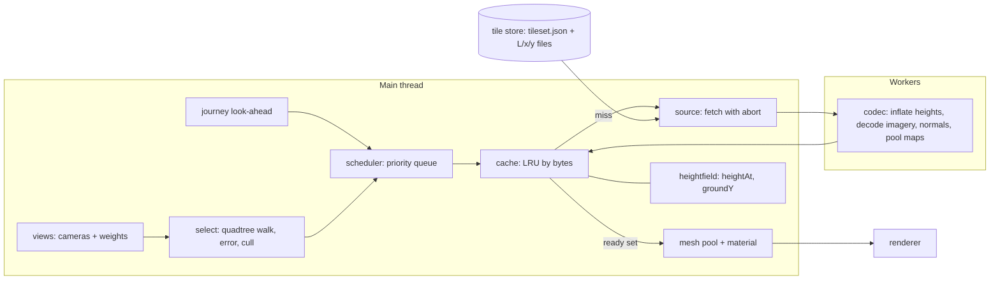
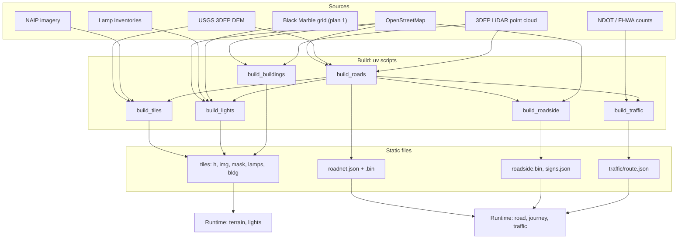

# Plan 02 — Drive into Las Vegas

Status: proposed · written 2026-11-10 · one of three sibling plans (01 Sky & weather, **02 Drive**, 03 Window seat & landing).

Conventions used below:

- "Plan 1" and "plan 3" are the sibling plans. Where this plan needs something from them it says so by capability, not by their phase numbers, because all three were written in parallel.
- **Measured** means the number was measured for this plan; section 13 lists each method. **Assumed** means a rule or estimate that the build must confirm. Everything else carries a reference code such as [R5], resolved in section 13.
- Sizes: **S** up to a day, **M** two to four days, **L** one to two weeks, for one senior engineer or the equivalent in agent sessions.
- Coordinates are the app's frame: metres, origin at Las Vegas Blvd and Flamingo Rd, x east, y up, −z north. "km 42.8" is distance along a route from its start (chainage).

## Decisions after planning (user, 2026-11-10)

These override anything below that conflicts with them.

1. **Terrain data is skipped for now.** Do not build or host the USGS 3DEP / NAIP tile pyramid, and do not set up Cloudflare R2. Use the terrain already in `public/data/<city>/`. Outside its extents, use a coarse, lightweight fallback that fits in the repository. Keep the tile pyramid as deferred work behind the same terrain interface, so it can be added later without changing callers.
2. **Treat the lamp inventories as public domain.** Clark County, City of Las Vegas, Boulder City and Henderson street-light layers can be used and shipped as derived lamp positions without asking the agencies, with a credit line kept in the About text. The rule-based fallback is only for areas with no inventory.

---

## 1. Executive summary

### What the user will experience

The panel gets a **Map / Drive** switch. Drive offers three real approaches to Las Vegas. Pick one and the app puts you in the driver's seat of a generic car at dusk, a minute before the valley comes into view.

On I-15 from Primm that means desert at 70 mph, the last light going behind you in the mirrors, a line of red taillights ahead and white headlights opposite in the numbers Nevada DOT counted for that hour of that weekday. Green guide signs flare as your headlights reach them. Just past Sloan the road tips downhill and the Strip rises out of the valley floor about 23 km away, its lights coming on against the afterglow. Along the resort corridor the Sphere's screen plays original, generic content. Hide the Sphere from the building list and it is gone from the drive too, with the light it threw on its neighbours.

You control time and where you look, nothing else. Play, pause, scrub and change speed on plan 1's transport; drag to look around; scroll to zoom; press **C** to swap the cabin for a clean camera at 1.2 m. Scrub to 3 a.m. and the traffic thins and the legacy sodium lamps are a deeper orange than the LED ones. Scrub to noon and it is a daytime drive on the same road.

| Journey | Path | Length | At posted limits | The reveal |
| --- | --- | --- | --- | --- |
| `i15n` I-15 north from Primm (built first) | California line → Spaghetti Bowl | 68.4 km (Flamingo exit at 61.2) | 37.6 min | km ≈ 42.8, 1.8 km past the Sloan exit: the top of the Strat clears the terrain 22.7 km away |
| `i15s` I-15 south from Apex | US-93 junction (Exit 64) → Russell Rd (Exit 36) | 45.2 km | 24.7 min | The Apex summit, 6.8 km in: downtown at 26 km, the Strat at 28 km |
| `us93` US-93 / I-11 from Hoover Dam | Nevada end of the bypass bridge → Spaghetti Bowl | 59.5 km | ≈ 35 min | Railroad Pass, km ≈ 25.2: the Strip 27–29 km away |

Lengths and speed zones are **measured** from OpenStreetMap's directional route relations (snapshot 2026-11-10). Reveal points are **measured** by line of sight over a 30 m elevation model from a 1.2 m eye, so they are good to about a kilometre until the 1 m model replaces it (section 8.2).

### Key technical decisions

1. **One tile pyramid in the app's own frame** (a quadtree in powers of two of a metre, root 1,048,576 m) for heights, imagery and data layers, built offline in Python and served as immutable files. It replaces the two fixed grids. *Why:* the app is planar with an analytic curvature drop; a local pyramid keeps that, gives synchronous height queries, and serves the drive and the flight alike.
2. **A custom terrain renderer**, not 3D Tiles or quantized-mesh. *Why:* sparse corridor coverage, roads carved into the heights, CPU height queries and a non-geocentric frame are all first-class needs here and all friction there (section 7.1).
3. **Heights from USGS 3DEP (1 m along the routes), imagery from NAIP (0.6 m, 2022).** *Why:* public domain, complete along all three routes by measurement, and the existing pipeline already reads both families.
4. **Roads are data, not meshes.** An OpenDRIVE-shaped road description (reference line, lane sections, elevation and crossfall profiles) is built from OSM and LiDAR; the browser meshes it in a worker. Lane markings are drawn by the road material. *Why:* a 68 km road is a few hundred kilobytes, and one description feeds the mesh, the path, the traffic, the signs and the lights.
5. **Everything is a pure function of simulation time.** Scrubbing backwards must work, so nothing integrates forward. *Why:* the user's only control over the car is the clock.
6. **Traffic is the level sets of cumulative count curves** N(s, t) built from the hourly counts of NDOT's permanent counters, as FHWA publishes them: vehicle *k* is where N = k. *Why:* it reproduces counted flow exactly, conserves vehicles, handles the Friday surge, needs no stepping, and the user's car is one of the vehicles.
7. **Street lighting is baked, vehicles are lit live.** Every lamp is an HDR sprite that conserves its flux; lamp pools are baked per tile into illuminance maps; real-time lights are spent only on moving sources. *Why:* tens of thousands of lamps cost one texture fetch, on WebGL2 as well as WebGPU.
8. **Retroreflection is exact for our own headlamps only.** Signs, markings, road studs and plates use measured sheeting curves and a beam pattern taken from a published survey of US low beams and held to the FMVSS 108 test points. *Why:* a retroreflector returns light to its source, so only the lamps beside the viewer matter, which makes the physically right answer the cheap one.
9. **City glow is fitted to VIIRS, then rendered from the ground.** A non-negative least-squares fit splits Black Marble radiance per 500 m cell between street lamps, windows, signs and lots, and the result drives what the driver sees. *Why:* it is the only measured, valley-wide constraint on how much light each district emits.
10. **Screens are an attribute of building geometry.** *Why:* they then hide and move with their building for free, which keeps the app's what-if identity intact inside the drive.
11. **The cabin is its own render pass**, mirrors are render targets budgeted per preset, and windshield effects are a post chain on the scene colour. *Why:* a 0.1 m near plane and a 200 km far plane do not share a depth buffer gracefully.
12. **Phase 1 uses only standard materials and CPU-built tiles.** *Why:* it must ship whether or not plan 1's renderer has landed.

### What ships when

| Phase | Result |
| --- | --- |
| 0 | `main.js` split along the seams the three plans need; test runners in place |
| 1 | A visible drive: I-15 from Primm on streamed terrain with a road ribbon, clean camera, hide/move working |
| 2 | The tile system at full resolution, hosted, replacing the old terrain in every mode; API frozen for plan 3 |
| 3 | The real road: lanes, markings, bridges, barriers, signs by day |
| 4 | The car: cabin, mirrors, windshield |
| 5 | Night I: headlights, retroreflection, street lighting |
| 6 | Traffic from counts |
| 7 | City glow fitted to VIIRS; signs and screens; buildings beyond the core |
| 8 | Weather on the drive |
| 9 | The other two routes |
| 10 | (Outline only) the Las Vegas Blvd cruise |

---

## 2. Locked decisions and assumptions

### 2.1 Locked, for all three plans (verbatim)

> - Hardware: scalable presets Low / High / Ultra, auto-picked; WebGPU where available, WebGL2 otherwise.
> - Control: **on rails** — the real path as driven; the user controls time (play, pause, scrub, speed) and where they look.
> - Las Vegas first; city-agnostic so Salt Lake City can follow. Modes inside the existing app; hide/move keeps working. Tests and realism validation in every plan.

### 2.2 Locked, for this plan (verbatim)

> - **Routes:** **I-15 northbound from Primm** (primary, built first — the classic California approach where the Strip rises out of the valley), **I-15 southbound from Utah** (past Apex and North Las Vegas: downtown first, then the Strip), **US-93 from Hoover Dam** (Boulder City, over Railroad Pass where the valley opens below; ends downtown). SR-160 from Pahrump is OUT. The first route carries the cost of the machinery; the others reuse it.
> - **How far:** **freeway now, the Strip later** — detail the freeway drives fully, and design a clean hook for a future street-level Las Vegas Blvd cruise (Welcome sign → Strat) as its own later phase (outline what it would need, do not fully plan it).
> - **Driver's view:** **both, with a toggle** — a modeled car interior by default (dashboard, A-pillars, live rear-view/side mirrors, windshield glare, dust catching low sun, dashboard glow at night, wipers and drops in rain using plan 1's weather state) and one key to switch to a clean camera at eye height ~1.2 m. Generic car, no brand.
> - **Data-driven night light (all four chosen):** **traffic** (other vehicles' headlights/taillights, density by hour and direction from NDOT traffic counts — "the red river into town on a Friday night"), **road & street lights** (poles placed from OpenStreetMap and NDOT/county records, each with its real lamp type and color — LED ~3000–4000 K vs legacy high-pressure sodium ~2000 K; gaps filled by rule), **city glow calibrated to NASA VIIRS Black Marble** (consume plan 1's data product to calibrate ground-level light emission of districts so the drive's glow matches measured radiance), **signs & screens** (billboards, casino marquees, the Sphere's exterior screen — animated with generic, original content; no real ads, logos or trademarks).
> - Default moment: dusk, when the Strip lights come on against the last daylight; scrubbable to any hour via plan 1's clock.
> - Terrain streams in tiles along the route rather than one bigger download.

Ownership is also locked: plan 1 owns the clock and transport, the renderer and presets, the sky, atmosphere, exposure, bloom, shadows, weather, the shared wet-surface layer and the VIIRS ingest. This plan owns terrain tiling (shared with plan 3), roads, roadside, the vehicle and camera rig, traffic, street lighting, signs and screens, journeys and the drive's performance.

### 2.3 Assumptions and decisions this plan makes (flagged, not blocking)

| # | Decision | Why | Cost of changing later |
| --- | --- | --- | --- |
| A1 | Route endpoints as in the table in section 1. "From Utah" starts at the US-93 junction (Exit 64), 3.4 minutes before the Apex summit. "From Hoover Dam" starts at the Nevada end of the Mike O'Callaghan–Pat Tillman bridge, where OSM's I-11 begins. Both freeway-only routes end on the freeway. | The first sight of the valley is the point of each drive; these starts put it a few minutes in. Ending on the freeway keeps street-level modelling out of scope. | Low: endpoints are two numbers in `routes.json` plus tiles for any extension. |
| A2 | A journey opens about 70 seconds before its reveal, not at its start. The whole route stays on the scrub bar. | A first-time visitor should see the valley open within about a minute. | None: one default. |
| A3 | "The real path as driven" means the real carriageway and lane geometry, real speed limits and the counted traffic state. It is not a recorded GPS trace, because no licensed trace of these drives exists; dated street-level photo sequences are used only to check the speed profile (section 8.1). | It says what is real and what is not. | A recorded trace could replace the speed profile without touching anything else. |
| A4 | The world is modelled as of its source data: 2022 LiDAR, the newest NAIP for Nevada, OSM at build time. The Brightline West works in the I-15 median south of Las Vegas (under way since 2024, opening since pushed to 2029 [G11]) are not modelled. | The imagery predates them and their state changes monthly. | Medium: a median construction set dressed along `i15n`. |
| A5 | Signs carry real destinations and exit numbers from OSM, set in an open highway typeface, with route numbers in plain generic shields. No real advertising, logos, casino names or brand marks anywhere. | The locked "no logos or trademarks" rule, applied conservatively to the Interstate shield as well (section 12.2). | Low: swap the shield renderer. |
| A6 | The car is left-hand drive, a generic mid-size crossover, driver's eye 1.2 m above the road. | The locked eye height and US traffic. | Low. |
| A7 | Every visible state is a pure function of simulation time, journey, what-if state, preset and seed. Three cosmetic exceptions re-warm after a seek: windshield drops, auto-exposure (plan 1) and camera damping. | Scrubbing in both directions. | High if abandoned: traffic and screens would need rewinding. |
| A8 | Tiles never enter git. They are served from object storage behind a CDN from Phase 1; until the bucket exists, a capped Phase 1 set (about 40 MB) deploys with the site. | Size and file count (section 6.9). | Low: the tile URL is one config value. |
| A9 | Plan 1 lands `WebGPURenderer` with its WebGL2 backend and node materials. Phases 1 and 3 here do not depend on that; phases 4 and later do. | Sequencing risk. | See the dependency table in section 10. |
| A10 | `cities.json` gains `timezone` (IANA name), `routes` and `tiles` per city. Salt Lake City gets `tiles` and no `routes`. | City-agnostic. | None. |

---

## 3. Current state

### 3.1 What exists

Line numbers are from the working tree on 2026-11-10, uncommitted changes included (`main.js` is 986 lines). The tree changed while this plan was being written, so the symbol names are the stable reference.

| Area | Where | What it does today |
| --- | --- | --- |
| Bootstrap, city choice | `src/main.js:12-21` | Top-level `await` on `cities.json`; city from `?city=` or local storage. One city per page load (`:944-950`). |
| Frame and units | `src/main.js:23-27`, `:112` | `BASE = city.base`, `EARTH_R = 6371000 × 7/6`, `LENS_HFOV = 39.6`, `curveDrop(x, z) = (x² + z²) / (2·EARTH_R)`. |
| Settings | `src/main.js:37-46`, `:842-936` | `DEFAULTS` includes `night: false` and `fountain: true`; persisted in local storage. |
| Renderer | `src/main.js:49-55` | `WebGLRenderer`, ACES, exposure 1.0, `PCFShadowMap` with `autoUpdate = false`, `preserveDrawingBuffer`. |
| Sky and light | `src/main.js:59-64`, `:84-109`, `:868-885` | `DAY`/`NIGHT` constant sets, `FogExp2`, gradient sky sphere, hemisphere light, one fixed sun with a 4096² shadow over `city.shadow`. `applyNight()` swaps the sets. Plan 1 replaces all of this. |
| Camera and controls | `src/main.js:66-81`, `:405-439` | 50 mm lens, near 5, far 150,000. Map-style `OrbitControls`. `resize()` holds the horizontal field of view and shifts the picture 158 px right of the panel. The camera is kept `groundY + 1.7` above ground (`:417-425`). |
| Terrain | `src/main.js:115-165`, `:268-285`, `:377` | Two `Uint16` height grids (`heightField`), each a single mesh built on the CPU with curvature baked in (`terrainMesh`), the far one with a hole and an 8 m sink under the near one. `groundY(x, y)` samples near, then far. Las Vegas: far grid x −48..30 km, y −34..38 km at 80 m; near grid x −3.6..4.6, y −4.4..8.2 km at 12 m (`public/data/cities.json:99-118`). |
| Buildings | `src/main.js:167-374` | `extrude()` builds loose triangles in world coordinates. `buildCity()` makes one mesh per building at or above the cutoff (182 at 35 m in Las Vegas, **measured**) with a BVH, and merges the other 17,679 into `low`. |
| What-if | `src/main.js:441-607`, `:731-840` | Hide, restore, drag-move with a ground marker, undo stack, toast. `place()` refuses moves outside the near grid (`:552-559`). `pick()` raycasts the removable towers and lets `low` occlude. |
| List, search, menu | `src/main.js:620-728` | Building list, search, context menu, `focusOn()` camera glide. |
| Loop | `src/main.js:79-81`, `:957-963` | Renders only when `dirty`. |
| Test hooks | `src/main.js:965-983` | `window.__skyline`: `tall`, `renderer`, `scene`, `camera`, `setView`, `select`, `screen(id)`, `place`, `hiddenIds`, and others. `attractions.js` adds `__skyline.attractions`, including `freeze(seconds)`. |
| Night shading | `src/night.js:15-17`, `:157-171` | Shared `night` and `clock` uniforms; `lightAtNight()` patches `MeshLambertMaterial` with GLSL through `onBeforeCompile` for procedural lit windows, baked `_GLOW`, and one abstract animation on LED faces (`ledGlow`, `:109-118`). Window density is a hash per 90 m block (`:83`). |
| Landmark models | `src/customModels.js:38-62`, `public/models/models.json` | 95 GLBs listed for Las Vegas at the time of writing. `flatten()` keeps position, normal, base colour, `_GLOW`, `_WINDOWS`, and sets `led = 1` on faces whose material name starts with `Led`; UVs are dropped. `sphere.glb`: 4,856 triangles, materials `LedSkin`, `LedSkinB` and others, no UVs, no textures (**measured**). |
| Attractions | `src/attractions.js`, `src/fountain.js`, `src/main.js:985-986` | Added while this plan was being written. Non-building "extras" from the manifest (optionally night-only, optionally additive), the Bellagio fountain show, and the clock for LED faces. It runs its own `requestAnimationFrame` tick on wall time and asks for frames at up to 30 a second while a show or an LED face is in view within 3–4 km. |
| Panel | `index.html:12-75`, `:80-90` | City tabs, title, viewpoint bar (`.views`), list, settings form with a Night checkbox (`:70`), dock with selection card and toast. |
| City config | `public/data/cities.json:79-168` | Origin, building bbox (36.085–36.178 N, −115.200 to −115.135 W), `base` 620, LiDAR dataset `NV_ClarkCo_2_B22`, terrain extents, shadow box, viewpoints. No time zone, no routes. |
| Pipeline | `scripts/build_terrain.py`, `build_imagery.py`, `fetch_lidar.py`, `build_buildings.py` | uv scripts with inline dependencies. Terrain from AWS Terrarium tiles at zoom 11 and 14 (`build_terrain.py:47`); imagery from the USGS NAIPPlus image service (`build_imagery.py:31`); LiDAR from the public EPT bucket, rasterised over the building bbox only (`fetch_lidar.py:38`); buildings from a hand-supplied OSM extract, with a measured terrain-to-LiDAR datum shift (`build_buildings.py:84-92`). |
| Tooling | `package.json` | `three ^0.187.0`, `three-mesh-bvh ^0.9.18`, `vite ^8.3.6`. No test runner, no lint, no CI. |

Installed three.js 0.187 already contains pieces this plan uses, confirmed in `node_modules`: `ClusteredLighting` (Forward+ clustered shading with a WebGL-backend path, 1,024 lights by default), `DynamicLighting`, `IESLoader`, `IESSpotLight` and `ProjectorLight` (WebGPURenderer only), spot-light `map` and `colorNode` projection, `ReflectorNode`, `CSMShadowNode`, `BloomNode`, `lensDirt`, `TRAANode`, `TAAUNode`, `PointsNodeMaterial` on instanced `Sprite`, `MeshPhysicalMaterial.retroreflectivity`, and `reversedDepthBuffer` and `logarithmicDepthBuffer` on both renderers. Two limits matter later: clustered lighting takes only shadowless point and spot lights without a projected map, and `WebGPURenderer` does not run `onBeforeCompile` patches, so `night.js` cannot survive plan 1's renderer change as written [G1, T11].

### 3.2 What must change

1. **Terrain.** Two fixed grids cannot reach Primm (22 km outside) or Hoover Dam (9 km outside), and 12 m posts with 2.5 m pixels are far too coarse at 1.2 m eye height. `terrainMesh`, `heightField` and `groundY` give way to the tile system behind one provider interface (section 5.3).
2. **`main.js`.** 986 lines with rendering, world building, interaction and UI interleaved at module scope. Three plans cannot edit it in parallel. It is split first (Phase 0).
3. **Camera ownership.** `OrbitControls` and the camera are created and driven at module scope. A mode manager must own which rig drives the camera, and `pick()` must use whichever camera is active.
4. **The loop.** Render-on-demand stays for the map. The drive needs continuous frames while the clock runs or tiles arrive.
5. **`place()`.** Its limit is "inside the near grid". It becomes "inside the city's building area", asked of the terrain provider.
6. **`night.js`, `customModels.js`, `attractions.js`.** The night boolean becomes plan 1's light state. The `led` flag that `flatten()` already derives from material names widens into a screen id (section 7.9). The LED and fountain clock is wall time today; in Drive it must be simulation time, or scrubbing would not reproduce a frame. The attractions tick joins the shared loop. The GLSL patch must move to node materials when plan 1 moves the renderer.
7. **Depth range.** Near 5 m cannot show a dashboard; far 150 km is short for the flight. Section 11.1 states what the drive needs from plan 1.
8. **Config and pipeline.** `cities.json` gains time zone, routes and tiles. New pipeline scripts sit beside the four existing ones and reuse their conventions.
9. **Tests.** There are none. Vitest, Playwright and pytest arrive in Phase 0.

---

## 4. Experience spec

### 4.1 Entering and leaving

- A segmented **Map / Drive** control sits under the city tabs. Drive is offered only for a city whose config has `routes`. Plan 3 adds its mode to the same control.
- Choosing Drive keeps everything the user has hidden or moved. The what-if state belongs to the city, not to a mode.
- Choosing Map returns to the last map camera. The drive remembers its route, position and time for the session.
- `Esc` closes menus and clears the selection as today. It never leaves the mode.

### 4.2 Route picker

Three cards in the panel, each with a small line map of the route across the valley, its length, its time at posted limits, and three start chips:

- **Before the view opens** (default): about 70 seconds ahead of the reveal.
- **From the start**: the state line, the US-93 junction, the bridge.
- **Through the city**: the first exit of the resort corridor or downtown.

Selecting a card loads the route and starts paused on the first frame until the coarse terrain and the first five seconds of fine data are in. A thin progress line under the card shows what is still loading. Playback then starts on its own.

### 4.3 Time and transport

- Plan 1's transport is the only time control: play, pause, scrub, rate. This plan adds no second clock.
- Above it this plan adds a **route bar**: distance along the route with ticks for exits and named points (Jean, Sloan, the reveal, I-215, each resort-corridor exit, the Spaghetti Bowl). Dragging it moves the car, which moves the clock by the journey's time-distance function.
- A **hold position** lock next to the route bar changes what the clock does. Unlocked (default), scrubbing time drives the car along the journey. Locked, the car stays where it is and scrubbing changes the hour around it: the journey's departure is re-based so that "now" still maps to this spot. That is how a user sees the same view at noon, dusk and 3 a.m.
- Rates from 0.25× to 16×. Above 4× the terrain drops one level of detail per doubling so streaming keeps up (section 9.3).
- At the end of a route the clock keeps running and the car holds at the end point with the view ahead.

### 4.4 Looking

| Input | Action |
| --- | --- |
| Drag (mouse or one finger) | Turn the head: yaw ±150°, pitch −40° to +50° |
| Scroll or pinch | Zoom: 24 mm to 200 mm equivalent |
| Double-click or `R` | Look ahead again |
| `1` `2` `3` | Look ahead / left mirror / right mirror, as a quick glance that eases back |
| `C` | Cabin ↔ clean camera |
| `H` | High beams |
| `Space`, arrow keys | Plan 1's transport |

Released, the head stays where it was put; it does not spring back. In the cabin the head turns about a neck pivot 10 cm behind the eyes, so pillars and mirrors shift slightly against the world.

### 4.5 Cabin and clean camera

- **Cabin** (default): dashboard, steering wheel, A-pillars, roof edge, hood, both side mirrors and the rear-view mirror with live images, instrument cluster showing the car's real speed and the local time, windshield with dirt and glare, and with drops and wipers in rain. Default lens 28 mm equivalent (about 65° across), because a windshield does not fit a 50 mm frame.
- **Clean**: no car at all. The same path, eye 1.2 m above the road, the app's usual 50 mm lens. This is the view for judging the skyline at true scale.
- The toggle is instant and does not disturb time or position.

### 4.6 Defaults

- **Moment:** today's date in the city's time zone, with the journey's departure set so the reveal falls when the sun is 3° below the horizon (mid civil twilight, roughly 12 minutes after sunset). Plan 1's ephemeris supplies the time.
- **Weather:** whatever plan 1's default is (live or clear).
- **Preset:** plan 1's auto-pick. The drive never overrides it, only reads it.
- **View:** cabin, looking ahead.

### 4.7 Hiding and moving buildings while driving

- The building list stays in the panel in Drive mode. Hide, Show, Reset and search work exactly as they do on the map.
- Removable buildings wear their natural colours while driving, whatever the "Color them blue" setting says, and their edge lines are not drawn. Pointing at one still highlights it.
- Clicking a removable building in the view selects it; the card's Hide button, `Delete`, and the right-click menu work as they do today. A click is told apart from a look-drag by the existing 5-pixel rule.
- Dragging a selected building moves it, as today. Pressing on a selected building pauses the clock for the length of the drag, because the ground plane under a moving camera is not a stable thing to drag on.
- "Center view on this" in the menu turns the head toward the building instead of flying the camera.
- Hidden and moved state reaches everything that belongs to a building: its screens, its obstruction lights, the light it casts on its surroundings, its shadow.
- The acceptance case is the brief's own: hide the Sphere on the map, switch to Drive, and arrive on I-15 with no Sphere and no Sphere glow.

### 4.8 Where the UI goes

```
#panel
  nav#cities              (as today)
  nav#modes               NEW  Map | Drive (| plan 3)
  header                  (as today; the hint line changes with the mode)
  #browse
    .views                map mode only
    #drive                NEW  drive mode only: route cards, start chips, Cabin/Clean, Hold position
    .bar, #search, #list  (as today, in both modes)
  form#settings           gains a "Drive" fieldset: reduce motion, mirrors, speed units
#dock
  #card, #toast           (as today)
  #routebar               NEW  drive mode only; sits directly above plan 1's transport
```

In Drive mode the panel can collapse to a 44 px rail so the windshield is unobstructed; the picture offset in `resize()` follows the panel's width instead of the constant 158.

### 4.9 Links

The address carries the whole state so a moment can be shared and a test can reproduce it:

`?city=lv&mode=drive&route=i15n&s=42150&t=2026-11-14T01:07:30Z&view=cabin&yaw=-12&pitch=2&lens=28`

`s` is metres along the route, `t` is simulation time in UTC. Hidden and moved buildings are not in the link today and this plan does not add them.

### 4.10 When things are slow or missing

- Fine tiles late: the ground near the car is blurrier for a moment; coarse tiles for the whole region are always resident, so there is never a hole.
- A data file fails: the affected layer is skipped with one toast ("Street lights could not be loaded"), and the drive continues.
- Device too weak for the cabin's mirrors: the preset drops them first (section 7.11), never the frame rate.

### 4.11 Comfort and safety

- **Reduce motion** (on by default when the system asks for it) removes head bob, body roll and the windshield shake.
- No full-field flashing above 3 Hz in generic screen content, and lightning (plan 1) is not amplified by the windshield chain.
- Speed is shown in the user's units setting.

---

## 5. Architecture

### 5.1 Principles

1. **One frame.** Everything stays in the app's planar frame with the curvature drop. Nothing becomes geocentric. The frame gains one function, `localUp(x, z)`, because 60 km from the origin true vertical leans 0.46° away from +y (370 km out, 2.9°).
2. **State is a function of time.** No subsystem integrates forward. Each answers "what is true at simulation time *t*" from data and hashes.
3. **Data first, rule second, and say which.** Every roadside element records whether it came from data or from a rule, and the About text reports the split.
4. **One description, many consumers.** The road description feeds the mesh, the path, traffic, sign and lamp placement. The lamp inventory feeds sprites, pool maps, the VIIRS fit and plan 3's view from the air.
5. **Workers for anything slow.** Tile decoding, road meshing, sign atlases and pool maps run off the main thread. The main thread's budget for streaming work is 2 ms a frame.
6. **Renderer-agnostic first.** Phase 1 and the day road use stock materials so they run on today's `WebGLRenderer` and on plan 1's. Custom shading is written once, as node materials, after plan 1 lands the renderer.

### 5.2 Modules

```
src/
  main.js                    bootstrap only (about 120 lines after Phase 0)
  app/
    config.js                cities, settings store
    loop.js                  frame loop: on-demand and continuous
    modes.js                 mode manager: which rig owns the camera
    hooks.js                 window.__skyline
    interact.js              picking and pointer handling for whichever mode is active
  modes/
    map.js                   today's orbit camera, viewpoints and glide, as a mode
  ui/                        list.js  menu.js  settings.js  toast.js: the existing panel code
  world/
    frame.js                 BASE, EARTH_R, curveDrop, localUp, lat/lon <-> local
    buildings.js             extrude, buildCity, ground markers
    whatif.js                hide / move / undo state, with change events
    terrain/                 SHARED WITH PLAN 3 (section 11.2)
      index.js               createTerrain(): the public API
      pyramid.js             tile addressing (pure)
      tileset.js             manifest and coverage index
      source.js              fetch with abort; codec dispatch
      codec.worker.js        heights, imagery, normals
      cache.js               LRU by bytes, CPU and GPU
      select.js              quadtree walk, screen-space error, culling (pure)
      scheduler.js           priorities, look-ahead, concurrency
      mesh.js                tile geometry and mesh pool
      material.js            terrain material (stock in Phase 1, node material later)
      heightfield.js         heightAt / groundY over resident tiles; legacy two-grid adapter
      layers.js              extra per-tile layers (masks, pool maps, lamps, buildings)
  drive/
    index.js                 createDriveMode()
    env.js                   the one adapter to plan 1, plus the fallback
    routes.js  journey.js    route catalogue; Journey = path + time
    roadnet/                 format.js  refline.js  crosssection.js  mesher.worker.js  chunks.js  material.js
    roadside/                signs.js  furniture.js  billboards.js  retro.js
    lights/                  lamps.js  lightfield.js  pools.worker.js  emitters.js
    traffic/                 demand.js  fleet.js  render.js
    vehicle/                 rig.js  cabin.js  mirrors.js  windshield.js  headlights.js
    screens/                 registry.js  content.js  footprint.js
    ui/                      panel.js  routebar.js
    debug.js                 overlays: tile bounds, lane ids, lamp counts, chainage
scripts/
  lib/                       frame.py, pyramid.py (golden-tested against the JS twins)
  fetch_osm.py               roads, lamps, billboards, power lines (and buildings, which is manual today)
  build_tiles.py             heights + imagery pyramid
  build_roads.py             RoadNet from OSM + DEM + LiDAR
  build_roadside.py          signs, furniture, billboards
  build_lights.py            lamp inventory, rule fill, VIIRS fit
  build_traffic.py           hour-of-week demand per segment
  build_buildings.py         extended to corridors (existing script)
  upload_tiles.py            sync a tileset to object storage
models/drive/                Blender build scripts: cabin, vehicles, poles, sign structures
tests/
  unit/  e2e/  data/  fixtures/
```

### 5.3 Splitting `main.js` (Phase 0)

A behaviour-preserving move, no rewrites. If plan 1's own refactor lands first, adopt its file names; the seams below are what matters.

| Today (`src/main.js`) | Goes to | Seam it creates |
| --- | --- | --- |
| `:12-46` city and settings | `app/config.js` | `city`, `settings`, `setSetting` importable anywhere |
| `:23-27`, `:112` constants, `curveDrop` | `world/frame.js` | One frame module for JS; `scripts/lib/frame.py` mirrors it |
| `:49-109` renderer, sky, lights | plan 1's modules (or `app/renderer.js` meanwhile) | Plan 1 owns it |
| `:115-165`, `:268-285`, `:377-388` terrain | `world/terrain/heightfield.js` (legacy adapter) | `terrain.groundY`, `terrain.heightAt`, `terrain.inBuildArea` replace `groundY`, `near`, `far` |
| `:167-374` buildings | `world/buildings.js` | `buildCity(scene, terrain, settings)` |
| `:441-607`, `:757-840` hide, move, undo | `world/whatif.js` + `app/interact.js` | `whatif.on('change', …)`: screens, lights and shadows subscribe |
| `:66-77`, `:391-439`, `:620-642` camera, views, glide | `app/modes.js` + `modes/map.js` | A mode owns the camera; `pick()` takes `modes.camera()` |
| `:645-728`, `:842-950` list, menu, settings, about | `ui/*.js` | DOM code out of the render path |
| `:79-81`, `:957-963` loop | `app/loop.js` | `loop.invalidate()`, `loop.setContinuous(key, on)`, `loop.onFrame(fn, order)` |
| `:965-983` hooks | `app/hooks.js` | `window.__skyline` grows `terrain` and `drive` namespaces |
| `:985-986` and `src/attractions.js` | stays, with two changes | Its frame tick registers with `loop.onFrame`; its clock reads the simulation clock through `env.js` |

```js
/** @typedef {Object} Mode
 * @property {string} id                              'map' | 'drive' | (plan 3) 'flight'
 * @property {(ctx: AppContext) => Promise<void>} enter
 * @property {() => void} exit
 * @property {(f: FrameInfo) => void} update          once per frame, before terrain.update
 * @property {() => THREE.PerspectiveCamera} camera   the camera this frame renders with; picking uses it
 */
/** @typedef {{ nowMs: number, dtRealMs: number, simMs: number, dtSimMs: number, seeked: boolean }} FrameInfo */
```

### 5.4 Frame and precision

`world/frame.js` exports the existing `curveDrop` plus:

```js
/** True vertical at a map position, in scene axes. */
export const localUp = (x, z, out) => out.set(x, EARTH_R, z).normalize();
/** Scene Y for a height above sea level h at map (x east, y north). */
export const sceneY = (h, x, y) => h - BASE - curveDrop(x, y);
```

Rules every module follows:

- **Vertices are chunk-local.** A tile, road chunk or roadside batch stores positions relative to its own origin and carries that origin in its matrix. When view and model matrices are multiplied on the CPU in double precision, the GPU only ever sees small numbers. Today's `WebGLRenderer` always does that; three's node renderer does it only with `renderer.highPrecision = true`, which the drive needs set (section 11.1). World-space vertices are fine within the building core (±7 km, half a millimetre in float32) and nowhere else (4 mm steps at 60 km).
- **Curvature is baked on the CPU** for anything built there (Phase 1 tiles, roads, instances). GPU-displaced tiles put the drop at the tile centre into the matrix and compute only the residual in the shader: `(lx·(2cx + lx) + lz·(2cz + lz)) / (2·EARTH_R)`, with `(lx, lz)` local and `(cx, cz)` the tile centre.
- **Upright things use `localUp`**: the camera rig, vehicles, poles, signs. Road and terrain surfaces need nothing; the tilt is in their geometry.
- **The sun stays one direction for the whole frame.** With `localUp` leaning, the sun's elevation changes correctly with position.

### 5.5 Terrain streaming and level of detail

#### The pyramid

A quadtree over a square of side 2^20 m (1,048.576 km) centred on the city origin. Level L has tiles of 2^(20−L) m. A tile carries 129 × 129 height posts (edge-shared) and 512 × 512 imagery pixels in one bundle (section 6.9). Powers of two of a metre keep every level's posts on the same lattice.

| L | Tile edge | Height posts | Imagery | Produced where | Tiles (**measured** from route geometry) |
| --- | --- | --- | --- | --- | --- |
| 2 | 262 km | 2,048 m | 512 m/px | r ≤ 400 km (plan 3) | 16 |
| 3 | 131 km | 1,024 m | 256 m/px | r ≤ 400 km (plan 3) | 44 |
| 4 | 65.5 km | 512 m | 128 m/px | r ≤ 400 km (plan 3) | 148 |
| 5 | 32.8 km | 256 m | 64 m/px | r ≤ 200 km | 148 |
| 6 | 16.4 km | 128 m | 32 m/px | r ≤ 120 km | 208 |
| 7 | 8.19 km | 64 m | 16 m/px | r ≤ 80 km | 332 |
| 8 | 4.10 km | 32 m | 8 m/px | drive region: x −56..48, y −64..48 km | 728 |
| 9 | 2.05 km | 16 m | 4 m/px | urban valley + 6 km either side of routes | ≈ 950 |
| 10 | 1.02 km | 8 m | 2 m/px | 2.5 km either side of routes + building core | 1,179 |
| 11 | 512 m | 4 m | 1 m/px | 1 km either side | 1,953 |
| 12 | 256 m | 2 m | 0.5 m/px | 500 m either side | 3,898 |

Levels 6–7 and 9–10 are today's far and near grids (80 m / 20 m/px and 12 m / 2.5 m/px), so the map looks the same after the switch. Level 13 (1 m posts) is not built until a visual review after Phase 3 says the carved road edges need it.

Coverage is sparse by design: level 12 exists only near the routes. `tileset.json` lists, per layer and level, which tiles exist as run-length rows, so the client never asks for a tile that is not there.

#### Selection

`select.js` walks the quadtree once per frame for a list of **views** (the main camera, plus mirror cameras at lower weight):

- Cull against the frustum and against the horizon (a tile whose top is below the curvature horizon of every view).
- Refine a tile while either error exceeds the preset's threshold *and* a child exists:
  - geometric: `err_m / distance × viewportHeight / (2·tan(fovY / 2))`, with `err_m` stored in the tile header by the pipeline (largest vertical difference from the finest source);
  - texel: the size of one imagery pixel at that distance, in screen pixels.
- **No holes.** A quadrant of a tile is drawn until the child that covers it is ready. Each tile mesh has four index groups, one per quadrant, so a parent goes on drawing exactly the quadrants whose children are still loading or do not exist. Corridor edges fall out of this with no special case.

Thresholds are in section 7.11. The walk is pure and unit-tested on synthetic cameras.

#### Scheduling

- Priority = screen-space error × view weight, with visible tiles above look-ahead tiles.
- **Look-ahead.** On rails, the future camera is known. `terrain.prefetchAlong(path, { from, to, halfWidth, maxLevel })` enqueues the corridor for the next 45 seconds of simulation time at the current rate. Plan 3 calls the same function with a flight path.
- **Seek.** A jump aborts in-flight requests that no longer matter (`AbortController`) and requests coarse-to-fine around the new position.
- Eight requests in flight on HTTP/2; decode in a pool of two to four workers (`createImageBitmap` is available there [T12]).
- **Base set.** Levels 5 and 6 around the active journey (about 140 tiles, 8 MB) load before it starts and are never evicted while it is active. That is what guarantees section 4.10's "never a hole".

#### Cache

A byte-budget LRU for CPU buffers (heights stay resident for queries) and another for GPU textures. Budgets per preset are in section 9.2. Tiles are immutable and versioned in their URL, so the browser's HTTP cache makes a second drive nearly free.

#### Meshes

- **Phase 1:** each tile's geometry is built in a worker exactly as `terrainMesh` builds the grids today (positions with curvature baked, normals from central differences, UVs), 65 × 65 vertices decimated from the 129 × 129 posts, plus a skirt one post deep around the edge. Stock material with the imagery as `map`. No morphing: level changes pop, softened by a conservative threshold.
- **Phase 2 onward (node material):** one shared grid geometry; the vertex stage reads the tile's height texture, morphs even vertices toward the parent lattice over the outer 30% of the tile's refine distance (CDLOD), and applies the curvature residual. Skirts stay as a safety net. Normals come from a worker-built RG8 normal texture at 256².
- The terrain material exposes hooks rather than hard-coding other plans' effects: `albedo`, `normal`, `roughness`, `emissive` stages that plan 1's atmosphere and wet layer and this plan's pool maps and ground detail compose into (section 11).

#### Height queries

`terrain.heightAt(x, y)` returns the height above sea level from the finest resident tile containing the point, bilinear, synchronously. `terrain.groundY(x, y)` is that minus `BASE` and the drop. Roads never ask at runtime: their elevation is fixed at build time against the same heights (section 7.2). Runtime askers are the camera floor on the map, building moves, and viewpoints.

#### Layers

A layer is any per-tile payload addressed like heights and imagery: `mask` (land cover and road carve), `pool` (baked lamp illuminance), `lamps` (lamp records), `bldg` (corridor buildings). `terrain.addLayer({ id, levels, decode, attach })` lets a subsystem ride the same selection, cache and look-ahead. Plan 3 can add `water` and `nightlights` the same way.



#### What plan 3 adds, and how this design takes it

| Flight requirement | Provision here |
| --- | --- |
| Terrain to the horizon at cruise (about 370 km) | Root tile spans ±524 km; levels 2–5 are produced to 400 km by the same script from regional sources (section 6.3) |
| Camera from 0 to 12 km altitude, up to 250 m/s | Selection is by screen-space error from any camera; nothing assumes a ground camera. Look-ahead takes any path sampler |
| Horizon and curvature at long range | Horizon cull in `select.js`; curvature residual per tile keeps float32 exact at any distance |
| True error bounds at coarse levels | `err_m` per tile from the pipeline, not a per-level constant |
| Several cameras (cabin window, wing) | `setViews([{ camera, weight }])` |
| Water, night lights from the air | Layer registry; this plan's `lamps` layer is offered to plan 3 as it stands |
| Stable API | Frozen at the end of Phase 2 as `terrain@1` (section 11.2) |

### 5.6 Roads

`build_roads.py` writes one **RoadNet** per city region: `roadnet.json` (structure) and `roadnet.bin` (stations). It is shaped like ASAM OpenDRIVE (reference line with an *s* coordinate, lane sections, elevation and superelevation profiles, objects) without being OpenDRIVE: a compact binary that a worker can mesh, with an optional `.xodr` export for checking in third-party viewers.

```jsonc
{
  "version": 1,
  "source": { "osm": "2026-11-10T06:15:27Z", "dem": "USGS 3DEP 1 m", "lidar": "NV_ClarkCo_2_B22" },
  "roads": [{
    "id": "i15n.main", "ref": "I 15", "dir": "north", "class": "motorway",
    "stations": { "offset": 0, "count": 17100 },      // roadnet.bin: s, x, y, h, heading, curvature, crossfall
    "sections": [{ "s0": 0, "s1": 12850,
                   "lanes": [{ "w": 3.66, "kind": "drive" }, { "w": 3.66, "kind": "drive" }, { "w": 3.66, "kind": "drive" }],
                   "left":  { "shoulder": 3.0, "edge": "yellow", "barrier": "none" },
                   "right": { "shoulder": 3.0, "edge": "white", "rumble": true },
                   "placement": "centre", "provenance": { "lanes": "osm", "widths": "rule", "crossfall": "lidar" } }],
    "speed":   [{ "s0": 0, "mph": 70 }, { "s0": 41600, "mph": 65 }],
    "surface": [{ "s0": 0, "kind": "asphalt" }],
    "bridges": [{ "s0": 30120, "s1": 30210, "kind": "viaduct" }],
    "links":   [{ "s": 41020, "side": "right", "kind": "exit", "ref": "25", "to": "i15n.x25.off" }]
  }]
}
```

Stations are stored as 32-bit integers in millimetres (x, y, h), so 60 km of road loses nothing. Runtime flow:

- `refline.js` interpolates position, tangent, curvature, grade and crossfall at any *s* (pure functions).
- `crosssection.js` gives lane edges at any *s*, with tapers where the lane count changes.
- `chunks.js` keeps a window of 256 m chunks around the car and ahead, three levels of detail (stations every 4 m, 16 m, 64 m), and asks `mesher.worker.js` for each.
- The worker sweeps the cross-section and returns chunk-local buffers: one strip per lane and shoulder with UVs in metres, edge-marking types as vertex attributes, plus barrier and bridge geometry.
- The same refline and cross-section functions serve the journey (lane centre lines), traffic (lane positions) and, through their Python twins, sign and lamp placement in the pipeline.

### 5.7 Journeys and the rig

```js
/** @typedef {Object} Journey
 * @property {string} id                     'lv/i15n'
 * @property {number} length                 metres
 * @property {number} departMs               simulation time (UTC ms) at s = startS
 * @property {(simMs: number) => Pose} poseAt        pure
 * @property {(s: number) => number} timeAt          inverse of the above, ms
 * @property {(s: number, simMs: number) => void} rebase   keep this s at this time (the hold-position lock)
 * @property {Marker[]} markers              exits, reveal, named points: { s, label, kind }
 */
/** @typedef {Object} Pose
 * @property {number} s  @property {number} lane  @property {number} lateral   metres from lane centre
 * @property {THREE.Vector3} position        road surface under the car's reference point, scene axes
 * @property {THREE.Vector3} forward  @property {THREE.Vector3} up  @property {THREE.Vector3} right
 * @property {number} speed  @property {number} accel  @property {number} curvature  @property {number} grade  @property {number} crossfall
 */
```

Plan 3's flights can implement the same `Journey` shape; the transport then needs to know only one thing about any mode (section 11.3).

The rig is four layers, each a pure function of the one below and of *s* or *t*:

1. **Path**: `journey.poseAt(t)`.
2. **Body**: the car's frame on the road, plus pitch from acceleration, roll from lateral acceleration, and a heave and pitch texture from road roughness keyed on *s* (so scrubbing shows the same bump at the same place), with a thump at each bridge joint.
3. **Head**: a lagged, lightly sprung offset from the body, then the user's yaw and pitch about the neck pivot.
4. **Camera**: lens, and the cabin or clean choice.

### 5.8 Traffic

For each direction of each route, `build_traffic.py` produces hourly flow by hour of week at the count stations, and free-flow speed and capacity per segment. At load, `demand.js` turns these into a **cumulative count surface** N(s, t): the number of vehicles that have passed point *s* by time *t*. Between stations N is carried along at the segment speed; where demand exceeds capacity it is the lower envelope of the upstream arrivals and the downstream departures (Newell's simplified kinematic-wave construction), which is what makes a queue grow backward from a bottleneck.

- **Vehicle *k* is at the *s* where N(s, t) = k.** N falls monotonically with *s*, so the position is one table inversion. The vehicles between s0 and s1 at time *t* are simply the integers between N(s1, t) and N(s0, t).
- Lane, body type, colour and small speed offsets come from hashes of *k*. Vehicles do not overtake within a lane; lanes differ in speed.
- Ramps: each *k* carries a uniform hash *u*; it is on segment *j* only if *u* is below that segment's share of the busiest segment's flow. Vehicles therefore join and leave at interchanges in the counted proportions.
- **The user's car is one of the *k*.** Its path through time is its lane's level set, so it travels at the speed of traffic, slows in the Friday queue, and cannot overlap a neighbour.
- Flow, density and speed satisfy q = k·v by construction, which is the unit test.

### 5.9 Lights

- **Inventory** (`lamps` layer, levels 9–10): one 16-byte record per lamp: position (mm, tile-local), mount height, type id, flux, aim, flags (source: data or rule; owner).
- **Lamp types** (`lamps.js`): colour temperature or spectrum reduced to a render colour, angular intensity curve I(θ), warm-up curve, the share of flux that goes up directly.
- **Sprites**: every lamp in view is an instanced sprite whose brightness conserves flux when it is smaller than a pixel. Its intensity toward the viewer comes from I(θ), then the atmosphere's transmittance (plan 1).
- **Pools** (`pool` layer): a worker splats each lamp's ground illuminance into a 256² map per level-10 tile when the tile loads. Terrain and road materials add `albedo × pool`. Vehicles and roadside instances sample the map at their position.
- **Live lights**: our headlamps always; the nearest few vehicles' headlamps and the biggest screens on High and Ultra, through three's clustered lighting.
- **Switching**: each lamp turns on when plan 1's ambient illuminance falls through a per-lamp threshold (a hash spreads thresholds over several minutes). Sodium lamps then warm from dim pink-white to full amber over a few minutes; LEDs are instant.

### 5.10 Screens

A **screen** is a set of triangles plus a mapping from position to (u, v) and a content program. The app already has the start of this: `flatten()` sets `led = 1` on faces whose material is named `Led…`, and `night.js` animates those faces with one abstract program. This plan widens the flag to a screen id (0 for none) through a `screens` map per model in `models.json` (`{ "LedSkin": "sphere" }`), and the building material runs the registry's program for that id. Because a screen is part of its building's mesh, it hides and moves with it. Billboards beside the road are screens on their own instanced panels.

Each screen also has a **footprint**: a precomputed map of how much of its light lands where, scaled every frame by the content's current average colour. `whatif` change events switch the footprint off when the building is hidden and translate it when the building is moved.

### 5.11 Data flow



`build_roads` runs before `build_tiles` for levels 10–12 because the road is carved into those heights.

### 5.12 Test hooks

```js
window.__skyline.terrain = { whenSettled, stats, heightAt, groundY, setLodBias };
window.__skyline.drive = {
  start(routeId, { s, t, view }),          // resolves when the first frame is settled
  seek({ s, t }),  setView(view),  look({ yaw, pitch, lens }),
  pose(),                                   // current Pose, plain numbers
  whenSettled(),                            // tiles, road chunks, lamps and sign atlases for this frame are in
  visible(targetId),                        // line of sight from the eye to a building's top, against terrain and buildings
  luminance(rect),                          // mean scene luminance in cd/m² over a screen rectangle, before tone mapping
  nadirRadiance({ cell }),                  // top-down emitted radiance per cell, for the VIIRS comparison
  stats(),                                  // draw calls, triangles, sprites, live lights, tile bytes, frame times
};
```

---

## 6. Data sources and pipelines

Nothing in the drive is fetched from a third party while the user drives. Every source below is read at build time by a uv script, turned into this project's own formats, and served from this project's own storage. Bracketed codes point to section 13. Counts and coverage figures were **measured** for this plan on 2026-11-09 and 2026-11-10 by querying the services named.

### 6.1 At a glance

| Layer | Source | Licence | Resolution, vintage | Coverage on the three routes | Output |
| --- | --- | --- | --- | --- | --- |
| Heights, corridor | USGS 3DEP 1 m DEM, four LiDAR projects [E1] | Public domain | 1 m; 2022, with 2019 and 2018 patches | 100% within 2 km of every route | Tile levels 10–12 |
| Heights, region | USGS 3DEP 1/3 arc-second [E1] | Public domain | about 10 m, seamless | Complete | Levels 5–9 |
| Heights, rings | 3DEP 1 arc-second in the US; Copernicus GLO-30 outside it [E8] | Public domain; Copernicus licence | about 30 m | To 400 km | Levels 2–4 |
| Imagery, corridor and valley | NAIP, Nevada 2022 [E6] | Public domain, credit requested | 0.6 m, flown June 2022 | Complete | Levels 7–12 |
| Imagery, rings and colour reference | Sentinel-2 cloudless 2016 or 2017 by EOX [E8] | CC BY 4.0 (2018 onward is non-commercial: not used) | 10 m | Global | Levels 2–6 |
| Point cloud | USGS 3DEP LiDAR as Entwine tiles [E5] | Public domain | QL1–QL2, 2022 | Dataset bounds contain every route | Road profile, crossfall, bridge decks, building heights |
| Roads, ramps, bridges, barriers, exits | OpenStreetMap [R1–R3] | ODbL | Snapshot at build | Section 6.4 | `roadnet` |
| Hourly traffic | FHWA TMAS station data, 2025 [C1] | US government work | Hourly, per lane, per direction, per day | Nine permanent stations on the routes | `traffic/<route>.json` |
| Annual traffic | NDOT TRINA service [C2] | None stated | AADT per station, 2007–2025 | 3,499 stations statewide | Scaling between counters |
| Street lamps | Clark County Public Works, City of Las Vegas, Boulder City [L1, L2, L4]; OSM | None stated; ODbL | 76,565 + 54,460 + 2,718 points; 6,656 in OSM | The Strip and unincorporated county, the city, Boulder City. Nothing for NDOT freeways or North Las Vegas | `lamps` layer |
| Night radiance | VIIRS Black Marble, through plan 1 [L7] | NASA open data | 15 arc-second | Complete | The fit in section 7.8 |
| Mile markers | NDOT `ALRS_Download/MileMarker` [R8] | None stated | 7,584 points statewide | To be extracted per route | Roadside |
| Billboards | OSM; City of Las Vegas; Clark County [L1, L2] | ODbL; none stated | 437; 339; 1,263 | Valley | Roadside, screens |
| Land cover | Annual NLCD [E9] | USGS | 30 m, yearly | Complete | `mask` layer |
| Building heights beyond LiDAR | Overture buildings [E10] | ODbL | Varies | Valley | One rung in the height ladder |
| Detail textures | Poly Haven [E11] | CC0 | n/a | n/a | `public/textures/ground` |
| Sign typeface | Roadgeek 2014 (FHWA series) [R9] | MIT | n/a | n/a | Bundled font |

### 6.2 Elevation

**1 m, for levels 10–12.** The National Map lists 1 m DEM tiles from several LiDAR projects along the routes. A coverage check for this plan sampled OSM centre lines every 50 m, and points 0.5, 1 and 2 km to each side, against the no-data masks of the 62 tiles involved: every sample has at least one valid project. No single project covers everything:

| Project | Flown | Role |
| --- | --- | --- |
| `NV_ClarkCounty_B22` | July–August 2022 | Primary everywhere it has data |
| `CA_MountainPass_2019_D19` | August–October 2019 | The only cover for about 20 km of `i15n`, from just north of Primm to 3 km past Jean (35.63–35.81° N), where the 2022 project has no data |
| `AZ_LowerColoradoRiver_2018_B18` | 2018–2019 | The only cover for the last 3.4 km of `us93` at the bypass bridge |
| `NV_Las_Vegas_Region_2016_A16` | April–May 2016 | Fallback under the valley |

Files are 10 km squares, 10,012 × 10,012 float32 at 1 m in UTM zone 11 (EPSG:26911), 260–320 MB each, cloud-optimised except the 2019 project. The script reads windows over HTTP ranges with rasterio, so it downloads the corridor, not the squares. Heights are NAVD88. USGS says 1 m DEMs are "not necessarily seamless across projects", so project boundaries are feathered over 50 m and checked (task D2.1's 0.15 m limit).

These are bare-earth models: buildings and bridge decks are removed. That is right for terrain and wrong for a road on a bridge, which is why bridge decks come from the point cloud (section 7.2).

**1/3 arc-second, for levels 5–9**, from the same bucket (`USGS_13_n37w116.tif` and neighbours, about 420 MB each, cloud-optimised). **1 arc-second and GLO-30 for the rings.** GLO-30 is a surface model, not bare earth, so it is used only where 3DEP does not reach.

**AWS Terrain Tiles** stay only for Phase 1. They are 3DEP 10 m data as it stood in 2017, resampled; zoom 15 is the maximum; attribution to Mapzen and USGS is required while they are used [E4].

Not used: the 3DEP image service [E2] (it answered 502 or 504 to several requests during research), and Planetary Computer's 3DEP collections (stale here: no 2022 Clark County data).

The **point cloud** the app already uses, `NV_ClarkCo_2_B22` (44.8 billion points), has bounds that contain every route landmark from Primm to the US-93 junction to Hoover Dam; `NV_ClarkCo_1_B22` and `NV_Southern_5_D23` overlap it. `fetch_lidar.py` grows from "the building bbox" to "a list of areas": the bbox, 40 m strips along roads, and building footprints near the routes.

### 6.3 Imagery

- **NAIP, Nevada.** Catalogued years are 2010, 2013, 2015, 2017 at 1 m and 2019, 2022 at 0.6 m; the 2022 frames over the Strip were flown on 10–11 June 2022. No 2024 or 2025 Nevada NAIP appeared in the three catalogues checked; the script takes the newest year it finds and records it.
- **Access.** Cloud-optimised four-band files (red, green, blue, near-infrared; about 360 MB per quarter-quad) from Planetary Computer's `naip` collection, read by window. The USGS NAIPPlus image service, which `build_imagery.py` uses today, is the fallback for coarse levels: it caps exports at 4,000 × 4,000 pixels and failed 2 of 18 small requests during research, so the script retries with backoff. The AWS NAIP buckets are requester-pays and are not used.
- **Level 12 is 0.5 m/px resampled from 0.6 m.** Nothing sharper is openly licensed: Clark County sells its orthophotos by the section and names no open licence [E7].
- **Colour consistency.** Imagery is built bottom-up: each coarser level is the 2 × 2 average of its children, so levels cannot disagree. Before that, every NAIP frame's low-frequency colour is matched to the Sentinel-2 mosaic. That removes the seams where states were flown in different years and seasons (California April 2022, Arizona 2023 at 0.3 m, Utah 2021) and the step where NAIP hands over to Sentinel-2 at level 6.
- **Known artefacts and what is done about them.** Noon shadows and parked cars are in the photo and stay. Vehicles on the freeway are hidden by the road mesh. Bridge decks painted on the ground under an overpass are inpainted (D3.3). The photo is June 2022: the ground around anything built since shows a construction site.

The near-infrared band gives a vegetation index, which with NLCD makes the land-cover mask for ground detail.

### 6.4 OpenStreetMap

One Overpass request on 2026-11-10 returned every motorway, link and trunk way from Primm to north of the US-93 junction and east to the Arizona line: 4,259 ways, 1,300 km of carriageway. What the mainlines carry, by length:

| Tag | I-15 (253 km of carriageway) | I-11 with US-93 and US-95 (180 km) |
| --- | --- | --- |
| `lanes` | 100% | 100% |
| `maxspeed` | 100% (70, 65, 75 mph) | 100% (65, 55 mph) |
| `surface` | 100% (asphalt 98%, concrete 2%) | 100% (asphalt 46%, concrete 39%, "paved" 15%) |
| `oneway` (carriageways mapped separately) | 100% | 100% |
| `placement` | 13% | 45% |
| `turn:lanes` | 26% | 27% |
| `shoulder` | 44% | 0% |
| `lit` | 9% | 0% |
| `width` | 0% | 0% |
| Bridges | 85 ways, 5.2 km | 120 ways, 14.0 km |

On the 2,547 link ways: `lanes` 91%, `destination` 65%, `destination:ref` 53%, `junction:ref` 52%, `maxspeed:advisory` 32%. Of 517 junction nodes, 222 carry an exit number. Only 23 milestone nodes exist, so mile markers come from NDOT (section 6.8).

**Directional route relations exist** and give each journey its ordered list of ways: I-15 north `2317122` and south `2317123`, I-11 north `14104671` and south `14104672`, US-93 `14104614` and `14104615`. The script selects them by tags (`network`, `ref`, `direction`), not by id. The former I-515 is tagged `I 11;US 93;US 95` throughout, matching NDOT's re-signing after the November 2023 designation [R8].

Speed zones as tagged: `i15n` 70 mph to km 41.6 (Sloan), 65 mph to km 87.0, 75 mph beyond; I-11 55 mph for most of its first 7 km, then 65 mph. FHWA's 2020-based speed layer puts the 70/65 change about three miles further north and shows 65 mph at the dam approach [R11]. Section 8.1 settles this from dated street-level photos.

**What the tags do not give**, and where it comes from instead: lane widths and shoulder widths (rule, section 7.3); crossfall and elevation (LiDAR); lamp positions (section 6.6); sign positions (rule).

**Access.** Overpass while developing (its policy allows about 10,000 requests and 1 GB a day; one request in this research needed a retry) [R2]. For builds, the daily Geofabrik Nevada extract (118 MB) read with pyosmium, with the extract's timestamp written into every output.

**Licence.** Attribution to OpenStreetMap stays in the About text and appears in Drive. `roadnet`, `roadside` and the OSM-derived lamps are a derivative database: they are published under ODbL, with the build scripts as the method. Meshes and baked maps made from them are produced works [R3]. This follows the OSM Foundation's guidelines and is not legal advice.

### 6.5 Traffic

**Hourly, by direction.** FHWA publishes every state's continuous-count data: one station file and twelve monthly volume files per year, pipe-delimited, one row per station, direction, lane and day with 24 hourly counts [C1]. Nevada's 2025 files hold 119 stations. NDOT itself publishes no hourly data online (its annual report says hourly data is available on request) [C3].

**Annual, everywhere.** NDOT's TRINA map service lists 3,499 stations, 104 of them permanent, with AADT for each year from 2007 to 2025 [C2].

Stations on the routes:

| Station | Where | AADT 2025 | Hourly data in 2025 | Use |
| --- | --- | --- | --- | --- |
| 0031110 | I-15 at the state line | 41,500 | 362 days; one northbound lane missing | Southbound shape only |
| 0035440 | I-15, 4.2 mi south of Jean | 46,000 | 356 days | **Primary shape for rural `i15n`** |
| 0035360 | I-15, 1.5 mi south of Sloan | 47,500 | 358 days | Cross-check |
| 0035340 | I-15, 1 mi south of Blue Diamond | 157,000 | November–December only | Shape with care |
| 0031210 | I-15, north of Sahara | 251,000 | 364 days; lanes reported unevenly by direction | Resort-corridor shape, totals only |
| 0031230 | I-15, north of Lake Mead Blvd | 167,000 | 362 days | North urban shape |
| 0031120 | I-15, 1.5 mi north of Apex | 34,500 | September–December only | `i15s` rural shape with care |
| 0035350 | I-15, 3.2 mi north of US-93 | 29,300 | 359 days | **Primary shape for rural `i15s`** |
| 0035410 | I-11, Boulder City bypass | 17,400 | 363 days | **Primary shape for rural `us93`** |
| short-term | I-15 south of Flamingo; north of Spring Mountain | 291,000; 298,000 | none | Level only |
| short-term | I-15 north of Craig; CC-215 to Speedway | 84,500; 48,500 | none | Level only |
| short-term | I-11 north of Railroad Pass; Henderson; Flamingo–Tropicana; downtown | 51,000; 76,000; 149,000; 188,000 | none | Level only |

What the hourly data shows at the station south of Jean in 2025, which is the pattern the drive must reproduce:

- Northbound Fridays average 31,174 vehicles, 1.36 times the northbound mean, peaking at 2,525 an hour around 15:00.
- Southbound Sundays average 32,431, 1.41 times the mean, peaking at 2,889 an hour around 11:00. The busiest hour of the year was 4,090 southbound on Labor Day at noon.
- Overnight flow falls to 170–360 an hour per direction.
- NDOT's own report agrees: at the state line, Sundays are 124% of the annual average, Fridays 119%, Tuesdays 81%; July is 113% and January 87% [C3].

**Trucks**, from NDOT's 2023 classification report (trucks ÷ AADT): 18.7% between Jean and Primm, 7.9% between St. Rose and Flamingo, 23.2% between the Speedway and US-93, 21.3% on the I-11 bypass, 4.7% on the former I-515 [C3].

**Speeds** are not openly downloadable (the regional FAST dashboard shows them but documents no export; the national probe dataset is for agencies) [C4]. Speed comes from flow through a speed–flow curve per segment, checked by eye against FAST's plots.

**Caveats the script handles.** TMAS station ids are TRINA's without the leading zero. Some TMAS coordinates are wrong, so positions come from TRINA. Partial years and missing lanes are detected per station and reported, not silently averaged.

### 6.6 Street and road lamps

| Inventory | Service | Points | Useful fields | Updated | Terms |
| --- | --- | --- | --- | --- | --- |
| Clark County Public Works, "LIGHT FIXTURES" [L2] | `services2.arcgis.com/MLoS3Qx4BXmDoTIY/…/Fixtures_View/FeatureServer/0` | 76,565 | `LAMP`, `FIXTURE` (wattage and technology), `SUPP_TYPE`, `ROW`, `LIGHT_SHIELD`, `MODERNIZATION` | November 2026 | No licence text |
| Clark County, supports [L2] | `…/Streetlight_Supports_View/FeatureServer/0` | 73,247 | `POLE_HEIGHT`, `SLP_ARMLEN`, material | live | No licence text |
| City of Las Vegas, `stlights` [L1] | `services1.arcgis.com/F1v0ufATbBQScMtY/…/stlights/FeatureServer/0` | 54,460 | `TYPE`, `WATT`, `MASTLENGTH`, `ARM_COUNT`, `JDICTION`, `ROT_ANG` | December 2024 | "For reference only", no warranty, no licence named |
| Boulder City [L4] | `services6.arcgis.com/ENlYDFfLXlpg7FOQ/…/Dark_Skies_Light_Replacement_view/FeatureServer` | 2,275 + 443 | `LAMP_TYPE`, `WATTAGE` | October 2026 | No licence text |
| OpenStreetMap | `highway=street_lamp` | 6,656 in the valley, 827 in the core | `lamp_type` on 1,434; `lamp_mount` on 1,901 (814 high masts) | live | ODbL |

Inside the valley the county and city layers hold 128,301 lamps; OSM holds about 5% of that and no colour or height tags at all. The county layer is the one that covers the Strip.

What the inventories say:

- **Clark County:** by fixture, about 71% LED, 24% high-pressure sodium, 4.5% induction. Poles are 30 ft for 66,566 supports, 70 ft for 323 and 100 ft for 110. All 1,698 high-mast fixtures are LED. The county's LED specification fixes 4000 K ± 300 K, 32 ft mounting height on an 8 ft arm, zero uplight (BUG rating U0), and a maximum of 105, 139 and 161 W for 60, 80 and 100 ft rights-of-way [L2].
- **City of Las Vegas:** `TYPE` reads sodium for 34,454 lamps and LED for 17,094. That conflicts with the 2011–2013 programme, reported at the time as converting more than 80% of about 50,000 lights to LED [L6]. The field is treated as unreliable until checked against night photographs (section 8.1).
- **None of them records colour temperature or lumens.** Both are assigned from lamp type and wattage (section 7.8).

Gaps, and how each is filled:

| Gap | Fill |
| --- | --- |
| NDOT freeway lighting: no inventory is published | Rule along stretches tagged or observed lit, plus an experiment detecting poles in the LiDAR. Known fact to match: NDOT replaced 550 sodium fixtures with LED along 35 miles of I-15 from Jean to the Spaghetti Bowl in 2016 [L5] |
| North Las Vegas: no layer found; a ten-year sodium-to-LED retrofit is funded through 2029 | Rule by road class, half sodium and half LED (**assumed**), reported as such |
| Henderson: only a contractor's public copy exists (31,491 points, 30,023 LED, frozen 2023), not a city publication and without a licence [L3] | Used to tune and test the rule. Not shipped unless the city confirms |
| Everything outside the valley | OSM where mapped, else rule at interchanges only |

**Terms are the weak point of this section.** The county and city layers are public but carry no open licence. Before the derived `lamps` layer is deployed, the two agencies are asked to confirm reuse with attribution (section 12.2). If either declines, its area falls back to OSM plus the rule, tuned on the inventory's statistics.

### 6.7 Night radiance

Plan 1 owns the ingest. For reference: VNP46A2 is the daily moonlight- and atmosphere-corrected product on a 15 arc-second grid from January 2012; monthly and yearly composites are VNP46A3 and A4 [L7]. Two properties shape section 7.8. The sensor's Day/Night Band does not see light below 500 nm, so a sodium-to-LED conversion reads as dimming even when the street is as bright [L8]. And the satellite passes after midnight, hours after the drive's default dusk.

### 6.8 Smaller sources

- **Mile markers:** NDOT's `MileMarker` layer gives the posted route, county, mileage and panel colour of every marker. Rule-placed markers are the fallback.
- **Billboards:** 432 OSM nodes and 5 ways in the valley; the city's `LIVE_Billboards` (339, with sign area, height and a freeway flag); the county's layer (1,263). NDOT's own billboard layer covers northern Nevada only.
- **Bridges:** NDOT `Authoritative/Bridge_Locations`, to cross-check OSM's bridge ways.
- **Land cover:** Annual NLCD, 30 m.
- **Building heights:** Overture's `height`, where OSM has none and LiDAR is not fetched.

### 6.9 Formats and hosting

**One bundle per tile** for the base layers, so a tile is one request:

```
base/{L}/{x}/{y}.tile
  header   32 bytes: magic, version, flags, hMin (f32), hScale (f32), err_m (f32), byte lengths of the three parts
  heights  129 × 129 uint16 = (h − hMin) / hScale, left-up predicted, deflate   (5–20 KB)
  imagery  512 × 512 WebP, quality 82                                             (28–44 KB)
  mask     129 × 129 uint8, deflate; optional                                     (under 2 KB)
```

Other layers are their own files: `lamps/{L}/{x}/{y}.bin`, `bldg/…`, `pool/…` (the last is computed in the browser, not stored). `tileset.json` holds the pyramid constants, per-layer coverage rows, attribution strings, source vintages and a version string that is part of every URL.

**Hosting.** The full store is about 12,000 files and 500 MB (section 9.4).

| Option | Facts [T9, T10] | Verdict |
| --- | --- | --- |
| Committed to git, deployed with the site | The repository already carries 35 MB of data; this would add 500 MB that changes with every rebuild | No. Tiles never enter git |
| Vercel static files from a CLI deploy | 15,000 source files and 100 MB per upload on Hobby (1 GB on Pro); Hobby includes 100 GB transfer and 1,000,000 CDN requests a month and is non-commercial | Fits only Phase 1's capped set (740 files, 40 MB). A stopgap |
| Vercel Blob | Hobby: 1 GB storage, 10 GB transfer a month | Too small on transfer |
| **Cloudflare R2, public bucket on a custom domain** | Free tier: 10 GB stored, 10 million reads a month, no egress charge; then $0.015 per GB-month and $0.36 per million reads. Range requests answered with 206. Caching needs the custom domain; the `r2.dev` address is rate-limited | **Chosen.** A full Ultra run of `i15n` is about 4,300 requests, so the free tier covers about 2,300 complete drives a month before the edge cache is counted |

Objects are uploaded with `Cache-Control: public, max-age=31536000, immutable` under `/{city}/{version}/`, with CORS for the site's origins. A rebuild writes a new version directory; the old one is deleted once no deployed site refers to it.

PMTiles was considered: its maintainers confirm the format is a quadtree not tied to any projection, so a local pyramid is legal in it, and it would turn 12,000 files into two [T8]. It is not used yet, because each tile is still one request, per-file edge caching is simpler than cached ranges into a 500 MB object, and a missing tile is easier to diagnose as a missing file. `source.js` isolates the choice.

### 6.10 Running the pipeline

```sh
uv run scripts/fetch_osm.py lv                     # roads, lamps, billboards, power lines -> data/raw/lv/osm-*.json
uv run scripts/fetch_lidar.py lv --areas roads     # LiDAR strips along routes (slow; several GB cached)
uv run scripts/build_roads.py lv                   # -> public/data/lv/roadnet.{json,bin}, routes.json
uv run scripts/build_tiles.py lv --levels 5-12     # -> data/tiles/lv/<version>/ (git-ignored)
uv run scripts/build_roadside.py lv                # -> public/data/lv/roadside.bin, signs.json
uv run scripts/build_lights.py lv                  # -> lamps layer, lights_report.json; `fit` stage once plan 1's grid exists
uv run scripts/build_traffic.py lv --year 2025     # -> public/data/lv/traffic/*.json
uv run scripts/upload_tiles.py lv                  # -> object storage
```

`pnpm data:drive` runs them in order. Every script caches its downloads under `data/raw`, is a no-op when its inputs are unchanged, writes a report with counts and provenance next to its output, and exits non-zero when an acceptance number in section 8 is missed.

---

## 7. Techniques

Each subsection gives the chosen technique, what it rests on, and what was rejected. Section 7.11 is the Low / High / Ultra matrix.

### 7.1 Terrain

**Chosen.** A quadtree of regular-grid tiles in the city frame, selected by screen-space error, with heights delivered as rasters. Skirts hide cracks in Phase 1. From Phase 2 the vertex stage displaces a shared grid from the tile's height texture and morphs between levels in the manner of CDLOD, which needs no stitching between neighbours [T7]. Curvature stays analytic.

Rasters, not meshes, because three other things need the numbers: synchronous height queries, carving the road into the ground, and morphing.

| Candidate | What research found | Decision |
| --- | --- | --- |
| `3d-tiles-renderer` 0.5.4, Apache-2.0 [T1] | Renders quantized-mesh, Terrarium and Terrain-RGB terrain and raster overlays. Planar output only in named EPSG projections. Its overlay, fade and terrain materials use `onBeforeCompile`, which `WebGPURenderer` does not support; the maintainer's last word on the WebGPU issue is that it is not a priority | **Reject** as the renderer. **Adapt** its ideas: a byte-budget LRU with an unload priority, a per-origin download queue, an error target in pixels |
| Cesium quantized-mesh [T4] | Irregular meshes in a geographic pyramid with a geocentric header and edge lists for skirts. Python encoders exist | **Reject.** Geocentric, and an irregular mesh cannot be carved, queried or morphed as a grid can |
| Terrarium or Terrain-RGB PNG [T5] | 1/256 m and 0.1 m steps on the Web Mercator lattice | **Reject** as the stored format. The lattice does not line up with the city frame. This plan's 16-bit heights carry a per-tile scale, which is sub-millimetre on a corridor tile |
| RTIN and Delaunay meshes (`martini`, `delatin`, and their Python ports) [T6] | Fewer triangles on flat ground, to a chosen error | **Not now.** Triangles are not the constraint and grids morph for free. An option for Low later |
| Geometry clipmaps [T7] | Nested grids centred on the viewer; detail depends on distance only | **Reject.** They cannot keep a high-resolution corridor away from the camera and they want uniform coverage |
| Chunked LOD [T7] | A static pyramid of pre-meshed chunks with skirts | Phase 1 is this, meshed at load instead of at build |
| CDLOD [T7] | Quadtree of grids, vertex-stage morph, "no need for stitching meshes" | **Adopt** from Phase 2 |
| `geo-three`, `three-geo`, iTowns, Giro3D, `three-tile` [T3] | Web Mercator or globe frames; WebGL-only or pinned to other three.js versions | **Reject** |
| takram `three-geospatial` [T2] | Atmosphere and clouds, no terrain | Plan 1's decision, not this one's |
| Fetching AWS Terrain Tiles in the browser [E4] | Public, but Mercator, capped at zoom 15, and 2017 data | **Reject.** Wrong frame, a third-party dependency while driving, and older and coarser than 3DEP 1 m |

**Depth.** The road is carved 0.3 m into the heights (D3.3), so road and ground never share a depth value. That holds on any depth buffer. Reversed-Z, asked of plan 1 in section 11.1, is for everything else at range.

**Ground at eye level.** A 0.5 m pixel is a blur from 1.2 m. Within 150 m the terrain material blends tiling detail (albedo and normal, CC0) chosen by the land-cover mask and tinted by the photo, fading out by 300 m. Ultra adds instanced desert scrub at densities from the mask. From the air nothing changes, because the detail has faded long before.

### 7.2 Road geometry

**Chosen.** A build-time pipeline from OSM and LiDAR to the RoadNet of section 5.6, meshed in the browser.

| Step | Technique | Data or rule |
| --- | --- | --- |
| Which ways, in what order | OSM directional route relations, stitched end to end | Data |
| Centre line | Smoothing spline held within 0.5 m of the OSM nodes, continuous in curvature, resampled to stations every 4 m (2 m where curved) | Data, smoothed |
| Where the line sits in the carriageway | `placement` where tagged (13% of I-15, 45% of I-11); otherwise the way is taken as the carriageway's centre | Data, else rule |
| Lanes | `lanes`, `turn:lanes`, `hov:lanes` per way | Data (100% on both mainlines) |
| Lane and shoulder widths | 12 ft lanes; right shoulder 10 ft; left shoulder 4 ft, or 10 ft with three or more lanes [R7] | Rule (`width` is tagged on 0%) |
| Lane-count changes | Taper of length L = W × S, W the offset in feet, S the speed in mph [R12] | Rule |
| Elevation | Median of LiDAR ground returns across the pavement, smoothed under a grade limit and a vertical-curve limit | Data |
| Crossfall | Robust line fit to ground returns across the pavement at each station | Data. Rule where the fit fails: 2% normal crown, superelevation from curvature and speed capped at 8% [R7] |
| Bridges | Deck elevation from bridge-deck or first returns along the line; joints recorded | Data |
| Ramps | Link ways as roads of their own, with gores where they part | Data |
| Overpasses | Crossing ways with `bridge` and `layer`, decks at LiDAR height, 4.9 m minimum clearance [R7], piers and abutments by rule | Data and rule |

**Centre-line accuracy.** OSM freeway lines are traced from imagery and are typically within a few metres. Phase 1 accepts that. D3.2 then shifts each station sideways to where the LiDAR says the pavement is (the flattest, smoothest strip of the right width), with the shift smoothed along the road. Target: median offset under 1 m against 30 hand-measured points.

| Rejected | Why |
| --- | --- |
| OSM2World 0.4.0 (MIT) [R4] | Exports whole-scene glTF. Its elevation support is described as fragile and off by default. A baked scene cannot be driven on, re-detailed by distance or carved into our terrain |
| Streets GL (MIT) [R4] | A renderer with no export |
| `osm2streets` (Apache-2.0) [R4] | Lane and intersection polygons for city streets; the project says its API is not stable; no elevation. Worth revisiting for the Boulevard cruise's junctions |
| SUMO `netconvert` 1.28 to OpenDRIVE [R4] | A real lane network from OSM, but elevation handling is marked experimental and we would still write the mesher. Kept as a cross-check: export `.xodr`, open it in a third-party viewer |
| NDOT or county centre lines as the primary source | Not lane-level, and no clearer in licence than OSM. NDOT's bridge points are used to cross-check OSM's bridge ways |

### 7.3 Road surface and markings

**Chosen.** One mesh strip per lane and shoulder. The road material draws markings from each strip's edge attributes and the distance along the road, with analytic antialiasing, so lines are sharp at any range and cost no geometry. A stock-material fallback (a repeating drawn texture) ships until node materials are available.

Dimensions, all from the MUTCD 11th Edition, Part 3 [R5] unless noted:

| Element | Value | Note |
| --- | --- | --- |
| Normal line width | 6 in (0.15 m) | The manual allows 4–6 in. 6 in is **assumed** for these freeways, to be confirmed from street-level photos |
| Broken lane line | 10 ft line, 30 ft gap (3.05 m, 9.14 m) | A 12.19 m cycle keyed on chainage |
| Dotted line along entrance and exit lanes | 3 ft line, 9 ft gap | |
| Lane-drop line | Wide dotted, starting at least half a mile before the gore | Wide is at least twice normal |
| Edge lines | Yellow on the left, white on the right of each carriageway | |
| Gore | Wide solid white channelizing lines on both sides; chevrons inside | |
| Raised markers | N = 40 ft; one per 2N (80 ft) on lane lines | The manual gives maximum spacings; NDOT's practice is **assumed** |
| Marking retroreflectivity | 100–300 mcd/m²/lx when new (**assumed** range) against a maintained minimum of 50, and a guideline of 100 at 70 mph and above | Feeds section 7.4's function |
| Shoulder rumble strips | Milled, 7 in along the road by 16 in across, 0.5 in deep, at 12 in centres [R6] | Normal detail inside 60 m |
| Concrete joints | Every 4.6 m on concrete surfaces (**assumed**; 39% of I-11 is tagged concrete) | |

Surface: asphalt or concrete from `surface`, with wheel-path wear, patches and joints as procedural layers keyed on chainage, and plan 1's wet layer composed on top.

### 7.4 Signs and retroreflection

**Sign faces.** Drawn at load on an `OffscreenCanvas` into an atlas: white legend and border on green, mixed-case FHWA Series E Modified from the MIT-licensed Roadgeek 2014 set [R9], route numbers in plain generic shields (A5). Sizes and positions follow MUTCD Chapters 2A and 2E [R5]:

| Property | Value |
| --- | --- |
| Destination lettering | 20 in capitals with 15 in lower case at major interchanges; 16 in and 12 in at intermediate ones and on overhead signs |
| Exit number plaque | 114 in × 30 in, numerals 15 in, at the top right (top left for a left exit) |
| Ground-mounted height | At least 7 ft above the road edge |
| Overhead clearance | At least 17 ft |
| Lateral offset | At least 6 ft outside the shoulder; 30 ft or more preferred for large signs |
| Where | An advance sign 1 mile and 1/2 mile before each exit (and 2 miles before a major one where spacing allows), an exit direction sign at the start of the exit lane, an exit sign in the gore. This spacing is the 2009 edition's wording; the 11th Edition's section is to be confirmed [R12] |

Legends are data where OSM has them (65% of links carry `destination`, 52% an exit number) and otherwise the exit number and the cross street's name. Positions are a rule: no public inventory of NDOT's signs was found. The About text says so.

**Retroreflection.** A retroreflector sends light back toward its source in a narrow cone, so the only lamps that matter to what the driver sees are the driver's own. That makes the exact calculation cheap: no light loop, just the two headlamp positions, the beam map and the eye.

`L = R_A(α, β) × E⊥ / cos ν`, where `E⊥` is the headlamps' illuminance on a plane facing them, α the observation angle (lamp–sign–eye), β the entrance angle, ν the viewing angle from the sign's normal.

| Sheeting (ASTM D4956 Type XI) | α = 0.2° | 0.5° | 1.0° |
| --- | --- | --- | --- |
| White, cd/lx/m² | 580 | 420 | 120 |
| Green | 58 | 42 | 12 |

Values are from a manufacturer's bulletin and a secondary table; the standard itself is paywalled [R10]. For a car, α is 0.2° at about 170 m and 0.5° at 70–80 m [R10]. In-service signs must keep at least 250 (white, overhead) or 120 (white, post-mounted) and 25 or 15 (green) [R5], so the model applies an ageing factor between 0.4 and 1.

A worked check, used as D5.2's acceptance: FMVSS 108 allows a low beam 500–2,700 cd at half a degree above the horizon to the right, and at most 1,400 cd at 1.5° up [C6]. Take 500 cd from each lamp toward an overhead sign 150 m ahead: `E⊥ = 2 × 500 / 150² = 0.044 lx`, so the white legend is `580 × 0.044 ≈ 26 cd/m²` and the green field about 2.6. Across the allowed intensities that is 10–60 cd/m² for the legend. Against a night sky well under 1 cd/m², that is the flare of a guide sign.

The same function lights lane lines (with a pavement-marking coefficient), road studs, delineators, barrier reflectors, and on Ultra the plates and reflex reflectors of vehicles ahead.

| Alternative | Decision |
| --- | --- |
| three's `MeshPhysicalMaterial.retroreflectivity` (in the installed 0.187; the minimal retroreflective microfacet model of Portsmouth and others, 2026) [G5] | **Evaluate first** (half a day inside D5.2). It works with any light and both backends. Adopt it if one roughness setting reproduces the table within 20% from 0.2° to 1.0°; otherwise keep the table-driven term |
| Prismatic-sheeting BRDFs (Guo and others 2018; measurements by Belcour and others 2014) [G5] | Reference only. More than a sign 100 m away needs |
| Emissive signs that simply glow | **Reject.** They would glow with the headlights off, and identically at 50 m and 300 m |

### 7.5 Roadside furniture and how assets are made

| Element | Placement | Geometry |
| --- | --- | --- |
| Concrete barrier | OSM `barrier` ways; else a rule on median width, tuned on the stretches OSM does map | Swept profile in the mesher: 32 in or 42 in, single-slope or F-shape [R7] |
| W-beam guardrail | OSM; else at bridge approaches and high embankments | Swept rail at 31 in, instanced posts [R7] |
| Sound walls, right-of-way fence | OSM `barrier=wall`, `fence`; else detected as linear LiDAR features beside the road | Swept panels |
| Delineators | Rule: 200–530 ft apart on the mainline, 100 ft on ramps, about 4 ft high, 2–8 ft outside the shoulder [R5] | Instanced post, retroreflective face |
| Mile markers | NDOT's `MileMarker` points [R8] | Instanced panel with Nevada's layout: route, county code, mile |
| Lamp poles | The lamp inventory | Three Blender-built poles: 30 ft with an 8 ft arm, median twin-arm, high mast |
| Sign structures | With the signs | Blender-built ground posts, cantilever, overhead truss |
| Billboards | OSM and the city and county layers | Blender-built monopole with one or two faces sized from the data |
| Transmission lines | OSM `power=tower` and `power=line` | Instanced lattice tower, catenary line segments |

Three ways to make geometry, chosen by shape:

- **Swept in the mesher** for anything that is a profile along a line. It follows grade and crossfall for free.
- **Built in headless Blender** with the landmark skill's kit and conventions (procedural script, closed meshes, triangle budget, mesh check, no logos) for anything with a shape of its own: the cabin, vehicles, poles, sign structures. Scripts live in `models/drive/`, outputs in `public/models/drive/`.
- **Instanced** at runtime per roadside batch (about a kilometre of road), one `InstancedMesh` per asset, oriented with `localUp`, dropped by distance per preset.

### 7.6 The car: cabin, mirrors, windshield

**Cabin.** A generic left-hand-drive crossover interior built by script in headless Blender (D4.1). It is rendered in its own pass after the world, with its own near and far planes and the depth buffer cleared, so the world can keep a 0.5 m near plane whatever depth scheme plan 1 chooses. The eye is 1.2 m above the road, as locked; AASHTO's design eye height for sight distance is 3.5 ft (1.07 m) [G9], so 1.2 m is a crossover's seat, not a sedan's.

**Motion.** Body and head motion are textures of position, not simulations: pitch and roll from the journey's acceleration and curvature, plus band-limited noise near the body's bounce frequency (1–2 Hz) and a little near wheel hop (10–15 Hz) [G9], keyed on chainage. The same metre of road bumps the same way every time it is passed, in either scrub direction.

**Mirrors.** Each mirror is a render target fed by a camera placed by reflecting the eye in the mirror's plane. US rules make the driver's-side mirror flat (unit magnification) and allow the passenger's side to be convex with a radius of 889–1,651 mm; the inside mirror must show at least 20° [G8]. The passenger mirror is therefore rendered with a wider field and a barrel mapping. three's `ReflectorNode` is not used: it is flat-only, full resolution by default, and offers no control over what the mirror pass skips. Mirror passes skip shadows, the cabin and the windshield chain, use a coarser terrain weight, and refresh in rotation (section 7.11). A driving simulator that ships real mirrors calls them "performance intensive" and leaves them off by default [G8]; here the preset decides.

**Windshield.** A post chain on the scene colour, in physical units:

| Effect | Technique | Basis |
| --- | --- | --- |
| Dirt and dust veil | A dirt mask (heavier outside the wiper arcs) times the bloom chain, plus an analytic sun term with a forward-scattering phase function | Veiling luminance from a glare source falls roughly as illuminance over angle squared (the Stiles–Holladay form, valid from 1° to 30°) [G7]; glare as a physical spread function, after Spencer and others [G7] |
| Dashboard reflection | The lit dashboard top, mirrored in the glass plane, at the glass's Fresnel reflectance for its rake | Standard Fresnel |
| Oncoming headlamps | They are sprites with real intensity, so the veil and plan 1's bloom respond to them with no special case | Section 7.7's photometry |
| Rain drops | A windshield-space simulation in a ping-pong target: drops arrive in proportion to rain rate and speed, merge, creep up the glass above about 60 km/h, and refract the scene | The droplet and wiper-map approach of Tatarchuk's 2006 rain course [G6]; Lagarde's wet-surface notes [G6] |
| Wipers | Two blades sweeping arcs that cover at least the legally required wiped area (for a wide car: 18° left, 56° right, 10° up, 5° down of the driver's eye) [G8]; modes off, intermittent, low, high from the rain rate | Wiper maps record how recently each texel was swept |

All shader code is written for this project. Two well-known references are not copied: Shadertoy's "Heartfelt" falls under that site's default licence, and the Codrops rain demo's repository has no licence file beyond a README note [G6].

### 7.7 Headlights and vehicle lamps

**Our beam.** A 2-D candela map over ±45° horizontally and −15° to +10° vertically, built by `scripts/make_beam.py`:

1. Start from the market-weighted median US low-beam intensities tabulated by UMTRI (45° left to 45° right, 5° down to 7° up) [G4], extended smoothly outside that range.
2. Check and, where needed, clamp to the FMVSS 108 lower-beam table [C6]:

| Test point | Limit, cd |
| --- | --- |
| 10°–90° up | ≤ 125 |
| 1.5° up, 1° right and beyond | ≤ 1,400 |
| 1° up, 1.5° left and beyond | ≤ 700 |
| 0.5° up, 1.5° left and beyond | ≤ 1,000 |
| 0.5° up, 1°–3° right | 500–2,700 |
| 0.6° down, 1.3° right | ≥ 10,000 |
| 0.86° down, 3.5° left | ≤ 12,000 |
| 1.5° down, 2° right | ≥ 15,000 |
| 4° down, 4° right | ≤ 12,500 |

3. High beam the same way from the upper-beam table: 40,000–75,000 cd at the centre.

The map is carried by one spot light at the car's nose through `SpotLight.map`, with the light's intensity set to the map's peak in candela. That path exists in both of three's renderers. `IESSpotLight` is not used: it is WebGPU-only, the loader normalises away absolute candela, and three's clustered lighting excludes lights with maps anyway [G1]. No openly licensed automotive photometric files were found (a large public library states its files "are not licensed") [G4], which is why the beam is authored from the regulation and the survey.

**Other vehicles.** Each lamp is a sprite whose intensity toward the viewer comes from the same maps: an oncoming low beam is at most 700–1,000 cd toward an eye just above the horizon to its left, which is exactly the regulated glare zone. Tail lamps are 2–18 cd and stop lamps 80–300 cd (FMVSS 108 Tables VIII and IX; these two figures are recalled and are checked against the table in D6.4). Trucks get amber and red marker lamps. The nearest few vehicles also get a real spot light (a plain cone, since clustered lights cannot carry a map) and a projected pool on the road.

### 7.8 Street lighting and the fit to VIIRS

**Rendering.** Three representations of the same lamp, chosen by what is being lit:

| Representation | What it is | Why |
| --- | --- | --- |
| **Sprite**, for the lamp as seen | An instanced quad per lamp (one `Sprite` with a count, as three's own instanced-sprite example does [G1]). Intensity toward the eye from the type's I(θ), times transmittance, divided by distance squared. Below one pixel the quad stays one pixel and its radiance is scaled so flux is conserved | A city at night is its point lights. Shipped games draw them as small batched quads or point sprites for a fraction of a millisecond [G3] |
| **Pool map**, for the ground it lights | Per level-10 tile, a 256² illuminance map splatted in a worker from every lamp in and near the tile; terrain and road add `albedo × E / π` | Lamps do not move. One texture fetch replaces any number of lights, identically on WebGL2 |
| **Live light**, for a few sources that move or matter | three's `ClusteredLighting` (Forward+; point lights and shadowless spots without maps; a WebGL2 path by transform feedback since r187; no shadows) [G1] | Only for the nearest vehicle lamps and big screens, tens at most. No WebGL2 performance figures are published, so Low uses none |

Rejected: every lamp as a real light (128,000 lamps against a system whose default ceiling is 1,024); a probe grid (bakes what the pool map gives exactly on the surfaces that matter); a deferred renderer (plan 1's pipeline, not this plan's choice).

**Lamp types.** `data/lamp_types.json`, each field marked verified or assumed:

| Type | Colour | Flux | Mounting | Uplight | Status |
| --- | --- | --- | --- | --- | --- |
| High-pressure sodium 100 / 250 / 400 W | 2,100 K, CRI 22 [L12] | about 9,500 / 27,500 / 50,000 lm | 30 ft pole, 8 ft arm; 400 W on high masts | A few percent from drop-lens heads | Colour verified from lamp data; flux and uplight **assumed** |
| County LED, 60 / 80 / 100 ft street | 4,000 K ± 300 K [L2] | Wattage × 90 lm/W: about 9,500 / 12,500 / 14,500 lm at the 105 / 139 / 161 W caps | 32 ft, 8 ft arm [L2] | None (U0) [L2] | Verified from the county's specification, except flux, derived |
| County high-mast LED, 210 / 302 W | 4,000 K | about 19,000 / 27,000 lm | 70–100 ft poles | None | **Assumed** from the roadway spec |
| City LED, 2011–2013 programme | 4,000 K | from `WATT` | 8 ft arm | Low | **Assumed**: the fixtures were offered at 4,000 K and 5,700 K |
| Induction, 89 W | 4,000 K | about 6,000 lm | as sodium | Low | **Assumed** |

Sodium lamps also get a warm-up curve; LEDs none.

**The fit.** The inventory says where lamps are. It does not say how bright a district is, because lamps are a minority of what a city emits: in the one direct experiment, Tucson's street lights accounted for 13% of the radiance seen from orbit after midnight, 18% had they not been dimmed [L8]. VIIRS measures the total. The fit splits it.

For each 500 m cell *c*, predict the radiance the satellite would see:

`R̂(c) = a_lamp·X_lamp(c) + a_window·X_window(c) + a_lot·X_lot(c) + a_sign·X_sign(c) + a_traffic·X_traffic(c)`

| Predictor | Built from | Physical meaning |
| --- | --- | --- |
| `X_lamp` | Σ over lamps in the cell of flux × w(type) × (direct uplight + ground reflectance × downlight) / (π × cell area) | Radiance from street lamps if the physics is right, so `a_lamp` should come out near 1. That is the fit's own sanity check |
| `X_window` | Building façade area from footprints and heights | Lit windows and façade lighting |
| `X_lot` | Commercial and parking land from OSM | Lot and yard lighting |
| `X_sign` | Billboard, marquee and screen area | Signs |
| `X_traffic` | Vehicles in the cell at 01:30 from section 5.8 | Headlamps on pavement |

`w(type)` converts a lumen to in-band radiance for that lamp's spectrum using the Day/Night Band's response. It is computed from published spectra, not assumed, and it is where the sensor's blindness below 500 nm enters [L8]: a white LED lumen yields less signal than a sodium lumen.

Coefficients are found by non-negative least squares over all lit cells. The remaining ratio of observed to predicted, smoothed and clamped to between one third and three, is a per-cell gain applied to everything that is not an inventoried lamp. Outputs: the gain grid, the coefficients, and a report.

What the fit drives at runtime: the share of lit windows per block (today a hash, `src/night.js:83`), the flux of rule-placed lamps, lot and façade emitters, and the coarse glow on distant ground.

Two limits. The satellite passes at about 01:30; carrying the result back to dusk uses per-class hour curves (street lamps constant, windows and lots higher in the evening) that are **assumed**, since no dataset for them was found. And composites mix viewing angles; that is ignored.

### 7.9 Signs and screens

- **A screen is geometry with an id** (section 5.10). The Sphere's two LED-skin materials become screen `sphere` with a spherical mapping from the model's own centre; flat panels map by projection onto their plane.
- **Content is original and procedural**: slow colour fields, drifting gradients, a rotating abstract globe, starfields, a geometric clock, soft particles. Each program is a pure function of time and a seed, so scrubbing reproduces it. Nothing imitates a real advertisement, a brand, a casino name or a known Sphere show; D7.3 and D7.4 include a review for exactly that.
- **Brightness follows the daylight**, as real displays do: the industry guideline limits a digital billboard to 0.3 foot-candles above ambient, its measurement guidance to 350 nits at night, and local codes commonly to 300 nits, against 5,000–7,500 nits by day [L9]. The Sphere's exterior is about 580,000 ft² with about 1.2 million LED pucks 8 inches apart, by its operator's account [L10]; no brightness is published, so it uses the billboard night level (**assumed**). At 0.2 m pitch the pucks resolve only within about 300 m through the 50 mm lens, or about a kilometre zoomed in; Ultra draws the dot structure there.
- **Digital billboards hold a frame for several seconds** before changing (Nevada's exact dwell rule is to be confirmed); static billboards are lit from below at a fixed luminance.
- **Cast light** is the footprint of section 5.10, scaled by each program's average colour, which is known analytically.
- **Special emitters:** the Luxor beam (39 xenon lamps of 7 kW by published accounts, about half lit on a typical night [L11]) and red obstruction lights on tall buildings. Both are attached to their building for hide and move. The beam reuses the night-only, additive extras that `attractions.js` already supports, with one addition: an extra may name the building it belongs to.
- **Bloom** is plan 1's. This plan supplies physical luminances and does not add glows of its own; a 300-nit screen and a 1,000 cd headlamp then bloom as differently as they should.

### 7.10 Traffic

**Chosen.** The cumulative-count surface of section 5.8, from counted flows, with Newell's lower-envelope construction for queues [C5].

| Rejected | Why |
| --- | --- |
| Car-following microsimulation (the Intelligent Driver Model with the MOBIL lane-change rule) [C5] | It must be stepped forward from an initial state, so scrubbing backward or jumping an hour means re-simulating. Its emergent flow also has to be tuned to the counts, where the chosen method reproduces them exactly |
| Random spawning at a density | Does not conserve vehicles past a moving camera, and has no notion of a queue |
| Recorded trajectories | None exist publicly for these roads |

Parameters, with status:

| Parameter | Value | Status |
| --- | --- | --- |
| Hour-of-week flow by direction | FHWA station data, 2025 | Data |
| Level between counters | NDOT AADT at short-term stations | Data |
| Truck share | 18.7% (Jean–Primm), 7.9% (St. Rose–Flamingo), 23.2% (Speedway–US-93), 21.3% (I-11 bypass), 4.7% (former I-515) | Data, 2023 |
| Free-flow speed | Posted limit plus a lane offset (0, +3, +6 mph from right to left) | **Assumed**; checked against street-level sequences (section 8.1) |
| Capacity | 2,300 passenger cars per hour per lane | **Assumed** (the Highway Capacity Manual's range); the busiest counted hour was 1,363 per lane |
| Lane shares | By lane count, from the per-lane station counts | Data |
| Body and colour mix of light vehicles | A generic US mix | **Assumed** |

### 7.11 Presets

Thresholds and switches the drive reads from plan 1's preset. The order of rows within each block is also the order in which features are dropped if a frame budget is missed.

| | Low | High | Ultra |
| --- | --- | --- | --- |
| **Terrain** error threshold (geometric and texel) | 3 px | 2 px | 1.5 px |
| Finest imagery level | 11 | 12 | 12 |
| Tile mesh | 33 × 33 | 65 × 65, morphing | 65 × 65, morphing; 129 × 129 within 200 m |
| Ground detail | One layer | Three layers with normals | Plus instanced scrub |
| **Road** full-detail range | 300 m | 600 m | 1.2 km |
| Road studs and delineators | 150 m | 400 m | 800 m |
| Roadside instances | Signs, barriers | Plus poles, fences, mile markers | Plus transmission lines, clutter |
| **Lamps** as sprites | 20,000 | 80,000 | 250,000, with distance twinkle |
| Pool maps | Road only | Road and terrain | Road, terrain, building bases |
| Live lights | Our headlamp | Plus 8 vehicles | Plus 24 vehicles and screens |
| Retroreflection | Signs | Plus lines, studs, delineators | Plus plates and reflex reflectors |
| **Traffic** bodies | 150 | 600 | 1,500 |
| Lamp sprites to | 1 km, ribbons beyond | 5 km | 15 km |
| **Cabin** | 15 k triangles | 40 k, live instruments | Plus dashboard reflection |
| Mirrors | Rear-view only, 256 × 96, every fourth frame | Three, 512 × 192, one per frame in rotation | Three, 1024 × 384, every frame |
| Windshield | Static dirt veil | Dynamic veil; rain at 256² | Rain at 1024² with refraction |
| **Screens** | Average colour, still | Animated | Animated, dot structure, footprints |
| **City** low-rise mesh | Hidden beyond 10 km | Decimated beyond 15 km | Full |

### 7.12 The city beyond the core, and from afar

- **No baked impostors for removable buildings.** They are the product: the user hides and moves them, so they stay geometry at every distance. 182 towers of a few thousand triangles each are cheap.
- **The low-rise mass** (17,679 buildings in one mesh) is what gets a level of detail: decimated or hidden with distance, since from 20 km it is below a pixel in height and only costs aliasing.
- **Beyond the core's 6 × 10 km**, the routes pass through places with no 3D buildings today. D7.6 adds every building within 1.5 km of a route and every building over 20 m in the valley, merged per tile and streamed. Heights use the existing ladder with Overture as an extra rung. Buildings over the cutoff join the removable list, so the M Resort or South Point can be hidden like the Strat.
- **Everything else in the valley** is imagery by day and the fitted light field by night, which is what it looks like from a freeway.
- **Draw distance.** Far plane 200 km for the drive. Ranges to 100 km are in view from the summits; the flat-ground horizon from 1.2 m is only 4.2 km, so most of what is far is mountain and sky.

---

## 8. Realism validation

Two questions are kept apart. **Is it built to spec?** is answered by automated tests against numbers. **Does it look like the place?** is answered by rendering the same pose at the same time as a dated photograph and putting the two side by side.

### 8.1 Ground truth

| Truth | Source | Terms | What it checks |
| --- | --- | --- | --- |
| Dated, located street-level photos | KartaView: a keyless API returns capture time, position and heading; coverage was confirmed at Primm, Jean, Blue Diamond, Tropicana, the bypass bridge and Railroad Pass, 2016–2024 [G10]. Mapillary: the same with a token [G10] | CC BY-SA 4.0. Photos are compared against, and may be shown with credit; nothing is textured from them | Day geometry: lanes, tapers, barriers, signs present and their legends, line patterns, where speed-limit signs stand. Consecutive frames' times and positions give real driven speeds |
| Dusk and night dashcam video of these exact drives | Five public videos found in research, 2011–2026, including a sunset-to-night I-15 arrival and a dusk Hoover Dam to Las Vegas drive [G10] | Reference only; not redistributed, no frames published | The night look: lamp colours by stretch, sign flare, traffic density, the moment of the reveal against the exit signs |
| Colour of the city's lighting from above | NASA astronaut photographs of Las Vegas at night, for example ISS026-E-006255 (30 November 2010) and a 2024 frame [L13] | NASA imagery | Sodium against LED by district, then and now; resolves the conflict in the city's lamp-type field |
| How much light, where | VIIRS Black Marble through plan 1 [L7] | NASA open data | The fit and its result |
| How many vehicles, when | FHWA hourly station data; NDOT's annual report [C1, C3] | Public | Flow by hour, weekday and direction |
| Shape of the ground and the road | 3DEP LiDAR and 1 m DEM [E1, E5] | Public domain | Profiles, crossfall, bridge decks, the reveal |
| What a road, sign and lamp must be | MUTCD, FMVSS 108, 104 and 111, FHWA and county standards [R5, C6, G8, L2] | Public | Dimensions and photometry |
| **Not usable** | Google Street View and Earth | Their terms forbid screenshots and reconstruction [G10] | Nothing. They are not consulted for geometry or texture |

Two specific disputes this evidence settles early, in Phase 1's QA:

- Where the 70 mph zone ends on `i15n` (OSM says Sloan; FHWA's layer says about three miles on) and whether the first kilometres of I-11 are 55 or 65 mph: find the posted sign in dated photos.
- Whether the city's lamps are mostly LED (2012 press) or mostly sodium (the inventory's `TYPE`): compare the 2024 astronaut frame's colour inside the city limits with the county's.

### 8.2 The reveal, measured

A line-of-sight calculation for this plan (30 m elevation model, eye 1.2 m above the road, refraction as in the app) gives where each route first sees the city:

| Route | First sight of the Strat's top | Range | Road elevation there | Notes |
| --- | --- | --- | --- | --- |
| `i15n` | km 42.8 | 22.7 km | 795 m, descending | Summit of the route is 958 m at km 33.4; the city stays hidden for another 9 km behind the hills at Sloan. Strip towers follow by km 43.4 and stay in view; the Sphere's top is continuous only from km 54 |
| `i15s` | 6.8 km after Exit 64 | 28.3 km | 763 m, the Apex summit | Downtown at 25.7 km appears in the same few hundred metres. The Strat then stays in view; the mid-Strip towers come and go until the Spaghetti Bowl |
| `us93` | km 25.2 | 28.6 km | about 716 m, Railroad Pass | The Strip is in view by km 25.4, then hidden for stretches through Henderson, and continuous from about km 48.5 |

The tolerance is ± 0.7 km until the 1 m model and the real road profile replace the estimate (road cuts matter at this scale), then ± 0.2 km against the dashcam videos, located by the nearest exit sign.

### 8.3 Automated tests

| Layer | Runner | What runs |
| --- | --- | --- |
| Pure JavaScript: frame, pyramid, selection, codec, refline, cross-section, journey, demand surface, retroreflection table, lamp photometry, beam map | Vitest | Unit and property tests; fixtures shared with Python |
| Pipeline: codecs, stitching, tapers, profile smoothing, rule placement, hour-of-week aggregation, the fit | pytest under uv | Unit tests on small fixture extracts; each script's acceptance numbers as assertions on its own report |
| Rendered frames | Playwright driving `window.__skyline` | Deterministic poses (route, *s*, time, view, preset, seed), `whenSettled()`, then screenshots and numeric probes |

Rendering tests are of three kinds:

- **Probes**, which are exact: `visible(id)`, `pose()`, `luminance(rect)`, `nadirRadiance()`, `stats()`. These carry most of the weight because they do not depend on a GPU's rounding.
- **Goldens**, compared by structural similarity (SSIM ≥ 0.97) per preset on one named reference machine. Software rendering in CI runs the Low preset only, as a smoke test.
- **Temporal** checks: frame-to-frame difference on a moving clip, to catch shimmer, popping and depth flicker that a still cannot show.

Until the LED and fountain clock follows simulation time (D7.3), tests hold it with the existing `__skyline.attractions.freeze(seconds)`.

### 8.4 Tolerances

| Subject | Measure | Tolerance | Truth |
| --- | --- | --- | --- |
| Frame | JS and Python against pyproj | 1 mm within 80 km, 0.1 m at 400 km | pyproj |
| Tiles | Height against source | ≤ 0.03 m RMS (0.05 in Phase 1) | Source rasters |
| | Shared edges of neighbouring tiles | Identical | |
| | Building bases against terrain | ≤ 0.3 m above, ≤ 2.5 m below | |
| Route | Length | ± 0.2% of the OSM relation (68.4, 45.2, 59.5 km) | OSM |
| | Centre line | p95 ≤ 0.5 m from OSM nodes; median ≤ 1 m from pavement centre after D3.2 | OSM, LiDAR |
| | Profile | ≤ 0.10 m RMS from ground returns off bridges | LiDAR |
| | Crossfall | ± 0.5 percentage points at 50 stations | Independent LiDAR fit |
| | Bearing to the Strat from ten stations | ≤ 0.05° | Geodesic from coordinates |
| Reveal | Chainage of first sight | ± 0.7 km, then ± 0.2 km | Section 8.2; dashcam |
| Skyline | Angle of matched ridge points against a located photo | mean ≤ 0.15° | KartaView or Mapillary frame |
| Markings | Broken line 3.05 m on, 9.14 m off; width | ± 1 cm | MUTCD |
| Signs | Letter height, panel colours, mounting height, offsets | Inside section 7.4's ranges | MUTCD |
| | Legends | Equal to OSM `destination` and exit number | OSM |
| Speed | Zone boundaries | Within 200 m of the posted sign | Dated photos |
| | Free-flow journey time | ± 2% of the integral of posted limits | |
| Traffic | Hourly flow at each station, each hour of week | ± 2% of the 2025 mean | FHWA data |
| | q = k·v | ± 1% everywhere | Identity |
| | Friday-evening northbound and Sunday-midday southbound ratio to the mean at Jean | 1.36 and 1.41, ± 0.05 | FHWA data |
| | Minimum headway in a lane | ≥ 0.8 s | |
| Headlamps | Every FMVSS 108 lower-beam test point | Inside its limits | FMVSS 108 |
| | Road luminance 30 m ahead | Within 2× of `E·ρ/π` | Photometry |
| Retroreflection | White legend at 150 m under low beams | 10–60 cd/m²; zero with lamps off | Section 7.4 |
| | Fall-off with observation angle | Table ratio ± 15% | Sheeting data |
| Lamps | Pool illuminance on axis and at 10 m | ± 10% of analytic | Inverse-square with I(θ) |
| | Sprite flux across distance | ± 5% | Conservation |
| | Sodium chromaticity | within 0.01 u′v′ of 2,100 K; LED of 4,000 K | Lamp data, county spec |
| | Rule against inventory, where both exist | Count ± 20%, median spacing ± 15% | Inventory |
| Glow | Nadir radiance at 01:30 against VIIRS, cells over 5 nW·cm⁻²·sr⁻¹ | r ≥ 0.90; total ± 15%; `a_lamp` between 0.5 and 2 | VIIRS |
| What-if | Hidden building's pixels, screen, beacon and footprint | Absent | |
| Determinism | Same route, *s*, time, preset, seed | Identical `pose()`; SSIM ≥ 0.995 between two runs | |
| Streaming | Coarser-than-target ground within 150 m at 1× on 10 Mbit/s | Never longer than 0.5 s | |
| Performance | p95 frame time on the reference machine per preset | Section 9.1 | |

### 8.5 Side-by-side review

At the end of phases 1, 3, 5, 6 and 7, a comparison sheet is produced, in the way the landmark skill already compares renders with photographs: six fixed poses per route (start, a rural stretch, just before the reveal, the reveal, the resort corridor, the end), each at noon, at the default dusk and at 01:30, next to the closest dated photo or video frame. A reviewer who has not worked on the phase lists the five worst differences. They become the first tasks of the next phase or are recorded in the README's "How accurate it is" with the reason.

The README section grows one table that states, for the drive, what is measured, what is from records, and what is placed by rule, with counts from the build reports.

---

## 9. Performance and data budgets

### 9.1 Frame budgets

Reference hardware is a class, to be pinned to real machines when plan 1 defines its auto-pick:

| | Low | High | Ultra |
| --- | --- | --- | --- |
| Class | Integrated GPU, recent phone or tablet; WebGL2 or WebGPU | Mid-range discrete GPU or Apple M-series Pro | Upper discrete GPU |
| Output | 1080p, pixel ratio 1, dynamic scale 0.6–1.0 | 1440p, pixel ratio ≤ 1.5 | 4K, pixel ratio ≤ 2, with plan 1's upscaler if it has one |
| Target | 30 fps floor, 45 typical | 60 fps | 60 fps |

WebGPU is in Chrome and Edge since 113, Firefox since 141 on Windows and 147 on macOS, and Safari 26; other browsers get the WebGL2 backend [G2]. The hardware class, not the API, decides the preset.

Where the 16.6 ms of the High preset goes (GPU unless marked):

| Share | ms |
| --- | --- |
| Plan 1: sky, shadows, exposure, bloom, tone mapping | 4.0 |
| Buildings: core and corridor | 2.5 |
| Terrain | 2.0 |
| Mirrors (one refreshed per frame) | 2.0 |
| Road and roadside | 1.5 |
| Traffic geometry and its sprites | 1.0 |
| Live lights (clustered) | 1.0 |
| Windshield chain | 1.0 |
| Lamp sprites | 0.8 |
| Cabin pass | 0.8 |
| **Main thread, CPU**: rig 0.2, selection 0.5, traffic enumeration 0.5, instance updates 1.0, scheduler 0.3, scene traversal 1.5 | 4.0 (in parallel with the GPU) |

Scene limits the presets enforce (the drive drops features in the order of section 7.11 before it drops frames):

| Limit | Low | High | Ultra |
| --- | --- | --- | --- |
| Triangles in the main view | 1.2 M | 3 M | 6 M |
| Draw calls in the main view | 250 | 450 | 700 |
| Terrain tiles drawn | 70 | 110 | 160 |
| Sprites (lamps + vehicle lamps + studs) | 20 k | 80 k | 250 k |
| Live lights | 1 | 9 | 40 |
| Mirror pixels per frame | 25 k | 100 k | 1.2 M |

Draw calls need one specific fix: each removable tower carries an edge-line child (`src/main.js:355`), so 182 towers are 364 calls. In Drive the edge lines are not drawn.

### 9.2 Memory

| | Low | High | Ultra |
| --- | --- | --- | --- |
| Terrain on the GPU (imagery 512² with mips is 1.4 MB uncompressed, plus height and normal textures) | 192 MB | 384 MB | 768 MB |
| Terrain on the CPU (heights as float32, 66 KB a tile) | 16 MB | 24 MB | 40 MB |
| Road chunks, roadside, lamps, traffic | 24 MB | 48 MB | 96 MB |
| Cabin, vehicles, furniture models | 12 MB | 24 MB | 40 MB |
| Mirror and windshield targets | 2 MB | 12 MB | 48 MB |
| **Drive total, on top of the map's footprint** | about 250 MB | about 500 MB | about 1 GB |

If Low cannot hold its visible set in 192 MB, imagery moves to GPU-compressed KTX2 (four times the tiles in the same memory). That is a contained change in `codec.worker.js` and `build_tiles.py`, and it is the first thing to try before lowering Low's detail (task D2.4).

### 9.3 Streaming

Tile sizes are **measured**: sixteen 512 × 512 NAIP tiles from six places along the routes (open desert, Jean, Sloan, Apex, the Strip at I-15, Henderson) at 0.5, 1 and 2 m/px, encoded as WebP quality 82, and 129 × 129 height tiles cut from the app's existing grids with a left-up predictor and deflate.

| Payload | Mean size |
| --- | --- |
| Imagery at 0.5 m/px (level 12) | 28 KB |
| Imagery at 1 m/px (level 11) | 42 KB |
| Imagery at 2 m/px and coarser | 44 KB |
| Heights, gentle relief (25 m in the tile) | 5 KB |
| Heights, mountain relief (780 m in the tile) | 19 KB |

(On the same samples JPEG quality 80 was 20–47% larger than WebP 82. AVIF quality 60 was 17–27% smaller, but visual quality was not matched and it decodes more slowly, so it is left as a later option.)

For a whole run of `i15n`, 68.4 km, with 12 KB assumed per height tile and each preset's error threshold deciding how far out each level is requested:

| | Low | High | Ultra |
| --- | --- | --- | --- |
| Finest level requested | 11 | 12 | 12 |
| Before the first frame: base set (levels 5–6 around the route, about 8 MB) + first view + road, lamps, signs | about 12 MB | about 13 MB | about 15 MB |
| Whole route, start to finish | about 70 MB | about 150 MB | about 180 MB |
| Average rate at 1× (37.6 minutes) | 0.25 Mbit/s | 0.53 Mbit/s | 0.64 Mbit/s |
| Rate at 8×, one level dropped | about 1.2 Mbit/s | about 2.7 Mbit/s | about 3.2 Mbit/s |

The other two routes scale with length: `us93` about 0.9 of these figures, `i15s` about 0.65 (its last 10 km reuse `i15n`'s tiles).

Rules that keep the stream ahead of the car:

- Look-ahead is 45 seconds of simulation time, so its distance grows with the rate.
- Above 4×, `setLodBias` adds one level per doubling of rate.
- A seek shows the base set at once, then refines; `whenSettled()` is what tests and screenshots wait for.
- On a slow link (measured throughput under 2 Mbit/s) the finest level drops by one and the route bar says so.

### 9.4 What is stored

| Set | Files | Size |
| --- | --- | --- |
| Base bundles (heights, imagery, mask), all levels, all three routes and the 400 km rings | 9,600 | about 475 MB (imagery 360, heights 115) |
| Lamp and building layers | about 2,500 | about 25 MB |
| **Tile store total** | **about 12,100 files** | **about 500 MB** |
| RoadNet, three routes with ramps | 2 files | about 2 MB |
| Roadside, signs, traffic profiles | a few files | under 3 MB |
| Models: cabin, six vehicles at two levels of detail, furniture | about 20 GLBs | about 3 MB |

Phase 1 alone (levels 5–11 around `i15n` from today's sources) is about 2,200 bundles and 125 MB; capped at level 10 with tight buffers it is about 740 bundles and 40 MB.

---

## 10. Phased roadmap

Every phase ends in something that can be deployed. Task ids are `D<phase>.<n>`; each header gives size, then what it waits for. "∥" lists tasks that can run at the same time by different people or agents. Where a task has no separate *Tests* line, its acceptance checks are the tests, automated in the runner section 8.3 assigns. Dependencies on plan 1 are by capability:

| Tag | Capability from plan 1 | Needed first by | Until then |
| --- | --- | --- | --- |
| `P1:clock` | Simulation clock and transport | (none; improves D1.6) | Internal clock and a minimal transport in `#routebar` |
| `P1:presets` | Low / High / Ultra and capability flags | D2.4 | Fixed at High |
| `P1:renderer` | `WebGPURenderer`, node materials, depth scheme, pipeline stages | D2.2, D3.5 (node version), all of Phase 4 | CPU tiles and stock materials: Phases 1–3 still ship |
| `P1:shadows` | Sun and moon shadows that follow the active camera | D3 (looks), D4 | Today's fixed shadow box: no shadows outside the core |
| `P1:units` | Physical light units, auto-exposure, bloom | D4.4, all of Phase 5 | Phase 5 can be prototyped at fixed exposure but does not ship |
| `P1:atmosphere` | Transmittance function, aerial perspective | D5.4 | `exp(−d / visibility)` |
| `P1:viirs` | Black Marble grid as a file | D7.1 | D7.1 waits; the rest of Phase 7 does not |
| `P1:weather` | Weather state, wet layer, rain, lightning | Phase 8 | Phase 8 waits |

### Phase 0 — Seams and scaffolding

*Ships:* no visible change; a codebase three plans can work in.

**D0.1 · Golden screenshots of today's app** · S · first
- *Goal.* Pin current behaviour before anything moves.
- *Files.* `tests/e2e/legacy.spec.js`, `tests/e2e/golden/legacy/*.png`, `playwright.config.js`.
- *Steps.* Capture every viewpoint of both cities, day and night, at 1600 × 900 through `window.__skyline.setView` and `setSetting('night', …)`; plus one hide and one move case using `hiddenIds`, `place`, `screen(id)`.
- *Accept.* Twelve or more goldens; the spec passes three runs in a row on the same machine (pixel difference ≤ 0.2%).
- *Note.* The working tree has uncommitted changes; the user decides which tree is the baseline before this runs.

**D0.2 · Test runners** · S · ∥ D0.1
- *Files.* `package.json` (`test`, `test:e2e`, `test:data`), `vitest.config.js`, `tests/unit/`, `tests/data/conftest.py`.
- *Steps.* Vitest for pure modules; Playwright (Chromium, software GL allowed; a second project with WebGPU enabled once plan 1 needs it); pytest run as `uv run --with pytest pytest tests/data`. One trivial test in each. A CI workflow that runs unit and data tests on every push and e2e on demand.
- *Accept.* `pnpm test && pnpm test:data` green locally and in CI.

**D0.3 · Split `main.js`** · M · after D0.1
- *Files.* Section 5.3's table.
- *Steps.* Move code along the seams without changing logic. Keep the top-level awaits in `main.js`. Keep `window.__skyline` identical and add empty `terrain` and `drive` namespaces.
- *Accept.* D0.1's goldens pass; `main.js` ≤ 150 lines; no new file over 400 lines; no module reads another's internals.
- *Tests.* D0.1 plus unit tests for what became pure: `extrude` on three fixture volumes (flat, pyramid, leaning), `summit`, settings load and save.

**D0.4 · Frame module and its Python twin** · S · ∥ D0.3
- *Files.* `src/world/frame.js`, `scripts/lib/frame.py`, `tests/fixtures/frame.json`.
- *Steps.* `curveDrop`, `sceneY`, `localUp`, and lat/lon ↔ local (a Krüger-series transverse Mercator, about 40 lines; no dependency). Generate the fixture from pyproj for 24 points out to 400 km, including Primm, Jean, Apex, Hoover Dam and Mount Whitney.
- *Accept.* JS and Python agree with pyproj to 1 mm within 80 km and 0.1 m at 400 km. `localUp` at Primm leans 0.46° ± 0.01°.

**D0.5 · Mode manager and loop** · M · after D0.3
- *Files.* `src/app/modes.js`, `src/app/loop.js`, `src/modes/map.js`, `index.html` (`nav#modes`, hidden while only one mode exists).
- *Steps.* Wrap today's `OrbitControls`, viewpoints and `focusOn` as the `map` mode. `pick()` and `resize()` take the active camera. The loop gains `setContinuous(key, on)` and ordered `onFrame` callbacks; the picture offset follows the panel's measured width.
- *Accept.* Goldens pass. Switching to a stub mode and back restores camera, target and active viewpoint exactly.
- *Tests.* Unit: loop renders zero frames when idle and not continuous; ordered callbacks; mode enter and exit are balanced.

**D0.6 · Terrain provider with the legacy adapter** · S · after D0.3, ∥ D0.5
- *Files.* `src/world/terrain/heightfield.js`, call sites in `buildings.js`, `whatif.js`, `modes/map.js`.
- *Steps.* Implement `heightAt`, `groundY`, `inBuildArea` over the two existing grids. Remove every direct use of `near` and `far`.
- *Accept.* Goldens pass; `grep -n "near\.\|far\." src` finds the adapter only.

**D0.7 · `env.js` and its fallbacks** · S · ∥ D0.5
- *Files.* `src/drive/env.js`, `tests/unit/env.test.js`.
- *Steps.* The `EnvPort` of section 11.1 with stand-ins: clock (play, pause, seek, rate), NOAA solar position, fixed preset and exposure, scalar visibility, dry weather.
- *Accept.* Fallback sun elevation within 0.3° of NOAA's solar calculator for six dates and times at the Las Vegas origin; `timeOfSunElevation(−3°)` within 60 seconds.

### Phase 1 — First drive

*Ships:* Drive mode with one route. I-15 from Primm on streamed terrain, a road ribbon with lane lines, the clean camera, look-around, the route bar, and hide and move working. No dependency on plan 1.

**D1.1 · Pyramid math** · S · first
- *Files.* `src/world/terrain/pyramid.js`, `scripts/lib/pyramid.py`, `tests/fixtures/pyramid.json`.
- *Steps.* Tile ↔ bounds, parent and children, neighbours, tiles along a polyline within a half-width, run-length coverage rows.
- *Accept.* Both implementations reproduce the fixture; for `i15n` with half-widths 2.5 km, 1 km, 500 m they return 514, 814 and 1,610 tiles at levels 10, 11, 12 (the counts in section 5.5).

**D1.2 · `build_tiles.py` v1** · L · after D1.1; ∥ D1.3, D1.4
- *Goal.* A tileset from the sources the app already uses.
- *Files.* `scripts/build_tiles.py`, `scripts/lib/tilecodec.py`, `public/data/cities.json` (`tiles`), `data/raw/tiles/` (cache, git-ignored).
- *Steps.* (1) Heights: Terrarium tiles at the zoom matching each level (as `build_terrain.py` does), resampled to the level's lattice so shared edges are bit-identical. (2) Imagery: NAIP at the finest level present per area, coarser levels by 2 × 2 averaging of children so colours agree across levels. (3) Write one bundle per tile as specified in section 6.9: header with min, scale and `err_m`; heights left-up predicted and deflated; imagery as WebP at quality 82. (4) Write `tileset.json`: pyramid constants, coverage rows, attribution, source vintages, a content version used in URLs. (5) Retries with backoff and an on-disk cache; a rerun is a no-op.
- *Coverage.* Levels 5–6 for the drive region, 7–9 buffered around `i15n`, 10–11 along it.
- *Accept.* Every tile decodes; shared edges identical; height error against the source ≤ 0.05 m RMS; a size report within 20% of section 9.4's Phase 1 estimate.
- *Tests.* pytest: codec round trip, edge identity on a synthetic surface, coverage rows; a JS decode test on three real tiles checked into `tests/fixtures/tiles/`.

**D1.3 · Terrain runtime v1** · L · after D1.1; ∥ D1.2 (develops against synthetic tiles from a fixture generator)
- *Files.* `src/world/terrain/*` (section 5.2), `src/drive/debug.js`.
- *Steps.* Manifest and coverage; fetch with abort; codec worker (`DecompressionStream`, `createImageBitmap`); byte-budget caches; selection with the no-holes rule and per-quadrant index groups; scheduler with look-ahead; CPU-built 65 × 65 meshes with skirts and baked curvature, stock material; `heightAt` over resident tiles; stats. In Phase 1 the map keeps the legacy grids, which are hidden while Drive is active.
- *Accept.* On `i15n` at 1×, High: ≤ 110 tiles drawn, no frame over 50 ms caused by tile work, GPU bytes under budget, no gap in a top-down coverage render at ten chainages.
- *Tests.* Unit: selection on synthetic cameras; a property test that the drawn set covers the root exactly once for random cameras and random coverage; LRU eviction order; abort on seek. e2e: `terrain.whenSettled()` then a screenshot at km 5, 33, 43, 62.

**D1.4 · `fetch_osm.py` and RoadNet v0** · M · after D0.4; ∥ D1.2, D1.3
- *Files.* `scripts/fetch_osm.py`, `scripts/build_roads.py`, `scripts/lib/refline.py`, `public/data/lv/roadnet.json`, `roadnet.bin`, `routes.json`.
- *Steps.* (1) Fetch motorway, link and trunk ways, junction nodes and the directional route relations for the region (by tags, not ids). (2) Stitch the northbound I-15 relation into one line. (3) Fit a smoothing spline held within 0.5 m of the OSM nodes; resample to stations. (4) Sample heights; smooth the profile under a grade limit and a vertical-curve limit. (5) One lane section per run of equal `lanes`; 3.66 m lanes; speed zones from `maxspeed`. (6) Compute the reveal by line of sight and write route markers.
- *Accept.* Length 68.4 km ± 0.2%; p95 distance from OSM nodes ≤ 0.5 m; |grade| ≤ 6%; speed zones 70 mph to km 41.6 then 65 mph; exits 1, 12, 25, 27, 33, 36, 38, 39, 40, 41, 42 present within 100 m of their OSM chainage.
- *Tests.* pytest on a fixture extract (stitching, spline tolerance, station spacing).

**D1.5 · Road ribbon v0** · M · after D1.4's format is fixed
- *Files.* `src/drive/roadnet/{format,refline,crosssection,mesher.worker,chunks}.js`.
- *Steps.* Decode RoadNet; refline interpolation; constant cross-section; mesh 256 m chunks in a worker; stock material with a canvas-drawn tile of asphalt and lane lines repeated every 12.19 m along the road; road raised 0.15 m with polygon offset until D3.3 carves the terrain.
- *Accept.* No visible terrain through the road within 500 m at any of 20 sampled chainages; chunk build under 8 ms in the worker; three consecutive paused frames identical (no depth flicker).
- *Tests.* Unit: refline continuity (position and tangent), arc-length error under 1 cm per 100 m, lane edges 3.66 m apart, JS and Python refline agree on the fixture.

**D1.6 · Journey, rig and UI v0** · M · after D1.5 (can start on D1.4's output)
- *Files.* `src/drive/{index,routes,journey}.js`, `src/drive/vehicle/rig.js`, `src/drive/ui/{panel,routebar}.js`, `index.html`, `src/style.css`, `src/app/hooks.js`.
- *Steps.* `s(t)` from speed zones with eased changes; `poseAt`, `timeAt`, `rebase`; rig with `localUp`, look, zoom, clean camera at 1.2 m; the Drive mode; route card, start chips, route bar with exit ticks, hold-position lock; address state; removable buildings in natural colours without edge lines while driving; `window.__skyline.drive`.
- *Accept.* (a) At 70 mph `pose().s` advances 31.29 m/s ± 1%. (b) Seeking backward and forward returns identical poses for identical times. (c) **Reveal:** `visible('w135457469')` is false at km 41.5 and true at km 44.5. (d) **What-if:** with the Sphere (`w976405284`) hidden on the map, a Drive frame at km 62 looking east has no Sphere; restoring it brings it back; dragging a selected tower pauses and moves it. (e) Map mode still passes D0.1.
- *Tests.* Unit: journey monotonic and invertible; rebase keeps *s*; URL round trip. e2e: (a)–(e).

**D1.7 · Tile hosting** · S · ∥ D1.6
- *Files.* `scripts/upload_tiles.py`, `public/data/cities.json` (`tiles.url`), `.gitignore`.
- *Steps.* Section 6.9. Upload with immutable cache headers and CORS for the site's origins; `pnpm tiles:pull` for developers. Until open question 1 is answered, build the capped set (to level 10, about 40 MB) and deploy it with the site.
- *Accept.* A production build streams tiles from the store; a second visit serves them from the browser cache.

### Phase 2 — Terrain for everyone

*Ships:* sharp ground in every mode, the old grids deleted, Salt Lake City on the same system, and a frozen API for plan 3.

**D2.1 · High-resolution sources** · L · ∥ D2.2, D2.5
- *Files.* `scripts/build_tiles.py`, `scripts/lib/sources.py`.
- *Steps.* (1) Heights for levels 10–12 from the four 3DEP 1 m projects of section 6.2 in priority order (2022, then 2019 between Primm and Jean, then 2018 at the dam, then 2016), read by window, feathered 50 m at project boundaries; levels 5–9 from 1/3 arc-second; rings from 1 arc-second. (2) Imagery for levels 7–12 from NAIP 2022 cloud-optimised files, each frame's low-frequency colour matched to the Sentinel-2 mosaic; levels 2–6 from the mosaic; pyramid built bottom-up. (3) Per-tile provenance (source, project, year) in the manifest. (4) A coverage report per route.
- *Accept.* Level 12 complete within 500 m of all of `i15n`; height error ≤ 0.03 m RMS against the source; no seam where sources change larger than 0.15 m after feathering.

**D2.2 · Node-material terrain** · M · needs `P1:renderer`
- *Files.* `src/world/terrain/{mesh,material}.js`.
- *Steps.* Shared grid; height texture in the vertex stage; CDLOD morph; curvature residual; worker-built normal textures; material hook stages.
- *Accept.* A scripted run at 16× shows no frame-to-frame jump above threshold at level changes; silhouettes match the CPU path within one pixel at ten test poses; Low on WebGL2 backend within budget.

**D2.3 · The map on tiles; legacy terrain removed; buildings re-based** · M · after D2.1
- *Files.* `src/world/terrain/heightfield.js` (adapter deleted), `scripts/build_buildings.py` (ground from tiles), `scripts/build_terrain.py` and `build_imagery.py` (removed), `public/data/*/terrain*`, `ground-*.jpg` (removed), `cities.json`.
- *Steps.* Build the Salt Lake City pyramid from its config. Re-run buildings for both cities against the new heights. Recompute viewpoints. `place()` uses `inBuildArea`.
- *Accept.* Map goldens match within tolerance apart from sharper ground; for every footprint vertex the building base is never more than 0.3 m above the terrain and never more than 2.5 m below; both cities load.

**D2.4 · Streaming robustness and budgets** · M · after D2.2; needs `P1:presets`
- *Steps.* Rate-adaptive bias; slow-link fallback; per-preset budgets; retry and error policy; `whenSettled`; a stats overlay. Decide KTX2 for Low by measurement.
- *Accept.* With the network throttled to 10 Mbit/s at 1×, no tile within 150 m of the car is coarser than its target for more than 0.5 s; at 8× the ground stays at level 10 or finer; a full-route run ends with memory inside section 9.2 and a flat tile count.
- *Tests.* e2e with DevTools-protocol throttling; a soak run of the full route at 16×.

**D2.5 · Ground detail** · M · ∥ D2.1
- *Files.* `scripts/build_tiles.py` (`mask` layer), `src/world/terrain/material.js`, `public/textures/ground/`.
- *Steps.* A land-cover mask from Annual NLCD and OSM land use (desert scrub, bare ground, playa, rock, paved, irrigated). Detail albedo and normal sets (CC0) blended over imagery inside 150 m and faded out by 300 m, tinted by the imagery so colour stays local. Ultra: instanced desert scrub within 200 m at densities from the mask.
- *Accept.* At 1.2 m, a side-by-side shows detail where the photo is smooth; from the map's aerial viewpoint nothing changes; mask agrees with 20 hand-labelled points.

**D2.6 · Freeze `terrain@1` and hand over to plan 3** · S · last
- *Files.* `docs/terrain-api.md`, `tests/unit/terrain-contract.test.js`, `cities.json` (`tiles.rings`).
- *Accept.* The contract test passes; a sample flight path at 10 km altitude and 230 m/s runs for five minutes inside the High budget with rings built to 400 km.

### Phase 3 — The real road, by day

*Ships:* a daytime drive that looks like I-15: correct lanes and tapers, crossfall, bridges and overpasses, carved terrain, markings to MUTCD, barriers, green signs with real destinations.

**D3.1 · RoadNet v1: lanes, tapers, shoulders** · L · after D1.4; ∥ D3.2
- *Files.* `scripts/build_roads.py`, `scripts/lib/{refline,crosssection}.py`, `src/drive/roadnet/crosssection.js`, `tests/fixtures/roadnet/`.
- *Steps.* Lane sections from `lanes`, `turn:lanes`, `placement`, `hov:lanes`, `shoulder`; tapers at every change of lane count with length L = W × S (W in feet, S in mph); the opposite carriageway and both of its shoulders; median width from the two reference lines; provenance per field.
- *Accept.* Lane counts match OSM at 200 random stations; no lane edge moves sideways faster than 1 m per 20 m; the two carriageways never overlap.
- *Tests.* pytest on fixture ways for each kind of transition (lane added, lane dropped, exit lane splitting off). Vitest: the JavaScript and Python cross-sections agree on the fixture to 1 mm.

**D3.2 · Vertical truth from LiDAR: profile, crossfall, bridge decks, centre line** · L · after D1.4; ∥ D3.1
- *Files.* `scripts/fetch_lidar.py` (areas: corridor strips as well as the building bbox), `scripts/build_roads.py`.
- *Steps.* (1) Fetch points within 40 m of every reference line. (2) Profile: robust median of ground returns across the pavement, smoothed under design limits. (3) Crossfall: a robust line fit across the pavement at each station; the rule value where the fit fails. (4) Bridges: deck elevation from bridge-deck or first returns along the line; joints recorded as stations. (5) Centre line: shift each station sideways to the flattest strip of the right width, with the shift smoothed along the road.
- *Accept.* Profile within 0.10 m RMS of ground returns off bridges; crossfall within 0.5 percentage points of an independent fit at 50 check stations; every OSM bridge on the route has a deck profile; median centre-line offset under 1 m at 30 hand-measured points.
- *Tests.* pytest on a synthetic point cloud with a known profile, crossfall, lateral offset and one bridge. The build report lists every bridge with the source of its deck height.

**D3.3 · Carve and aprons** · M · after D3.1, D3.2
- *Files.* `scripts/build_tiles.py` (carve stage, `mask` layer), `src/drive/roadnet/mesher.worker.js` (aprons).
- *Steps.* Burn the road surface, less 0.3 m, into height levels 10–12 with a 6 m feather; write the carve into the `mask` layer; mesh an apron strip from the pavement edge to the carved ground; inpaint imagery under bridge decks. Remove D1.5's 0.15 m lift.
- *Accept.* Terrain is below the road everywhere on it and within 0.05 m of the apron's outer edge; no painted bridge on the ground under an overpass.
- *Tests.* pytest: carved heights against the road surface on a fixture. e2e: three paused frames are identical at 20 chainages with the lift removed.

**D3.4 · Interchanges: ramps, gores, overpasses** · L · after D3.1
- *Files.* `scripts/build_roads.py` (links, junction records), `src/drive/roadnet/mesher.worker.js` (gores, decks, piers).
- *Steps.* Links within 600 m of the route as roads with their own sections; gore geometry where a link leaves; crossing roads' decks, parapets, piers and abutments by rule from their `bridge` and `layer` tags and LiDAR deck heights; the I-215 interchange and the Spaghetti Bowl checked by hand against dated photos.
- *Accept.* Every exit on the route has a visible ramp for at least 300 m; every overpass crossing the route exists with clearance of at least 4.9 m; no ramp intersects the mainline surface.
- *Tests.* pytest: where two road surfaces overlap in plan they are either more than 4.9 m apart vertically or share a junction record. A review sheet of both big interchanges against street-level photos.

**D3.5 · Road material** · M · after D3.1; node version needs `P1:renderer`, a baked-texture version ships otherwise
- *Files.* `src/drive/roadnet/material.js`, `public/textures/road/`.
- *Steps.* Asphalt and concrete from tiling CC0 detail plus procedural wear in the wheel paths; concrete joints; lane lines from vertex attributes with analytic antialiasing (section 7.3); rumble strips as normal detail; a hook stage for plan 1's wet layer.
- *Accept.* Broken line 3.05 m on, 9.14 m off, width as in section 7.3, to ± 1 cm; no shimmer in a 10-second clip at 70 mph.
- *Tests.* An orthographic probe render that measures line lengths and widths. The temporal check of section 8.3 on the clip.

**D3.6 · Barriers, guardrail, walls, fences** · M · after D3.1; ∥ D3.5
- *Files.* `scripts/build_roadside.py` (barriers), `src/drive/roadnet/mesher.worker.js` (profiles), `src/drive/roadside/furniture.js`.
- *Steps.* OSM `barrier` ways where mapped; rules elsewhere, with thresholds (median width for a median barrier, embankment height for guardrail, fence offset) fitted to the stretches OSM does map and written to the report; swept profiles in the mesher; instanced posts.
- *Accept.* Barrier presence matches dated photos at 30 check points on `i15n`; provenance recorded.
- *Tests.* pytest: the rule against a held-out share of mapped barrier stretches, with precision and recall in the report.

**D3.7 · Signs by day, mile markers, delineators** · L · after D3.4; ∥ D3.5, D3.6
- *Files.* `scripts/build_roadside.py`, `src/drive/roadside/{signs,furniture}.js`, `models/drive/sign_structures/`, `public/fonts/`.
- *Steps.* Placement by MUTCD rule at each exit (advance signs, exit direction sign, gore sign), speed-limit signs at zone changes, route confirmation after interchanges, delineators at rule spacing. Mile markers from NDOT's `MileMarker` layer, with one per mile as the fallback. Legends from `destination`, `destination:ref`, `junction:ref`, else exit number and cross-street name. Sign faces drawn to an atlas on an `OffscreenCanvas` in Roadgeek 2014 with generic shields. Structures (ground posts, cantilever, overhead truss) built in headless Blender and instanced.
- *Accept.* Every exit on `i15n` has its three signs; legends equal the OSM tags; letter height, panel colours and mounting heights inside the ranges in section 7.4; the atlas contains no real logo.
- *Tests.* pytest: placement distances on a fixture exit. Vitest: atlas layout and text fitting. e2e: one golden per sign type. A scan of every generated legend against a deny-list of brand names.

**D3.8 · Journey v1: a lane to drive in** · S · after D3.1
- *Files.* `src/drive/journey.js`, `scripts/build_roads.py` (the lane plan in `routes.json`).
- *Steps.* The path follows a lane centre line; planned lane changes (quintic, 4 s) around lane drops and before the route's end; markers for them on the route bar.
- *Accept.* Lateral acceleration in lane changes at most 1.0 m/s²; the car is never in a lane that ends within 300 m.
- *Tests.* Vitest: bounds on lateral acceleration and jerk; lane continuity along the whole route.

### Phase 4 — The car

*Ships:* the default view. Needs `P1:renderer`; D4.4 needs `P1:units`.

**D4.1 · Cabin model** · M · ∥ everything in Phase 3
- *Files.* `models/drive/cabin/build_cabin.py` (headless Blender, the landmark kit's conventions), `public/models/drive/cabin.glb`.
- *Steps.* A generic left-hand-drive crossover interior: dashboard, cowl, steering wheel, A-pillars, header, door tops, hood, mirror housings with separately named mirror faces, instrument and centre-screen faces with UVs. No badge, no recognisable brand shapes. About 40 k triangles, 15 k for Low.
- *Accept.* The kit's mesh checks pass; eye point 1.2 m above the road datum; forward view between the pillars at least 60° wide; a reviewer finds no brand cue.
- *Tests.* The kit's mesh check and triangle budget inside the build. A render sheet from the driver's eye, by day and by night, for the review.

**D4.2 · Cabin pass, body and head motion** · M · after D4.1
- *Files.* `src/drive/vehicle/{cabin,rig}.js`.
- *Steps.* Render the cabin after the world with its own near 0.05 m and far 6 m, depth cleared, lit by plan 1's sun and sky. Rig layers 2 and 3 of section 5.7, keyed on *s*.
- *Accept.* No depth artefacts between cabin and world at any look angle; with Reduce motion on, the camera's offset from the path is constant; vertical head acceleration at most 0.5 m/s² RMS on smooth road.
- *Tests.* Vitest: rig offsets are a pure function of *s*. e2e: a look sweep across ±150° passes the temporal check.

**D4.3 · Mirrors** · M · after D4.2
- *Files.* `src/drive/vehicle/mirrors.js`.
- *Steps.* Three cameras placed by reflecting the eye in each mirror plane (the passenger mirror with a wider field for its convexity); targets and refresh per preset (section 7.11); mirror views join `terrain.setViews` at low weight; mirrors skip shadows, cabin and windshield stages.
- *Accept.* An object 30 m behind in the next lane appears in the correct mirror on the correct side; mirror cost within section 9.1.
- *Tests.* e2e with a marker object placed behind the car; `stats()` for the cost.

**D4.4 · Windshield I: dirt, veil, dashboard reflection** · M · after D4.2; needs `P1:units`
- *Files.* `src/drive/vehicle/windshield.js`, `public/textures/windshield/`.
- *Steps.* A dirt and wiper-arc mask; veil = mask × (bloom chain + a sun term with a forward-scattering phase function); a faint reflection of the lit dashboard top; everything in physical units.
- *Accept.* With the sun 5° above the horizon and 10° off the heading, veiling luminance is within a factor of two of the scattering model in section 7.6; with the sun behind, the veil is under 1% of scene luminance.
- *Tests.* e2e `luminance()` probes with the sun ahead and behind.

**D4.5 · Instruments** · S · after D4.2; ∥ D4.3
- *Files.* `src/drive/vehicle/cabin.js` (instrument canvas).
- *Steps.* A canvas texture for speed, local time and outside temperature (from plan 1's weather when present), redrawn ten times a second.
- *Accept.* The speedometer reads `pose().speed` in the chosen units within 1 unit; the clock reads city local time.
- *Tests.* Vitest on the formatters; e2e reads the drawn values back.

**D4.6 · Controls, Reduce motion, the `C` toggle** · S · after D4.2
- *Files.* `src/drive/vehicle/rig.js`, `src/drive/ui/panel.js`, `index.html` (settings).
- *Steps.* Glance presets that ease back; touch gestures; Reduce motion from the system setting and from Settings; the toggle.
- *Accept.* Toggling cabin and clean changes neither `pose()` nor simulation time; every input of section 4.4 works with mouse, touch and keyboard.
- *Tests.* e2e over the input table of section 4.4.

### Phase 5 — Night I: headlights, retroreflection, street lighting

*Ships:* the night drive without traffic. Needs `P1:units`; D5.4 is better with `P1:atmosphere`.

**D5.1 · Headlights** · M · ∥ D5.3
- *Files.* `src/drive/vehicle/headlights.js`, `scripts/make_beam.py`, `public/data/drive/beam_low.bin`, `beam_high.bin` (float16 grids).
- *Steps.* Build low- and high-beam candela maps over ±45° by −15°..+10° from the UMTRI survey medians, extended smoothly outside the survey's range and clamped to the FMVSS 108 test points (section 7.7). One spot light at the car's nose carrying the map through `SpotLight.map`, intensity in candela from `lighting.units`. `H` switches maps.
- *Accept.* Every FMVSS 108 lower-beam test point sampled from the map is inside its limits; road luminance 30 m ahead in the lane is within a factor of two of `E × ρ / π` for the map's illuminance and an asphalt albedo of 0.07–0.12.
- *Tests.* Vitest on the test-point table. e2e: `drive.luminance(rect)` on the lane at 30 m and 60 m.

**D5.2 · Retroreflection** · M · after D5.1; ∥ D5.4
- *Files.* `src/drive/roadside/retro.js`; the sign, road and furniture materials.
- *Steps.* First, half a day: test three's built-in `retroreflectivity` against the sheeting table and adopt it if it holds within 20% from 0.2° to 1.0° (section 7.4). Otherwise one TSL function: given the surface point and normal, the two headlamp positions, the beam map and the eye, return `R_A(α, β) × E⊥ / cos ν` from tabulated curves (white, green, yellow and red sheeting; marking beads; road studs as sprites with their own coefficient). Apply it to signs, lane lines, studs, delineators and barrier reflectors.
- *Accept.* A white sign legend 150 m ahead under low beams reads 10–60 cd/m² and its green field about a tenth of that; with headlights off the term is exactly zero; moving the eye 0.5 m sideways at 50 m dims the return by the table's ratio ± 15%.
- *Tests.* Vitest: table interpolation and the worked figure of section 7.4. e2e: luminance probes on a test sign at 150, 80 and 50 m, lamps on and off.

**D5.3 · Lamp inventory pipeline** · L · ∥ D5.1, D5.2
- *Files.* `scripts/build_lights.py`, `scripts/lib/lamps.py`, `data/lamp_types.json`, `data/derived/lv/lights_report.json`.
- *Steps.* (0) Act on the answer to open question 2: a jurisdiction without permission uses OSM and the rule. (1) Collect lamps from every inventory in section 6.6 and from OSM; de-duplicate within 5 m. (2) Assign a lamp type from inventory fields; else by owner and road class. (3) Fill gaps by rule along roads marked or inferred lit: spacing, mount height and arrangement by road class; high masts at system interchanges. (4) Write the `lamps` layer and a report: counts by source, type and jurisdiction, and the share placed by rule.
- *Accept.* In an area that has an inventory, hiding it and running the rule reproduces the lamp count within 20% and the median spacing within 15%; the report exists and the About text quotes it.
- *Tests.* pytest: de-duplication, the type-assignment table, rule placement on a fixture street grid. The hold-out comparison as an assertion on the report.

**D5.4 · Light field runtime: sprites and pool maps** · L · after D5.3's format is fixed; better with `P1:atmosphere`
- *Files.* `src/drive/lights/{lamps,lightfield,pools.worker}.js`.
- *Steps.* Instanced sprites with flux-conserving size and I(θ) toward the viewer; transmittance per sprite; pool maps splatted in a worker per level-10 tile and composed into the terrain and road materials; instances sample the pool at their position.
- *Accept.* Illuminance under a 9 m, 10,000 lm lamp in the pool map is within 10% of the analytic value on axis and 10 m out; summed sprite radiance toward a viewer is unchanged (± 5%) between 2 km and 20 km once transmittance and inverse-square are divided out; 80 k sprites inside the High budget.
- *Tests.* Vitest: each I(θ) integrates to its type's flux within 2%; one splat against the analytic point. e2e: the sprite-flux probe at two distances.

**D5.5 · Switching at dusk, warm-up, cabin glow** · S · after D5.4
- *Files.* `src/drive/lights/lightfield.js`, `src/drive/vehicle/cabin.js`.
- *Steps.* A per-lamp switching threshold (hashed) against `ambientLux`; a warm-up curve in colour and flux for sodium; instruments and screens dim with ambient light.
- *Accept.* As the sun passes from 0° to −6°, the lit share of lamps goes from under 5% to over 95% with no step larger than 10% in any 30 seconds of simulation time; a sodium lamp reaches within 0.005 u′v′ of its steady colour in 3–5 minutes.
- *Tests.* Vitest on both curves. e2e: lit share at three sun elevations.

**D5.6 · Obstruction lights and special emitters** · S · after D5.4
- *Files.* `src/drive/lights/emitters.js`, `src/attractions.js`.
- *Steps.* Red obstruction lights on buildings above 61 m (200 ft; the threshold is **assumed**), by rule from the building list, attached to their building so they hide and move with it. The Luxor beam through the existing night-only, additive extras of `attractions.js`, extended so an extra can name the building it hides and moves with; a volumetric shaft instead if plan 1's atmosphere offers scattering.
- *Accept.* Hiding the Strat removes its beacon; the beam is visible from km 43 on `i15n` on a clear night and absent when the Luxor is hidden.
- *Tests.* e2e: the two what-if cases.

### Phase 6 — Traffic

*Ships:* the red river and the white one, by the hour.

**D6.1 · `build_traffic.py`** · M · after D1.4; ∥ D6.2, D6.3
- *Files.* `scripts/build_traffic.py`, `public/data/lv/traffic/*.json`, `data/derived/lv/traffic_report.json`.
- *Steps.* (1) Read FHWA's 2025 Nevada station and volume files; keep the stations of section 6.5; drop station-days with a lane missing and report them. (2) 168 hour-of-week means per station, direction and season. (3) Levels between counters from TRINA's AADT at short-term stations, shaped by the nearest permanent station. (4) Lane shares from the per-lane counts; free-flow speed and capacity per segment; truck share from NDOT's classification report. (5) Write `traffic/<route>.json` with provenance per segment.
- *Accept.* For every station, the product's hour-of-week flow equals the source mean within 1%; at the station south of Jean, Friday northbound is 1.36 × and Sunday southbound 1.41 × the mean day (± 0.05), peaking near 15:00 and 11:00.
- *Tests.* pytest on a three-station fixture. The acceptance numbers as assertions on the report.

**D6.2 · `demand.js`: the cumulative surface** · M · ∥ D6.1 (against a synthetic profile)
- *Files.* `src/drive/traffic/demand.js`.
- *Steps.* Build N(s, t) on a grid (100 m × 60 s) for a rolling six-hour window around simulation time; Newell's lower envelope at bottlenecks; inverse lookup; lane assignment and hashes; the nested ramp rule.
- *Accept.* Flow through any station in any hour equals the input within 2%; density × speed = flow everywhere within 1%; headway in a lane never under 0.8 s; N is identical when rebuilt after a seek away and back.
- *Tests.* Vitest, including a synthetic bottleneck whose queue length has a closed form.

**D6.3 · Vehicle models** · M · ∥ D6.1, D6.2
- *Files.* `models/drive/vehicles/build_*.py`, `public/models/drive/vehicles.glb`.
- *Steps.* Six generic bodies (sedan, crossover, pickup, van, tractor with trailer, coach) at two levels of detail (about 600 and 60 triangles), lamp positions as named empties, paint as an instance colour. No badges, no recognisable grilles or lamp signatures.
- *Accept.* Lengths, widths and heights inside published class ranges; mesh checks pass; a reviewer finds no brand cue.
- *Tests.* The kit's checks inside the build; a render sheet for the review.

**D6.4 · Traffic renderer** · L · after D6.2, D6.3
- *Files.* `src/drive/traffic/{fleet,render}.js`.
- *Steps.* Per frame, enumerate *k* in view per lane and direction; instanced bodies near, sprites to the preset's range, ribbons beyond (emissive segments whose brightness is density × per-vehicle intensity). Lamp sprites with angular patterns, brake lamps when a vehicle's speed is falling, truck marker lamps. Projected headlamp pools for the nearest vehicles; live lights for the nearest few on High and Ultra. Confirm the tail- and stop-lamp ranges against FMVSS 108 Tables VIII and IX.
- *Accept.* A count of vehicles in a top-down render over 1 km matches N within ± 1; the sprite-to-ribbon handover changes summed radiance by under 10%; 600 bodies and their lamps inside the High budget.
- *Tests.* e2e: the top-down count, the handover probe, `stats()`.

**D6.5 · The user's car in traffic** · M · after D6.4, D3.8
- *Files.* `src/drive/journey.js`, `src/drive/traffic/demand.js`.
- *Steps.* The journey's `s(t)` becomes its lane's level set; lane changes go into gaps found when the journey is built; followers appear in the mirrors; oncoming lamps load the windshield veil.
- *Accept.* Gap to the vehicle ahead never under 0.8 s; journey time on a Tuesday at 03:00 within 2% of the posted-limit time; journey time on a Friday at 18:00 longer by what the demand surface predicts, ± 2%.
- *Tests.* Vitest: the gap and both journey times.

**D6.6 · Light ribbons on the rest of the valley** · S · after D6.4
- *Files.* `scripts/build_traffic.py` (valley roads), `src/drive/traffic/render.js`.
- *Steps.* For other freeways and arterials, daily volumes from NDOT's count layer times the hour-of-week shape of the nearest continuous station, drawn as ribbons only.
- *Accept.* From Railroad Pass at 18:00 the valley's main arterials read as lines; cost under 0.3 ms.
- *Tests.* A frame-time probe with the ribbons on and off.

### Phase 7 — City glow, screens, more city

*Ships:* a valley whose brightness is fitted to measurement, with moving screens, and with buildings where the freeway passes beyond today's core.

**D7.1 · Fit emission to VIIRS** · L · after D5.3; needs `P1:viirs`
- *Files.* `scripts/build_lights.py` (`fit` stage), `data/derived/lv/viirs_fit.json`.
- *Steps.* Section 7.8: per 500 m cell, the predictors (street-lamp flux by type with spectral weight, façade area, commercial and parking area, sign and screen area, traffic at 01:30); non-negative least squares for class coefficients; the residual per cell as a bounded gain; hour-of-night curves per class to carry 01:30 back to dusk.
- *Accept.* Predicted against observed radiance over cells brighter than 5 nW·cm⁻²·sr⁻¹: correlation at least 0.90, total within 10%, `a_lamp` between 0.5 and 2.
- *Tests.* pytest: the fit recovers known coefficients from a synthetic grid with noise. The acceptance numbers as assertions on the report.

**D7.2 · Apply the fit** · M · after D7.1, D5.4
- *Files.* `src/drive/lights/lightfield.js`, `src/night.js` (or its node-material successor), the terrain material's emissive stage.
- *Steps.* Gains drive the lit-window share per block (replacing the hash at `night.js:83`), the rule-placed lamps' flux, parking-lot and façade emitters, and the coarse glow on distant terrain.
- *Accept.* `drive.nadirRadiance({ cell: 500 })` at 01:30 against the VIIRS grid: correlation at least 0.90, total within 15%.
- *Tests.* e2e: the comparison above.

**D7.3 · Screens: registry, content, the Sphere** · L · ∥ D7.1
- *Files.* `src/drive/screens/*`, `src/customModels.js`, `public/models/models.json` (`screens`).
- *Steps.* Widen the existing `led` flag into a per-vertex screen id; move the animation clock in `night.js` to simulation time; mappings (spherical for the Sphere, planar for flat panels); a library of original procedural programs, each a pure function of time and a seed; luminance from `ambientLux`; the LED dot structure at close range on Ultra.
- *Accept.* The Sphere animates; scrubbing to the same time gives the same frame; hidden, it is gone; moved, it still plays; a review of every program finds nothing that resembles a real advertisement, a logo or a known Sphere show.
- *Tests.* Vitest: every program is deterministic in time and seed and stays under the flash-rate limit of section 4.11. e2e: the hide and move cases.

**D7.4 · Billboards and marquees** · M · after D7.3
- *Files.* `scripts/build_roadside.py` (billboards), `src/drive/roadside/billboards.js`, `models/drive/billboard/`.
- *Steps.* Billboard structures from OSM `advertising=billboard` and the city and county layers, sized from their area and height fields (static faces lit from below; digital faces as screens that hold each frame for several seconds); marquee panels on landmark models that already have a screen material.
- *Accept.* Every mapped billboard within 300 m of a route exists; none shows text or marks from a real business.
- *Tests.* pytest: de-duplication across the three sources. The deny-list scan of D3.7 on any generated text.

**D7.5 · Screen footprints and what-if** · M · after D7.3, D5.4
- *Files.* `src/drive/screens/footprint.js`, `src/world/whatif.js` (events).
- *Steps.* Precompute each screen's footprint on the ground and on nearby façades (illuminance per unit of screen luminance); scale it each frame by the program's mean colour; switch and move it on what-if events.
- *Accept.* Mean luminance of a façade facing the Sphere drops when the Sphere is hidden and follows its colour when shown; moving the Sphere moves the lit patch.
- *Tests.* e2e luminance probes for hide, show and move.

**D7.6 · Buildings beyond the core** · L · after D2.3; ∥ D7.3
- *Files.* `scripts/build_buildings.py`, `scripts/fetch_lidar.py`, `cities.json` (`buildingAreas`).
- *Steps.* Buildings within 1.5 km of each route and every building over 20 m in the valley, heights by the existing ladder (OSM tag, LiDAR, levels, guess) with Overture's height as one more rung before the guess. Merged per level-10 tile into the `bldg` layer; those over the cutoff join the removable list.
- *Accept.* A coverage report per route; the height checks the README describes, on a sample of 40 buildings outside the core; the list handles the larger set.
- *Tests.* The existing height-ladder logic under pytest for the first time, with the new rung; counts by source in the report.

**D7.7 · City level of detail** · S · after D7.6
- *Files.* `src/world/buildings.js`.
- *Steps.* Beyond 15 km the merged low-rise mesh swaps to a decimated version (or is hidden on Low); removable buildings always keep their geometry.
- *Accept.* From km 43 the skyline silhouette is unchanged pixel for pixel with the swap on and off; frame time improves on Low.
- *Tests.* e2e: silhouette difference; a frame-time probe.

### Phase 8 — Weather on the drive

*Ships:* rain. Needs `P1:weather`.

**D8.1 · Wet road and reflected lamps** · M · after D3.5, D5.4
- *Files.* `src/drive/roadnet/material.js`, `src/drive/lights/lightfield.js`, `src/drive/traffic/render.js`.
- *Steps.* Plan 1's wet layer on the road and terrain materials; rutted wheel paths hold water first; each lamp and vehicle-lamp sprite gains a reflected, vertically stretched twin on wet pavement, scaled by wetness and Fresnel reflectance.
- *Accept.* Dry: no twins. Fully wet: a tail lamp 40 m ahead has a streak whose integrated luminance is within a factor of two of a mirror reflection at the pavement's Fresnel reflectance.
- *Tests.* e2e probes, dry and wet.

**D8.2 · Windshield II: drops and wipers** · L · after D4.4
- *Files.* `src/drive/vehicle/windshield.js`.
- *Steps.* A windshield-space simulation in a ping-pong target: drops arrive at a rate from `precipMmPerHour` and speed, merge, run upward with the airflow above about 60 km/h, and are cleared by two wiper blades whose mode follows the rain rate; drops refract the scene colour; the cleared film re-wets. Re-warmed for two seconds after a seek.
- *Accept.* Drop arrival rate proportional to rain rate × the glass's projected area along the relative wind, ± 20%; wiper mode follows the thresholds stated in the module; cost inside the windshield budget.
- *Tests.* Vitest on the arrival-rate and wiper-mode functions. e2e: cost, and one golden per wiper mode.

**D8.3 · Spray and dust** · M · after D6.4
- *Files.* `src/drive/traffic/render.js`, `src/drive/lights/lightfield.js`.
- *Steps.* Spray plumes behind vehicles on a wet road; lamps and sprites dim and redden through plan 1's dust; headlamp shafts in rain or dust if plan 1 offers scattering.
- *Accept.* Sprite radiance through a dust wall follows plan 1's transmittance within 10%.
- *Tests.* e2e: the transmittance probe.

### Phase 9 — The other two routes

*Ships:* all three cards in the picker.

**D9.1 · `i15s`** · M · after Phase 3 (and each later phase it should match); ∥ D9.2
- *Files.* `public/data/cities.json` (`routes`), every build output for the route.
- *Steps.* Run every build script for the southbound relation from Exit 64; tiles for the 34.7 km north of the Spaghetti Bowl; QA by hand at the Apex summit, the northern beltway interchange, the Speedway and the Spaghetti Bowl.
- *Accept.* The same checks as `i15n` (D1.4, Phase 3, D5.3, D6.1); reveal at the summit ± 0.7 km.
- *Tests.* The per-route suite of D9.4.

**D9.2 · `us93`** · M · ∥ D9.1
- *Files.* As D9.1.
- *Steps.* The same for the northbound I-11 relation. Particular to this route: it starts on a bridge (deck from LiDAR; whether its parapets hide the dam from a car is to be confirmed from street-level photos); the 55 mph zones at the start; Lake Mead's surface is flat and takes plan 1's water treatment if there is one.
- *Accept.* As D9.1; reveal at Railroad Pass ± 0.7 km; the deck at the start within 0.5 m of LiDAR.
- *Tests.* The per-route suite of D9.4.

**D9.3 · Route landmarks** · M · ∥ D9.1, D9.2
- *Files.* `models/drive/landmarks/`, `public/models/models.json`.
- *Steps.* A short list of unbranded landmark models by the existing Blender skill, fixed after the side-by-side review shows where a route feels empty. Candidates: the Speedway's grandstands beside I-15, the casino at Railroad Pass, the resort tower at St. Rose Parkway.
- *Accept.* Each passes the skill's checks and carries no logo.
- *Tests.* The skill's GLB check and app check.

**D9.4 · Picker and per-route tests** · S · after D9.1, D9.2
- *Files.* `src/drive/ui/panel.js`, `tests/e2e/routes.spec.js`.
- *Steps.* Three cards; the Phase 1 e2e cases and the night probes parameterised by route.
- *Accept.* Every per-route test passes for all three routes.
- *Tests.* As above.

### Phase 10 — Las Vegas Blvd cruise (outline only)

Not planned here. What it would need, and the hooks this plan leaves:

| Need | Hook already in place |
| --- | --- |
| A journey across several roads: off I-15 at Russell Rd (Exit 36), east to the Welcome sign, north on the Boulevard to the Strat | `Journey` is a list of RoadNet road segments joined by `links`; exits are real roads after D3.4 |
| Junctions, signals, turn lanes, crosswalks | `roadnet.json` reserves `junctions`; OSM carries `turn:lanes` and signals |
| Stop-and-go traffic | The demand surface takes time-varying capacity; a signal is a capacity that is zero on red |
| Street-level ground: 0.25 m imagery, 1 m heights, kerbs, medians, palms | Add pyramid levels 13–14 along one more corridor; kerbs and medians are more RoadNet profile |
| Podiums, porte-cochères, marquees at eye level | The landmark models are towers seen from afar. This is the real cost: about 7 km of street frontage at a higher level of detail |
| Pedestrians, fountains, volcanoes | Out of scope even then, unless asked for |
| The Strip's own lighting | The lamp inventory and screens registry already cover it |

---

## 11. Contracts

The three plans were written at the same time, so names here are this plan's side of each handshake. `src/drive/env.js` is the only file that touches plan 1's real exports; if plan 1 names something differently, that file changes and nothing else does. Types are JSDoc because the project is plain JavaScript.

### 11.1 What this plan needs from plan 1

```js
/** @typedef {Object} EnvPort
 * @property {Clock} clock          @property {Transport} transport   @property {Quality} quality
 * @property {Ephemeris} ephemeris  @property {Lighting} lighting     @property {Exposure} exposure
 * @property {Atmosphere} atmosphere @property {Weather} weather      @property {Pipeline} pipeline
 */

/** Simulation time. UTC inside, as plan 1 has it.
 * @typedef {Object} Clock
 * @property {() => number} now                         ms since the Unix epoch, UTC
 * @property {boolean} playing
 * @property {number} rate                              simulation seconds per real second
 * @property {(ms: number) => void} seek
 * @property {(type: 'tick'|'seek'|'rate'|'play'|'pause', fn: (e: { simMs: number, dtSimMs: number }) => void) => () => void} on
 */

/** The shared transport UI.
 * @typedef {Object} Transport
 * @property {(journey: Journey|null) => void} attachJourney    show a journey's extent and markers on the timeline; null removes them
 * @property {HTMLElement} slotAbove                            where this plan mounts #routebar
 */

/** @typedef {Object} Quality
 * @property {'low'|'high'|'ultra'} preset
 * @property {{ webgpu: boolean, compute: boolean, reversedDepth: boolean, floatTargets: boolean, maxTextureSize: number }} caps
 * @property {number} renderScale
 * @property {(fn: (q: Quality) => void) => () => void} onChange
 */

/** @typedef {Object} Ephemeris
 * @property {(simMs: number) => { azimuth: number, elevation: number }} sun     degrees, at the city origin
 * @property {(elevationDeg: number, dayMs: number, evening: boolean) => number} timeOfSunElevation   used to place the reveal at −3°
 */

/** Physical light units and the lights plan 1 owns.
 * @typedef {Object} Lighting
 * @property {{ nit: number, candela: number, lux: number }} units    scene value per SI unit, for emissive surfaces, point intensities and illuminance maps
 * @property {() => number} ambientLux                                horizontal illuminance from sky, sun and moon now; switches lamps, dims screens and instruments
 * @property {THREE.Vector3} sunDirection                             toward the sun, fixed across the frame
 * @property {(focus: THREE.Vector3, radius: number) => void} setShadowFocus   shadows follow whichever rig is active
 * @property {(kelvin: number) => THREE.Color} colorFromCCT           in the working colour space
 * @property {(spd: Float32Array, nm0: number, nmStep: number) => THREE.Color} colorFromSpectrum
 */

/** @typedef {Object} Exposure
 * @property {() => number} ev100
 * @property {(mask: THREE.Texture|null) => void} setMeteringMask     the cabin meters through the glass, not the dashboard
 */

/** @typedef {Object} Atmosphere
 * @property {(worldPosition: Node) => Node} transmittance   TSL, vec3: camera to a world position. Sprites have no depth, so they cannot use a depth-based post pass
 * @property {(color: Node, worldPosition: Node) => Node} [apply]   TSL: aerial perspective inside a material, if plan 1 does not do it in post
 * @property {() => number} visibilityMeters                 scalar fallback for the CPU and for Low
 */

/** @typedef {Object} Weather
 * @property {() => WeatherState} state
 * @property {(material: NodeMaterial, o: { porosity: number, drainage?: Node }) => void} applyWetSurface   plan 1's shared wet layer
 * @property {(type: 'lightning', fn: (e: { simMs: number, position: THREE.Vector3 }) => void) => () => void} on
 */
/** @typedef {{ precipMmPerHour: number, precipKind: 'none'|'rain'|'hail'|'snow', wetness: number, puddles: number,
 *              windFromDeg: number, windSpeed: number, visibilityM: number, dust: number, tempC: number }} WeatherState */

/** Places in the frame where this plan adds work.
 * @typedef {Object} Pipeline
 * @property {(stage: { id: string, at: 'beforeScene'|'afterScene'|'beforeBloom'|'afterBloom',
 *                      render?: (renderer, f: FrameInfo) => void, node?: (color: Node) => Node }) => () => void} addStage
 * @property {Node} sceneColor   @property {Node} sceneDepth   @property {Node} bloom
 * @property {(camera: THREE.Camera) => void} setActiveCamera
 */
```

Used as follows:

| Stage | What this plan puts there |
| --- | --- |
| `beforeScene` | Mirror render targets; the screens' content targets |
| `afterScene` | The cabin pass (own camera range, depth cleared) |
| `beforeBloom` | Windshield refraction through rain drops (needs scene-referred colour) |
| `afterBloom` | Windshield dirt veil, built from the bloom chain; wiper streaks |

Three requests that are not functions:

- **Precision.** `renderer.highPrecision = true`, so model-view matrices are composed on the CPU. Without it three's node renderer multiplies them on the GPU in float32 (confirmed in the installed source), and everything seen from a camera 60 km out jitters by millimetres.
- **Depth.** Reversed-Z where `caps.reversedDepth` is true (three exposes `reversedDepthBuffer` on both renderers), logarithmic depth otherwise. The drive's world pass runs near 0.5 m and far 200 km; with a conventional 24-bit buffer that resolves 0.12 m at 1 km and 12 m at 10 km, which makes roads shimmer against terrain.
- **The VIIRS product, as a file.** The fit in section 7.8 runs in the Python pipeline, so the contract is a path and a format, not an API:
  `data/derived/<city>/nightlights.npy` (float32, rows south to north) and `nightlights.json`:
  `{ "product": "VNP46A4", "year": 2025, "units": "nW cm-2 sr-1", "x0": …, "y0": …, "cell": 500, "nx": …, "ny": …, "frame": "<city>", "overpassLocal": "01:30", "band": [500, 900] }`,
  resampled to the city frame on a 500 m grid covering at least x −60..50 km, y −65..50 km for Las Vegas.

**Fallbacks**, so no phase here waits needlessly: `env.js` ships a stand-in for each member (an internal clock with a minimal play, pause and scrub in `#routebar`; a NOAA solar position routine; preset fixed at `high`; fixed exposure; `exp(−d / visibility)`; dry weather). The stand-ins are deleted member by member as plan 1 lands.

### 11.2 What this plan provides to plan 3: `terrain@1`

```js
/** @param {{ city: CityConfig, scene: THREE.Scene, quality: Quality, tilesUrl?: string, budget?: TerrainBudget }} options
 *  @returns {Promise<Terrain>} resolves when the tileset manifest is loaded */
export function createTerrain(options) {}

/** @typedef {Object} Terrain
 * @property {1} apiVersion
 * @property {Tileset} tileset                    pyramid constants, layers, coverage, attribution strings, source vintages
 * @property {(views: { camera: THREE.Camera, weight: number, maxLevel?: number }[]) => void} setViews
 * @property {(f: FrameInfo) => void} update      select, schedule, swap; call once per frame after cameras are final
 * @property {(x: number, y: number) => number} heightAt     metres above sea level, finest resident level, synchronous; NaN outside coverage
 * @property {(x: number, y: number) => number} groundY      scene Y: heightAt − BASE − curveDrop
 * @property {(x: number, y: number, minLevel: number) => Promise<number>} heightAtLevel
 * @property {(x: number, y: number, margin?: number) => boolean} inBuildArea
 * @property {(path: PathSampler, o: { from: number, to: number, halfWidth: number, maxLevel?: number }) => { cancel: () => void, done: Promise<void> }} prefetchAlong
 * @property {(bounds: { x0: number, y0: number, x1: number, y1: number }, maxLevel: number) => Promise<void>} preload
 * @property {() => Promise<void>} whenSettled    every tile the current views want at the current thresholds is on screen
 * @property {(levels: number) => void} setLodBias        +1 is one level coarser everywhere
 * @property {(layer: TerrainLayer) => () => void} addLayer
 * @property {TerrainMaterialHooks} material      albedo, normal, roughness, emissive stages others compose into
 * @property {() => TerrainStats} stats           tiles drawn, wanted, pending; bytes on CPU and GPU; fetch latency percentiles
 * @property {(type: 'tile'|'evict'|'settled'|'error', fn: Function) => () => void} on
 * @property {() => void} dispose
 */

/** A path in the caller's own parameter: metres of road for the drive, seconds of flight for plan 3.
 * @typedef {{ at: (u: number) => { x: number, y: number, alt?: number } }} PathSampler */

/** @typedef {Object} TerrainLayer
 * @property {string} id                          directory name in the tile store
 * @property {[number, number]} levels            inclusive
 * @property {(buffer: ArrayBuffer, tile: TileId) => unknown} decode     runs in the codec worker
 * @property {(payload: unknown, tile: TileId, mesh: THREE.Mesh|null) => (() => void)} attach   returns the detach function
 */
```

Pipeline side, for plan 3's rings: `cities.json` → `tiles.rings: [{ "levels": [2, 4], "radiusKm": 400 }, { "levels": [5, 5], "radiusKm": 200 }, …]`. `build_tiles.py <city> --rings` produces them from the regional sources in section 6.3. Plan 3 chooses the radii; nothing in the runtime changes.

Also offered to plan 3, as they stand:

- the `lamps` layer (every street lamp as a point with colour and flux), which is what a city looks like from a window seat at night;
- traffic's far level of detail (ribbons of light along roads from N(s, t)), which works from any camera;
- `world/frame.js` and its Python twin, for projecting recorded ADS-B positions into the city frame.

### 11.3 A shape for both plans' journeys

`Journey` (section 5.7) is deliberately free of roads: an id, a length, `poseAt(simMs)`, `timeAt(u)`, `rebase`, markers. If plan 3's flights implement it, plan 1's transport needs only `attachJourney`, and the hold-position lock, deep links and the route bar work for flights unchanged. This is a proposal to the other two plans, not a dependency: the drive works without it.

### 11.4 What this plan provides to plan 1

- The terrain and road materials accept `applyWetSurface` and `atmosphere.apply` through their hook stages; plan 1 does not edit them.
- An **emission inventory** per 500 m cell (lumens by lamp class, with hidden buildings' screens removed), available at runtime as `drive.lights.emission()`. If plan 1's sky-glow model wants the glow to respond when the Sphere is hidden, this is its input. Optional.
- `whatif` change events, for shadow updates.

---

## 12. Risks, licensing, open questions

### 12.1 Risks

| # | Risk | Why it is real | Mitigation |
| --- | --- | --- | --- |
| 1 | The plan is large | Ten phases, 60 tasks | Every phase ships on its own. Phases 1–3 need nothing from plan 1. The order puts the shared terrain system and the visible drive first |
| 2 | Plan 1 lands later, or with different interfaces | The three plans were written in parallel | One adapter file with a stand-in for every member (section 11.1). Phases are tagged with the capability they need. The contracts are reconciled as soon as plan 1's document exists |
| 3 | Node materials on the WebGL2 backend are slower than hoped | No performance figures are published for three's clustered lighting on WebGL2; `WebGPURenderer` is still described as experimental | Low uses no live lights and no vertex-stage terrain if it measures badly (the CPU mesh path stays). Measure in D2.2 before building on it |
| 4 | three.js moves | `TiledLighting` was added in r170 and removed in r185 | The version is pinned. Every three add-on is wrapped in one of this plan's modules, never called from several places |
| 5 | Lamp inventories cannot be redistributed | The county and city layers are public but name no licence | Ask (open question 2). Fallback: OSM plus rules tuned on the inventories' statistics, which is still data-informed |
| 6 | Source data disagree | The city's lamp types against its own press history; OSM against FHWA on two speed zones; no NDOT lighting record at all | Section 8.1 names the evidence that settles each. Build reports print every such conflict instead of hiding it |
| 7 | OSM centre lines are metres off | Traced from imagery | D3.2 fits the line to LiDAR pavement. Until then the road is drawn with a wide apron so the photo's own road does not show beside it |
| 8 | 1 m elevation changes project mid-route | Three seams on the routes; USGS does not promise they match | Feather 50 m; test the step; the road profile is smoothed across seams regardless |
| 9 | Streaming hitches | Texture uploads and worker hand-offs on the main thread | At most two tile uploads per frame; `ImageBitmap` decode in workers; the no-holes rule means a late tile is blur, never a gap; D2.4's throttled test |
| 10 | Memory on Low and on phones | 1.4 MB per uncompressed imagery tile | Budget LRU; KTX2 as the first lever (section 9.2); Low stops at level 11 |
| 11 | A stateful effect breaks scrubbing | The temptation to simulate | Principle A7, a determinism test in CI (section 8.4), and three named exceptions that re-warm |
| 12 | Something resembles a real brand | Sign legends, billboard content, the Sphere's shows, vehicle shapes, casino crowns | A5; content and model reviews are acceptance criteria (D4.1, D6.3, D7.3, D7.4); the Blender skill's no-logo rule applies to every new model |
| 13 | The world has moved on from the data | 2022 imagery and LiDAR; LED conversions under way in three jurisdictions; rail works in the I-15 median | The About text states the model date per layer from the build reports. The lamp pipeline is rerun when inventories update |
| 14 | Motion discomfort | A moving horizon in a wide field of view | Reduce motion honoured from the system setting; the clean camera has no body motion by default; no forced camera turns |
| 15 | Pipeline weight | Several gigabytes of LiDAR and DEM reads; flaky public services | Windowed reads, strips not squares, on-disk caches, retries, and no service that failed during research on the critical path |
| 16 | Phase 0 collides with uncommitted work | `index.html`, `src/main.js`, `src/night.js`, `src/customModels.js`, `src/attractions.js`, `src/fountain.js` and `public/models/` are modified or untracked, and changed again while this plan was being written | Phase 0 starts from a commit the user makes; D0.1's goldens are taken from that commit |

### 12.2 Licensing and attribution

| Material | Terms | What the app and README must carry |
| --- | --- | --- |
| OpenStreetMap: roads, exits, barriers, lamps, billboards, footprints | ODbL 1.0 | "© OpenStreetMap contributors", visible in Drive as well as in About. The derived `roadnet`, `roadside` and OSM-derived lamp files are offered under ODbL, with the scripts that make them [R3] |
| USGS: 3DEP elevation and LiDAR, NAIP, NLCD | Public domain | The credit USGS asks for: "Map services and data available from U.S. Geological Survey, National Geospatial Program" [E3]; NAIP additionally credited to USDA |
| AWS Terrain Tiles (Phase 1 only) | Open, attribution required | Mapzen and the USGS source line [E4]; removed when Phase 2 replaces them |
| Sentinel-2 cloudless 2016 or 2017 | CC BY 4.0 | "EOxCloudless https://cloudless.eox.at by EOX IT Services GmbH (Contains modified Copernicus Sentinel data 2016)", as the service states it. Later years are non-commercial and are not used [E8] |
| Copernicus DEM (rings outside the US only) | Copernicus licence | Its required notice [E8] |
| FHWA station data | US government work | Credit FHWA |
| NDOT services: counts, mile markers, bridges | No licence stated | Credit Nevada Department of Transportation; derived aggregates only |
| Clark County and City of Las Vegas lamp and billboard layers | No licence stated; "for reference only" | Ask before shipping derived positions (open question 2); credit either way |
| VIIRS Black Marble | NASA open data | Plan 1 carries the citation (Román and others, 2018) [L7] |
| Overture buildings | ODbL | With OSM's |
| Roadgeek 2014 typeface | MIT | Licence file beside the font |
| Poly Haven textures | CC0 | None required; listed anyway |
| Street-level photos used in validation | CC BY-SA 4.0 | Only if a comparison image is published: credit and same licence for that image |
| Dashcam videos, traffic cameras | Not licensed for reuse | Looked at, never copied into the repository |
| Google Street View, Earth | Forbidden for this use | Not used |

Rules for what this plan creates:

- **Signs** show real place names and exit numbers (facts) in a standard public typeface. Route numbers sit in a plain shield of this project's own drawing. The Interstate shield is treated as off-limits under the locked "no logos or trademarks" rule; if the user wants standard shields, it is a one-file change (A5).
- **Screens and billboards** show only original procedural content.
- **Vehicles and the cabin** are generic shapes with no badge, grille or lamp signature that identifies a make.
- **Landmarks** continue under the Blender skill's rule: the surface, never the wordmark.

### 12.3 Open questions

Only two things need the user before work can be deployed. Neither blocks development.

**Both answered on 2026-11-10; see "Decisions after planning" at the top: tiles are deferred (no R2), and the lamp inventories are treated as public domain.**

1. **Where do tiles live?** The tile store outgrows the repository and Vercel's static limits at Phase 1 (section 6.9). Recommended: a Cloudflare R2 bucket on a custom subdomain, which needs the user's Cloudflare account and a domain in it. Until it exists, Phase 1 can deploy with its capped 40 MB set through the Vercel CLI. *Blocks:* deploying Phase 1 at full detail, and everything after.
2. **May the lamp inventories be used?** Clark County Public Works and the City of Las Vegas publish their street-light layers without a licence. Should the project ask them for permission to ship derived lamp positions with credit, or ship the rule-based fallback and use the inventories only to tune and check it? *Blocks:* deploying D5.3's output in its data-rich form.

Decided and flagged, not waiting on anyone: A1–A10 in section 2.3. The ones most worth a second look are A1 (where the two shorter routes start and end), A2 (opening a minute before the reveal, not at the start) and A5 (generic shields).

---

## 13. References

Research was done on 2026-11-09 and 2026-11-10. Marks:

- no mark: the page, file or service was opened or queried directly;
- ‡ read through a search result or a summarising fetch, not the raw page;
- † a paywalled standard, cited through the secondary source named;
- § recalled, not re-opened in this research. Confirm before relying on a number from it.

### Measured for this plan

| Measurement | Method |
| --- | --- |
| Route lengths, exits, speed zones, tag coverage (sections 1, 6.4) | One Overpass request for motorway, link and trunk ways and junction nodes in 35.55–36.47° N, 115.48–114.68° W (OSM timestamp 2026-11-10T06:15:27Z); directional route relations stitched in the city frame with pyproj |
| Reveal points and elevation profiles (section 8.2) | 210 AWS Terrarium tiles at zoom 12 (about 31 m posts); line of sight from 1.2 m above the road to building tops taken from `public/data/lv/buildings.json`, with the app's curvature and refraction |
| Tile counts per level (section 5.5) | The pyramid of section 5.5 intersected with the stitched routes at the stated half-widths |
| Tile sizes (section 9.3) | Sixteen 512 × 512 exports from the USGS NAIPPlus service, re-encoded with Pillow; height tiles cut from `public/data/lv/terrain-*.bin` |
| LiDAR dataset bounds (section 6.2) | `ept.json` of each Nevada dataset in the public USGS bucket |
| 1 m DEM coverage and gaps (section 6.2) | The National Map API per point and per bbox; no-data masks read from each tile's overview by HTTP range |
| Station list and 2025 traffic patterns (section 6.5) | NDOT TRINA service queries; all twelve FHWA monthly volume files for 2025, Nevada rows |
| Lamp and billboard inventories (section 6.6) | Count and group-by queries against each ArcGIS layer; four Overpass count queries |
| What three.js 0.187 contains (section 3.1) | The installed package under `node_modules/three` |
| Landmark model contents (section 3.1) | The JSON chunk of each GLB in `public/models` |

### T — Terrain, tiling, hosting

- **T1** 3d-tiles-renderer 0.5.4. https://github.com/NASA-AMMOS/3DTilesRendererJS · plugins: https://github.com/NASA-AMMOS/3DTilesRendererJS/blob/master/src/three/plugins/API.md · WebGPU status: https://github.com/NASA-AMMOS/3DTilesRendererJS/issues/1380
- **T2** takram three-geospatial. https://github.com/takram-design-engineering/three-geospatial · WebGPU notes: https://github.com/takram-design-engineering/three-geospatial/blob/main/packages/atmosphere/WEBGPU.md
- **T3** https://github.com/tentone/geo-three · https://github.com/w3reality/three-geo · https://github.com/iTowns/itowns · https://gitlab.com/giro3d/giro3d · https://github.com/sxguojf/three-tile
- **T4** quantized-mesh 1.0. https://github.com/CesiumGS/quantized-mesh ‡ · encoder: https://github.com/kylebarron/quantized-mesh-encoder
- **T5** Terrarium encoding: https://github.com/tilezen/joerd/blob/master/docs/formats.md ‡ · Terrain-RGB: https://docs.mapbox.com/data/tilesets/reference/mapbox-terrain-rgb-v1/ ‡
- **T6** https://github.com/mapbox/martini · https://github.com/mapbox/delatin · https://github.com/kylebarron/pymartini · https://github.com/kylebarron/pydelatin
- **T7** CDLOD (Strugar): https://github.com/fstrugar/CDLOD ‡ · Geometry clipmaps (Losasso and Hoppe, 2004): https://hhoppe.com/proj/geomclipmap/ ‡ · Chunked LOD (Ulrich, 2002): http://tulrich.com/geekstuff/chunklod.html ‡
- **T8** PMTiles v3: https://github.com/protomaps/PMTiles/blob/main/spec/v3/spec.md · not tied to a projection: https://github.com/protomaps/PMTiles/issues/526 · hosting: https://docs.protomaps.com/pmtiles/cloud-storage
- **T9** Vercel limits: https://vercel.com/docs/limits · Hobby plan: https://vercel.com/docs/plans/hobby · Blob: https://vercel.com/docs/vercel-blob/usage-and-pricing
- **T10** Cloudflare R2 pricing: https://developers.cloudflare.com/r2/pricing/ ‡ · public buckets: https://developers.cloudflare.com/r2/buckets/public-buckets/ ‡ · CORS: https://developers.cloudflare.com/r2/buckets/cors/ ‡
- **T11** `WebGPURenderer` manual (no `onBeforeCompile`, WebGL2 fallback): https://threejs.org/manual/pages/webgpurenderer.html · `KTX2Loader`: https://github.com/mrdoob/three.js/blob/r187/examples/jsm/loaders/KTX2Loader.js
- **T12** `createImageBitmap` in workers: https://developer.mozilla.org/en-US/docs/Web/API/WorkerGlobalScope/createImageBitmap ‡

### E — Elevation, imagery, land

- **E1** The National Map products API: https://tnmaccess.nationalmap.gov/api/v1/products · 1 m DEM files: `https://prd-tnm.s3.amazonaws.com/StagedProducts/Elevation/1m/Projects/<project>/TIFF/` · project dates: https://prd-tnm.s3.amazonaws.com/StagedProducts/Elevation/metadata/WESM.csv · 1/3 arc-second: https://prd-tnm.s3.amazonaws.com/StagedProducts/Elevation/13/TIFF/current/n37w116/USGS_13_n37w116.tif
- **E2** 3DEP image service: https://elevation.nationalmap.gov/arcgis/rest/services/3DEPElevation/ImageServer
- **E3** USGS terms and credit line: https://www.usgs.gov/faqs/what-are-terms-uselicensing-map-services-and-data-national-map ‡
- **E4** AWS Terrain Tiles: https://registry.opendata.aws/terrain-tiles/ ‡ · attribution: https://github.com/tilezen/joerd/blob/master/docs/attribution.md ‡ · sources: https://github.com/tilezen/joerd/blob/master/docs/data-sources.md ‡
- **E5** USGS public LiDAR (Entwine): `https://s3-us-west-2.amazonaws.com/usgs-lidar-public/<dataset>/ept.json`, datasets `NV_ClarkCo_2_B22`, `NV_ClarkCo_1_B22`, `NV_Southern_5_D23`
- **E6** NAIP on Planetary Computer: https://planetarycomputer.microsoft.com/api/stac/v1/collections (`naip`) · USGS NAIPPlus: https://imagery.nationalmap.gov/arcgis/rest/services/USGSNAIPPlus/ImageServer · AWS registry: https://registry.opendata.aws/naip/ ‡
- **E7** Clark County data for purchase: https://www.clarkcountynv.gov/government/departments/geographic_info_systems/services/_data_for_purchase.php ‡
- **E8** Copernicus DEM: https://registry.opendata.aws/copernicus-dem/ ‡ · Sentinel-2 cloudless layers and licences: https://tiles.maps.eox.at/wmts/1.0.0/WMTSCapabilities.xml
- **E9** Annual NLCD: https://www.usgs.gov/centers/eros/science/usgs-eros-archive-land-cover-annual-nlcd-collection-12-land-cover ‡ · https://mrlc.gov/ ‡
- **E10** Overture buildings: https://docs.overturemaps.org/guides/buildings ‡
- **E11** Poly Haven licence: https://www.polyhaven.com/license ‡

### R — Roads and signs

- **R1** OSM wiki: https://wiki.openstreetmap.org/wiki/Key:lanes · https://wiki.openstreetmap.org/wiki/Key:placement · https://wiki.openstreetmap.org/wiki/Key:turn · https://wiki.openstreetmap.org/wiki/Key:destination · https://wiki.openstreetmap.org/wiki/Tag:highway=motorway_junction · https://wiki.openstreetmap.org/wiki/Tag:highway=street_lamp · https://wiki.openstreetmap.org/wiki/Tag:advertising=billboard
- **R2** Overpass usage policy: https://dev.overpass-api.de/overpass-doc/en/preface/commons.html · Geofabrik Nevada: https://download.geofabrik.de/north-america/us/nevada.html
- **R3** ODbL 1.0: https://opendatacommons.org/licenses/odbl/1-0/ · attribution: https://osmfoundation.org/wiki/Licence/Attribution_Guidelines · produced works: https://osmfoundation.org/wiki/Licence/Community_Guidelines/Produced_Work_-_Guideline
- **R4** https://github.com/tordanik/OSM2World · https://github.com/StrandedKitty/streets-gl · https://github.com/a-b-street/osm2streets · https://sumo.dlr.de/docs/netconvert.html · https://github.com/pageldev/libOpenDRIVE · https://github.com/osmcode/pyosmium
- **R5** MUTCD 11th Edition: Part 3 https://mutcd.fhwa.dot.gov/pdfs/11th_Edition/part3.pdf · Chapter 2A https://mutcd.fhwa.dot.gov/pdfs/11th_Edition/Chapter2a.pdf · Chapter 2E https://mutcd.fhwa.dot.gov/pdfs/11th_Edition/Chapter2e.pdf · Part 5 https://mutcd.fhwa.dot.gov/pdfs/11th_Edition/part5.pdf. Revision 1 (December 2025) exists and was not compared for these sections: https://mutcd.fhwa.dot.gov/kno_11th_Editionr1.htm
- **R6** FHWA rumble strips, T 5040.39: https://highways.dot.gov/safety/rwd/keep-vehicles-road/rumble-strips/technical-advisory-shoulder-and-edge-line-rumble-strips
- **R7** Interstate standards: https://www.fhwa.dot.gov/programadmin/interstate.cfm · cross slope: https://safety.fhwa.dot.gov/geometric/pubs/mitigationstrategies/chapter3/3_crossslope.cfm · vertical clearance: https://www.fhwa.dot.gov/design/090415.cfm · concrete barrier: https://safety.fhwa.dot.gov/roadway_dept/countermeasures/docs/Concrete_Apr2013Saferlogo.pdf · guardrail height: https://deldot.gov/Business/drc/pd_files/plan_development/strong_post_w-beam_guardrail.pdf · older NDOT practice (8% superelevation): https://onlinepubs.trb.org/Onlinepubs/sp/STATEPRACTICES/Nevada.pdf
- **R8** NDOT GIS services (mile markers, bridges, TRINA): https://gis.dot.nv.gov/arcgis/rest/services · milepost signs: https://www.dot.nv.gov/safety/roadway-safety-improvements/milepost-signs · I-11 designation and re-signing: https://www.dot.nv.gov/projects-programs/transportation-projects/sign-replacement-project-along-i-11-u-s-95-u-s-93 · standard plans: https://www.dot.nv.gov/doing-business/about-ndot/ndot-divisions/operations/construction/standard-specifications-and-plans
- **R9** Roadgeek 2014 fonts (MIT): https://github.com/sammdot/roadgeek-fonts · Overpass typeface (OFL, LGPL): https://github.com/RedHatOfficial/Overpass
- **R10** Retroreflective sheeting: FHWA, https://highways.dot.gov/safety/local-rural/maintenance-signs-and-sign-supports/iii-sign-materials · ASTM D4956 values †: https://signwarehouse.com/blogs/content/astm-d4956-sheeting-types · observation angle against distance: https://reflectives.averydennison.com/en/home/learn/learn-sheeting/8-on-road-performance.html · Type XI bulletin: https://reflectives.averydennison.com/content/dam/averydennison/reflective-responsive/documents/english/pdb/retroreflective-sheeting/t-11500-pdb-ww-english.pdf
- **R11** FHWA posted-speed layer: https://geo.dot.gov/server/rest/services/Hosted/FHWA__2022_Speed_Limit_Study_Results__All_States/FeatureServer/0
- **R12** MUTCD 2009 wording, to be re-read in the 11th Edition: taper L = W·S, Chapter 3B https://mutcd.fhwa.dot.gov/htm/2009/part3/part3b.htm ‡ · advance guide sign spacing, §2E.33 as reproduced at https://regulations.justia.com/states/delaware/title-2/2000/2400/2402/part-2/chapter-2e/section-2e-33 ‡

### C — Traffic and vehicle lighting

- **C1** FHWA TMAS station data, 2010–2025: https://www.fhwa.dot.gov/policyinformation/tables/tmasdata/ · record formats: https://www.fhwa.dot.gov/policyinformation/tmguide/tmg_2022/traffic-data-formats.cfm
- **C2** NDOT TRINA service: https://gis.dot.nv.gov/arcgis/rest/services/Applications/TRINA/MapServer · NDOT traffic information: https://www.dot.nv.gov/doing-business/about-ndot/ndot-divisions/planning/traffic-information ‡
- **C3** NDOT Annual Traffic Report 2024: https://epubs.nsla.nv.gov/statepubs/epubs/16867-2024.pdf · Vehicle Classification Distribution Report 2023: https://dot.nv.gov/home/showpublisheddocument/22703/638560162620170000 ‡
- **C4** FAST dashboard: https://bugatti.nvfast.org/ · Nevada 511 developer documentation: https://www.nvroads.com/developers/doc
- **C5** Newell, "A simplified theory of kinematic waves in highway traffic, part I", Transportation Research Part B 27(4), 1993, doi:10.1016/0191-2615(93)90038-C ‡ · Treiber, Hennecke, Helbing, Physical Review E 62, 2000, doi:10.1103/PhysRevE.62.1805 § · Kesting, Treiber, Helbing, Transportation Research Record 1999, 2007, doi:10.3141/1999-10 §
- **C6** FMVSS 108 (49 CFR 571.108), 2023 edition, Tables XVIII and XIX: https://www.govinfo.gov/content/pkg/CFR-2023-title49-vol6/pdf/CFR-2023-title49-vol6-sec571-108.pdf

### L — Lighting, night radiance, emitters

- **L1** City of Las Vegas street lights: https://services1.arcgis.com/F1v0ufATbBQScMtY/arcgis/rest/services/stlights/FeatureServer/0 · hub: https://geocommons-lasvegas.opendata.arcgis.com
- **L2** Clark County fixtures: https://services2.arcgis.com/MLoS3Qx4BXmDoTIY/arcgis/rest/services/Fixtures_View/FeatureServer/0 · supports: https://services2.arcgis.com/MLoS3Qx4BXmDoTIY/arcgis/rest/services/Streetlight_Supports_View/FeatureServer/0 · LED specification: https://www.clarkcountynv.gov/government/departments/public_works_department/led-qualified-product-list-technical-specifications · billboards: https://maps.clarkcountynv.gov/arcgis/rest/services/GISMO/UseSeperation/MapServer/0
- **L3** Henderson: https://www.ameresco.com/ameresco-awarded-21-million-contract-to-illuminate-hendersons-streets-with-state-of-the-art-led-technology/ · the contractor's layer: https://services6.arcgis.com/clPWQMwZfdWn4MQZ/arcgis/rest/services/HendersonPublish/FeatureServer/125
- **L4** Boulder City: https://services6.arcgis.com/ENlYDFfLXlpg7FOQ/arcgis/rest/services/Dark_Skies_Light_Replacement_view/FeatureServer · https://bouldercityreview.com/news/city-continues-dark-sky-initiative-91102
- **L5** NDOT's 2016 I-15 LED replacement: https://ktnv.com/news/new-freeway-lighting-to-be-installed-this-january
- **L6** Las Vegas LED conversion, 2012: https://www.ge.com/news/press-releases/las-vegas-bets-it-all-white-energy-saving-led-streetlights-ge
- **L7** VNP46A2: https://blackmarble.gsfc.nasa.gov/VNP46A2.html ‡ · https://ladsweb.modaps.eosdis.nasa.gov/missions-and-measurements/products/VNP46A2/ ‡ · Román and others, Remote Sensing of Environment 210, 2018, doi:10.1016/j.rse.2018.03.017 ‡
- **L8** Kyba and others, Science Advances, 2017, doi:10.1126/sciadv.1701528 ‡ · Kyba and others, Lighting Research & Technology, 2021, doi:10.1177/1477153520958463, record: https://gfzpublic.gfz-potsdam.de/pubman/item/item_5003693 ‡
- **L9** Digital billboard brightness guidance: https://oaaa.org/wp-content/uploads/2022/11/Explanation-of-OAAA-Recommended-Brightness-Guidelines2017.pdf ‡
- **L10** Sphere exterior figures (operator's statements): https://meetingstoday.com/articles/144017/las-vegas-sphere-lights-citys-skyline-first-time ‡
- **L11** Luxor beam: https://lasvegas.citycast.fm/explainers/luxor-light-sky-beam-las-vegas ‡
- **L12** High-pressure sodium lamp data (2,100 K, CRI 22): https://www.gexpro.com/p/13933/ledvance/high-pressure-sodium-lamp-et23-1-2-150w-clear/lu150-55-eco ‡
- **L13** NASA astronaut photographs: https://eol.jsc.nasa.gov/Collections/EarthObservatory/articles/LasVegasatNight.htm ‡ · https://visibleearth.nasa.gov/images/47687/las-vegas-at-night ‡ · 2024 frame: https://scitechdaily.com/bright-lights-big-game-astronaut-photograph-of-allegiant-stadium-from-space-at-night/ ‡

### G — Rendering, the car, ground truth

- **G1** three.js: r185 notes (clustered lighting in, tiled lighting out) https://github.com/mrdoob/three.js/releases/tag/r185 · spot lights and the WebGL2 path, r187: https://github.com/mrdoob/three.js/pull/34978 · example list: https://raw.githubusercontent.com/mrdoob/three.js/r187/examples/files.json · instanced sprites: https://raw.githubusercontent.com/mrdoob/three.js/r187/examples/webgpu_instance_sprites.html · https://threejs.org/docs/pages/BloomNode.html · https://threejs.org/docs/pages/ReflectorNode.html · https://threejs.org/docs/pages/WebGPURenderer.html
- **G2** WebGPU support by browser: https://web.dev/blog/webgpu-supported-major-browsers · https://github.com/gpuweb/gpuweb/wiki/Implementation-Status
- **G3** Courrèges, GTA V graphics study, part 2: https://www.adriancourreges.com/blog/2015/11/02/gta-v-graphics-study-part-2/ · Persson, "Creating Vast Game Worlds", 2012: https://humus.name/Articles/Persson_CreatingVastGameWorlds.pdf · clustered shading course, 2015: https://newq.net/publications/more/s2015-many-lights-course · Frostbite physically based rendering notes: https://seblagarde.wordpress.com/2015/07/14/siggraph-2014-moving-frostbite-to-physically-based-rendering/
- **G4** UMTRI-2004-23, market-weighted US low-beam patterns: https://hdl.handle.net/2027.42/55198 · IES Library on licences: https://ieslibrary.com/help/licenses · `IESLoader` source: https://raw.githubusercontent.com/mrdoob/three.js/r187/examples/jsm/loaders/IESLoader.js
- **G5** Portsmouth, Raab, Belcour, Liu, "The Minimal Retroreflective Microfacet Model", JCGT 15(1), 2026: https://jcgt.org/published/0015/01/04/ · https://threejs.org/docs/pages/MeshPhysicalMaterial.html · Guo, Guo, Pan, Graphical Models 96, 2018, doi:10.1016/j.gmod.2018.01.002 · Belcour and others, JOSA A 31(12), 2014, doi:10.1364/JOSAA.31.002561 · angle definitions: https://www.roadtrafficsigns.com/mps/pdfs/3M_4000.pdf
- **G6** Tatarchuk, rain course, 2006: https://advances.realtimerendering.com/s2006/Chapter3-Artist-Directable_Real-Time_Rain_Rendering_in_City_Environments.pdf · Lagarde, "Water drop" series: https://seblagarde.wordpress.com/2012/12/10/observe-rainy-world/ · not copied: https://tympanus.net/codrops/2015/11/04/rain-water-effect-experiments/ , https://www.shadertoy.com/view/ltffzl , terms https://www.shadertoy.com/terms
- **G7** Spencer and others, SIGGRAPH 1995: https://doi.org/10.1145/218380.218466 · CIE 146:2002: https://cie.co.at/publications/cie-collection-glare-2002 · Vos, 2003, doi:10.1111/j.1444-0938.2003.tb03080.x
- **G8** FMVSS 111 (mirrors): https://www.law.cornell.edu/cfr/text/49/571.111 · FMVSS 104 (wiped area): https://www.law.cornell.edu/cfr/text/49/571.104 · a simulator's mirrors: https://docs.beamng.com/modding/vehicle/sections/mirrors
- **G9** Design eye height: https://www.txdot.gov/manuals/des/rdw/chapter-4--basic-design-criteria/4-11-sight-distance.html ‡ · body and wheel frequencies: https://trid.trb.org/View/22565 , https://bamason2.github.io/ttc066-module/notes/Section_5.html
- **G10** KartaView: https://wiki.openstreetmap.org/wiki/KartaView , API `https://api.kartaview.org/2.0/photo/` · Mapillary: https://www.mapillary.com/terms , https://www.mapillary.com/developer/api-documentation · Google's terms: https://about.google/brand-resource-center/products-and-services/geo-guidelines/ · reference videos (titles as published, not viewed in full): "I-15 North - Las Vegas - Nevada - 4K Night Highway Drive" https://www.youtube.com/watch?v=RrthZx_C9SU · "Las Vegas Road Trip: San Diego to Las Vegas via I-15 (Sunset to Night)" https://www.youtube.com/watch?v=yykTVAn37k4 · "Driving at night on the I-15 to Las Vegas" https://www.youtube.com/watch?v=_wRTw7o24Eo · "Dusk Drive into Vegas: Hoover Dam to Las Vegas (I-11 & I-15)" https://www.youtube.com/watch?v=tMmrXMEFibQ · "Relaxing Desert Drive at Dusk | Boulder City to Las Vegas via I-11, 215 & I-15" https://www.youtube.com/watch?v=zMU7Qt6yijA
- **G11** Brightline West in the I-15 median: https://en.wikipedia.org/wiki/Brightline_West ‡ · https://www.fox5vegas.com/2026/01/14/brightline-west-high-speed-rail-project-now-track-late-2029/ ‡
