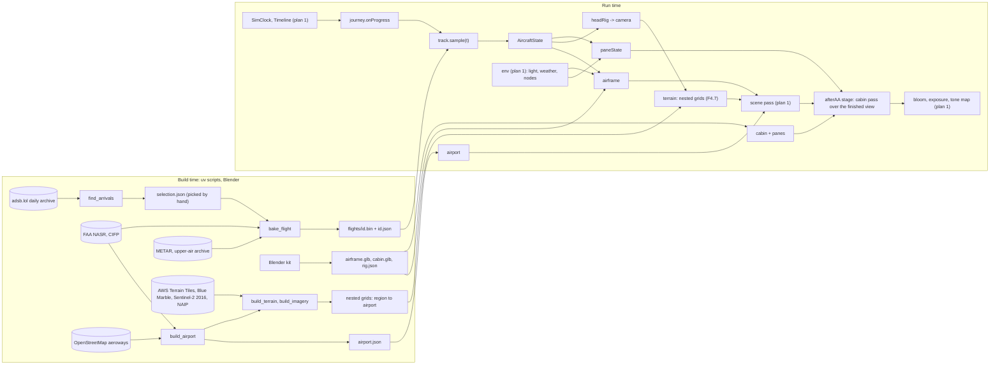
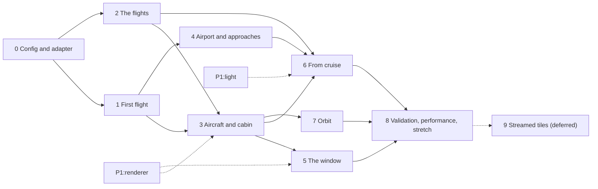

# Plan 03 — Window seat and landing

Status: proposed · written 2026-11-09 and 2026-11-10 · one of three sibling plans (01 Sky & weather, 02 Drive, **03 Window seat & landing**).

Conventions used below:

- "Plan 1" and "plan 2" are the sibling plans. Where this plan needs something from them it says so by capability. Plan 2's document was complete when this was finished; plan 1's was read in draft, so its names may still move (section 11).
- Coordinates are the app's frame: metres, origin at Las Vegas Blvd and Flamingo Rd, x east, y north in data and −z north in the scene, heights above sea level unless stated.
- Aviation quantities keep their usual units (feet, knots, nautical miles) where a source or a pilot would use them, with metric beside them where it matters to the code.
- Sizes: **S** up to a day, **M** two to four days, **L** one to two weeks, for one senior engineer or the equivalent in agent sessions.
- A number is either referenced in section 13, **measured** for this plan (the method is in section 13), or marked as an estimate.
- A code in square brackets, such as [H1] or [N7], is a reference in section 13. Labels without brackets are this plan's own: tasks (F1.4), assumptions (A1 to A9), ground-truth rows (G1 to G12) and requests to the sibling plans (P1-a, P2-a). Plan 1's tasks are written T0.1 and plan 2's D0.1.

---

## 1. Executive summary

### What the user will experience

The mode switch gains **Fly**, with two tabs.

**Fly in** lists a handful of real arrivals at Harry Reid International, each one a flight that happened: its date, its hour, its runway, its weather. Pick one, pick a seat on the seat map (the default is a window seat behind the wing on the right, where the Strip will be), and the app puts you there at 35,000 ft with 25 minutes to run.

- **Cruise.** The wing, the winglet, a horizon 400 km away that sits three degrees below level, ice crystals around the breather hole at the bottom of the pane. The ground is real geography, coarse at this range and softened by real haze.
- **Descent.** The crystals retreat as the pane warms. At 10,000 ft the landing lights come on. Slats, then flaps in stages; the horizon tilts in each turn because the aircraft is flying the turns the real one flew.
- **Approach.** From the east it is a 38 km straight-in to runway 26L with Lake Mead to the right. To runway 19 it is a run west across the valley and a curving left turn onto a short final beside the Strip, by then below the top of the Strat.
- **Night.** The valley is its street lamps, 134,000 of them from the county's and the city's own inventories, orange where sodium lighting remains and white where it does not, with the airport's lights exactly as the FAA lists them: flashers leading to 26L, none at all on the 19s.
- **Landing.** The aircraft's shadow closes in on the wheels. Touchdown; the spoilers rise and the wingtip drops as the lift goes; reverser sleeves slide back; the terminals and the parked aircraft go by with the Strip behind them.

You control time and where you look, nothing else: play, pause, scrub in both directions, speed; turn your head, lean to the pane, zoom, pull focus from the city to the scratches on the acrylic. Hide the Sphere on the map first and you land beside a Strip that does not have one.

**Orbit** circles the valley at an altitude, radius and hour of your choosing, in the same seat, behind the same window.

The app says what is real. Position, height, speed and track are as recorded. Pitch, flaps, gear, spoilers and lights are inferred from the recording and from how the aircraft is flown, and each flight's information panel says so.

### Key technical decisions

1. **Tracks come from adsb.lol's archive, and only from there.** *Why:* it is the one public ADS-B history whose terms (ODbL) allow derived tracks to be redistributed; OpenSky, ADS-B Exchange and the others do not (section 6.2).
2. **The bake fuses recorded positions with recorded velocities in a fixed-interval smoother.** *Why:* the archive is thinned to a point every 6 to 8 s on final and every 30 s in cruise, which is too sparse to differentiate but plenty when each point carries the aircraft's own velocity (7.2).
3. **Height is the geometric altitude, calibrated on the runway.** *Why:* barometric altitude is hundreds of feet wrong on a hot day, and the geometric one has a 28 m datum ambiguity that one look at the rollout removes (7.2).
4. **Attitude and configuration are inferred conservatively and labelled.** *Why:* ADS-B carries none of them, and an honest label is worth more than a confident guess (7.3).
5. **The app's frame is kept to the horizon, and the aircraft is levelled to the curved datum.** *Why:* measured against the ellipsoid it is 39 m out in height at 370 km; a geocentric rewrite would buy nothing visible (7.1).
6. **Regional terrain is six fixed grids in the repository, not streamed tiles.** *Why:* the user's decision of 2026-11-10. They add 12.6 MB, reach ±524 km, and sit behind plan 2's terrain interface so that tiles can replace them later (7.9, Phase 9).
7. **The airframe is drawn in plan 1's scene pass; the cabin is a second pass composed after anti-aliasing and before bloom; the pane is one layered material that samples the finished outside view.** *Why:* the wing then gets atmosphere, cloud and shadows for free, and the pane can refract, scatter and reflect what is really outside (7.6, 7.7).
8. **Everything animated is a pure function of time.** Frost is a growth map thresholded by a pane temperature integrated once per flight; droplets are stateless. *Why:* the user's only control is the clock, and it runs both ways (5.1).
9. **The aircraft and cabin are built procedurally with the project's Blender kit from published dimensions, with an explicit list of window positions.** *Why:* the type's window pitch is not uniform and some positions have no window at all; a seat's view should follow from geometry, not be authored (7.4).
10. **The airport is generated from FAA data and OpenStreetMap.** Runways from surveyed ends and elevations, pavement from the FAA's polygons, markings and lights from the FAA standards for the systems each runway end actually has. *Why:* airport-agnostic, and correct where assumption is not: Las Vegas has no high-intensity approach lighting and no centre-line lights (7.10).
11. **Street lamps from the air are flux-conserving points at three levels of clustering, calibrated to plan 1's night-radiance product.** *Why:* a city at night from a window seat is its lamps, and the inventories exist (7.11).
12. **The orbit is a turn around a point whose phase advances with wall time.** *Why:* scrubbing the hour must change the light, not fling the aircraft round the circle (7.12).

### What the research changed

| Assumed going in | Found |
| --- | --- |
| Runway 19 arrivals are as ordinary as runway 26 ones | Large aircraft land on 26L/R 73% of the time and on 19L/R 7%. The flights exist, and are found by scanning for them |
| The runway 19 approach runs straight down the east side of the Strip | The usual one crosses the valley westbound and turns left onto a 2-nautical-mile final; a right-hand window looks away during the turn and at the Strip for the last minute |
| The airport has ALSF-2 or MALSR approach lights | It has a MALS on 26R and MALSF on 26L and 1L, nothing on 19L or 19R, and no centre-line or touchdown-zone lights anywhere |
| Cabin windows are 20 inches apart | 20 inches over the original fuselage and about 22 through the stretch plugs, with blank positions ahead of the wing |
| An ADS-B archive is a 1 Hz recording | It is thinned by rule; the flare is not in it at all |
| The airport is inside the detailed core | Runway 26L is entirely outside the near grid, and half the terminal is outside the building data |

### What ships when

| Phase | Result |
| --- | --- |
| 0 | The airport block in `cities.json`, the adapter to plan 1, test fixtures (the shared foundations are the sibling plans') |
| 1 | **A visible flight:** the last six or seven minutes of one real runway 19 arrival over today's terrain, from a window seat with a simple frame and a plain wing; time under control; hide and move working |
| 2 | Four to six baked arrivals with the picker, badges, chapters and QA reports |
| 3 | The real airframe with moving flaps, slats, spoilers, gear and reversers, wing flex and lights; the cabin; any seat |
| 4 | The airport: surfaces, markings, lights, terminals, parked aircraft; buildings under both finals; sharper ground at the airport |
| 5 | The window: reflections, scratches and glare, frost, droplets, focus, shade |
| 6 | The whole flight from cruise over terrain to the horizon; the valley's lamps at night |
| 7 | Orbit |
| 8 | Validation report, performance pass, Salt Lake City, stretch items (other aircraft, sound, taxi to the gate) |
| 9 | Deferred: streamed tiles behind the same interface |

---

## 2. Locked decisions and assumptions

### 2.1 Decisions that apply to all three plans (verbatim)

> - Hardware: scalable presets Low / High / Ultra, auto-picked; WebGPU where available, WebGL2 otherwise.
> - Control: **on rails** — the real path as flown; the user controls time (play, pause, scrub, speed) and where they look (head movement within the seat/window constraints).
> - Las Vegas first; airport-agnostic code so Salt Lake City (SLC) can follow. Modes inside the existing app; hide/move keeps working. Tests and realism validation in every plan.

### 2.2 Decisions for this plan (verbatim)

> - **Approach: recorded real arrivals** — a handful of actual flights to **both runway directions (26L/R from the east and 19L/R from the north)**, **by day and by night**, baked in at build time from **public ADS-B archives**, flown as recorded (position, altitude, ground speed, track; derive attitude). Check each source's license/terms (e.g. adsb.lol open data, OpenSky Network historical access/datasets, ADS-B Exchange, airplanes.live) and pick legally usable ones; plan the selection criteria (aircraft type ~737-class, complete tracks from cruise to touchdown, good data density, varied time of day/season, maybe one with weather).
> - **Seat: choose any seat** — a seat map, any row, either side; **default: behind the wing, right side** (both runway directions put the Strip on the right side).
> - **Overhead view: both** — **one continuous flight** (cruise ~35,000 ft → descent → approach → landing, ~25 minutes real time or time-compressed; the overhead view is the opening act) **plus a separate free orbit "window seat" mode** that circles the valley at a chosen altitude and time of day, reusing the same window, terrain and clouds.
> - Aircraft: a **generic 737-class narrow-body in a plain livery, no airline branding**.

### 2.3 Decisions after planning (user, 2026-11-10, as relayed to this plan; verbatim)

These override anything else in this document that conflicts with them. Plan 2's document records the same two decisions at its top.

> 1. High-resolution terrain data is skipped for now. Plan 02 will not build or host the USGS 3DEP / NAIP tile pyramid, and there will be no Cloudflare R2 bucket. Plan the flight against the terrain already in public/data/<city>/, plus a coarse, lightweight fallback for the regional range out to cruise distance that fits in the git repo (for example a low-resolution DEM and imagery that stay within the repo's size limits). Put the full tile streaming in a deferred later phase behind the same terrain interface.
> 2. The county and city street-light inventories are to be treated as public domain (relevant if you use lamp positions for the night view from the air).

What follows from them here: the regional terrain is a fixed set of grids in the repository (section 7.9), built and drawn by this plan; streamed tiles are Phase 9, deferred; the lamps of the night view come from the inventories and ship as derived positions (section 7.11).

### 2.4 Ownership (from the brief)

- **Plan 1 owns** the simulation clock and the shared timeline and transport UI, the renderer and pipeline (WebGPU with WebGL2 fallback, presets, HDR, physical light units, auto-exposure, bloom), sun, moon and stars, the atmosphere and aerial perspective from the ground to cruise altitude, shadows, the sky-glow model and VIIRS data, the weather service, clouds that can be seen from above and flown through, rain and the wet state, lightning, dust walls.
- **Plan 2 owns** the tiled terrain streaming and level-of-detail system, now deferred, and the terrain interface that both the fixed grids and the future tiles sit behind.
- **This plan owns** the flight data pipeline, the aircraft and its configuration timeline, the cabin window, the wing and exterior, the regional terrain to the horizon (as fixed grids for now), the airport, the camera and look system, the orbit mode, the journeys, and what is drawn at each altitude.

### 2.5 Assumptions made here (each can be changed without restructuring the plan)

| # | Assumption | Consequence if wrong |
| --- | --- | --- |
| A1 | The site stays free, non-commercial and open source. | Several data licences (section 12.2) are conditional on it. |
| A2 | The flight picker shows the date, time, runway and direction of each real flight, but **no airline, flight number, registration or ICAO address**. Provenance (archive release and ICAO address) is kept in the repository for reproducibility, not shown. | A wording change in the picker. |
| A3 | "As recorded" means position, altitude, ground speed, track and the air/ground transition. **Attitude, flaps, slats, gear, spoilers, reversers, lights and the last seconds of the flare are inferred** from the recording, the aircraft's limits and standard practice, and are disclosed as such in the app. | None; this is the only honest reading of what ADS-B contains. |
| A4 | Recorded flights can be retimed to another date and hour through plan 1's "Depart at" control. Weather defaults to the flight's real weather and can be overridden. A chip says when either was changed. | Remove one default. |
| A5 | No audio in the first version. It is a stretch task because it matters to immersion, but nothing else depends on it. | Move task F8.5 earlier. |
| A6 | Plan 1 migrates the app to `WebGPURenderer` and node materials before this plan's Phase 5. Custom shading here is written as node materials only; nothing is written in GLSL to be thrown away. | Phase 5 (the pane) waits; Phases 1 to 4 do not. |
| A7 | The generic cabin has its own layout (rows, pitch, exits), chosen to fit the airframe's published geometry, not any airline's seat map. | None. |
| A8 | Other traffic is not simulated in the first version. Parked aircraft are static props. Real surrounding traffic from the same archive is a stretch task. | None. |
| A9 | About 26 MB of new data for Las Vegas may be committed to the repository (section 9.2), taking it to about 83 MB. | Coarser regional imagery, or the deferred hosting decision returns sooner. |

---

## 3. Current state

Read at the working tree of 2026-11-09 (uncommitted night mode and GLB landmarks included). The tree was still changing while the three plans were written, so line numbers will drift and the symbol names are the stable reference.

### 3.1 What exists

| Area | Where | What it does today | What it means for the flight |
| --- | --- | --- | --- |
| Entry, city | `src/main.js:11-20` | One module with top-level `await`; `?city=` picks a city from `public/data/cities.json`; each city is a full page load. | Flight mode is per city and must load lazily (dynamic `import()`), so the map view pays nothing for it. |
| Frame | `src/main.js:22-26`, `:111`, `scripts/build_terrain.py:35` | 1 unit = 1 m; +x east, +y up, -z north; `BASE = city.base` (LV 620 m); `EARTH_R = 6371000 * 7/6`; `curveDrop(x, z) = (x² + z²) / (2·EARTH_R)`; horizontal coordinates are a transverse Mercator centred on the city origin (`+proj=tmerc +lat_0 +lon_0 +k=1`). | Reused unchanged. Section 7.1 shows it is accurate enough at 370 km. "Level" for the aircraft is the local tangent of this curved surface, not the XZ plane. |
| Renderer | `src/main.js:47-54` | `WebGLRenderer`, MSAA, `preserveDrawingBuffer`, ACES, exposure 1.0, PCF shadows 4096² updated on demand. | Plan 1 replaces it. Phase 1 here uses only built-in materials so nothing is thrown away. |
| Sky, light | `src/main.js:56-63`, `:83-108`, `:866-883` | `DAY`/`NIGHT` look tables, `FogExp2(0.000014)`, a gradient sky sphere of radius 120 km centred on the world origin, one fixed sun (azimuth 245°, elevation 32°), `night` is a boolean setting. | Good enough below about 5 km altitude and within about 40 km of the origin. Useless at cruise: the sky sphere and the 150 km far plane are smaller than the view. |
| Camera | `src/main.js:65-76`, `:425-437` | One `PerspectiveCamera(27°, near 5, far 150000)`, `OrbitControls` in map style, the field of view held at a 50 mm lens (39.6° horizontal), the picture shifted 158 px right of centre to clear the panel. | A cabin needs near ≈ 0.02 m and a far plane beyond 400 km. One conventional depth range cannot hold both; section 7.6 draws the cabin in a pass of its own. |
| Loop | `src/main.js:78-80`, `:955-961` | Render on demand: a `dirty` flag, `renderer.setAnimationLoop`. | Playback must mark the frame dirty every tick while playing and stop when paused. |
| Terrain | `src/main.js:114-164`, `:266-283`, `:375` | Two fixed height grids and two JPEGs. LV far: x −48..30 km, y −34..38 km, 80 m posts, 20 m/px. LV near: x −3.6..4.6 km, y −4.4..8.2 km, 12 m posts, 2.5 m/px. `groundY(x, y)` samples them. | Kept. Until the six further grids of section 7.9 exist, a flight is only presentable inside the far grid (its last six or seven minutes). Streamed tiles are deferred. |
| Buildings | `src/main.js:167-372`, `public/data/lv/buildings.json` | 17,861 footprints extruded at load (about 0.5 M triangles): one mesh per building over the height cutoff (`tall[]`, 182 at 35 m), one merged mesh for the rest (`low`). Coverage x −2.5..3.4 km, y −3.3..7.1 km. | Hide and move state lives in `tall[]` and survives a mode change for free. `low` is a single mesh and cannot be culled or faded by distance. |
| Landmarks | `src/customModels.js`, `public/models/*.glb` | Hand-built GLBs listed in `public/models/models.json` (73 for Las Vegas when this was written, and growing), flattened into the building geometry, with `_GLOW` and `_WINDOWS` vertex attributes. | The aircraft and cabin are built with the same Blender kit, but as separate nodes that keep their pivots. |
| Night | `src/night.js:12`, `:113-126` | A shared `night` uniform and GLSL injected through `onBeforeCompile`: procedural lit windows, baked glow. | `onBeforeCompile` does not run on `WebGPURenderer`; plan 1 ports it. From the air at night the city is lit windows on a ground with a flat orange tint: no street lights, no airport lights. |
| Picking, hide, move | `src/main.js:439-615`, `:729-838` | BVH raycast against `tall` meshes and ground markers, with `low` as an occluder; drag on a level plane; undo stack. `place()` keeps a moved building on the near grid (`:552`). | Picking reads the module-level `camera` (`:740`), so flight mode drives that same camera object instead of adding a second one. |
| Naming clash | `src/main.js:618-640`, `:966` | `flight`, `stepFlight` and `__skyline.flying()` are the 750 ms camera glide of "Center". | Should be renamed `glide` when the sibling plans' Phase 0 moves it (the `flying` hook stays as an alias). Everything new lives under `src/flight/` and `__skyline.flight`. |
| UI | `index.html`, `src/style.css` | A 300 px panel on the left: city tabs, title and Settings, viewpoint buttons, counts, search, building list, footer; a dock for the selection card and the undo toast; a bottom sheet under 720 px. | The mode switch and the flight sections go in this panel; the transport bar is plan 1's. |
| Test hooks | `src/main.js:964-981` | `window.__skyline` exposes the scene, camera, settings and helpers. | Extended with `__skyline.flight`. There is no test runner yet. |
| Pipeline | `scripts/*.py`, `package.json` | Four single-file `uv` scripts (PEP 723 headers) reading `cities.json`; raw downloads cached under `data/raw/` (git-ignored); outputs checked in under `public/data/<city>/`. | The flight and airport scripts follow the same conventions. |

### 3.2 Facts measured for this plan

Runway positions are the FAA's (NASR cycle of 29 October 2026) projected into the app frame with the terrain's own projection string.

- **The airport is only partly inside the detailed core.** Runway 8L/26R runs along y = −4.25 km from x = 0.14 to 4.66 km, so its east end is 58 m past the near grid's edge. Runway 8R/26L, where most airliners land, runs along y = −4.56 km: **entirely south of the near grid** (which stops at −4.4 km), in 20 m/px imagery. So is the south end of 1R/19L.
- **Half the terminal is missing.** The building data stops at y = −3.3 km. Terminal 1, the A gates, Terminal 3 and the control tower are in it; the B, C and D concourses, the cargo area and everything south of them are not.
- **Both approaches fly over ground with no 3D buildings.** The 19R landing threshold is at (1.37, −1.89) km and the runway points 205° true, so a straight-in final runs north-north-east of it: abeam the Sphere it is 1.6 km east of it and about 180 m above the ground; abeam the Strat it is 2.4 km east and, on the published 3.04° to 3.24° paths, 985 to 1,005 m above sea level against 971 m for the top of the mast. Building coverage ends at x = 3.4 km, which that line crosses 4.9 km before the threshold. The whole 26L/26R final lies east and south of the coverage.
- **Curvature is fine.** Against exact WGS-84 geometry, the transverse Mercator plus parabola puts a point 250 km away within 128 m horizontally and 14 m vertically, and a point 370 km away within 412 m and 39 m (section 7.1).
- **OpenStreetMap is rich at KLAS** (Overpass, 2026-11-10): 6 runway ways, 346 taxiways, 30 taxilanes, 25 aprons, 12 terminals, 110 gates, 197 parking positions, 114 jet bridges, and 1,339 mapped lights (630 taxiway edge, 399 runway edge, 232 taxiway centre line, 45 approach lights and 24 threshold lights, 8 PAPI units). The lights are complete only around the 1/19 runways.
- **Where airliners actually land.** Clark County's 2025 noise report gives large-aircraft arrivals as 73% on 26L/R, 19% on 1L/R, 7% on 19L/R and 1% on 8L/R. Runway 19 arrivals by airliners are real but a minority, so those flights are found by scanning for them (section 6.2).

### 3.3 What must change

1. A mode system: Explore (today's map), Fly-in, Orbit, and plan 2's Drive, with the camera, controls and panel handed over cleanly and the hide/move state untouched.
2. A journey on the shared clock, so time is the user's control and every animated thing is a pure function of it.
3. A cabin pass with its own depth range and a far plane at the horizon, instead of one 5 m to 150 km camera range.
4. Terrain and imagery far beyond today's grids, as a fixed set of coarse grids in the repository until streamed tiles exist (section 7.9); buildings under the approaches; and an atmosphere that works from the runway to 12 km (plan 1).
5. An airport: surfaces, markings, lights, terminals, parked aircraft.
6. `low` split into cells so the city can be culled and faded by distance; street and airport lights as points.
7. A test runner (Vitest, Playwright, pytest) and a build-time flight pipeline.

---

## 4. Experience spec

### 4.1 Entering and leaving

- The mode switch that plan 2 adds under the city tabs (`nav#modes`: Map | Drive) gains **Fly**. Fly is offered only for a city whose `cities.json` entry has an `airport` and whose `flights/index.json` lists at least one flight; Salt Lake City shows it disabled, labelled "Coming", until its data exists.
- Fly has two tabs: **Fly in** (recorded arrivals) and **Orbit**.
- Entering keeps every hidden and moved building. The what-if state belongs to the city, not to a mode.
- The change of view is a 500 ms fade through black to the seat. There is no fly-through from the map camera.
- Leaving returns the map camera exactly as it was. The mode remembers its flight, seat, look and time for the session.
- `Esc` behaves as today (closes menus, clears the selection). It never leaves the mode.

### 4.2 Flight picker

One card per recorded flight, in the order day, dusk, night:

```
+--------------------------------------------------------------+
| [preview]  Runway 19R, from the north-east                   |
|            Sat 15 Mar 2025 . touched down 6:42 pm            |
|  DUSK   19R   CLEAR   STRIP ON THE RIGHT            27 min   |
|  [Play (8 min)]   [Real time (27 min)]   [Final (4 min)]     |
+--------------------------------------------------------------+
```

- **Title:** the runway and where the flight came from, in plain words. No airline, flight number or registration (assumption A2).
- **Date and time:** the real ones, in the airport's time zone.
- **Badges:** light at touchdown (Day, Dusk, Night, from the sun's elevation), runway, weather as flown (Clear, Scattered, Overcast, Rain, Wind), and which side the Strip is on.
- **Three ways to play:** condensed (the default: cruise and descent run fast, the last three minutes run in real time), real time, or straight to the final approach.
- **Preview frame:** rendered by the Playwright job of task F2.8 from the default seat 90 seconds before touchdown.
- **"About this flight"** opens the provenance: the archive and its licence, what is recorded and what is inferred, which seconds were reconstructed, and the QA numbers (glide path angle, threshold crossing height, touchdown point).
- **The real date and time are the default.** Plan 1's transport has a "Depart at" control whose default for a recorded flight is "Real date and time"; choosing another date or hour there keeps the aircraft where it is and moves the sky. The track does not change. Weather stays as flown until the user picks another source in plan 1's Sky sheet.
- Whenever the departure differs from the recording, the HUD shows **Retimed**; a weather override already shows as plan 1's chip. Both stay in screenshots, so a picture never passes for conditions that did not happen.

### 4.3 Seat map

A top-down SVG of the cabin with the wing drawn to scale beneath it.

- Every seat is selectable: rows of six, A to C on the left, D to F on the right. Window seats are full colour; middle and aisle seats are lighter (they work, and show more cabin and less world).
- Each window is drawn as a tick on the fuselage edge at its true station, so the user sees which rows line up with a window, which sit between two, and which have a blank wall. Those seats are selectable too: the view is a wall and a sliver of the next window, as in the real aircraft.
- Hovering a seat names the view: "22F · right · behind the wing · window 12 cm ahead of your shoulder".
- Three shortcuts sit above the map: **Ahead of the wing**, **Over the wing**, **Behind the wing** (default), each for the side the Strip is on for the chosen flight.
- **Default: the right-hand window seat of the first row whose window is at least 1.2 m behind the wing's trailing edge at the root and aligned within 15 cm of the eye.** The rule, not a row number, is the specification (section 7.4).
- Changing seat during a flight fades through black in 300 ms. Time does not stop.

### 4.4 Time

- Plan 1's transport is the only clock: play, pause, scrub, rate, depart at. The journey scrubber spans the flight and carries this plan's markers: Cruise, Top of descent, 18,000 ft, 10,000 ft (landing lights), Gear down, 1,000 ft, Touchdown, Runway vacated.
- Scrubbing the flight moves the clock, so the sun sets as the user scrubs through a dusk arrival. That is plan 1's rule for every journey.
- Rates 1× to 8×. The condensed pace is a rate that changes along the flight; touching the rate control turns it off.
- Flashing lights and vibration run on wall-clock time and are limited to three flashes a second at any rate (section 7.5). With the terrain in fixed files there is nothing to outrun, so every rate works on any connection once a flight has loaded.
- At the end the aircraft holds on the taxiway where the recording ends.
- The HUD chip shows time to touchdown, altitude, ground speed and the phase ("Descending · 12 min to landing"), in the user's units setting. `H` hides it.

### 4.5 Looking

| Input | Action |
| --- | --- |
| Drag (mouse or one finger) | Turn the head: ±80° fore and aft of straight out, 60° down, 35° up |
| Scroll or pinch | Zoom: 13 mm to 85 mm equivalent; default 26 mm, a phone's main camera |
| Shift-drag, two-finger drag, or `W A S D` and `Q E` | Move the head: lean to the pane or back, slide fore and aft ±18 cm, rise ±10 cm |
| Double-click or `R` | Back to the default look |
| `F` | Pull focus between the world and the pane |
| `C` | Clean view: no cabin, the eye at the pane (the same key as plan 2's cabin toggle) |
| `V` | Window shade (also draggable by its handle) |
| `H` | HUD |
| `Space`, `,` `.`, `[` `]` | Plan 1's transport |

- Released, the head stays where it was put.
- The limits are geometric, not arbitrary: the eye cannot pass the inner pane or the seat in front, and how far forward you can see is set by the depth of the window reveal, as in the aircraft.
- On a phone, an optional **Hold as a window** uses the device's orientation for the look (it asks for motion permission where the browser requires it).

### 4.6 Orbit

- **Altitude:** 4,500 ft to 41,000 ft above sea level (the airport is at 2,183 ft), with marks at 5,000, 10,000, 18,000 and 35,000.
- **Radius:** from the smallest the bank limit allows at that altitude and speed, up to 60 km. The panel shows the resulting bank angle and lap time.
- **Centre:** the Strip by default; "Orbit this" on any building in the list re-centres on it.
- **Direction:** chosen so the selected seat looks into the turn. A switch looks outward instead, at the mountains.
- **Speed:** set from the altitude (section 7.12); not a control.
- **Time and weather:** plan 1's Sky block, as on the map. No journey is active in Orbit, so the day scrubber changes the hour and leaves the aircraft where it is (section 7.12).
- **Presets:** Overhead at 35,000 ft; The valley at 12,000 ft; The Strip at 6,500 ft.

### 4.7 Defaults

- City Las Vegas; the dusk arrival on runway 19 if it exists, otherwise the first day arrival.
- Condensed pace, starting at Cruise.
- Seat as in 4.3; look straight out and 8° down; 26 mm; cabin frame on; HUD on.
- Real date, time and weather. Preset from plan 1's auto-pick.
- Reduced motion follows the system setting: no head shake, steady lights in place of flashes.

### 4.8 Hiding and moving buildings from the air

- The building list stays in the panel. Hide, Show, Reset, search and undo work as on the map.
- Clicking a removable building through the window selects it; the card, `Delete` and the right-click menu work as today. A click is told from a look-drag by the existing 5-pixel rule (`src/main.js:774`).
- Dragging a selected building moves it. Pressing on it pauses the clock for the length of the drag (the same rule as plan 2).
- "Center" becomes **Look at**: the head turns to the building if the seat can see it; otherwise a toast says which side it is on.
- Hidden and moved state reaches the building's lights and shadow through the sibling plans' change events. The ground photo still shows its roof, as today; task F6.6 covers that patch.
- Acceptance case: hide the Sphere on the map, fly a runway 19 arrival, and pass a Strip with no Sphere and no glow where it stood.

### 4.9 Where the UI goes

```
#panel
  nav#cities                (as today)
  nav#modes                 plan 2's switch, plus Fly
  header                    (as today; the hint line changes with the mode)
  #browse
    .views                  map mode only
    plan 1's Sky block      every mode
    #fly                    NEW, fly mode only
      tabs                  Fly in | Orbit
      #flight-picker        cards (4.2)            #orbit-controls (4.6)
      #seat                 seat map (4.3), collapsible
      #fly-view             frame, HUD, focus, effects, reduced motion
    .bar, #search, #list    (as today, in every mode)
#transport                  plan 1's, with this plan's markers
#dock
  #card, #toast             (as today)
```

While playing, the panel can collapse to plan 2's 44 px rail; under 720 px wide it collapses to its handle.

### 4.10 Links

`?city=lv&mode=flight&flight=lv-19-dusk&at=1240&seat=22F&yaw=-10&pitch=-8&lens=26`

`?city=lv&mode=flight&orbit=1&alt=12000&r=9&phase=140&seat=22F&t=2026-11-14T01:07:30Z`

`at` is seconds from the start of the flight. `t` is plan 1's simulation-time parameter; for a recorded flight it appears only when the flight is retimed. Tests use these links.

### 4.11 When things are slow or missing

- Terrain late: the coarse grids load first and the finer ones replace them as they arrive, so the ground is blurrier for a moment and there is never a hole.
- A flight file fails: its card says so; the others work.
- A weak device: plan 1's preset drops this plan's pane effects first (section 7.13), then light points, never the flight.

---

## 5. Architecture

### 5.1 Principles

1. **Everything animated is a pure function of time.** Aircraft state, flap position, lights, frost, droplets and wing flex are computed from the journey time (plus a wall-clock phase for things that flash or shake). Nothing integrates frame to frame, so scrubbing backwards, jumping to a chapter and a screenshot at `at=1240` all give the same picture. What is naturally an integral (pane temperature, frost, wetness) is integrated once over the whole journey when it loads. Both sibling plans state the same rule.
2. **One camera, drawn in layers.** The world and the airframe share the scene pass; the cabin and its panes are a second pass composed after anti-aliasing and before bloom (section 7.6).
3. **One adapter per sibling plan.** `src/flight/env.js` is the only file that touches plan 1 (clock, timeline, environment, pipeline); it mirrors plan 2's `drive/env.js`. Terrain is reached only through plan 2's terrain interface, which today's grids, this plan's nested grids and the deferred tiles all answer. Each has a fallback built on today's code, so every phase ships with whatever the other plans have delivered.
4. **Lazy and per city.** `src/flight/index.js` is the only flight file in the main bundle. It registers the mode and reads `flights/index.json`; the rest is `import()`ed on entering the mode. Source stays valid browser ESM, as plan 1 requires.
5. **Data-driven airports.** No airport's name appears in code. `cities.json` gains an `airport` block; runways, lights and procedures come from `public/data/<city>/airport.json`.
6. **No compute shaders, no backend-only features.** Every technique runs on the WebGL2 backend; presets change quality, not capability.
7. **Say what is recorded and what is inferred.** Every baked channel carries its provenance, and the app shows it.

### 5.2 Modules

The split of `main.js`, the app context, the mode registry, the frame module and the loop are the sibling plans' Phase 0 and are used as they land (section 11.3 lists the two naming schemes). This plan adds one folder under `src/`, two files to the shared terrain module, a handful of scripts, and one models folder.

```
src/flight/
  index.js             createFlightMode(): mode id 'flight', tabs Fly in and Orbit; lazy-loads the rest
  env.js               the one adapter to plan 1, with fallbacks
  types.d.ts           AircraftState, Track, FlightMeta (types only)
  track.js             baked track loader and sampler
  kinematics.js        level frame, attitude quaternion, coordinated-turn maths              (pure)
  journey.js           a recorded flight as a journey: markers, pace schedule, recorded start
  orbit.js             generated orbit path                                                  (pure)
  aircraft/
    airframe.js        GLB + rig, wing flex, shadow proxy
    rig.js             channel values -> part transforms                                     (pure)
    lights.js          light schedule and flash functions                                    (pure)
  cabin/
    lopa.js            seat <-> body station <-> eye point <-> windows                       (pure)
    cabin.js           cabin segment around the chosen seat, shade
    headRig.js         eye pose, look limits, pointer / keyboard / device-orientation input
    paneState.js       pane temperature, frost, fog and wetness along a journey             (pure)
    paneOptics.js      node material: the pane as a thin scattering, refracting, reflecting layer
    droplets.js        node functions: stateless droplets and streaks
  view/layers.js       scene-pass membership, the cabin pass, per-frame near and far, composition
  airport/
    airport.js         loads airport.json, owns the airport group
    surfaces.js        runway, taxiway and apron meshes; markings
    lightLayout.js     FAA light systems -> light lists                                      (pure)
    lightField.js      draws light lists as points with directional intensity
    props.js           parked aircraft, terminal blocks
    approachBuildings.js   instanced boxes under the two finals
  night/
    lamps.js           street lamps from the air: three levels, drawn by lightField
  ui/
    panel.js           the #fly section: picker, orbit controls, options
    seatMap.js         SVG seat map
    hud.js             status chip
  debug.js             window.__skyline.flight

terrain module (plan 2's `world/terrain/`, or `city/` in plan 1's layout)
  grids.js             any number of nested fixed grids behind the terrain interface (task F4.7)
  chunks.js            chunked meshes with three strides, skirts, culling; a meshing worker

scripts/
  lib/                 adsb.py  geodesy.py  smooth.py  attitude.py  config_schedule.py  qa.py   (+ plan 2's frame.py, pyramid.py)
  fetch_adsb_day.py    download one day of the archive
  find_arrivals.py     list and rank arrivals at an airport for a day
  bake_flight.py       one selected flight -> flights/<id>.bin + .json
  bake_flights.py      every flight in data/flights/<city>/selection.json
  build_airport.py     FAA NASR and airport-mapping layers + OpenStreetMap -> airport.json
  fetch_cifp.py        FAA CIFP -> procedure extracts for validation
  build_terrain.py     (existing, extended) more grids, gzip-difference heights, stitching, pavement burn-in
  build_imagery.py     (existing, extended) Blue Marble and Sentinel-2 sources, WebP, colour matching
  build_approach_buildings.py   Overture footprints + LiDAR heights -> compact boxes under the finals
  build_farlights.py   street-lamp inventories + plan 1's radiance grids -> lamps-air.bin
  build_pane_textures.py   frost growth maps, scratch map, dirt

models/aircraft/       landmark_kit.py (copy)  aircraft_kit.py  spec.py  build_airframe.py  build_cabin.py
tests/unit/flight/     Vitest        tests/e2e/flight/   Playwright        tests/data/flight/   pytest
data/flights/<city>/   selection.json  raw/<id>.trace.json.gz  qa/  procedures.json          (ODbL)
public/data/<city>/    airport.json   flights/index.json   flights/<id>.{json,bin,jpg}
                       terrain-<grid>.bin.gz   ground-<grid>.webp   approach-<rwy>.bin   lamps-air.bin
public/models/aircraft/  airframe.glb   cabin.glb   rig.json
public/textures/pane/    frost-0..3.png   scratches.png   dirt.png
```

Files stay under 400 lines. Anything marked pure holds no scene state and is unit-tested.

### 5.3 Data flow



### 5.4 One frame

In plan 1's frame order:

```mermaid
sequenceDiagram
  participant Loop as FrameLoop (plan 1)
  participant TL as Timeline (plan 1)
  participant Mode as flight mode (order 20)
  participant Rig as airframe + headRig
  participant World as terrain grids, env (plan 1)
  participant Pipe as pipeline (plan 1)
  Loop->>TL: step 10
  TL->>Mode: journey.onProgress(progressS, { seek })
  Note over Mode: state = track.sample(progressS)
  Loop->>Mode: step 20 update(frame)
  Mode->>Rig: airframe.update(state, wallPhase), headRig.update(input)
  Rig-->>Mode: camera pose, velocity
  Mode->>World: terrain.setViews([{ camera, weight: 1 }])
  Loop->>World: step 40 env.update, then terrain.update
  Mode->>Pipe: near and far, paneOptics uniforms from paneState.at(progressS) and env.at(position)
  Loop->>Pipe: step 60 render
```

### 5.5 Interfaces

Types are written as declarations for brevity; the code is JavaScript with JSDoc, as in the sibling plans.

```ts
// the frame module (core/earth.js or world/frame.js): this plan adds one helper
/** Rotation taking the app axes to the level frame at (x, z): +y -> localUp, north kept in the vertical plane of -z. */
function levelQuaternion(x: number, z: number, out: Quaternion): Quaternion;

// src/flight/types.d.ts
interface AircraftState {
  t: number;                 // seconds from the journey start
  s: number;                 // metres along the ground track
  position: Vector3;         // main-gear contact point on the centre line, scene axes, metres
  quaternion: Quaternion;    // body -> scene; body axes: nose -Z, right wing +X, up +Y
  velocity: Vector3;         // m/s over the ground, scene axes
  airVelocity: Vector3;      // m/s through the air: what the rain and the droplets see
  heading: number; pitch: number; roll: number;   // rad; heading clockwise from grid north; pitch up +; right wing down +
  altMsl: number; gs: number; tas: number; ias: number; vs: number;    // SI
  flap: number;              // 0..40: surface position in lever units (7.5 = between 5 and 10)
  slat: number;              // 0 retracted, 1 extend, 2 full extend
  gear: number;              // 0 up .. 1 down
  speedbrake: number; groundSpoiler: number; reverser: number;         // 0..1
  lights: number;            // bit field: NAV | BEACON | STROBE | LANDING | TAXI | TURNOFF | LOGO | WING
  cabinLight: number; turbulence: number;                              // 0..1
  onGround: boolean;
}
interface Track {
  meta: FlightMeta;          // the <id>.json header: provenance, badges, QA, atmosphere profile
  durationS: number; lengthM: number;
  events: { t: number; s: number; id: string; label: string }[];
  sample(t: number, out?: AircraftState): AircraftState;   // Hermite between 1 Hz samples; clamps at both ends
}
function loadTrack(url: string): Promise<Track>;

// src/flight/journey.js: plan 1's Journey, plus plan 2's four members so either transport works
function flightJourney(track: Track, apply: (s: AircraftState) => void): Journey & {
  length: number;                                   // metres (plan 2)
  poseAt(simMs: number): AircraftState;             // (plan 2)
  timeAt(s: number): number;                        // (plan 2)
  paceRate(progressS: number): number;              // the condensed pace: the clock rate to use at this point
};

// src/flight/index.js: plan 2's Mode, registered with plan 1's mode registry
function createFlightMode(): Mode;                  // { id: 'flight', enter(ctx), exit(), update(frame), camera() }

// src/flight/debug.js: test hooks, shaped like plan 2's __skyline.drive
window.__skyline.flight = {
  list,          // () => flight metadata from index.json
  start,         // (id, { at, seat, pace, rate, frame, hud, effects }) => Promise<void>; resolves when the first frame has settled
  orbit,         // ({ altitudeFt, radiusKm, center, seat, phaseDeg }) => Promise<void>
  exit,          // () => void
  seek,          // ({ at } | { chapter }) => Promise<void>
  setSeat,       // ('22F') => Promise<void>
  look,          // ({ yaw, pitch, lean, slide, rise, lens, focus: 'far' | 'pane' }) => void
  state,         // () => AircraftState as plain numbers, plus heightAboveGround, phase, paneState
  project,       // (x, y, z) => { x, y, onScreen, throughWindow }
  whenSettled,   // () => Promise<void>: loop.settle(), terrain.whenSettled() and this plan's own assets
  visible,       // (buildingId) => boolean: line of sight from the eye through a pane to the building's top
  luminance,     // (rect) => mean scene luminance, cd/m², before tone mapping (plan 1's pipeline.probe)
  options,       // ({ frame, hud, reducedMotion, effects: { frost, droplets, scratches, reflections, flex } }) => void
  stats,         // () => { drawCalls, triangles, lightPoints, layerMs }
};
```

### 5.6 What this plan needs from the `main.js` split

Both sibling plans split `main.js` in their Phase 0 and list the same seams. This plan depends on five of them:

| Seam | Used here for |
| --- | --- |
| The frame module: `BASE`, the effective radius, `curveDrop`, `localUp` | Placing and levelling the aircraft; its Python twin in the bake |
| The mode registry and "picking uses the active mode's camera" | The flight mode; selecting a building through the window |
| The loop: ordered per-frame work and a demand for continuous frames | Playback |
| What-if change events (`buildings:changed` in plan 1, `whatif.on('change')` in plan 2) | `Look at`, pausing for a drag |
| The hooks module | `__skyline.flight` |

One rename rides along: the camera glide in `src/main.js:618-640` is called `flight` today (`stepFlight`, `__skyline.flying`). It should become `glide` when it moves, with `flying` kept as an alias for the existing checks; plan 1's file for it is `interaction/focus.js`.

**If Phase 0 has not landed when Phase 1 here starts**, Phase 1 adds about 20 lines to `main.js` instead: it builds a context object from the module's existing variables, adds a hook list to the animation loop (`:955-961`), passes the camera to `pick()`, and calls `createFlightMode()`. Those lines are deleted when Phase 0 lands.

---

## 6. Data sources and pipelines

Nothing here is fetched from a third party while the user flies. Every source is read at build time by a `uv` script in the style of the four existing ones (PEP 723 header, a city id from `cities.json`, raw downloads cached under `data/raw/`, which is git-ignored), turned into this project's own files and served with the site. Bracketed codes point to section 13. Marks: **[D]** opened and read directly for this plan; **[A]** opened by a research sub-agent, which reported quotations; **[S]** read only through a search-engine copy because the site refuses automated requests.

### 6.1 At a glance

| Layer | Source | Licence | Read how | Output | Size |
| --- | --- | --- | --- | --- | --- |
| Flight tracks | adsb.lol `globe_history` daily archives [H1, H2] | ODbL 1.0 (attribution, share-alike) [D] | One day's release from GitHub, 2 to 4 GB | `flights/<id>.bin`, `.json` | about 150 KB a flight |
| Runway ends, elevations, displaced thresholds, PAPI, approach-light codes, marking types | FAA NASR 28-day subscription, airport CSV bundle [N1] | US government work | One 8.5 MB zip | `airport.json` | under 500 KB |
| Approach courses, glide path angles, crossing heights, arrival routes | FAA CIFP (ARINC 424) [N2] | US government work | One 9 MB zip | `data/flights/<city>/procedures.json` (validation only) | 20 KB |
| Runway, taxiway and apron polygons, airport buildings, the beacon | FAA airport-mapping layers on its public ArcGIS service [N5] | "The data provided is for public use" [A] | A few JSON queries | `airport.json` | (in the above) |
| Stands, gates, jet bridges, taxiway names, individually mapped lights | OpenStreetMap, Overpass [N6] | ODbL 1.0 | One request | `airport.json` | (in the above) |
| Altimeter setting, wind, weather at the airport for a past hour | Iowa Environmental Mesonet ASOS archive (plan 1's `iemStation`) [W1] | Public domain, credit appreciated [A] | One request per flight | QA report, selection metrics | n/a |
| Wind and temperature aloft for a past hour | Open-Meteo historical forecast API, pressure-level variables [W2, W3] | CC BY 4.0; free for non-commercial use under 10,000 calls a day [D] | One request per flight | In the track header | 2 KB |
| Geoid height | NOAA GEOID18 grid through PROJ (`us_noaa_g2018u0.tif`, 16.7 MB) [W4] | Public domain [A] | Downloaded once by pyproj | Used in the bake only | n/a |
| Terrain to the horizon | AWS Terrain Tiles; NASA Blue Marble; Sentinel-2 cloudless 2016; NAIP [E1 to E4] | Open with attribution; NASA open data; CC BY 4.0; public domain | The two existing scripts, extended | Six more grids in `public/data/<city>/` | about 12.6 MB (6.7) |
| Street lamps | County and city inventories [L1] | Treated as public domain (section 2.3) | Public map services, or plan 2's processed inventory | `lamps-air.bin` | about 1.6 MB (6.8) |
| Buildings under the approaches | Overture footprints, 3DEP LiDAR heights [L2, L3] | ODbL; public domain | Bounding-box download; the existing LiDAR script | `approach-<rwy>.bin` | under 3 MB (6.8) |
| Night radiance, weather at run time | plan 1 | plan 1 | | | |
| Aircraft and cabin models | built here with the Blender kit from published dimensions [B1 to B9] | this project's (MIT) | | GLB | under 3.5 MB |
| Pane textures | generated here | this project's | | PNG | about 2 MB |
| Reference photographs | Wikimedia Commons [V1 to V3] | CC BY-SA 2.0 | Looked at; shown only in the validation report, with credit | | |

### 6.2 Flight tracks

**Why adsb.lol and nothing else.** It is the only archive found whose terms allow public redistribution of derived tracks:

| Source | Terms | Verdict |
| --- | --- | --- |
| **adsb.lol** | "license: ODbL 1.0, use it freely, just keep it open" on its historical-data page; the `globe_history_2023` to `_2026` repositories are each marked ODbL-1.0 [D] | **Used.** Attribution and share-alike apply (section 12.2) |
| OpenSky Network [H5] | Data licensed "solely for the purpose of non-profit research and non-profit education"; redistribution outside one's institute is forbidden; historical access is for researchers at universities and agencies [S] | Not usable |
| ADS-B Exchange [H6] | First-of-month samples are free "for testing and evaluation"; the acceptable-use policy prohibits publishing or distributing the data [A] | Not usable |
| airplanes.live, adsb.fi [H7] | Live data only, personal and non-commercial use; no history [A, S] | Not usable |
| FlightAware, Flightradar24 | Commercial | Not usable |

**What a day looks like** (checked on GitHub, 2026-11-10):

- One release per UTC day and server: `v2026.11.09-planes-readsb-prod-0` with `…tar.aa` and `…tar.ab` (1.9 + 1.6 GB), plus `-staging-0` and `-mlatonly-0`. The archive runs from 2023-02-16; a day was about 1.4 GB in 2023, 2 GB in 2024, 3 GB in 2025.
- Inside: `traces/<last two hex digits>/trace_full_<hex>.json`, one gzip-compressed file (without a `.gz` suffix) per aircraft per UTC day, with the aircraft type at the top level (`"t": "B738"`), so no separate type database is needed [H3].
- Each trace point is the 14-element array documented by readsb: time offset, latitude, longitude, barometric altitude or `"ground"`, ground speed, track, flags, vertical rate, an optional state object, position source, geometric altitude, geometric rate, indicated airspeed, roll.
- Each repository's `PREFERRED_RELEASES.txt` says whether `prod-0` or `staging-0` is the better copy of a given day.

**Selection criteria** (`find_arrivals.py` computes them; a person picks):

| Criterion | Requirement |
| --- | --- |
| Aircraft | Type B738. B38M, B737 and B739 share the cabin cross-section and the window, and are acceptable if a B738 cannot be found for a slot |
| Completeness | Trace present from at least 26 minutes before touchdown; at or above 30,000 ft at 24 minutes before touchdown (which excludes short hops from California and Arizona) |
| Position source | At least 98% ADS-B; geometric altitude on at least 95% of points |
| Gaps | None over 30 s above 18,000 ft, 15 s below 10,000 ft, 10 s in the last 5 km |
| Ground | At least 60 s of surface positions after touchdown |
| Approach | One approach, no go-around; landing on 19L, 19R, 26L or 26R |
| Light | Day: sun above 15° at touchdown. Dusk: between 2° above and 6° below. Night: more than 12° below |
| Weather | Visibility 10 miles and no ceiling below 12,000 ft for the clear flights; one flight with rain, a thunderstorm nearby or a broken layer below 8,000 ft |
| Variety | Different months; at least one winter day; arrival routes from both the north-east (CHOWW, BLAID) and the east (RKSTR), which between them pass Zion, the Grand Canyon, Lake Mead and Hoover Dam |

**The set to ship:**

| Id | Runway | Light | Notes |
| --- | --- | --- | --- |
| `lv-19-day` | 19L or 19R | Day | Phase 1's flight. Whichever approach it flew, the last minute is beside the Strip and below the top of the Strat |
| `lv-19-dusk` | 19L or 19R | Dusk | The default: the Strip's lights against the afterglow, to the right |
| `lv-19-night` | 19L or 19R | Night | |
| `lv-26-day` | 26L | Day | Straight in from the east over Lake Mead and Henderson; a morning flight puts the sun behind the aircraft |
| `lv-26-night` | 26L or 26R | Night | |
| `lv-wx` | any of the four | any | Only if a qualifying day exists; Las Vegas has few |

**Runway 19 arrivals are the scarce ones.** In the airport's most common configuration (winds from 150° to 330°, about half the time) airliners land on 26L and smaller aircraft on 19R; Clark County's noise office counts large-aircraft arrivals in 2025 as 73% on 26L/R, 19% on 1L/R, 7% on 19L/R and 1% on 8L/R [N8, N9]. Seven percent is still dozens of airliners on the days it happens, typically with a south-easterly wind. `find_arrivals.py` reports the runway of every arrival, and candidate days are chosen from the METAR archive by wind before anything is downloaded.

**How a runway 19 arrival actually arrives.** Not usually by a long straight final up the east side of the Strip. The published RNAV (RNP) approach brings the aircraft westward across the east valley about 3 km north of Flamingo Road, then through a curving left turn onto a final of only 2 nautical miles, rolling out about 2 km east of the Sphere [N4]. In that turn a right-hand window looks up and away; the Strip fills it for the last minute. The straight-in RNAV (GPS) approach also exists. Whichever was flown is what the track holds, and the picker's preview shows it.

**An optional seventh flight.** Runway 1L/1R takes 19% of airliner arrivals, from the south, with the Strip on the left. It is outside the locked decision and costs nothing but a selection.

**Baked format.** Like the terrain grids: a JSON header and a raw little-endian binary.

```jsonc
// public/data/lv/flights/lv-19-dusk.json
{
  "format": "skyline-flight/1",
  "id": "lv-19-dusk", "city": "lv", "airport": "KLAS", "runway": "19R", "aircraftType": "B738",
  "recordedStart": "2025-03-15T01:14:52Z", "touchdown": "2025-03-15T01:42:17Z",
  "dt": 1.0, "samples": 1745,
  "channels": ["x", "n", "h", "s", "gs", "vs", "tas", "ias", "hdg", "pitch", "roll",
               "flap", "slat", "gear", "speedbrake", "groundSpoiler", "reverser", "lights", "cabinLight", "turbulence"],
  "provenance": { "x": "recorded", "hdg": "derived", "roll": "recorded", "pitch": "inferred", "flap": "inferred" /* … one per channel */ },
  "reconstructed": [{ "from": 0, "to": 95, "what": "cruise extended backwards" }],
  "events": [{ "t": 0, "s": 0, "id": "cruise", "label": "Cruise, 35,000 ft" }, { "t": 372, "id": "tod", "label": "Top of descent" } /* … */],
  "atmosphere": [[600, 18.5, -2.1, 3.0], [1500, 11.0, -4.0, 6.5] /* altitude m, temperature °C, wind east m/s, wind north m/s */],
  "badges": { "light": "dusk", "weather": "clear", "from": "north-east", "stripSide": "right" },
  "qa": { "glidePathDeg": 3.02, "crossingHeightM": 19.4, "touchdownPastThresholdM": 412, "altitudeOffsetM": 3.1, "datum": "ellipsoid" },
  "source": { "archive": "adsb.lol globe_history", "release": "v2025.03.15-planes-readsb-prod-0", "licence": "ODbL-1.0" }
}
```

- `<id>.bin` is `Float32`, channel after channel (`samples` values each). `x`, `n` are metres east and north of the city origin; `h` is metres above sea level; the app applies `BASE` and `curveDrop` when it loads the file, so the file does not depend on those constants. (The dates above are placeholders for the format, not a chosen flight.)
- `flights/index.json` lists the flights with their badges, durations and preview images.
- The aircraft's ICAO address and the release tag stay in `data/flights/<city>/selection.json` in the repository, with the raw single-aircraft extract (`raw/<id>.trace.json.gz`, 100 to 300 KB) so the bake is reproducible without downloading 3 GB. They are not in the files the site serves.

### 6.3 The airport

**FAA NASR** [N1]. `build_airport.py` downloads `https://nfdc.faa.gov/webContent/28DaySub/extra/<DD_Mon_YYYY>_APT_CSV.zip` for the current 28-day cycle and reads three files. The columns it uses, confirmed in the cycle effective 29 October 2026:

| File | Columns |
| --- | --- |
| `APT_BASE.csv` | `ARPT_ID`, `ICAO_ID`, `LAT_DECIMAL`, `LONG_DECIMAL`, `ELEV`, `MAG_VARN`, `BCN_LENS_COLOR`, `BCN_LGT_SKED` |
| `APT_RWY.csv` | `RWY_ID`, `RWY_LEN`, `RWY_WIDTH`, `SURFACE_TYPE_CODE`, `TREATMENT_CODE`, `RWY_LGT_CODE` |
| `APT_RWY_END.csv` | `RWY_END_ID`, `TRUE_ALIGNMENT`, `ILS_TYPE`, `RWY_MARKING_TYPE_CODE`, `LAT_DECIMAL`, `LONG_DECIMAL`, `RWY_END_ELEV`, `LAT_DISPLACED_THR_DECIMAL`, `LONG_DISPLACED_THR_DECIMAL`, `DISPLACED_THR_ELEV`, `DISPLACED_THR_LEN`, `TDZ_ELEV`, `THR_CROSSING_HGT`, `VISUAL_GLIDE_PATH_ANGLE`, `VGSI_CODE`, `APCH_LGT_SYSTEM_CODE`, `RWY_END_LGTS_FLAG`, `CNTRLN_LGTS_AVBL_FLAG`, `TDZ_LGT_AVBL_FLAG` |

What that file says about Harry Reid (FAA id LAS, elevation 2,183.1 ft, variation 11° E, beacon white and green from sunset to sunrise), projected into the app frame for this plan:

| End | App x, y of the end (m) | Elevation (m) | Landing threshold x, y (m) | True | Markings | Approach lights | PAPI: angle, crossing height | End identifier lights |
| --- | --- | --- | --- | --- | --- | --- | --- | --- |
| 8L | 137, −4,254 | 665.4 | 887, −4,253 | 090° | non-precision | none | 3.00°, 76 ft | no |
| 26R | 4,658, −4,248 | 619.7 | 4,232, −4,248 | 270° | precision | MALS | 3.00°, 84 ft | no |
| 8R | 1,024, −4,557 | 657.4 | (same) | 090° | non-precision | none | 3.00°, 61 ft | yes |
| 26L | 4,232, −4,553 | 624.4 | (same) | 270° | precision | MALSF | 3.00°, 84 ft | no |
| 1L | 219, −4,369 | 664.8 | 295, −4,207 | 025° | precision | MALSF | 3.40°, 63 ft | no |
| 19R | 1,474, −1,668 | 634.7 | 1,373, −1,885 | 205° | non-precision | none | 3.04°, 80 ft | yes |
| 1R | 479, −4,489 | 663.0 | 542, −4,354 | 025° | non-precision | none | 3.00°, 76 ft | yes |
| 19L | 1,733, −1,789 | 633.3 | 1,620, −2,031 | 205° | non-precision | none | 3.00°, 75 ft | yes |

- Runways: 8L/26R 14,835 × 150 ft, 8R/26L 10,526 × 150 ft, 1L/19R 9,770 × 150 ft, 1R/19L 9,769 × 150 ft; all grooved concrete; high-intensity edge lights except 1R/19L (medium). Every PAPI is a four-light unit on the left.
- No runway has centre-line or touchdown-zone lights in the record, and none has a high-intensity approach system. Runway status lights are in operation.
- The two 1/19 runways cross 8L/26R near its west end (417 ft and 854 ft from their south ends); neither touches 8R/26L.
- The passenger terminals are all north of 8L/26R and east of 1R/19L; the control tower stands 370 ft above the ground in the FAA's obstacle file.
- NASR coordinates are NAD 83, which differs from WGS-84 by about a metre here; the difference is ignored.

**FAA CIFP** [N2]. `fetch_cifp.py` downloads `https://aeronav.faa.gov/Upload_313-d/cifp/CIFP_<YYMMDD>.zip` and reads four record types with a fixed-column reader of about 60 lines (no parsing library is needed): runways, localizer and glide slope, approaches, arrivals. From the cycle effective 29 October 2026:

- Instrument landing systems on 26L and 26R (glide slope 3.00°, crossing height 60 ft) and 1L (3.40°, 59 ft). The plates note that the PAPI and the ILS glide path do not coincide on the 26s (PAPI crossing height 84 ft).
- Runways 19L and 19R have RNAV approaches only: 3.24° to 19R and 3.00° to 19L, crossing at 60 or 75 ft.
- From the east, arrivals on CHOWW and RKSTR cross a fix 20.6 nautical miles out on the extended centre line of 26L or 26R at 8,000 ft and 210 kt and are told to expect the ILS: a 38 km straight-in.
- Arrival routes and where they come from, measured from each route's first fix:

| From | Routes | Runway transitions |
| --- | --- | --- |
| North-east (bearing 045° to 075°, 105 to 190 nm out) | CHOWW, BLAID | CHOWW: 26L, 26R, both 19s, both 1s |
| East and south-east (090° to 130°) | RKSTR, ISHEE | RKSTR: 26L, 26R, both 19s, both 1s, both 8s |
| South and south-west (155° to 225°) | RNDRZ, LARKK, CRESO | RNDRZ: all |
| West and north-west (285° to 310°) | COKTL, JAYSN, GAMES, PUMLE | COKTL, JAYSN: all |

**FAA airport-mapping layers** [N5]. The FAA's public ArcGIS service has surveyed polygons per airport: for KLAS, 4 runways, 279 taxiway pieces, 23 aprons, 53 buildings and the beacon (`AM_Runway`, `AM_Taxiway`, `AM_Apron`, `AM_Building`, `AM_Beacon`), plus the obstacle file. These are the pavement.

**OpenStreetMap** [N6] supplies what the FAA layers lack. One Overpass request for `aeroway=*` in the airport box returned, on 2026-11-10, 346 taxiway centre lines (76 with names), 30 taxilanes, 12 terminals, 110 gates, 197 parking positions, 114 jet bridges, 106 holding positions and 1,339 light nodes (`aeroway=navigationaid` with `navigationaid=txe`, `rwe`, `txc`, `als`, `rwt`, `papi`). Its runway lengths are stale for two runways, which is one reason runway geometry comes from the FAA.

*Not used:* OurAirports (free to use, but its Las Vegas rows disagree with the FAA on surfaces and on a displaced threshold); the `arinc424` (MIT) and `cifparse` (GPL-3.0) packages on PyPI, since four record types need only a short reader.

**`airport.json`:** runways (ends, thresholds, elevation profile, width, marking type, light codes, PAPI), pavement polygons (runway, taxiway, apron), taxiway centre lines and names, terminals and other buildings (polygons, heights), stands (position, heading), mapped lights (position, kind, colour, direction), the beacon and the tower. The pavement polygons are also what is burnt into the `airport` height grid (section 7.9).

### 6.4 Weather for the bake

- **Altimeter setting and surface wind** at touchdown, for the barometric cross-check and the selection metrics: the Iowa Environmental Mesonet's archive of the airport's ASOS reports [W1], the same station plan 1 configures.
- **Wind and temperature aloft**, for airspeed, heading and the pane model: Open-Meteo's historical forecast API [W2] has pressure-level temperature, wind speed and direction and geopotential height from 1,000 to 30 hPa (`temperature_500hPa` and so on) from 2021 for the GFS model. One request per flight, stored in the track header as the `atmosphere` profile, so the app needs no upper-air data at run time. For flights before 2021, the trace's own derived wind where present, otherwise the surface wind with a power-law profile, and the standard atmosphere shifted to the surface temperature.
- **Geoid:** `pyproj` with the NOAA GEOID18 grid from the PROJ CDN [W4].

### 6.5 The aircraft

Built by `models/aircraft/build_airframe.py` and `build_cabin.py` in headless Blender with the landmark kit (`blender-landmark-model` skill), extended by `aircraft_kit.py` for multi-part export. Every number lives in `models/aircraft/spec.py` with its source.

| Quantity | Value | Source |
| --- | --- | --- |
| Length overall, fuselage | 39.47 m, 38.02 m | Manufacturer's airport-planning document [B1] |
| Span without and with winglets | 34.32 m, 35.79 m | [B1] |
| Tail height; fuselage width and height | 12.55 m; 3.76 m, 4.01 m | [B1], [B3] |
| Cabin width between trim panels | 3.54 m | [B1] |
| Wing area, quarter-chord sweep, dihedral, mean chord | 124.58 m², 25.02°, 6°, 3.96 m | [B3], type certificate data [B2] |
| Chord at the fuselage side, at the kink 5.6 m out, at the tip | about 6.4 m, 3.6 m, 1.4 m | Scaled from [B1]'s plan drawing |
| Leading and trailing edge at the fuselage side | about 15.0 m and 21.4 m aft of the nose | Scaled from [B1] |
| Wingtip leading and trailing edge; winglet's last point | 23.47 m, 24.99 m; 26.01 m aft of the nose | [B1], printed dimensions |
| Winglet | 8 ft (2.44 m) tall, about 4 ft wide at its base | [B1], [B3] |
| Engine | centre line 4.83 m from the aircraft's; inlet 13.36 m aft of the nose; fan 61 in; nacelle 2.06 m wide | [B1], [B3] |
| Gear | nose gear 4.09 m aft of the nose; wheelbase 15.60 m; track 5.72 m | [B1] |
| Doors | forward 4.76 m (right) and 5.03 m (left) aft of the nose; aft 31.88 m | [B1] |
| Overwing exits | two a side, 20 × 36 in, at 16.70 m and 17.67 m | A third-party study drawing, consistent with [B1] to 0.1 m [B5] |
| Heights above the ground, empty | forward door sill 2.74 m; fuselage top 5.56 m; bare wingtip 3.91 m; winglet top 6.76 m | [B1] |
| Window opening | 10.5 × 14.4 in | Accident report on a 737-700 [B4] |
| Window construction | Acrylic outer and middle panes, both structural, with a silicone seal between; a vent hole in the middle pane; a non-structural inner pane | [B4] |
| Window stations and blanks | 44 left, 46 right; blanks at about 13.6 m (left) and 14.7 m (both) | To-scale seat maps [B6]; the cause from an airline's own explanation [B7] |
| Spoiler panels, leading-edge devices, flap and gear limits | section 7.3 | [B3], [B8] |
| Exterior light positions | section 7.8 | Flight crew manual as reposted [B8] |
| **Estimated until F3.1:** window height above the floor; breather-hole diameter; pane spacing; flap and slat travel per setting; wingtip deflection in flight (0.5 to 0.8 m assumed) and first bending frequency (about 2.5 Hz assumed, from a flight-data study of the 737-100 [B9]) | | Each tagged `ESTIMATED` in `spec.py` |

**Budgets:** airframe at most 60,000 triangles, cabin segment at most 20,000, both GLBs together under 3.5 MB. The models contain no logo, lettering, registration or airline colours, as the kit's rules already require.

**Kit changes** (`aircraft_kit.py`, beside a copy of `landmark_kit.py`): one `Builder` per moving part; each part's origin placed on its hinge or track axis; all parts exported in one GLB as named nodes with their transforms; two extra per-corner attributes for the baked light of the aircraft's own lamps, written the way `_GLOW` is.

### 6.6 Pane textures

`build_pane_textures.py` (numpy, Pillow) writes `public/textures/pane/`: four frost growth maps (512 × 704, which is half a millimetre per texel; a 16-bit arrival value plus an 8-bit facet id), a scratch map (direction and density) and a dirt map, about 2 MB together. All are generated from seeds, so they are reproducible and carry no third-party rights.

### 6.7 Terrain grids

Section 7.9 has the grid table. The sources, all read at build time by the two existing scripts:

| Source | Used for | Licence and credit | Access |
| --- | --- | --- | --- |
| AWS Terrain Tiles, "Terrarium" encoding [E1] | Heights of all six new grids, as for today's two | Open data; attribution required per underlying source (USGS 3DEP, SRTM and GMTED in the United States; INEGI in Mexico) [A] | `s3.amazonaws.com/elevation-tiles-prod/terrarium/{z}/{x}/{y}.png`, zooms 0 to 15, already used by `build_terrain.py:47`. Over Las Vegas zooms 12 to 15 are 3DEP at about 10 m; zooms 9 and 10 are SRTM |
| NASA Blue Marble Next Generation, through GIBS [E2] | `region` image (500 m native) | NASA open data; acknowledgement requested [A] | GIBS web map tiles, layer `BlueMarble_NextGeneration`, to zoom 8 |
| EOX Sentinel-2 cloudless, 2016 edition [E3] | `approaches` and `valley` images (10 m native) | CC BY 4.0 for this edition; fair-use limits on the server [A] | Layer `s2cloudless_3857`; one to four requests of at most 4,096 px per grid |
| USGS NAIP, Nevada 2022 [E4] | `airport`, `final26`, `final19` images | Public domain; credit requested [A] | The image service `build_imagery.py:30` already uses |

If the EOX server is unavailable, ESA's WorldCover Sentinel-2 annual composite (CC BY 4.0, cloud-optimised files on public storage) is the same imagery and needs only a colour grade [E5].

`terrain.json` gains, per grid: `encoding` (`raw` for today's two, `delta-gzip` for the new ones), `image` (file and format), `priority`, and for `region` the mean colour of its edge, which plan 1's virtual ground uses.

### 6.8 Lamps and approach buildings

| Layer | Source | Terms | Output |
| --- | --- | --- | --- |
| Street lamps | The street-light layers of Clark County Public Works (76,565 points), the City of Las Vegas (54,460) and Boulder City (2,718), as counted in plan 2's research, and Henderson's; plan 2's processed inventory and lamp types if its pipeline exists [L1] | Treated as public domain by the user's decision of 2026-11-10; credited | `lamps-air.bin`, about 1.6 MB |
| Lamps where there is no inventory (freeways, North Las Vegas, the region's towns) | Placed by rule along OpenStreetMap roads, scaled to plan 1's radiance grids | ODbL for the road geometry; flagged as rule-made | (in the above) |
| Footprints under the approaches | Overture Maps buildings theme, by bounding box with its `overturemaps` command-line tool [L2] | ODbL | `approach-19.bin`, `approach-26.bin`, under 3 MB together |
| Heights under the approaches and at the airport | USGS 3DEP LiDAR, dataset `NV_ClarkCo_2_B22`, whose bounds contain both strips [L3] | Public domain | (in the above, and in `airport.json`) |

---

## 7. Techniques

Each subsection gives the chosen technique, why, and what was rejected. The preset matrix is 7.13; what is drawn at each height is 7.14.

### 7.1 The frame at 370 km, and what "level" means

**Chosen: keep the app's frame** (transverse Mercator on the city origin, heights lowered by `curveDrop` with the 7/6 effective radius) for the whole flight, and level the aircraft to that curved datum with `localUp`.

*Is the parabola accurate enough?* Yes. Measured for this plan against exact WGS-84 geometry (geocentric coordinates rotated into the origin's east-north-up frame, with pyproj):

| Point | Horizontal error | Drop from the parabola | True drop | Difference |
| --- | --- | --- | --- | --- |
| 90 km east | 6 m | 636 m | 635 m | 2 m |
| 250 km east | 128 m | 4,919 m | 4,904 m | 14 m |
| 369 km east | 412 m | 10,704 m | 10,665 m | 39 m |
| 370 km north | 208 m | 10,721 m | 10,739 m | −18 m |
| 541 km east | 1,291 m | 22,949 m | 22,829 m | 121 m |

(Both drop columns use the true radius so that they compare geometry with geometry; the app's 7/6 factor scales both alike.) At 370 km the worst error is 0.1% in position and 39 m in height, which is 0.006° seen from the aircraft. Most of it is the ellipsoid (its radius of curvature differs by 27 km between north-south and east-west at this latitude), not the parabola: the fourth-order term of the sphere is 9 m at 370 km.

*What does change at this range:*

- **Level is not the XZ plane.** In the app's world the datum slopes away by 1.9° at 250 km from the origin and 2.9° at 370 km. The aircraft's heading, pitch and roll are applied relative to `localUp(x, z)`. Applied to the app axes instead, the horizon would be 2° wrong at the start of every flight and drift level as the aircraft neared the city.
- **The sun stays one direction.** With the aircraft levelled to the curved datum, the sun's height above the passenger's horizon follows the aircraft's position. Because the app's Earth is flattened by the 7/6 factor, that height is short of the truth by `d / (7·R)`: 0.3° at 250 km. Plan 1 corrects exactly this in its celestial tilt.
- **The atmosphere shares the planet.** Plan 1's sphere uses the same effective radius and centre, so the terrain's horizon and the sky's coincide: 398 km away and 3.07° below level from 35,000 ft (369 km and 3.32° on the true sphere, which is not what the app draws).
- **The 7/6 factor is slightly too strong from cruise altitude**, because the air a grazing ray crosses is thinner on average than at the ground. A factor nearer 1.1 would move the horizon by 0.09°. One constant for every altitude is kept.
- **Grid north is not true north away from the central meridian** (1.6° at 250 km east). Headings come from the track's own velocity in the app frame, so nothing depends on it.

*Rejected:* a geocentric frame (rewrites the app for no visible gain), and a floating origin (three.js composes model-view matrices in double precision on the CPU and plan 1 guarantees it to 500 km; terrain chunks carry their own origin, so only small numbers reach the GPU).

### 7.2 From an ADS-B trace to a flyable track

**What the archive really contains.** An adsb.lol trace is not a 1 Hz recording. The server (readsb) thins it [H4]: by default one point every 30 s in steady flight, sooner when the track turns or the altitude changes by 400 ft (above 12,000 ft), 200 ft (to 12,000 ft) or 75 ft (below 7,000 ft), and on the ground every 40 m or on a turn; a point is always written when the aircraft changes between air and ground (`globe_index.c`, `traceAddInternal`). Two airliner files sampled for this plan had a median spacing of 6.5 to 7.9 s. Each point carries the aircraft's own ground speed, track and vertical rate, barometric and geometric altitude in 25 ft steps, and how it was positioned; one point in four also carries the full state, which sometimes includes indicated airspeed, heading, roll and derived wind.

So the path of a final approach (a straight line, sampled about every 500 m) is recorded well, the moment of touchdown is recorded to about a second, and the flare is not recorded at all.

**Chosen pipeline** (`scripts/bake_flight.py`, with the steps as tested functions in `scripts/lib/`):

| Step | What | How |
| --- | --- | --- |
| 1 Cut | The 30 minutes before touchdown to the end of ground coverage | Files are one per aircraft per UTC day, so a flight that crosses 00:00Z is stitched from two days |
| 2 Filter | Keep ADS-B positions (`adsb_icao`); drop stale points (flag 1), MLAT and TIS-B | A flight with more than 2% non-ADS-B points is rejected at selection |
| 3 Gate | Reject outliers | A point whose distance from its neighbours disagrees with the reported ground speed by more than 25% + 20 m/s, or implies more than 8,000 ft/min, is dropped; repeat until stable |
| 4 Altitude | True height above sea level | Geometric altitude (height above the WGS-84 ellipsoid) minus the geoid height from PROJ's NOAA GEOID18 grid, then **calibrated on the runway** (below). Barometric altitude, corrected with the METAR altimeter setting and an upper-air temperature profile, fills gaps and is reported as a cross-check |
| 5 Smooth | Position and velocity at 1 Hz | A fixed-interval Kalman smoother (Rauch-Tung-Striebel) per axis with a constant-acceleration model. It fuses positions (σ 8 m in the air, 3 m on the ground; height σ 6 m) with the recorded velocity (ground speed and track, σ 1 m/s; vertical rate, σ 0.5 m/s). Using the aircraft's own velocity is what makes 7-second sampling enough |
| 6 Touchdown | The flare and the wheels | Touchdown time is the air-to-ground transition. From the last airborne points the sink rate is known; a flare from 6 to 9 m wheel height [B8, B11] decays it exponentially to 0.5 to 1 m/s at that time. Along-runway position comes from the smoother, not from a model |
| 7 Ground | Rollout and exit | Recorded surface positions and speeds; if coverage ends early, a constant deceleration to taxi speed, flagged as reconstructed |
| 8 Air data | Wind, true and indicated airspeed, Mach | Wind from the trace's own derived wind where present, otherwise from the upper-air archive, otherwise the surface wind with a power-law profile. Air velocity is ground velocity minus wind |
| 9 Attitude | Heading, bank, pitch | 7.3 |
| 10 Configuration | Flaps, slats, gear, spoilers, reversers, lights, cabin light | 7.3 |
| 11 Extras | Turbulence, chapters | Turbulence is the 30-second RMS of recorded minus smoothed vertical rate, scaled to 0..1. Chapters are detected events |
| 12 Stitch | A missing cruise start | If the first minutes are missing or have a gap over 120 s, the track is extended backwards along its initial course at the first reliable Mach and level, and the range is marked `reconstructed` |
| 13 Write | `<id>.bin`, `<id>.json`, QA report | 6.2 |

**Altitude: why geometric, and why calibrate.** Barometric altitude is what the pilots fly but not where the aircraft is: on a Las Vegas summer afternoon 25 °C warmer than standard, an aircraft showing 5,000 ft above the airport is about 450 ft higher than that. Geometric altitude is the true position, with two caveats: it is referenced to the ellipsoid [H8] (the geoid is 28.1 m below it at the airport by NOAA's GEOID18 [W4]), and avionics have not always agreed on that reference. Both caveats, and any constant GNSS bias, are removed by one measurement: during the rollout the antenna is a known height above a runway whose end elevations the FAA publishes. The median difference there is subtracted from the whole flight and recorded. If it is close to the geoid height, the aircraft was reporting height above sea level, and the QA report says so.

**Quality gates** (the bake fails outside these, and section 8 reuses them as realism checks):

| Check | Gate |
| --- | --- |
| Smoothed minus raw position, RMS | ≤ 12 m in the air, ≤ 5 m below 300 m above the runway |
| Smoothed minus raw height, RMS | ≤ 8 m in the air, ≤ 3 m in the last 60 s |
| Glide path over the last 3 km to 1 km | Within 0.35° of the nearest published angle for that runway end (3.00° on 26L and 26R; 3.04° PAPI and 3.24° RNAV on 19R; 3.00° on 19L); warn beyond 0.2° |
| Antenna height over the landing threshold | Between the approach's and the PAPI's published crossing heights (60 and 75 to 84 ft at these four ends), with 6 m of tolerance: 12 to 32 m |
| Touchdown point | 250 to 1,000 m past the landing threshold, within 8 m of the centre line |
| Flaps | Never above the placard speed for the selected setting |
| Bank, pitch, deceleration | ≤ 35°; −6° to +12°; ≤ 3.5 m/s² |
| Recorded versus derived, where the trace has them | Roll RMS ≤ 4°, heading RMS ≤ 3°, indicated airspeed RMS ≤ 8 kt (reported, not gated, in Phase 2) |

*Rejected:* differentiating positions for velocity (noisy at 5 m resolution and 7 s spacing); splines without velocity observations (they overshoot in turns at this sampling); OpenSky's 1 Hz state vectors (its terms forbid redistribution, section 6.2); snapping the final approach to the published procedure (it would no longer be the flight as flown). Two open-source libraries were considered and are not needed for a handful of flights: `traffic` for trajectory handling and OpenAP for aircraft performance [H9]; both remain options if the set grows.

### 7.3 Attitude and configuration: inferred, and labelled so

ADS-B does not transmit pitch, flap position, gear, spoilers, reversers or lights. Roll, heading and airspeed are present only when a ground radar happened to ask for them. Each channel in the baked file therefore carries a provenance tag, shown in "About this flight":

| Channel | Source | Method |
| --- | --- | --- |
| Position, height, ground speed, track, vertical rate, air/ground | recorded | Step 5 |
| Heading | recorded where present, otherwise derived | Direction of the air velocity (ground velocity minus wind). The difference from track is the crab angle, visible on a crosswind final and removed in the last seconds before touchdown |
| Roll | recorded where present, otherwise derived | Coordinated turn: `φ = atan(V · ω / g)` from true airspeed and the turn rate of the air velocity, limited to 30° and 5°/s |
| Pitch | inferred | Flight-path angle through the air plus angle of attack. Angle of attack from lift: `CL = n·W / (½ρV²·S)` with S = 124.58 m², `α = α0(flap) + CL / CLα(flap)`, the two constants per flap setting fitted so that the model returns the reference attitudes below. Flare and nose-lowering by the last two rows of that table |
| Weight | inferred | From the stabilised speed over the last 5 km, minus 5 kt and the wind additive, through the reference-speed table; default 62 t |
| Flaps and slats | inferred | A setting is selected when the speed decays to within 10 kt of the manoeuvring speed for the current one, or at a gate if that comes first (flaps 1 by 22 km from the threshold, flaps 5 before joining final, flaps 15 with the gear, landing flap on the glide path and no later than 300 m above the runway), and never above a limit speed. Surfaces then travel at a fixed rate (estimated: 40 s from up to 40) |
| Gear | inferred | Down with flaps 15 when the aircraft is established on final below 760 m (2,500 ft) above the runway, and in any case by 9 km from the threshold |
| Speed brake in the descent | inferred, low confidence | Shown only when the descent is steeper than idle thrust explains: more than 25% beyond the clean idle rates below, above 600 m |
| Ground spoilers, reversers | inferred | Spoilers 0.5 s after touchdown; reverser sleeves from 2 s after, to idle as the recorded ground speed passes 60 kt, stowed at taxi speed |
| Lights | inferred | 7.8 |
| Cabin light | inferred | Dimmed from 10,000 ft when the sun is more than 6° below the horizon. This is common airline practice, not a regulation |

**Reference numbers for a 737-800** (section 13 gives the sources; most are the manufacturer's training and reference documents as publicly reposted, so each is re-checked against `spec.py`'s source list in F3.1):

| Quantity | Value |
| --- | --- |
| Flap settings | 1, 2, 5, 10, 15, 25, 30, 40; landing with 30 or 40 (15 in some cases) |
| Flap limit speeds | 250, 250, 250, 210, 200, 190, 175, 162 kt; no flaps above 20,000 ft |
| Leading edge | Per wing, two Krueger flaps inboard of the engine and four slats outboard. Flaps 1 to 5: Krueger flaps out, slats at "extend". Beyond 5: slats "full extend" |
| Gear limit speed, extension | 270 kt |
| Reference speed, flaps 40 / 30 | 128 / 136 kt at 55 t; 135 / 142 at 60 t; 141 / 148 at 65 t |
| Manoeuvring speed | Flaps-40 reference speed + 70 kt clean, + 50 at flaps 1, + 30 at 5, + 20 at 15 |
| On an ILS | Flaps 5 before joining the localizer; gear and flaps 15 when the glide slope comes alive; landing flap at capture; stable by 1,000 ft (500 ft in good weather) |
| Descent | Top of descent about 3 nautical miles per 1,000 ft (105 nm from 35,000 ft); 250 kt below 10,000 ft; idle rates 2,200 ft/min at Mach 0.78 or 280 kt (3,100 with the speed brake) and 1,700 at 250 kt (2,300) |
| Pitch attitudes at 60 t | Cruise at 35,000 ft 2.5°; idle descent 0°; level at manoeuvring speed 5.0° clean and 6.0° with flaps 5; on a 3° path at reference speed + 5: 2.4° with flaps 30, 1.4° with flaps 40 |
| Flare | Begun at about 20 ft of wheel height by raising the nose 2° to 3°; 4 to 8 s; touchdown at 4° to 7°; tail contact at 11° |
| Spoilers | Per wing, four flight and two ground panels; up to 38° and 60°; ground spoilers rise at wheel spin-up with the thrust levers at idle |
| Braking | Autobrake 1, 2, 3: 4, 5, 7.2 ft/s² (1.2, 1.5, 2.2 m/s²): 35, 28 or 19 s from touchdown to 60 kt |
| Reverse | Translating sleeves and cascades; held until about 60 kt, idle by taxi speed |

Everything inferred is deterministic and conservative: it never invents a manoeuvre, only dresses the recorded motion.

*Rejected:* a full six-degree-of-freedom simulation tracking the recorded path (weeks of tuning for a result nobody can check from a window), and leaving the aircraft level (the horizon tilting in the turn onto final is the first thing a passenger notices).

### 7.4 The cabin: seats, windows and what each one sees

**Chosen: real airframe geometry, a generic seat layout, and an explicit list of window stations.** The view from a seat then follows from where the eye is, with nothing authored per seat.

**The airframe** (published figures, section 6.5): the wing's leading edge meets the fuselage about 15.0 m aft of the nose and its trailing edge about 21.4 m aft; the two overwing exits on each side are at 16.7 and 17.7 m; the bare wingtip's trailing edge is at 25.0 m and the winglet's last point at 26.0 m. The cabin is 3.54 m wide between the trim panels, and at the wing its floor is about 2.9 m above the ground, with the wingtip about 1 m above floor level.

**Windows.** The opening is 10.5 in wide and 14.4 in high (267 × 365 mm), as measured in an accident report on a 737-700 with the same window. Two common assumptions are wrong:

- **The pitch is not a uniform 20 inches.** It is 20 in over the original fuselage and about 22 in through the stretch plugs. `lopa.js` therefore holds an explicit station for each window (44 on the left, 46 on the right, the first about 5.6 to 6.1 m aft of the nose and the last about 30.5 m), taken into `spec.py` from the published drawings in F3.1.
- **Some positions have no window.** On the left there is a blank panel about 13.6 m aft of the nose, where the air-conditioning riser ducts climb from the belly, and on both sides another at about 14.7 m, just ahead of the wing root. These are in the list as blanks, and the cabin model draws a plain panel there.

The height of the window above the floor was not found in a published source. It is measured from the manufacturer's cross-section drawing and photographs in F3.1 and is an estimate until then (centre about 0.97 m above the floor). The 737's windows are low: an adult sitting upright has eyes at or above the top of the opening.

**Seats.** A generic single-class cabin, not an airline's:

| Property | Value | Basis |
| --- | --- | --- |
| Abreast | 3 + 3: A B C, aisle, D E F | The type's standard |
| Seat width, triple, aisle | 17 in, 59 in, 20 in | The manufacturer's cabin cross-section |
| Rows | 30, numbered 1 to 30 | Between the manufacturer's 175 and 184-seat layouts |
| Pitch | 31 in (0.787 m); the two rows at the overwing exits have 38 in | Between its 30 and 32 in layouts |
| First row | Front of the seat 6.1 m aft of the nose | As in a published 189-seat layout |
| Eye point | 0.55 m aft of the seat front, on the seat's centre line, 1.20 m above the floor | Seat surface 0.43 m (scaled from the drawing, not published) plus a seated eye height of 0.77 m, between the male and female means of the US Army's survey |

With those numbers the wing's leading edge is beside row 12, the exits are ahead of rows 15 and 16, the trailing edge at the fuselage is beside row 20, and the default seat of section 4.3 comes out as 21F or 22F, whichever has the better-aligned window: eye about 23 m aft of the nose, 1.4 to 2.1 m behind the trailing edge at the root, with the winglet just aft of straight out and a clear view down and behind. Seats 10A, 11A and 11F are the blank-wall seats.

`lopa.js` is pure: `seat(row, letter)` gives the eye point in body coordinates and the offsets of the three nearest windows (or blanks); `defaultSeat(side)` applies the rule.

**The head.** Section 4.5 gives the ranges. Two details make it feel like a neck and not a camera on a stick:

- The eye turns about a pivot 10 cm behind it (the same value as plan 2's driver), so the window reveal shifts against the world when the head turns.
- The default pose is not bolt upright. It leans 10 cm toward the pane and 8 cm down, which is how people sit to look out of a low window, and it puts the horizon in the upper third of the opening in level flight.

**Field of view.** The app's 50 mm lens (39.6° across) shows a third of the window from a seat. The default here is a 26 mm equivalent (about 69° across), the main camera of a phone, which is what most reference videos were shot with. The window then spans the height of a landscape frame, with the reveal visible to either side.

*Rejected:* one airline's exact seat map (branding by another route, and no better for the purpose); a uniform window pitch (wrong by up to 15 cm at the plugs, which moves a seat from "aligned" to "between windows").

### 7.5 Two time bases, and flashing

- **Journey time** drives everything that belongs to the flight: position, attitude, configuration, which lights are on, pane temperature.
- **Presentation time** (wall clock while playing, frozen while paused) drives everything periodic or noisy: strobe and beacon phase, wing vibration, droplet jitter, head shake. At 8× a 1 Hz strobe on journey time would flash at 8 Hz.
- **Flash limit.** WCAG 2.2 success criterion 2.3.1 [R9] allows at most three flashes in any one second unless the flashing area is small. The strobe, the beacon and the approach-light flashers run on presentation time at their real rates and are staggered so that their sum stays at or under three a second; the full-window flash of a strobe inside cloud is capped at a small step in luminance. With reduced motion on, strobes and flashers are steady and dim. Plan 1 applies the same limit to lightning.
- **Shocks** (touchdown, nose-wheel contact, a reverser rumble) are closed-form responses of a damped spring to an impulse at a known event time, so they are functions of journey time and scrub correctly.

### 7.6 Layers and depth

The eye is 30 cm from an acrylic pane and 400 km from the horizon, and the pane must be drawn after what it shows.

**Chosen: the airframe in plan 1's scene pass, the cabin as a second pass composed after anti-aliasing and before bloom.**

| Layer | Contents | Near / far | Where it is drawn |
| --- | --- | --- | --- |
| WORLD (0) | terrain, city, airport, light points; atmosphere and clouds composed from depth | 0.5 m / `horizonDistance(height) + 80 km` (at most 480 km) | plan 1's scene pass |
| AIRFRAME (0) | wing, engine, flaps, winglet, fuselage side | same camera | the same pass: plan 1's depth guarantee (0.1 m to 600 km) covers it |
| CABIN (11) | sidewall, window reveal, panes, shade, seat backs | 0.02 m / 6 m, own depth | a `pass(scene, cabinCamera)` restricted to layer 11, composed in plan 1's `afterAA` stage |

- **Why the airframe shares the scene pass.** It is ordinary opaque geometry between 2 and 40 m from the eye. In the scene pass it gets plan 1's aerial perspective and cloud composite from depth (so the wingtip fades as the aircraft enters cloud, with no code here), plan 1's anti-aliasing with correct motion, a local shadow cascade (`addLocalCascade`, radius 22 m) for the fuselage's and winglet's shadow on the wing, and it casts its own shadow on the ground through the ordinary cascades. On short final at a low sun that shadow runs alongside and meets the wheels at touchdown.
- **Why the cabin does not.** The pane material needs the finished outside view as a texture (7.7), and the eye can be 8 cm from the pane, inside plan 1's 0.1 m near limit. three.js 0.187 supports the second pass directly (confirmed in the installed source [R1]): `pass(scene, camera, options)` takes `depthTexture` and `autoClear` options and `setLayers()`; `RenderPipeline` composes passes (`PostProcessing` is a deprecated alias since r183).
- **Composition** is one stage, `Pipeline.addStage({ id: 'flight-cabin', at: 'afterAA', … })`. `outside` is the stage's input colour (scene, atmosphere, clouds and rain, already anti-aliased), made into a texture with a mip chain (`convertToTexture`, present in the installed source); the cabin pass draws the pane quads, whose material samples `outside` and its mips, and the opaque cabin surfaces; the result replaces the input where the cabin pass has coverage. Bloom, exposure and tone mapping follow, so a bright window blooms onto the frame as it does in a photograph.
- **Why after anti-aliasing.** On Ultra plan 1 resolves the frame with temporal anti-aliasing, which reprojects each pixel by the scene's motion. Scratches, frost and the window frame do not move with the ground and would smear. After plan 1's anti-aliasing the input is one resolved image on every preset, and nothing later reprojects it. The price is that the cabin layer brings its own edge smoothing: a 4× multisampled target of its own (the cabin is a few thousand triangles) and the defocus of section 7.7, which softens every cabin edge anyway. Plan 1 offers a second route, a `render` callback at its `afterWorld` stage that writes zero motion and near depth into the scene's targets; it is held in reserve for the opaque cabin surfaces, should their edges need the scene's own anti-aliasing.
- **Picking** uses layer 0 only, so a click through the pane reaches a building.
- **Edge lines** on removable buildings are not drawn in flight.
- **Fallback before plan 1's renderer exists** (Phases 1 to 3): three `renderer.render` calls on today's `WebGLRenderer` with `renderer.clearDepth()` between them: the world with today's 5 m near plane; the airframe from 0.4 m to 80 m; the cabin from 0.02 m to 6 m. No pane effects are needed in those phases.

*Rejected:* everything in one pass with the pane as a transparent mesh reading the frame buffer (`viewportSharedTexture`): simplest, but it ties the pane to the scene pass's near plane and leaves no place to defocus the cabin; three separate scenes (lights and environment would have to be mirrored by hand); a logarithmic depth buffer of this plan's own (plan 1 owns the depth scheme and three ignores logarithmic depth when reversed depth is on).

### 7.7 The window

A cabin window is three sheets of acrylic: an outer pane that normally carries the pressure, a middle pane that can carry it if the outer one fails and has a small vent hole near the bottom, and a thin non-structural inner pane in the sidewall that takes the scratches. Each surface reflects about 4% (acrylic's refractive index is 1.49 [R5]), so the stack passes roughly four fifths of the light and returns the rest as faint, offset reflections.

**Chosen: draw the panes as real quads in the cabin pass, with one node material that treats the stack as a thin layer which transmits, scatters, refracts and reflects.** The finished outside view is already a texture (`outside`, the input of plan 1's `afterAA` stage, section 7.6); the pane material samples it.

For each pane pixel, with `uvIn` on the inner pane (from the rasteriser) and `uvOut` on the outer pane (the view ray carried on across the gap between them, about 9 cm, so the two layers shift against each other when the head moves):

```
L = T(θ) · [ (1 − sN − sW) · outside(screenUV + refraction)            sharp view, bent by droplets
           +  sN · outsideBlur(screenUV, narrow, across the scratch)     glare from scratches and haze
           +  sW · outsideBlur(screenUV, wide) ]                         frost and fog: nearly diffuse
    + exposure · Esun · visible · scatter(θsun) · (dirt + scratches + frost)   sun on the pane itself
    + exposure · R(θ) · cabin(reflect) [+ a second, offset sample on Ultra]    the cabin, mirrored
```

| Term | Lives on | Data | Notes |
| --- | --- | --- | --- |
| `T`, `R` | all six surfaces | Fresnel for n = 1.49 | `R` rises steeply at grazing angles, which is why the far end of the window always shows the cabin |
| Scratches, crazing | inner pane (fine wipe marks), outer pane (pitting) | `scratches.png`: direction and density | A scratch throws light across itself, so glare is sampled along the perpendicular; random directions give the familiar arcs around the sun and around bright lights at night |
| Dirt, smears | both | `dirt.png` | Revealed by the sun term and by bright lights, as three's `lensDirt` does for a lens |
| Frost | inner face of the outer pane | `frost-N.png`: a **growth map** (below) | Threshold against the frost amount from `paneState` |
| Fog (condensation) | same | procedural, low frequency | From `paneState` |
| Droplets, streaks | outer face | procedural, stateless (below) | Refract `outside`, catch highlights |
| Breather hole | middle pane | analytic disc, about 1 mm, low centre | Mostly visible when focus is pulled to the pane; frost starts around it |
| Cabin reflection | all | a cube map rendered once from the cabin model at the pane, scaled by `cabinLight` | Because plan 1's pipeline is in physical units, it appears by itself when the outside is dark and vanishes by day. This is why crews dim the cabin for a night landing |

- `outsideBlur` is the mip chain of the `outside` texture; narrow is about 2°, wide about 20°.
- `Esun` and its visibility come from `env.lightAt` at the aircraft; plan 1's rule that added light is multiplied by its exposure node is followed (the two marked terms).
- The gap, the hole's size and the pane tint are estimates until F3.1 finds published values; they live in `spec.py` marked as such.

**Focus.** Nothing here needs a depth-of-field pass over the scene. With the eye or a phone focused far away, a point on a pane 35 cm off is blurred across the aperture's width (3 to 4 mm). So the pane textures are sampled with a mip bias equal to that blur, and scratches (tens of microns wide) correctly dissolve into a veil that only shows near a light source. Pulling focus to the pane (`F`) removes the bias and instead blurs `outside` by the matching angle (about 0.5°). The cabin surfaces (the reveal, the wall) are softened the same way when focus is far: by a fixed kernel on the cabin pass (High), or through three's `dof()` node with the cabin pass's own depth (Ultra).

**Frost.** At cruise the outer pane is far below freezing while the air in the gap is cabin air that has come through the breather hole, so vapour deposits as ice, typically in a patch that starts near the hole and at scratches. Crystal habits follow Libbrecht and nucleation on scratches follows Caltech's frost page [R4]; the hole is described in an article that quotes the window's makers [B7].

- *Texture.* `build_pane_textures.py` grows crystals offline on a hexagonal lattice with Reiter's cellular automaton [R4], seeded on a ring around the hole and along lines taken from the scratch map, and stores for every texel **the step at which it froze**, normalised to 0..1 (16-bit), plus a facet id. Four seeded variants.
- *Run time.* `ice = smoothstep(a − w, a, frostAmount)` where `a` is that stored arrival value. One texture fetch gives growth and retreat at any time, in either direction of scrubbing. On High and Ultra the facet id gives each crystal its own glint when the sun lines up.
- *Amount.* `paneState` integrates a two-line model over the journey when it loads. The pane's inner-face temperature relaxes (time constant about 3 minutes) toward a mix of the cabin temperature and the outside recovery temperature, `T_static · (1 + 0.18 · r · M²)` with r ≈ 0.9. Frost is stable while that temperature is below the frost point of cabin air (about −6 °C at the 12% humidity and 24 °C that surveys of airliner cabins report [B12]), sublimes above it, and melts above 0 °C into a film that clears in a minute or two. With standard temperatures on a normal descent the pane passes 0 °C between about 18,000 and 13,000 ft.
- *Honest limit.* No published account of how cabin-window frost retreats in a descent was found. The constants are tuned against window-seat footage, and the code and the About text say so.

**Droplets.** Plan 1 supplies the rain rate at the aircraft (`env.at`); this plan owns what it does on the pane.

- Stateless: drops live in cells of a grid in `uvOut`; each cell's drop is a hash of the cell and of a time step, so any instant can be drawn without history. (Plan 2 lists its windshield drops as an effect that re-warms after a seek; here they do not need to.)
- Direction is physical. On a side window, drops are pushed back by the air's shear and down by gravity, and a drop does not move at all until the air is fast enough for its size (measurements on acrylic, and on car side glass [R3]). The drift direction is the air velocity in the pane's plane, from `AircraftState.airVelocity`, mixed with gravity by dynamic pressure: at 140 kt streaks run aft and, at a positive angle of attack, slightly up; taxiing, they run down.
- Each drop refracts `outside` (the view inside it is inverted), is slightly blurred, and carries a highlight. Fine mist replaces drops inside cloud.
- The pane stays wet for a while after the rain stops: `paneState.wet` is the rain exposure integrated over the journey with a drying time.
- This is the technique of the well-known shader-site rain effects [R2], reimplemented from the idea. The best known is licensed non-commercial share-alike and is not copied.
- No measurement of droplets on an airliner's cabin window in flight was found; speeds are tuned against footage.

**Light inside the cabin.** The reveal and the wall are lit by the sky through the window (`env.nodes.ambient` on the window's outward normal) and by the cabin lights (`emissive()`), and at night by the city through `artificialLight()`. The sun patch needs no shadow map: a fragment is in sun if the ray toward the sun leaves through the rounded rectangle of one of the three nearest windows. It slides across the wall as the aircraft turns.

**Shade.** A sliding mesh in the reveal, driven by a handle or `V`.

*Rejected:* `MeshPhysicalNodeMaterial` transmission (one roughness for the whole pane, no layers); a full-screen post chain as plan 2 uses for a windshield that fills the view (here the window is a moving shape inside the frame, and the pane quads give the mask and the coordinates for free; the two plans can still share the droplet and scatter functions); polarisation colours (real, but only through a polarising filter); a stateful droplet simulation (cannot be scrubbed).

### 7.8 Wing, engine and lights

**Geometry** is built with the Blender kit (section 6.5): fuselage, wing lofted from aerofoil sections, winglet, nacelle and pylon, flap track fairings, flap segments, slats and Krueger flaps, spoiler panels, aileron, gear, reverser sleeve, tail. Parts that move are separate nodes with their origin on the hinge or track axis. No logos, no registration, a plain white and grey scheme.

**Motion** comes from `rig.json`, not from glTF animation: for each part, a small table from the channel value (flap lever units, slat state, 0..1) to a translation and rotation, authored once from the published flap geometry and photographs. `rig.js` interpolates it; a unit test checks every part at every detent against the table.

**Flex.** The wing is bent in the vertex stage along its span, `w(η) = tip · η²(3 − η) / 2`. The tip deflection is a static part proportional to the load factor (from the track: 1 g in cruise, more in turns, near zero once the spoilers dump the lift at touchdown, which is why the tip visibly drops then) plus a small oscillation at the wing's first bending frequency scaled by `turbulence`. Flaps, spoilers, aileron and nacelle ride the same function. The magnitudes are estimates (section 6.5) tuned against footage.

**Shading.** Ordinary physical node materials: grey paint with a clear coat, bare metal on the slats and the inlet lip, lit by plan 1's key light and ambient, reflecting `skyReflection()`. The wing is the one object in every frame whose colour the viewer knows, so it is the first place a wrong exposure or white balance shows. Wet from `paneState.wet` through plan 1's `wetLayer()`. Inside cloud it fades by plan 1's composite, since it is in the scene pass.

**The aircraft's own lights** cost no light sources. For each of them the Blender build bakes, per vertex, how much light that lamp throws on that point of the airframe (distance, angle and occlusion), stored like `_GLOW` in two four-component attributes. At run time the material adds `Σ baked · colour · intensity(t)` through `emissive()`.

| Light | Where | When it is on (inferred from regulation and common practice, section 13) | What the passenger sees |
| --- | --- | --- | --- |
| Position | red at the left wingtip, green at the right, white at the aft tip of both | always (required from sunset to sunrise) | a steady green glow on the right winglet |
| Anti-collision | red flashing, top and bottom of the fuselage | whenever the engines run | a red pulse across the wing and nacelle about once a second |
| Strobes | white, the forward tip of each wing and the tail cone | from entering the departure runway to leaving the landing one, so the whole flight until the runway is vacated | a hard white flash on the winglet, and across the whole window inside cloud |
| Landing | in the wing's leading edge near the root | below 10,000 ft, day or night | nothing in clear air; a glowing cone ahead in cloud, rain or dust |
| Runway turn-off, taxi | each wing root; the nose gear strut | from gear down; taxi light after vacating | light on the ground beside the fuselage after touchdown |
| Wing illumination | on the fuselage, lighting the leading edge | at night below 10,000 ft (a convention assumed here) | the leading edge and nacelle softly lit |
| Logo | on top of each side of the stabiliser | at night below 10,000 ft (assumed) | not visible from the cabin |

- Each lamp is also a light point through `pointSource()`, so it blooms. It is not marked `artificial`: the lights-out control is about the city.
- The landing lights are registered with plan 1 as rain illuminators. In cloud, beams are additive cones whose brightness is proportional to the local cloud density from `env.at`, so they exist only where there is something to scatter them.
- Regulation allows anti-collision lights 40 to 100 flashes a minute [B10]. The type's own rates were not found; 60 a minute is used for the beacons and the strobes until the video log says otherwise. Flash timing follows 7.5.

*Rejected:* real-time lights for the strobe and beacon (clustered lighting for six lamps that only ever light the same few thousand vertices), and morph targets for flex (the bend must follow every moving part).

### 7.9 The region: terrain to the horizon from files in the repository

By the user's decision of 2026-11-10 (section 2.3) there is no streamed tile pyramid for now. The flight uses the two grids already in `public/data/<city>/` and adds a **small fixed set of coarser and finer grids**, built by the existing two scripts and committed like the existing ones. Plan 2's tile system stays the long-term answer, behind the same terrain interface (section 11.2 and Phase 9).

**How far.** From 35,000 ft the horizon of the app's datum is 398 km away, and a 3 km summit shows another 211 km beyond it. A flight starts up to 300 km from the city. A square of ±524 km holds everything except the far side of the starting point; there plan 1's atmosphere draws its virtual ground, and at that range nothing else would be visible through the haze anyway.

**Chosen: nested fixed grids.** Each is a height grid and a draped image in the app frame, exactly like today's `far` and `near`:

| Grid | Extent from the origin (km) | Height posts | Imagery | Imagery source | In the repository |
| --- | --- | --- | --- | --- | --- |
| `region` | ±524 in x and y | 1,024 m | 512 m/px (2,048²) | NASA Blue Marble (500 m) | about 1.6 MB |
| `approaches` | ±262 | 512 m | 128 m/px (4,096²) | Sentinel-2 cloudless 2016 | about 3.7 MB |
| `valley` | x −60 to +70, y −60 to +50 | 128 m | 32 m/px (4,063 × 3,438) | Sentinel-2 cloudless 2016 | about 3.2 MB |
| `far` (exists) | x −48 to +30, y −34 to +38 | 80 m | 20 m/px | NAIP | 4.5 MB today |
| `near` (exists) | x −3.6 to +4.6, y −4.4 to +8.2 | 12 m | 2.5 m/px | NAIP | 6.7 MB today |
| `final26` | x +4.2 to +19.2, y −6.1 to −3.0 | 16 m | 4 m/px (3,750 × 775) | NAIP | about 0.7 MB |
| `final19` | x +0.8 to +8.2, y −2.0 to +11.0 | 16 m | 4 m/px (1,850 × 3,250) | NAIP | about 1.2 MB |
| `airport` | x −0.6 to +5.4, y −5.6 to −1.4 | 8 m, pavement burnt in | 1.5 m/px (4,000 × 2,800) | NAIP | about 2.2 MB |
| **New in total** | | | | | **about 12.6 MB** |

- `valley` reaches east to Lake Mead and Hoover Dam and the whole 38 km straight-in to runway 26L, north to Apex and south to Primm, which also gives plan 2's drives ground beyond today's far grid.
- `airport` fixes section 3.2: all four runways, the concourses the building data misses, and the cargo area, at better resolution than the core has today.
- The two `final` rows are for straight-in finals. The strips actually built enclose the last 15 km of each selected flight's ground track with 1.5 km to spare, which for the curved runway 19 approach is a different rectangle; what is fixed is their budget, about 2 MB for both.
- Sizes assume WebP at the rate plan 2 measured on NAIP (44 KB per 512 × 512 at quality 82) and heights stored as a left-up difference, gzip-compressed, read in the browser with `DecompressionStream`.

**What the ground then looks like, honestly:**

| Where the aircraft is | Ground below | Against a 1080p pixel |
| --- | --- | --- |
| Cruise at 35,000 ft, more than 262 km out | 512 m/px | 60 times coarser: colour and large relief only |
| Cruise and early descent, 262 to 70 km out | 128 m/px | 16 times coarser at 35,000 ft, rising to 30 times by 18,000 ft: canyons, lakes and ranges read; roads do not |
| Descent over Lake Mead and the valley, 18,000 to 6,000 ft | 32 m/px, then 20 m/px | 8 to 20 times coarser |
| Approach, below 6,000 ft | 4 m/px under the path, 20 m/px to the side, 2.5 m/px over the core | 5 to 15 times coarser under the path |
| At the airport | 1.5 m/px, with vector pavement and markings | sharp where it matters |

A pixel's footprint shrinks as the aircraft descends, so fixed imagery looks coarser the lower the aircraft is over it. Outside the airport the ground is soft throughout. That is the cost of the decision, stated plainly.

Three things make that acceptable until tiles arrive:

- **Relief is lit live.** Normals come from the height grids, so the real sun models every ridge, and at sunset the terminator crosses the region. The photograph's own baked shading matters less from far away.
- **Haze is real.** Plan 1's aerial perspective removes contrast with distance exactly where the imagery is coarsest.
- **Detail synthesis.** Where a texel covers more than two screen pixels the terrain material adds two octaves of position-keyed noise to its luminance (about ±6%), fading out as the texel shrinks. It hides the bilinear blur without inventing features.

**Building the grids.** No new scripts, two extended ones:

- `cities.json` → `terrain` gains the six entries. `build_terrain.py` already loops over that table and reads AWS Terrain Tiles at the zoom each entry names (7, 8, 10, 13, 13 and 14 here). It gains: gzip-difference output; a maximum-preserving downsample for the two coarsest grids, so summits keep their height on the skyline; **stitching**, in which each grid's outer eight posts are blended to the next coarser grid's surface so that neighbours agree exactly at their shared border; and burning the airport's pavement polygons into the `airport` grid on the FAA's elevation profile.
- `build_imagery.py` already drapes NAIP on each grid. It gains two sources (Blue Marble through NASA's GIBS, and EOX's Sentinel-2 cloudless 2016 through its map service: six requests in all, far inside its fair-use policy), WebP output, colour matching of each grid to the next finer one over their overlap, and a feathered edge.

**Drawing them** (`grids.js` in the terrain module: the generalisation of today's two-grid code and of plan 2's legacy adapter):

- Each grid is cut into chunks of 128 × 128 cells with three index buffers (every post, every second, every fourth) and a skirt. A chunk is culled against the frustum and the horizon [R6], skipped where a finer grid covers it, and drawn at the stride whose cell is nearest to four screen pixels.
- Curvature is baked in as today (`src/main.js:140`), with the datum's tilt added to the normals.
- Heights are queried through the same `heightAt` and `groundY` as plan 2's interface, from the finest grid containing the point.
- Images are held by height band (section 9.2) so that the resident set stays bounded; on Low the three largest are loaded at half size.

**Buildings under the approaches.** From section 3.2, both finals cross ground with no 3D buildings. The valley has several hundred thousand houses, far too many for the footprint format the core uses (320 bytes each). So the ground within 3 km of the selected flights' last 15 km gets a compact form built by `build_approach_buildings.py`: footprints from Overture's buildings theme (ODbL), heights from the same LiDAR survey as the core (`fetch_lidar.py` run over those areas), each small building reduced to its minimum-area rectangle and written as 8 bytes (position, width, depth, rotation, height); buildings over 400 m² keep their polygons. They are drawn as instanced boxes in 500 m cells within 5 km of the aircraft, are not removable, and are loaded only in flight. Airport buildings come from the FAA's polygons with LiDAR heights, in `airport.json`. Elsewhere suburbs stay as imagery: from the 600 m and more at which the aircraft crosses them, a 4 m house shows less than half a degree of relief.

**Known limits, stated in the app's About text:** coarse ground far from the city, as tabulated; the aerial photographs of the valley (the `far` and `near` grids) are from June 2022, so a winter flight shows no snow on the Spring Mountains; the regional mosaic is a 2016 cloud-free composite; lake levels are those years'.

*Rejected:* fetching public map tiles in the browser at run time (a third-party dependency while flying, the wrong projection, and terms that vary); one giant image (a 16,000-pixel texture exceeds what many devices allow); a pre-rendered horizon ring (the aircraft moves 300 km, so its parallax is wrong within a minute); the 2018 and later Sentinel-2 mosaics (non-commercial, share-alike); commercial basemaps (their terms forbid harvested or redistributed tiles); a globe engine or a 3D-tiles renderer in place of the app's own frame (studied for how they draw far terrain [R8]; each would bring a second frame and scene graph for ground this coarse).

### 7.10 The airport

Everything is generated from data: `airport.json` holds the FAA's runway ends, codes and surveyed pavement polygons, and OpenStreetMap's stands, gates and mapped lights. Nothing is modelled by hand except the generic aircraft.

**Surfaces.**

- Runways are rectangles between the FAA end points at the published width, on a straight line between the published end elevations. That matters at Las Vegas: all four runways slope about 1%, falling 30 to 46 m from the south-west to the north and east.
- Taxiways and aprons are the FAA's surveyed polygons (279 taxiway pieces and 23 aprons at Las Vegas); OpenStreetMap's centre lines give the painted lines and names.
- The same polygons are burnt into the `airport` height grid at build time (7.9), so the terrain agrees with the pavement; the pavement mesh sits 5 cm above it.
- Materials are procedural: grooved concrete for the runways (all four are concrete), asphalt shoulders, rubber deposits darkening the touchdown zones, joints and patches at low contrast. The ground photograph shows through nowhere on pavement, so a 1.5 m photograph is never looked at from 4 m.

**Markings** are geometry, from the FAA marking standard (AC 150/5340-1M) [N7], chosen by each end's published marking type (precision on 26L, 26R and 1L; non-precision on the other five):

| Element | Dimensions used |
| --- | --- |
| Threshold | 12 stripes for a 150 ft runway, each 150 ft by 5.75 ft, starting 20 ft from the threshold |
| Designation | Numerals 60 ft high, with L or R |
| Centre line | 120 ft stripes, 80 ft gaps, 3 ft wide on a precision runway |
| Aiming point | Two blocks 150 ft by 30 ft starting 1,020 ft from the threshold, inner edges 72 ft apart |
| Touchdown zone (precision ends) | Bars 75 ft by 6 ft in groups of three, two, then one a side, every 500 ft |
| Side stripes | 3 ft wide |
| Displaced thresholds (six of the eight ends, 490 to 2,459 ft) | Arrows along the centre line, arrowheads and a 10 ft bar at the threshold |
| Taxiways | Yellow centre lines, holding-position bars where OpenStreetMap maps them |

**Lights.** What each runway end has comes from the FAA record, not from assumption. Las Vegas has no high-intensity approach system at all:

| Runway end | Approach lights | PAPI (all four-light, on the left) | Other |
| --- | --- | --- | --- |
| 26R | MALS, 1,400 ft | 3.00° | high-intensity edge lights; displaced 1,399 ft |
| 26L | MALSF, 1,400 ft with flashers (LED) | 3.00° | high-intensity edge lights |
| 19R | none | 3.04° | runway end identifier lights; displaced 783 ft |
| 19L | none | 3.00° | identifier lights; medium-intensity edge lights; displaced 877 ft |
| 1L | MALSF | 3.40° | displaced 586 ft |
| 1R | none | 3.00° | identifier lights; displaced 490 ft |
| 8L, 8R | none | 3.00° | 8L displaced 2,459 ft |

`lightLayout.js` has one pure generator per system, from FAA Order JO 6850.2C and AC 150/5340-30J [N7], each returning a list of `{ position, colour, peak candela, lobe, flash }`:

- **Edge lights:** white, 2 to 10 ft outside the pavement edge and at most 200 ft apart, yellow over the last 2,000 ft of an instrument runway (or half its length if shorter); green across the threshold toward the approach and red toward the runway.
- **MALS:** seven bars of five steady white lights every 200 ft out to 1,400 ft, the 1,000 ft bar widened by a five-light bar on each side (45 lights, which is exactly what OpenStreetMap maps at runway 1L). **MALSF** adds three sequenced flashers on the outer bars, twice a second.
- **Identifier lights:** a synchronised white flasher 40 ft outside each runway edge at the threshold.
- **PAPI:** four units 30 ft apart, the innermost 50 ft from the left edge, about 1,000 ft from the threshold; each turns from red to white through a few arc-minutes at its own angle (for a 3.00° path, from the unit nearest the runway outward: 3°30′, 3°10′, 2°50′, 2°30′).
- **Taxiways:** blue edge lights, green centre lines where mapped.
- **Beacon:** alternating white and green, 24 to 30 flashes a minute, at the tower.
- **Apron floodlights:** on masts along apron edges every 70 m (estimated; no public record).
- Where OpenStreetMap maps a light within 5 m of a generated one, its position wins. A unit test reports the residuals.
- Centre-line and touchdown-zone lights are generated only if the FAA record lists them for that runway.
- Runway status lights are in use at Las Vegas but depend on live traffic and are not drawn.

`lightField.js` draws them all as one instanced sprite set through plan 1's `pointSource()`, the way simulators draw light points [R7]:

- A light's brightness toward the eye is its lobe evaluated in the direction of the eye. That is why approach lights blaze from the approach path and nearly vanish from the side, and why edge lights whip past the window as short streaks of their side-emission.
- Tower-selected intensity is not recorded. The default is the middle step at night in clear air and the top step in low visibility; it is a per-flight field in the track's header, marked inferred.
- All of them pass `artificial: true`, so plan 1's lights-out control dims the airport with the city.

**Props.** Terminals, concourses, hangars and the tower are the FAA's 53 building polygons with LiDAR heights (the ones already in `buildings.json` are skipped). Parked aircraft are instances of a 1,500-triangle version of the airframe at mapped parking positions, heading along the lead-in line, in a few plain colour schemes, about two thirds occupied from a fixed seed.

*Rejected:* a hand-built airport model (not airport-agnostic); painting markings into the ground photo (blurred at 1 m per pixel, and wrong after any repaint); real lights for the approach system (two hundred lights that illuminate nothing the passenger can see).

### 7.11 The city at night from the air

Most of this is the sibling plans' work, seen from a new place. What each contributes, and what this plan adds:

| Element | Owner | From the air |
| --- | --- | --- |
| Lit windows, façade glow, signs and screens | plan 1 (materials), plan 2 (screens) | As on the ground |
| The sky-glow dome, moonlight, stars, the Luxor beam | plan 1 | The beam is visible for hundreds of kilometres from cruise [L4]; it must not be clipped by any city-only draw distance |
| Ground emission from the VIIRS grids (500 m over the metro area, 1 km over ±420 km) | plan 1 | The representation of last resort: beyond lamp range, and on Low |
| Street lamps and their pools of light along the drive; head and tail lights as ribbons | plan 2 | Drawn in flight too where plan 2 has built them |
| The airport | this plan | 7.10 |
| **Every street lamp in the valley as a point, at any height** | **this plan** | below |
| **Towns outside the valley** | **this plan** | below |

**Lamps from the air.** A city at night from a window seat is its street lamps. Clark County, the City of Las Vegas, Boulder City and Henderson publish their street-light inventories, about 134,000 lamps in the three that research for plan 2 counted, and by the user's decision of 2026-11-10 they are treated as public domain. `build_farlights.py` turns them into one static file for the flight:

- **Input:** plan 2's lamp inventory if its pipeline has produced one (the same records, with its lamp types and its rule-based fill for freeways and North Las Vegas); otherwise the public layers themselves.
- **Three levels in one file** (`lamps-air.bin`, about 1.6 MB): every lamp (8 bytes: position, type, flux); lamps merged in 250 m cells; lamps merged in 1 km cells. Merging sums flux and averages colour by flux, so brightness per square kilometre is the same at every level by construction.
- **Run time:** the same `lightField.js` that draws the airport draws them through plan 1's `pointSource()`, which conserves flux below one pixel. The level is chosen per 4 km cell by distance: all lamps within 15 km, 250 m clusters to 60 km, 1 km clusters beyond.
- **Calibration:** per 500 m cell, the lamps' summed intensity toward the zenith matches plan 1's `nightlights.upwardLuminance` within ±30%, the same target plan 2 sets for its own lamps.

**Towns outside the valley** (Mesquite, St George, Pahrump, Kingman, Bullhead City, Barstow) have no inventory. The same script places lamp points along their OpenStreetMap streets and scales the flux so that each cell of plan 1's regional radiance grid is matched. They are flagged as rule-made, as plan 2 flags its rule-filled lamps.

**No double counting.** Plan 1's rule is that drawn lamps are the visible form of its base radiance. Where this plan's lamp points are drawn, the ground emission under them is reduced by their share through plan 1's `nightlights.setDrawnMask`; where they are not (Low, or beyond range), the ground emission stands in. Because both are tied to the same radiance grid, the hand-over is a change of form, not of brightness.

**Colour.** The county's LED specification is 4,000 K and what remains of its sodium lighting is 2,100 K (plan 2's lamp-type table); the county was still tendering LED conversions in 2026, so the patchwork of orange and white is real and is checked against the dated photographs of section 8.

### 7.12 The orbit

**Chosen: a turn around a point**, generated analytically.

- **Speed** from the altitude, using the FAA's maximum holding speeds [N10] as a plausible schedule: 200 KIAS up to 6,000 ft, 230 KIAS to 14,000 ft, 265 KIAS above, capped at the aircraft's cruise Mach; true airspeed from the standard atmosphere, or from plan 1's conditions aloft if request P1-c is granted.
- **Bank** for a ground circle of radius r at ground speed V: `φ = atan(V² / (g·r))`. With wind the ground speed varies round the circle and the bank with it: steepest downwind, shallowest upwind, as in the pilot's manoeuvre of the same name. Heading comes from the wind triangle.
- **Limits:** bank at most 25° (this plan's choice, a normal autopilot limit). The radius slider's minimum follows: 4.1 km at 230 KIAS and 10,000 ft; 11.7 km at 450 kt true at 35,000 ft. For a comfortable 10° at 35,000 ft the radius is 31 km, and the centre of the valley is then 18° below the horizon, well inside the window.
- **Direction** is clockwise for right-hand seats and anticlockwise for left-hand seats, so the chosen seat looks into the turn.
- **Phase and the clock.** The orbit is not a journey on plan 1's timeline: a journey's progress is the clock, and scrubbing the day would fling the aircraft round the circle. Instead the mode keeps one number, the phase angle, and advances it by wall time multiplied by `min(rate, 8)` while the clock is playing. Scrubbing from noon to sunset therefore changes the light and leaves the aircraft where it was; playing at 60× makes the sun move 60 times faster and the aircraft 8 times faster. The phase is in the link, and tests set it directly, so frames are still reproducible.
- Everything else (airframe, cabin, pane, terrain, clouds) is shared with the recorded flights. The configuration is clean, or flaps 1 below 210 KIAS.

*Rejected:* a racetrack hold (half the time the window faces away), a looping journey on the timeline (see above), and a recorded sightseeing track (none exists at arbitrary altitudes).

### 7.13 Presets

What this plan's features do at each preset. Plan 1 defines the presets and picks one.

| Feature | Low | High | Ultra |
| --- | --- | --- | --- |
| Track, attitude, configuration, chapters | full | full | full |
| Airframe | full geometry, no flex oscillation | flex and vibration | same |
| Shadow of the fuselage and winglet on the wing | plan 1's one local cascade | yes | yes, sharper |
| The aircraft's lights on the airframe | baked attributes | same | same |
| Light beams in cloud and rain | no | yes | yes |
| Cabin | reveal and wall, stock shading | sun patch, sky fill | same, `artificialLight` on the ceiling |
| Pane: transmission, tint, reflection | one reflection sample | same | second, offset sample |
| Pane: scratches and dirt | overlay lit by the sun term | glare from the blurred outside, sampled across the scratch | same, more taps |
| Pane: frost | growth map, no glint | glints | glints and refraction |
| Pane: droplets | streak overlay, no refraction | refracting drops | drops with trails and highlights |
| Focus | none (everything sharp) | pane by mip bias; fixed blur of the cabin | `dof()` on the cabin layer |
| Airport surfaces and markings | full | full | full |
| Airport lights | all, as points | all | all |
| Parked aircraft | 30 | all | all |
| Lamps from the air | ground emission only | every lamp to 15 km, clusters beyond | every lamp to 25 km, clusters beyond |
| Terrain grids | images at half size; one stride coarser | full | full, with detail synthesis at two octaves |
| Approach buildings | boxes within 2.5 km | within 5 km | within 5 km, with shadows |

### 7.14 What is drawn at each height

Rules are by projected size, so they hold for the orbit at any altitude as well. The heights are where each rule typically takes effect on an arrival.

| Height above ground | Terrain (finest grid below the aircraft) | City | Lights at night | Airport |
| --- | --- | --- | --- | --- |
| Above 6,000 m (cruise, early descent) | `region` or `approaches`; `valley` once within 70 km | Landmarks over 100 m as their own meshes; nothing else | Lamp clusters, ground emission, the beam, the beacon | Pavement and lights only |
| 1,500 to 6,000 m | `valley`, `far` | Every removable building; the merged low-rise where it stands more than 2 px high | Every lamp within range, ribbons | Markings, parked aircraft as instances |
| 300 to 1,500 m | `far`, `near`, the final's strip | The above, and the approach buildings | Every lamp | Everything |
| Below 300 m | the final's strip, `airport` | The same | The same | Everything, including taxiway lights and rubber |

- A building is drawn when its height subtends 1.5 px (3 px on Low). Removable buildings are never replaced by an impostor: hiding and moving them is the product.
- The scene pass runs from 0.5 m to `horizonDistance(height) + 80 km`, inside plan 1's depth guarantee.
- Today's merged low-rise mesh is one object and cannot be culled or faded. It is split into 500 m cells (the sibling plans both list a level of detail for it; whichever lands first does it).
- The edge lines on removable buildings (`src/main.js:353`) are not drawn in flight, as in plan 2's drive.

---

## 8. Realism validation

### 8.1 Ground truth

| # | Truth | What it validates | Where it comes from |
| --- | --- | --- | --- |
| G1 | The raw ADS-B points of each flight | The baked path, speed and timing | `data/flights/<city>/raw/<id>.trace.json.gz` (committed, ODbL) |
| G2 | Recorded roll, heading and indicated airspeed, where the trace has them | The derived attitude and air data | Same file |
| G3 | FAA runway geometry: end coordinates and elevations, displaced thresholds, PAPI angles and crossing heights (3.00° and 84 ft on 26L and 26R; 3.04° and 80 ft on 19R; 3.00° and 75 ft on 19L) | Altitude datum, glide path, touchdown zone, the airport model | NASR, through `build_airport.py` |
| G4 | FAA procedure geometry: final approach course, glide path angle and threshold crossing height of the ILS and RNAV approaches (ILS 26L and 26R: 3.00°, 60 ft; RNAV to 19R: 3.24°; to 19L: 3.00°) | The same, independently | CIFP, through `fetch_cifp.py`, and the approach plates |
| G5 | The aircraft's published dimensions, limits and reference attitudes | Airframe, seat and window geometry; the configuration schedule; pitch | `models/aircraft/spec.py`, every number sourced |
| G6 | OpenStreetMap's individually mapped lights at the airport (1,339 nodes) | The generated light layout | Overpass snapshot |
| G7 | FAA standards for markings and light systems | Counts, spacing, colours | The orders and advisory circulars in section 13 |
| G8 | Dated window-seat photographs with a free licence, for example Ken Lund's on Wikimedia Commons: "Las Vegas Strip on Approach to McCarran International Airport" (7 Aug 2011, 21:55 camera time) and "Las Vegas, Nevada at Night on Approach to Airport" (4 Nov 2014, 21:15, 1/8 s at ISO 2500), CC BY-SA 2.0 | The night look from the approach: what is lit, how bright against the ground, the colour of street lighting; framing through the window | Category "Aerial photographs of Las Vegas" and its night subcategory |
| G9 | Dated window-seat videos of these approaches | Timing: flap and gear sounds and movement, spoilers, the flare, strobe rate, droplet motion, frost | Watched and logged, never redistributed; the log (`tests/data/flight/video-log.json`) holds only links, timestamps and observations |
| G10 | The sun | Shadow direction and glint on the wing at a known time | Plan 1's ephemeris, cross-checked against the video log |
| G11 | VIIRS radiance, and astronaut photographs of the valley at night such as ISS026-E-6241 (30 November 2010, before the LED conversions) | Regional brightness and the pattern and colour of lights from above | Plan 1's product; NASA's astronaut photography archive, with its credit line |
| G12 | Named summits with surveyed positions and heights (Charleston Peak, Mount Potosi, Frenchman Mountain, Mount Wilson in Arizona) | The mountain skyline from altitude: each summit's computed bearing and elevation angle from a track point against where the render puts it | Public survey data; the method is the README's Ensign Peak comparison turned into numbers |

The 2011 photograph predates the Sphere, Resorts World and Fontainebleau. Hiding them is exactly what the app is for, so the comparison is made with those buildings hidden, and is a good demonstration as well as a test.

### 8.2 Automated tests

**pytest (`tests/data/flight/`, the bake):**

| Test | Asserts |
| --- | --- |
| `test_trace_parse` | The 14-element layout, `"ground"` altitudes, flags, files with and without a state object, a flight split across two UTC days |
| `test_gate` | Injected position spikes and MLAT points are removed; clean data is untouched |
| `test_altitude` | A synthetic flight with a known 28 m datum offset and 25 ft quantisation comes back within 2 m on the runway and 6 m in the air |
| `test_smoother` | A synthetic turn at 3°/s and 250 kt sampled every 7 s is reconstructed within 10 m and 1 m/s |
| `test_touchdown` | Flare ends at the transition time with a sink rate between 0.3 and 1.2 m/s; no height below the runway |
| `test_attitude` | The coordinated-turn bank for 3°/s at 250 kt is 34.5°; level flight gives the reference pitch attitudes within 0.5° |
| `test_config` | Flaps are monotonic on an approach, never above a placard, gear before landing flap |
| `test_runway_classify` | Each LAS runway end is identified from synthetic finals; an offset parallel is not confused |
| `test_frame` | Python and JavaScript frame functions agree to 1 mm on a golden set (plan 2's twin test, extended with `levelQuaternion`) |
| `test_baked_files` | Every committed flight passes the quality gates of 7.2 and matches the schema |
| `test_grids` | Neighbouring grids agree in height along shared borders and in mean colour over overlaps; summits keep their height in the coarse grids; file sizes |

**Vitest (`tests/unit/flight/`):**

| Test | Asserts |
| --- | --- |
| `track.test.js` | Sampling at sample times returns the samples; continuity of position and velocity between them; heading interpolates through 360° |
| `kinematics.test.js` | `localUp` at the origin is +y; 250 km east it leans 1.93° (2.25° with the true radius); heading 90° points +x; positive roll lowers +x; the body basis stays orthonormal |
| `journey.test.js` | `poseAt` and `timeAt` agree with the track; moving the journey's start keeps the pose; the pace schedule is positive and bounded |
| `orbit.test.js` | Bank equals `atan(V²/gr)`; the radius limit; with wind the ground track is still a circle within 1 m |
| `lopa.test.js` | Seat to station to eye point; window alignment; the blank-wall positions; left and right are mirror images |
| `rig.test.js` | Every part at every detent equals the table; flex is zero at the root |
| `lights.test.js` | Landing lights turn on at 10,000 ft; the combined flash rate never exceeds three a second at any playback rate; reduced motion gives no flashes |
| `paneState.test.js` | Frost falls monotonically through a descent; none on the ground on a warm day; identical results forwards and after a seek |
| `lightLayout.test.js` | Counts, spacing and colours of each light system; the generated layout for LAS matches OpenStreetMap's mapped lights within 5 m where they exist |
| `terrain/grids.test.js` | `heightAt` steps less than 0.5 m across every grid border; chunk and stride selection on synthetic cameras; the finest grid containing a point answers |

**Playwright (`tests/e2e/flight/`), in plan 1's software-rendered WebGL2 project for stable pixels, with `env.freeze()` for time, weather and seed:**

| Test | Asserts |
| --- | --- |
| `enter-exit.spec.js` | Enter, play 2 s, leave: the map camera, the selection and the hidden and moved lists are exactly as before |
| `whatif.spec.js` | Hide the Sphere on the map; fly; at the moment it would be abeam, `flight.visible(sphereId)` is false and nothing but its ground marker is drawn where it stood; undo works in flight; a drag pauses the clock |
| `touchdown.spec.js` | For each flight: at the touchdown chapter the wheels are within 0.3 m of the runway surface and 8 m of the centre line; the runway's far-end lights project inside the window from the default seat |
| `seat.spec.js` | Changing seat moves the eye to the table's position; a blank-wall seat sees no sky pixels through its own window position |
| `golden.spec.js` | Screenshots at fixed links (cruise, 10,000 ft, 2 km final, touchdown; day and night) against committed images, with a small pixel-difference allowance |
| `links.spec.js` | A link reproduces its frame after a reload |

### 8.3 Tolerances

| Quantity | Tolerance | Basis |
| --- | --- | --- |
| Baked position against raw ADS-B | 12 m RMS in the air, 5 m near the ground | ADS-B position resolution is about 5 m |
| Height above the runway at touchdown | 0.3 m | Runway mesh and gear model |
| Glide path angle on an instrument or PAPI-guided final | published angle ± 0.35° | Pilots hand-fly visual finals; this is a sanity check of the datum, not of the pilot |
| Antenna height over the landing threshold | 12 to 32 m | Published crossing heights are 60 to 84 ft at these ends |
| Airframe overall length, span, tail height | 1% | Published |
| Window pitch, window size | 5 mm | Published |
| Wing position against the rows | half a seat pitch | The cabin layout is generic |
| Sun direction on the wing against a logged video | 3° | Camera clock and seat uncertainty |
| Mountain skyline from a known position | 0.2° within 100 km, 0.4° beyond | The frame is good to 0.01°; the rest is the grids' post spacing (512 m and 1,024 m far out) |
| Generated airport lights against mapped ones | 5 m | Standards allow field adjustment |
| Night luminance of the valley from above | within a factor of 2 of `nightlights.upwardLuminance` per square kilometre | Plan 1's product is the reference; plan 2 calibrates its lamps to ±30% of it |

### 8.4 The validation report

Task F8.1 produces `docs/validation/flight.md`: for each flight, the QA numbers, the raw-against-baked plot, the glide path plot, and side-by-side frames against G8 where a licence allows the photograph to be shown, in the manner of the README's Ensign Peak comparison. What cannot be validated (the inferred channels) is listed there too.

---

## 9. Performance and data budgets

Plan 1 defines the presets, the reference devices and the frame budget, and reserves a share of each frame for whichever mode is active (`quality.budgetMs.modes`: 15.3 ms on Low, 8.1 ms on High and 9.2 ms on Ultra in clear weather, in its draft of 2026-11-10). This section budgets what the flight adds inside that share, and what it adds to the repository, to a visitor's download and to memory.

### 9.1 Frame time (inside plan 1's share for modes)

| Milliseconds on the GPU | Low (30 fps, about 1.4 MP, WebGL2) | High (60 fps, about 2.1 MP) | Ultra (60 fps, up to 3.7 MP) |
| --- | --- | --- | --- |
| Airframe in the scene pass (60k triangles, 40 draws at most) | 0.8 | 0.5 | 0.5 |
| Mip chain of the outside view | 0.5 | 0.3 | 0.4 |
| Cabin pass and pane material (texture taps per pane pixel: 4 / 12 / 20) | 1.2 | 1.0 | 1.5 |
| Cabin defocus | none | 0.3 (fixed kernel) | 0.5 (`dof()`) |
| Airport: pavement, markings, about 6,000 light points | 0.6 | 0.4 | 0.4 |
| Lamp points from the air; approach buildings | none; 0.3 | 0.6; 0.3 | 0.5; 0.3 |
| **This plan, total** | **3.4 of 15.3** | **3.4 of 8.1** | **3.9 of 9.2** |
| CPU per frame: track sample, rig, head, uniforms, chunk selection | 0.6 | 0.4 | 0.4 |

- These are budgets to be measured with `__skyline.flight.stats()` in task F8.2, not measurements.
- The rows sum to well under the share on every preset, and the margin is deliberate until F8.2 measures. Flights run in weather, where plan 1's environment takes up to 4 ms more on High (it recovers that from render scale and its own features before a mode's), and the cabin pass costs more as the window fills the screen when the user leans in. If margin remains, its first uses are lamp points on Low and the second reflection sample on High.
- The terrain grids are part of plan 1's "city scene" share, as today's two grids are. Today they are 3.2 million triangles, always drawn. With chunks and strides (7.9) the whole nested set is held to 1.5 million triangles in view on High and 0.8 million on Low, so the flight's terrain costs less than the map's does now.
- The local shadow cascade on the airframe is counted in plan 1's shadow budget.
- When a frame runs long, plan 1's dynamic resolution acts first; then this plan drops, in order: the second reflection sample, droplet refraction, cabin defocus, lamp points.

### 9.2 What this plan adds to the repository, the download and memory

| Asset | In the repository | Downloaded | In memory |
| --- | --- | --- | --- |
| Flight code (a lazy chunk); growth of the main bundle | 200 KB minified at most; 4 KB | on entering the mode | |
| `flights/index.json`, preview frames | 0.3 MB | on opening the Fly tab | |
| Tracks (six at about 150 KB) | 1.0 MB | one per flight played | 150 KB |
| Raw trace extracts and QA (`data/flights/`, not served) | 1.5 MB | never | |
| `airport.json` | 0.5 MB | on entering | 4 MB with meshes and lights |
| `airframe.glb`, `cabin.glb`, `rig.json` | 3.5 MB | on entering | 8 MB of buffers |
| Pane textures | 2.0 MB | on entering (High and Ultra) | 16 MB on the GPU |
| Regional grids: `region`, `approaches`, `valley` | 8.5 MB | for a flight from cruise, or an orbit above 15,000 ft | below |
| Inset grids: `airport`, `final26`, `final19` | 4.1 MB | `airport` on entering; a final's strip with its flight | below |
| Approach buildings (one file for each runway direction) | 3.0 MB | one file with its flight | 12 MB of instances |
| `lamps-air.bin` | 1.6 MB | first night frame in flight | 6 MB |
| **Added to the repository** | **about 26 MB** | | |
| **First whole flight from cruise** | | **about 20 MB by day, 22 MB at night**, on top of the 17 MB the Las Vegas map already loads | |
| **Final approach only** | | **about 11 MB** | |

**The repository.** Tracked files are 42 MB today, and the 15 MB of landmark models in the working tree are not yet committed: 57 MB. This plan takes it to about 83 MB. Plan 2's research puts the limit for a deploy from the Vercel CLI on the Hobby plan at 100 MB of source files. So Las Vegas fits, with little to spare; a second city's flight data would not, and that is the point at which the deferred hosting decision returns (Phase 9). A test fails the build if `public/` passes 90 MB.

**Ground images on the GPU** (RGBA with mipmaps; this plan's grids only, on top of the 163 MB plan 1 measured for today's two):

| Height band | Held | High and Ultra | Low (the large three at half size) |
| --- | --- | --- | --- |
| Above 6,000 m | `region`, `approaches`, `valley` | 185 MB | 46 MB |
| 1,500 to 6,000 m | `approaches`, `valley`, `airport` | 223 MB | 56 MB |
| Below 1,500 m | `valley`, `airport`, the final's strip; `approaches` and `region` at half size | 195 MB | 49 MB |

That is the largest memory cost in this plan. GPU-compressed textures (KTX2), which plan 1 carries as an optional task (its T8.3), would cut it by about four; they are the first lever if High devices run short, and are left out of the first version only because they add a build tool.

### 9.3 The network

Everything a flight needs is a handful of fixed files, fetched once and cached: no streaming, no tile server, and time compression costs the network nothing. A flight shows a single progress line while its files load and starts when the coarse grids and the track are in; the finer grids replace the coarser ones as they arrive.

For the deferred tile phase, the estimate made before the decision of 2026-11-10 is kept as a starting point: a model of one straight-in arrival seen from a right-hand window, in plan 2's pyramid with its measured 35 to 65 KB per tile, needs about 300 tiles and 14 MB on Low, 700 tiles and 33 MB on High, and 1,150 tiles and 54 MB on Ultra, at a mean of 12 to 60 KB/s during the approach at 1×.

### 9.4 Guards

- `tests/e2e/flight/budget.spec.js` fails if the flight chunk, the models, the pane textures, a track or any grid exceeds its size above, or if `public/` passes 90 MB.
- Plan 1's bench mode (its task T2.8) gains a flight case: the last 90 s of one arrival; it fails if this plan's passes exceed twice their budget on the reference device (a regression guard, not a benchmark).
- `bake_flights.py` fails if a track file exceeds 200 KB.

---

## 10. Phased roadmap

Sizes as in the sibling plans: **S** up to a day, **M** two to four days, **L** one to two weeks, for one senior engineer or the equivalent in agent sessions. Task ids are `F<phase>.<n>`. "∥" names tasks that can run at the same time. Tests are written first and fail first. Every phase ends in something that can be deployed.

Dependencies on the sibling plans are by capability. The ids in brackets are those plans' own task numbers as drafted when this was written.

| Tag | Capability | Needed first by | Until then |
| --- | --- | --- | --- |
| `P1:foundations` | Toolchain, baseline goldens, `main.js` split, frame module, hooks test [plan 1 T0.1 to T0.7; plan 2 D0.1 to D0.5] | F1.4 (better with it) | The 20-line seam of section 5.6 |
| `P1:clock` | `SimClock`, `Timeline`, transport bar, frame loop tiers [T1.1, T1.8, T1.9] | F2.8 | `LocalClock` and a minimal transport in `env.js` |
| `P1:renderer` | `WebGPURenderer`, `Pipeline.addStage`, quality presets, physical units, `emissive()`, `pointSource()`, auto-exposure [T2.1 to T2.7] | F3.8, F3.9, F4.4, all of Phase 5 | Stock materials and three render calls: Phases 1 to 4 still ship their geometry |
| `P1:light` | Atmosphere and aerial perspective to cruise altitude, key light, ambient, sky reflection, camera-following shadows and local cascades [T3.4 to T3.6] | F6.2; improves F3.9 | Today's fog and fixed sun; flights limited to the last minutes |
| `P1:night` | Night-lights grids, terrain emission, lights-out factor, the Luxor beam [T4.4, T4.8, T4.9] | F6.4 | No regional lights |
| `P1:weather` | Weather service with history; `env.at()` [its Phase 5] | F5.3 (real input), F2.8 (as-flown weather) | Standard atmosphere, clear |
| `P1:clouds` | Clouds seen from above and flown through [its Phase 6] | F6.2 (cloud passage) | Clear sky |
| `P1:rain` | Rain rate and wetness at the camera [its Phase 7] | F5.4 (real input) | A debug slider |
| `P2:terrain` | The terrain interface over today's grids: `heightAt`, `groundY`, `inBuildArea` [D0.6] | F4.7 (extends it) | The same three functions written in F4.7 |
| `P2:lamps` | The processed street-lamp inventory [D5.3] | F6.4 (optional) | `build_farlights.py` reads the public inventories itself |

Plan 2's tile pyramid is deferred (section 2.3). Nothing below waits for it; Phase 9 says what changes when it exists.



Phases 2 and 4 are mostly data and geometry and can run in parallel with Phase 3 from the start.

### Phase 0 — Configuration and the adapter

*Ships:* nothing visible. The shared foundations (toolchain, goldens, the `main.js` split, the frame module) are the sibling plans' Phase 0 and are not repeated here.

**F0.1 · Airport block in `cities.json`** · S · ∥ everything
- *Goal.* One place that says which airport a city has and where its detailed areas are.
- *Files.* `public/data/cities.json`, `tests/unit/cities.test.js` (plan 1's shape test, extended).
- *Steps.* Add `"airport": { "faa": "LAS", "box": [x0, y0, x1, y1], "arrivals": ["19L", "19R", "26L", "26R"] }` for `lv` (the ICAO code is plan 1's `icao` field); nothing for `slc` yet. The strips under the finals are derived from the selected flights, not listed here.
- *Accept.* The shape test passes; the four existing scripts still run.

**F0.2 · `flight/env.js` with fallbacks** · S · ∥ F0.1
- *Goal.* One adapter to plan 1, so nothing else in `src/flight/` imports from `sim/`, `env/` or `render/`.
- *Files.* `src/flight/env.js`, `tests/unit/flight/env.test.js`.
- *Steps.* Expose `clock`, `timeline`, `quality`, `env` (state, nodes, `at`, `lightAt`), `pipeline`, `shadows`; where plan 1's object is absent, a stand-in: a wall-clock `LocalClock` with `set`, `play`, `pause`, `setRate`, `on('tick' | 'seek')`; a one-journey timeline; preset `high`; fixed sun; clear, standard-atmosphere weather.
- *Accept.* With no plan 1 code present, every member exists and the stand-in clock passes the same unit tests as the contract (rate, pause, seek event on a jump over 2 s).

**F0.3 · pytest fixtures for flight scripts** · S · ∥ F0.1
- *Files.* `tests/data/flight/conftest.py`, `tests/data/flight/fixtures/` (a synthetic trace generator; one real 10-minute trace extract, ODbL).
- *Accept.* `uv run --with pytest pytest tests/data/flight` runs one placeholder test.

### Phase 1 — First flight

*Ships:* a **Fly** entry for Las Vegas. One real arrival on runway 19, its last six to seven minutes (the part inside today's terrain), flown on rails from a window seat with a simple window frame and a plain wing, time under the user's control, hide and move working. Needs nothing from the sibling plans.

**F1.1 · Runway ends** · S · ∥ F1.2, F1.3
- *Goal.* The runways in the app frame, from FAA data.
- *Files.* `scripts/build_airport.py` (v0), `public/data/lv/airport.json`, `tests/data/flight/test_airport.py`.
- *Steps.* Read the FAA NASR airport files for the city's `faa` id; for each runway end: latitude, longitude, elevation, displaced threshold, true alignment, PAPI angle and side, approach light code; project with `scripts/lib/frame.py`; write ends, landing thresholds and a linear elevation profile per runway.
- *Accept.* For LAS: four runways; lengths 4,521, 3,208, 2,978 and 2,977 m within 2 m; the 19R landing threshold at (1,373, −1,885) m within 3 m; every runway slopes about 1% down to the north or east.
- *Tests.* Those numbers; a fixture of the NASR rows so the test runs offline.

**F1.2 · Bake v0** · M
- *Goal.* One real flight in the app's format.
- *Files.* `scripts/fetch_adsb_day.py`, `scripts/bake_flight.py`, `scripts/lib/adsb.py`, `scripts/lib/smooth.py`, `data/flights/lv/selection.json`, `data/flights/lv/raw/<id>.trace.json.gz`, `public/data/lv/flights/{index.json,<id>.json,<id>.bin}`, `data/flights/LICENSE` (ODbL notice).
- *Steps.* Download one day (resumable; 2 to 4 GB into `data/raw/adsb/`, git-ignored); pick by hand one 737-800 landing on 19L or 19R in daylight with dense data; extract its trace; steps 1 to 6 of section 7.2 with the altitude calibration; heading from track, bank from the turn rate, pitch from the flight path plus a constant; cut at the far grid's edge; write the files of section 6.2.
- *Accept.* The quality gates of section 7.2 for position, height, glide path, crossing height and touchdown; file under 60 KB.
- *Tests.* `test_trace_parse`, `test_gate`, `test_altitude`, `test_smoother`, `test_touchdown` on synthetic traces; `test_baked_files` on the real one.

**F1.3 · Track sampler and kinematics** · M · ∥ F1.2 (against a synthetic track)
- *Files.* `src/flight/track.js`, `src/flight/kinematics.js`, the frame module (`levelQuaternion`, `horizonDistance` if absent), `tests/unit/flight/{track,kinematics}.test.js`.
- *Steps.* Parse header and channels; Hermite sampling with shortest-arc angles; `AircraftState` with the body quaternion built on the level frame at the aircraft's position.
- *Accept.* Sampling is continuous in position and velocity; a level aircraft 250 km east of the origin has its up vector equal to `localUp` there.
- *Tests.* As in section 8.2.

**F1.4 · The mode** · M · after F1.3; better with `P1:foundations`, `P1:clock`
- *Files.* `src/flight/index.js`, `src/flight/journey.js`, `src/flight/ui/{panel,hud}.js`, `src/flight/debug.js`, `index.html` and `src/style.css` (the `#fly` section; the Fly entry in `nav#modes`, or a button in `.views` until that exists).
- *Steps.* Register mode `flight`; on enter save the camera, controls and view offset, disable `OrbitControls`, begin the journey (`timeline.begin` with `recordedStartMs`, markers, `atEnd: 'hold'`); in `onProgress` sample the track; in `update` place the camera; ask the loop for continuous frames while playing; parse and write the link parameters of section 4.10; on exit restore everything.
- *Accept.* Enter, play, scrub both ways, pause, leave: the map is exactly as it was (`enter-exit.spec.js`). 30 fps or better on an integrated GPU.
- *Tests.* `journey.test.js`; `enter-exit.spec.js`; `links.spec.js`.

**F1.5 · Window v0, wing v0, head v0** · M · ∥ F1.4
- *Files.* `src/flight/cabin/{headRig,cabin}.js` (v0), `src/flight/aircraft/airframe.js` (v0, generated in code), `src/flight/view/layers.js` (fallback path).
- *Steps.* Build in code, from the published dimensions: a slab of sidewall with one rounded window opening and its reveal; a swept wing, winglet and nacelle as plain lofts; stock materials. Three render calls with the depth cleared between them (section 7.6's fallback). Head: drag to look, wheel to zoom, limits from section 4.5.
- *Accept.* From the default seat the wing sits where photographs from a seat behind the wing show it; the horizon tilts with bank; nothing clips at any allowed look direction.
- *Tests.* `seat.spec.js` (v0: eye position), a golden frame at two times.

**F1.6 · What-if from the air** · S · after F1.4
- *Files.* the interaction module (`pick` takes the active camera; a `Look at` action), `src/flight/index.js`.
- *Steps.* Section 4.8: click-through selection, the clock pauses for a drag, `Look at` instead of `Center`.
- *Accept and tests.* `whatif.spec.js`.

**F1.7 · Touchdown check** · S · after F1.2, F1.5
- *Tests.* `touchdown.spec.js` for the one flight: wheels within 0.3 m of the ground mesh on the runway and 8 m of the centre line at the touchdown marker.

### Phase 2 — The flights

*Ships:* four to six recorded arrivals in the picker (runway 19 and runway 26, day and night, plus dusk and a weather day if found), each with its QA report and provenance. Until Phase 6 they play from the edge of today's terrain; the files already hold the whole 25 to 30 minutes.

**F2.1 · `find_arrivals.py`** · M
- *Goal.* Turn a day of the archive into a ranked list of candidate arrivals.
- *Files.* `scripts/find_arrivals.py`, `scripts/lib/adsb.py`, `tests/data/flight/test_runway_classify.py`.
- *Steps.* Stream the tar; keep traces whose type is in the configured list; find air-to-ground transitions inside the airport box; classify the runway from the final 2 km; compute the metrics of section 6.2 (gaps, share of ADS-B points, geometric altitude, height 25 minutes out, sun elevation, METAR weather); write `data/flights/<city>/candidates-<date>.csv`.
- *Accept.* On one real day it lists at least 100 arrivals at LAS with a runway each, and every listed runway agrees with a manual check of ten of them.
- *Tests.* Synthetic finals for all eight runway ends, including a parallel-runway confusion case and a go-around.

**F2.2 · Selection** · S (a person chooses) · after F2.1
- *Steps.* Scan six to ten days chosen from the METAR archive for the wanted light and weather (section 6.2's criteria); pick; commit `selection.json` and the raw extracts.
- *Accept.* At least: runway 19 by day, runway 19 at night, runway 26 by day, runway 26 at night, each meeting every criterion; dusk and weather if a qualifying flight exists.

**F2.3 · Altitude, smoother, touchdown** · L · ∥ F2.1 (synthetic data)
- *Files.* `scripts/lib/{geodesy,smooth}.py`, tests.
- *Steps.* Steps 3 to 7 of section 7.2 in full: geoid, runway calibration with datum detection, the barometric cross-check with METAR and the upper-air profile, the fixed-interval smoother with velocity observations, flare, rollout.
- *Accept.* All gates on every selected flight; the QA report records the calibration offset and which datum it implies.
- *Tests.* `test_altitude`, `test_smoother`, `test_touchdown`.

**F2.4 · Air data and attitude** · M · ∥ F2.5
- *Files.* `scripts/lib/attitude.py`, `tests/data/flight/test_attitude.py`.
- *Steps.* Steps 8 and 9: wind, true and indicated airspeed, heading and crab, bank, weight, pitch from the lift model with the per-flap constants fitted to `spec.py`'s reference attitudes.
- *Accept.* Reference attitudes within 0.5°; where a trace carries roll, heading or airspeed, the report shows RMS differences within section 7.2's figures.

**F2.5 · Configuration, lights, chapters** · M · ∥ F2.4
- *Files.* `scripts/lib/config_schedule.py`, `tests/data/flight/test_config.py`.
- *Steps.* Step 10 and 11 as specified in section 7.3; provenance tags per channel.
- *Accept.* On every flight: flaps monotonic on the approach, never above a placard, gear before landing flap, landing lights on at 10,000 ft, a chapter list with no gaps.

**F2.6 · QA report and the procedure check** · M · after F2.3
- *Files.* `scripts/fetch_cifp.py`, `scripts/lib/qa.py`, `data/flights/<city>/qa/<id>.json` and plots.
- *Steps.* Extract from CIFP the final approach course, glide path angle and crossing height of each runway's approaches; compare each flight's final; write the report shown by "About this flight".
- *Accept.* Section 7.2's gates; each flight's final is within 0.35° of a published angle for its runway end (on 19R, 3.04° or 3.24°).

**F2.7 · Reconstruction, `bake_flights.py`, guards** · S · after F2.3
- *Steps.* Step 12; one command bakes every selected flight; schema and size checks.
- *Accept.* `uv run scripts/bake_flights.py lv` reproduces the committed files byte for byte from the committed raw extracts.

**F2.8 · Picker, journeys, previews** · M · ∥ F2.3 onward; final form needs `P1:clock`
- *Files.* `src/flight/ui/panel.js`, `src/flight/journey.js`, `tests/e2e/flight/preview.spec.js` (writes `flights/<id>.jpg`).
- *Steps.* Section 4.2's cards and badges; journey markers from chapters; the condensed pace as a rate schedule applied through `clock.setRate` (any manual rate change turns it off); the "Retimed" chip when the journey's start differs from `recordedStartMs`; as-flown weather requested from plan 1 at the recorded time.
- *Accept.* Every flight plays in all three ways; a retimed flight shows the chip; previews exist.

### Phase 3 — Aircraft and cabin

*Ships:* the real airframe with working flaps, slats, spoilers, gear and reversers, wing flex, its own lights; the cabin window; the seat map with any seat selectable.

**F3.1 · `spec.py`** · S · first
- *Goal.* Every dimension with its source, or marked estimated.
- *Files.* `models/aircraft/spec.py`, `models/aircraft/research/dimensions.md`.
- *Steps.* Section 6.5's table as code: fuselage, wing planform and position, engine, gear, door and exit stations, window size, pitch, height and missing positions, flap and slat geometry per detent, light positions.
- *Accept.* No number without a source line or an `ESTIMATED` tag.

**F3.2 · `aircraft_kit.py`** · M · ∥ F3.1
- *Goal.* The landmark kit's lofts and checks, for a model made of moving parts.
- *Files.* `models/aircraft/{landmark_kit.py (copy), aircraft_kit.py}`.
- *Steps.* Build each part with its own `Builder`; set its origin on the hinge or track axis; export all parts in one GLB as named nodes with transforms kept; write the baked light attributes (two four-component per-corner attributes, like `_GLOW`); per-part mesh checks and a triangle budget for the whole.
- *Accept.* A two-part test model loads in three.js with both nodes, their pivots and both attributes.

**F3.3 · `build_airframe.py`** · L · after F3.1, F3.2; ∥ F3.5, F3.6
- *Steps.* Fuselage, wing from aerofoil sections with dihedral and twist, winglet, nacelle and pylon, flap track fairings, flap segments, slats and Krueger flaps, spoilers, aileron, gear, reverser sleeve, tail; plain materials; light bake; a 2,000-triangle shadow proxy; preview renders compared with reference photographs by a reviewer, as the landmark skill does.
- *Accept.* Length, span and tail height within 1% of the published figures; under 60,000 triangles; mesh check clean; no logo, lettering or registration.

**F3.4 · Rig and flex** · M · after F3.3 (develops against F1.5's proxy)
- *Files.* `public/models/aircraft/rig.json`, `src/flight/aircraft/{rig,airframe}.js`, `tests/unit/flight/rig.test.js`.
- *Steps.* Section 7.8: tables per part; flex in the vertex stage (a `positionNode` on the new renderer; on today's renderer the rest shape only).
- *Accept.* Scrubbing a flight shows slats, then flaps in stages, gear, spoilers at touchdown, reversers, flaps retracting on the taxiway; the tip drops when the spoilers rise.

**F3.5 · Cabin model** · M · ∥ F3.3
- *Files.* `models/aircraft/build_cabin.py`, `public/models/aircraft/cabin.glb`, `src/flight/cabin/cabin.js`.
- *Steps.* A three-window length of sidewall with reveals, the three panes as separate quads per window, shade, a seat back and armrest; instanced along the cabin around the chosen seat; the blank panel where a window is missing.
- *Accept.* Window opening and pitch within 5 mm of `spec.py`; under 20,000 triangles.

**F3.6 · Layout and seat map** · M · ∥ F3.3
- *Files.* `src/flight/cabin/lopa.js`, `src/flight/ui/seatMap.js`, `tests/unit/flight/lopa.test.js`.
- *Steps.* Section 7.4: the row table, the window station list with its blanks, eye points; the SVG map of section 4.3; keyboard operation and labels.
- *Accept.* `lopa.test.js`; every seat reachable by keyboard; the default-seat rule returns 21F or 22F; 10A, 11A and 11F report a blank wall.

**F3.7 · Head rig, complete** · M · after F3.5
- *Steps.* Limits from the geometry (inner pane, seat in front); lean and slide; keys; touch; optional device orientation; the shocks of section 7.5; reduced motion.
- *Accept.* The eye cannot leave its box by any input; `seat.spec.js`.

**F3.8 · The aircraft's lights** · M · ∥ F3.7; points need `P1:renderer`
- *Files.* `src/flight/aircraft/lights.js`, `tests/unit/flight/lights.test.js`.
- *Steps.* Schedule to intensities; flash functions on presentation time; the limiter; baked attributes into emissive; lamps as light points through `pointSource()`.
- *Accept.* `lights.test.js`; at night the winglet flashes white and glows green, and the nacelle pulses red.

**F3.9 · Layers on the real pipeline** · M · needs `P1:renderer`; better with `P1:light`
- *Files.* `src/flight/view/layers.js`.
- *Steps.* Section 7.6: the airframe in the scene pass with a local shadow cascade; the cabin pass as an `afterAA` stage with a multisampled target of its own; per-frame near and far; the fallback path kept behind a capability check.
- *Accept.* No depth artefacts from the eye's nearest position to the horizon at cruise; the wing fades inside cloud once `P1:clouds` exists; the aircraft's shadow reaches the wheels at touchdown.

### Phase 4 — The airport and the approaches

*Ships:* runways with their real markings and slopes, every light system the FAA lists for each runway end, taxiways and aprons, terminals, parked aircraft, buildings under both final approaches, and sharper ground at the airport and under the finals.

**F4.1 · `build_airport.py`, complete** · M · after F1.1
- *Steps.* Add from NASR: lighting and marking codes per end. Add the FAA's airport-mapping polygons: runways, taxiways, aprons, buildings, beacon. Add from OpenStreetMap: taxiway centre lines and names, gates, parking positions, jet bridges, holding positions, mapped lights. Write `airport.json` (section 6.3).
- *Accept.* LAS: 4 runways, 279 taxiway polygons, 23 aprons, about 200 parking positions, 1,339 mapped lights; file under 500 KB.

**F4.2 · Surfaces and markings** · L · after F4.1; sits on F4.8's `airport` grid
- *Files.* `src/flight/airport/surfaces.js`, `scripts/build_airport.py` (pavement polygons for F4.8).
- *Steps.* Section 7.10: pavement meshes from the FAA polygons on the published elevation profile; markings as geometry from the FAA standard; rubber in the touchdown zones; taxiway lines from OpenStreetMap's centre lines; hand the pavement polygons to F4.8's burn-in.
- *Accept.* Marking counts and dimensions equal the standard's for each runway's marking type; from the cabin at touchdown the centre line and edge are sharp.

**F4.3 · Light layout** · M · ∥ F4.2
- *Files.* `src/flight/airport/lightLayout.js`, `tests/unit/flight/lightLayout.test.js`.
- *Steps.* Pure generators per system from section 7.10; mapped lights override generated ones within 5 m.
- *Accept.* `lightLayout.test.js`, including the comparison with OpenStreetMap's mapped lights.

**F4.4 · Light field** · M · after F4.3; needs `P1:renderer`
- *Files.* `src/flight/airport/lightField.js`.
- *Steps.* One instanced sprite set; intensity from each light's lobe toward the eye; PAPI colour by elevation angle; flashers and the beacon on presentation time; `pointSource(…, { artificial: true })` so brightness, extinction and the lights-out factor are plan 1's.
- *Accept.* On a night final the approach lights lead to the threshold, edge lights converge correctly, taxiways are blue, and from a left seat the PAPI's split of red and white agrees with the aircraft's angle to it computed from the track (two and two on its 3.00° path; three red on the lower ILS glide path of the 26s).

**F4.5 · Buildings under the approaches** · L · ∥ F4.2
- *Goal.* No bare ground under either final.
- *Files.* `scripts/build_approach_buildings.py`, `scripts/fetch_lidar.py` (an area argument), `public/data/lv/approach-{19,26}.bin`, `src/flight/airport/approachBuildings.js`.
- *Steps.* Section 7.9: footprints within 3 km of the selected flights' last 15 km from Overture; LiDAR heights; minimum-area rectangles at 8 bytes each, polygons for buildings over 400 m²; instanced boxes in 500 m cells with stock shading and the app's grey; loaded with the flight that uses the strip.
- *Accept.* From either final below 600 m there is no visible edge where 3D buildings stop; both files together under 3 MB; under 0.3 ms.
- *Tests.* Rectangle fitting on fixture footprints; a golden frame 3 km from each threshold.

**F4.6 · Props** · M · ∥ F4.2
- *Files.* `src/flight/airport/props.js`.
- *Steps.* Parked aircraft as instances of a reduced airframe at parking positions, in several plain colour schemes, with a seeded occupancy; terminal and other airport buildings from `airport.json` that are not already in the building set.
- *Accept.* Under 0.3 ms; no logos.

**F4.7 · The nested-grid terrain provider** · L · develops against a synthetic grid set; shared with plan 2
- *Goal.* Draw and query any number of nested grids, behind plan 2's terrain interface.
- *Files.* `grids.js`, `chunks.js` and a meshing worker in the terrain module; the call sites that build today's two meshes (`src/main.js:266-283`) or their Phase 0 successors; `tests/unit/terrain/grids.test.js`.
- *Steps.* Section 7.9: grids listed in `terrain.json`, loaded on demand; chunks with three strides and skirts; frustum and horizon culling; holes where a finer grid covers; curvature with tilted normals; `heightAt`, `groundY`, `inBuildArea`, `setViews`, `update`, `whenSettled`, with `prefetchAlong` and `preload` reduced to loading named grids; images released by height band.
- *Accept.* The map view's goldens are unchanged with the same two grids and fewer triangles drawn; no gap or step is visible at any grid border; triangles in view within section 9.1.
- *Tests.* `heightAt` is continuous across borders (step under 0.5 m); chunk and stride selection on synthetic cameras.
- *Note.* Plan 2's drives need the same thing beyond today's far grid (Primm is 22 km outside it). This is one implementation for both; whichever plan reaches it first builds it to this specification.

**F4.8 · Inset grids: the airport and the two finals** · M · after F4.1; drawn by F4.7
- *Files.* `public/data/cities.json` (three `terrain` entries), `scripts/build_terrain.py`, `scripts/build_imagery.py`, `public/data/lv/terrain-{airport,final26,final19}.bin.gz`, `ground-{airport,final26,final19}.webp`.
- *Steps.* Section 7.9: gzip-difference heights; stitching of each grid's border to its parent; the airport's pavement burnt into its grid on the FAA's elevation profile; the two strips placed around the selected flights' last 15 km; WebP; colour matching to `near` and `far`; feathered edges. The existing `far` and `near` files are not rebuilt.
- *Accept.* All four runways and every terminal lie inside the `airport` grid; the pavement mesh and the terrain agree within 5 cm; sizes within section 9.2.

### Phase 5 — The window

*Ships:* the pane: reflections, scratches and glare, frost that retreats in the descent, droplets in rain, focus pull, shade. Needs `P1:renderer`.

**F5.1 · Pane textures** · M · ∥ everything
- *Files.* `scripts/build_pane_textures.py`, `public/textures/pane/*`.
- *Steps.* Frost growth maps by the hexagonal automaton with seeded nucleation; scratch direction and density; dirt.
- *Accept.* Deterministic from the seed; a contact sheet reviewed against reference photographs; files within section 9.2.

**F5.2 · Pane optics** · L · after F3.9
- *Files.* `src/flight/cabin/paneOptics.js`.
- *Steps.* Section 7.7's equation as node functions, one term at a time, each behind an option so its cost can be measured: transmission and Fresnel; pane-space sampling at both depths; scatter from the blurred outside; the sun-lit term; the breather hole.
- *Accept.* With every effect off the view equals the plain composite within one grey level; each term's cost is within section 9.1.

**F5.3 · Pane state** · S · ∥ F5.2
- *Files.* `src/flight/cabin/paneState.js`, `tests/unit/flight/paneState.test.js`.
- *Accept.* `paneState.test.js`.

**F5.4 · Droplets** · M · after F5.2; real input needs `P1:rain`
- *Accept.* Streak direction follows the air velocity at three speeds; identical frames at the same time after a seek.

**F5.5 · Reflections and cabin light** · M · after F5.2
- *Steps.* The cabin cube map; the second offset sample on Ultra; the sun patch; `artificialLight()` on the ceiling at night.
- *Accept.* At night with the cabin bright the reflection hides the dark ground; dimmed, the city shows through; by day no reflection is visible in the sunlit part of the view.

**F5.6 · Focus and metering** · M · after F5.2
- *Steps.* Mip-bias defocus of the pane; the outside blur for near focus; the cabin layer's blur; the metering mask for plan 1's exposure.
- *Accept.* By day the reveal reads as a dark, soft frame; pulling focus sharpens scratches and softens the city.

**F5.7 · Options, reduced motion, flash audit** · S
- *Accept.* Every effect has a switch in `#fly-view`; `lights.test.js` covers the combined flash rate with the airport flashers in view.

### Phase 6 — From cruise

*Ships:* the whole flight, from 35,000 ft to the runway exit, over terrain that reaches the horizon. Needs `P1:light`; nothing from plan 2.

**F6.1 · Regional grids** · M · after F4.8's script changes; ∥ everything else
- *Goal.* Ground from the valley to the horizon, in the repository.
- *Files.* `public/data/cities.json` (three more `terrain` entries), `scripts/build_terrain.py`, `scripts/build_imagery.py`, `public/data/lv/terrain-{region,approaches,valley}.bin.gz`, `ground-{region,approaches,valley}.webp`, `tests/data/flight/test_grids.py`.
- *Steps.* Section 7.9: a maximum-preserving downsample for `region` and `approaches`; the Blue Marble and Sentinel-2 cloudless 2016 imagery sources; colour matching down the chain from `far`; loading by height band in the provider; the mean colour of `region`'s edge written to `terrain.json` for plan 1's virtual ground; the three grids registered with plan 1's `Shadows.registerHeightField`, so that the ranges shade the ground beyond today's far grid at a low sun.
- *Accept.* Sizes within section 9.2; heights of neighbouring grids agree within 0.5 m along every shared border; mean colour agrees within 3% per channel over each overlap; Charleston Peak stands within 30 m of its surveyed height in `approaches`; from 35,000 ft the terrain reaches the horizon in every direction inside the region.
- *Tests.* Border agreement, summit heights and sizes on the built files; a golden frame at cruise.

**F6.2 · The sky at altitude** · M · needs `P1:light`; cloud passage needs `P1:clouds`
- *Steps.* Far plane from `horizonDistance`; the level frame at range; rain shelter set to the cabin; landing lights registered as rain illuminators; the strobe's flash inside cloud as a capped veil from `env.at().cloudDensity`.
- *Accept.* The horizon is level in cruise and sits 3.07° below eye level at 35,000 ft within 0.1°; the wing disappears and returns through a cloud layer.

**F6.3 · What is drawn at each height** · M
- *Steps.* Section 7.14: buildings by projected height; landmark meshes always; airport detail by distance; the merged low-rise mesh split into 500 m cells (with the sibling plans' level-of-detail task, whichever lands first); detail synthesis on magnified ground.
- *Accept.* Frame time at cruise is within budget with the valley in view; no pop larger than 2 px while descending.

**F6.4 · Night from the air** · L · needs `P1:night`; uses plan 2's lamp inventory if it exists
- *Files.* `scripts/build_farlights.py`, `public/data/lv/lamps-air.bin`, `src/flight/night/lamps.js`.
- *Steps.* Section 7.11: read the inventories (or plan 2's processed inventory); rule-fill where there is none; three levels with flux conserved; lamp points for the region's towns from the radiance grid and their streets; calibration per 500 m cell; the reduction of ground emission where points are drawn (`nightlights.setDrawnMask`).
- *Accept.* Per square kilometre, brightness seen from above is within a factor of 2 of `nightlights.upwardLuminance` everywhere in the valley; Mesquite, Pahrump and Boulder City are recognisable as towns from cruise; no step in brightness where one level hands over to the next.

**F6.5 · Pace and loading** · S
- *Accept.* The condensed flight takes 8 minutes ± 1; a flight starts within 3 s of its coarse grids arriving on a 10 Mbit/s link and sharpens without a visible pop.

**F6.6 · Water and the what-if patch** · S · optional
- *Steps.* Sun glint on Lake Mead from a water mask derived from the imagery's own colour, through plan 1's `skyReflection`; a neutral ground patch over the footprint of a hidden or moved tower.

### Phase 7 — Orbit

*Ships:* the Orbit tab.

**F7.1 · `orbit.js`** · S · any time after F1.3
- *Tests.* `orbit.test.js`.

**F7.2 · Orbit mode and controls** · M · after F3.9
- *Steps.* Section 7.12 and 4.6: phase advanced by wall time while the clock plays; sliders; "Orbit this"; presets; links.
- *Accept.* Scrubbing the day leaves the aircraft in place; the bank readout equals the rendered bank.

**F7.3 · Tests and presets** · S
- *Tests.* A golden frame per preset; `links.spec.js` for orbit links.

### Phase 8 — Validation, performance, stretch

**F8.1 · Validation report** · M. Section 8.4.

**F8.2 · Performance pass** · M. Measure every row of section 9.1 on plan 1's reference devices; fix or re-budget; add the guards of section 9.4.

**F8.3 · Salt Lake City** · M. An `airport` block, `build_airport.py slc`, two arrivals; needs the same grids built for that city, and room for them (section 9.2). No code changes are expected, and each one needed is a bug against principle 5.

**F8.4 · (Stretch) The other aircraft** · M. Bake the positions of every aircraft within 40 km during each flight from the same archive day (a few kilobytes each) and draw them as light points at night and reduced airframes by day: a departure rolling on the parallel runway is what the real view contains.

**F8.5 · (Stretch) Sound** · M. Engine, air, flap motors, gear, touchdown, reversers, keyed to the same channels.

**F8.6 · (Stretch) Taxi to the gate** · M. Follow the recorded surface track where the archive has it, along `airport.json`'s taxiways.

### Phase 9 — Streamed tiles (deferred by the decision of 2026-11-10)

*Would ship:* sharp ground everywhere a flight goes, and room for a second city. Not scheduled. It starts when plan 2's tile pyramid and a place to host it exist.

**F9.1 · Swap the provider** · S. The nested grids and plan 2's `terrain@1` answer the same interface, so the flight changes no calls; the grids of F6.1 remain as the offline fallback and the base set.

**F9.2 · Coverage for flights** · M. The requests of section 11.2: coarse levels over the whole root square; swaths along each recorded ground track; the airport and the approach strips at the fine levels.

**F9.3 · Look-ahead and preload** · S. Per-flight tile manifests built by running plan 2's selection along each track; `prefetchAlong` while playing; a Preload button; the rate stepping down when tiles fall two levels behind.

**F9.4 · Buildings and lamps as tile layers** · M. The approach buildings and the lamp levels move from this plan's static files into plan 2's layers.

---

## 11. Contracts with plans 1 and 2

The three plans were written at the same time. Plan 2's document (`docs/plans/02-vegas-drive.md`) was complete when this section was finished, and its terrain interface is used as written. Plan 1's document was not yet in `docs/plans/`; its contract section was read in draft, last on 2026-11-10 after it had added answers to this plan's requests (its section 11.11), so the names below are that draft's and may still move. `src/flight/env.js` is the only file that touches plan 1's exports, and terrain is reached only through plan 2's interface, so a renamed member changes one file.

Each subsection has two parts: what this plan uses **as offered**, and what it **asks for in addition**. Every request has the fallback used until it is granted.

### 11.1 Plan 1

**Used as offered** (plan 1's contract section, draft):

| Need | Plan 1's interface | How the flight uses it |
| --- | --- | --- |
| Time | `SimClock`: `timeMs`, `rate`, `playing`, `set()`, `setRate()`, `on('tick' \| 'seek')` | The only clock. The condensed pace is a rate schedule applied with `setRate`. The orbit reads `playing` and `rate` |
| A recorded journey | `Timeline.begin(journey, { startMs })` with `Journey { id, label, durationS, recordedStartMs, markers, onProgress(progressS, { seek, dtS }), atEnd }` and the handle's `seek`, `setStart`, `setTimeOfDay`, `useRecordedStart` | One journey per recorded flight, `atEnd: 'hold'`, markers from the chapters. `onProgress` samples the track. The transport's "Depart at" is the retiming control; its default "Real date and time" is `recordedStartMs` |
| Frame order | step 10 `onProgress`, step 20 the mode places the camera and reports its velocity, step 40 the environment, step 60 render; `loop.add(subsystem, order)`, `demand()` | The mode is a subsystem at order 20 and returns `'continuous'` while playing |
| The planet | `core/earth.js`: `EFFECTIVE_RADIUS`, `curveDrop`, `altitudeOf`, `horizonDistance`; the atmosphere's sphere uses the same radius and centre; a virtual ground beyond the terrain; the celestial tilt correction | Section 7.1 depends on exactly this |
| Depth and precision | Reversed or logarithmic depth with near 0.1 m and far 600 km; double-precision model-view matrices | The airframe is drawn in the scene pass (7.6) |
| Light | `env.state.key`, `env.lightAt(position)`; scene lights carry physical values; `env.nodes.ambient`, `skyReflection`, `artificialLight`, `cloudShadow` | Wing and cabin materials; the pane's sun term and reflections |
| Units | `env.nodes.emissive(cd/m²)`, `pointSource(candela, { artificial, minPixels })`, `exposure`; everything in the HDR target is luminance times exposure | Cabin lights, the aircraft's lamps, every airport light. Added light is multiplied by `exposure` |
| Atmosphere on things drawn late | `env.nodes.aerialPerspective(position)`, `transmittance(position)` | Light points, which have no depth of their own |
| Shadows | Cascades that follow the camera; `Shadows.addLocalCascade(target, { radiusM })`; `Shadows.registerHeightField(heightField)` | One local cascade on the airframe (radius 22 m); the airframe casts onto the ground through the ordinary cascades; the regional grids join the far terrain shadow (F6.1) |
| Weather at a point | `env.at(position)`: `rainRateMmH`, `cloudDensity`, `inCloud`, `visibilityM`, and `tempC` and `wind` at that position's height | Droplets, the strobe's veil in cloud, the orbit's wind and pane temperature |
| Rain around a vehicle | `env.precipitation.setShelter(box)`, `setIlluminators(spots)` | The cabin is the shelter; the landing lights are illuminators |
| Night | `env.nightlights` (`radiance`, `upwardLuminance`, `setDrawnMask`, the regional grid), `env.state.lights.cityFactor`, the Luxor beam | F6.4's calibration and its hand-over from ground emission to lamp points; `artificial: true` on airport lights and lamp points. The aircraft's own lights are not artificial in this sense and do not dim |
| Quality | `Quality.level`, `profile`, `budgetMs.modes` | Section 7.13; section 9.1's totals are held under `budgetMs.modes` |
| Pipeline | `Pipeline.addStage({ id, at: 'afterAA', render, node })`; `Pipeline.setCamera(camera)` | The cabin layer and the pane (7.6, 7.7); the seat's camera is the active view |
| Exposure | `env.exposure.setMeteringMask(texture)` | The window's coverage, so that the eye adapts to the view and not to the wall around it (F5.6) |
| Tests | `env.freeze()`, `loop.settle()`, `clock.step()` | `whenSettled`, goldens |
| Source rules | Buildless ESM: no bundler-only imports; workers by `new URL(…, import.meta.url)` | Followed in `src/flight/` |

**Asked for in addition, and answered.** Plan 1's draft now has a section for these requests (its 11.11). Its answers, and what this plan does with each:

| # | Request | Why | Plan 1's answer | Here |
| --- | --- | --- | --- | --- |
| P1-a | The cabin layer is not smeared by temporal anti-aliasing | Under the window frame the scene's motion vectors are the ground's | Granted both ways: a `render` callback at `afterWorld` may write depth and motion into the scene's targets, and an `afterAA` stage exists | Composes at `afterAA` (7.6); the other route is in reserve |
| P1-b | `exposure.setMeteringMask(texture \| null)` (plan 2 asks for the same) | The eye adapts to the view through the pane, not to the dark wall around it | Granted | F5.6 passes the window's coverage. A fixed bias while the frame is visible until `P1:renderer` lands |
| P1-c | `env.at(position)` also returns the air temperature, and wind valid at that position's height, not at 10 m | The pane's temperature model; the orbit's wind | Granted: `tempC` and `wind`, from the weather model's levels where they exist and a standard profile where they do not | The orbit reads both. A recorded flight keeps the profile baked into its header, because `paneState` is integrated over the whole journey when it loads and `env.at()` answers only for the present moment |
| P1-d | The velocity reported at step 20 may be 250 m/s and is taken relative to the air | Rain should streak past nearly level at 140 kt | No change needed: streaks use fall speed plus wind minus the reported velocity, whatever its size | Reports its velocity over the ground in world axes, so that plan 1's formula counts the wind once. The air-relative velocity is used only on the pane (7.7) |
| P1-e | The Luxor beam, the sky glow and cloud tops are drawn from any height and distance inside the far plane | From cruise the beam is the first sign of the city | By design; its tasks T4.6, T4.9 and T6.6 each carry an acceptance check from 10,668 m | Checked when F6.2 runs; a miss is reported against those tasks |
| P1-f | The virtual ground's colour is taken from the terrain's outer edge | Otherwise the join shows as a ring 500 km out | Granted: the mean colour of the outermost grid, read from `terrain.json` | F6.1 writes that colour for `region` |
| P1-g | (Stretch) a mode can register a brief local light that the cloud renderer scatters | A strobe lighting the inside of a cloud | Offered as a stretch with its lightning task (T7.5), not promised | A capped veil over the window from `cloudDensity` |

### 11.2 Plan 2

By the decision of 2026-11-10 plan 2's tile pyramid is deferred, and the terrain is whatever is in the repository. What matters now is the **interface**, which plan 2 defines (`terrain@1`, its section 11.2) and which three things will answer: today's two grids (its legacy adapter), this plan's nested grids (task F4.7), and later the tiles.

**Used now, as offered:**

| Need | Plan 2's interface | With fixed grids |
| --- | --- | --- |
| Heights | `terrain.heightAt(x, y)`, `terrain.groundY(x, y)` | From the finest grid containing the point |
| The views | `terrain.setViews([{ camera, weight }])`, `terrain.update(frameInfo)` after the mode's `update` | Chunk and stride selection |
| Readiness | `terrain.whenSettled()`, `terrain.stats()` | Every grid the views need is loaded |
| Look-ahead | `terrain.prefetchAlong(path, …)`, `terrain.preload(…)` | Reduced to loading the grids the path will need |
| Moving buildings | `terrain.inBuildArea()` replacing the near-grid test in `place()` (`src/main.js:552`) | The core's rectangle, from `cities.json` |
| The frame | `world/frame.js` (or plan 1's `core/earth.js`) and its Python twin `scripts/lib/frame.py` | Used by the bake |
| What-if | `whatif.on('change')` (or plan 1's `buildings:changed`) | `Look at`, pausing for a drag |
| Lamps | Plan 2's processed inventory and lamp types, if built | Otherwise `build_farlights.py` reads the public inventories |
| Traffic ribbons, screens | "as they stand" | Drawn in flight where they exist |

**What this plan gives the shared terrain** (so that it is built once): the nested-grid provider of F4.7 and the six extra grids. Plan 2's drives need ground beyond today's far grid as much as the flight does; `valley` reaches Primm, Apex and Hoover Dam.

**For the deferred tile phase** (Phase 9), the requests this plan would make of the pyramid, recorded so they are not lost:

| # | Request | Why |
| --- | --- | --- |
| P2-a | Levels 2 to 4 over the whole root square, not within 400 km | A flight starts 300 km out and sees 400 km further. 128 more tiles |
| P2-b | Swaths either side of each recorded ground track: level 5 within 150 km, 6 within 60 km, 7 within 25 km, 8 within 12 km below 20,000 ft, from the Sentinel-2 2016 mosaic outside NAIP's areas (research for this plan found the 2017 layer blank over Las Vegas) | The ground below the aircraft at cruise needs 16 m/px, not 128 |
| P2-c | The airport box at level 11 and both approach strips at level 10 | Section 3.2 |
| P2-d | The carve step accepts the airport's pavement polygons | Pavement that agrees with the terrain |
| P2-e | Look-ahead for a viewer at height: corridor width and finest level follow the path sampler's `alt`; `preloadTiles(ids)` by id | A fixed half-width is wrong by two orders of magnitude between cruise and final |
| P2-f | Tile normals include the datum's tilt (up to 2.9° at 370 km) | At sunrise and sunset that tilt decides which distant ground is lit |
| P2-g | Lamp tiles at coarse levels, selected by their own error measure | From altitude the fine terrain levels are never selected |
| P2-h | The outer ring's mean colour published for plan 1's virtual ground | The join 500 km out |

### 11.3 Where the three plans differ, and what this plan does

| Topic | Plan 1 (draft) | Plan 2 | Here |
| --- | --- | --- | --- |
| Frame module | `src/core/earth.js` | `src/world/frame.js`, with `scripts/lib/frame.py` | Whichever lands; plan 2 says it adopts plan 1's names. This plan adds `levelQuaternion` to it and uses the Python twin |
| Terrain module | `src/city/terrain.js` (a move of today's code) | `src/world/terrain/` | `grids.js` and `chunks.js` go wherever the terrain interface lives |
| A journey | Progress is `(clock − start)` in seconds; `onProgress` callback; the transport owns "Depart at" | `poseAt(simMs)`, `timeAt(s)`, `rebase(s, simMs)`, `markers` in metres | A flight is naturally plan 1's shape (its parameter is time). `journey.js` also exposes plan 2's four members, so either transport works; plan 1's draft has since added `Transport.attachJourney` and `Journey.rebase` for plan 2's shape |
| Mode | `modes.js` registry: `explore`, later `drive`, `flight` | `Mode { id, enter, exit, update, camera }` | Implements plan 2's `Mode` and registers under plan 1's registry; the id is `flight` |
| Time zone key in `cities.json` | `tz` | `timezone` | Reads neither directly; uses `clock.zone` |
| Phase 0 | T0.1 to T0.7 | D0.1 to D0.7 | Does not repeat it (section 10) |
| Keys | Space, `,` `.`, `[` `]`, `N`, `T` | `C` cabin or clean, `R` look ahead, `H` high beams, `1 2 3` | `C` and `R` mean the same here; `H` is the HUD, `F` focus, `V` the shade; none collides with plan 1's |

### 11.4 What this plan provides to the others

- **To plan 2:** the nested-grid terrain provider and grids that reach Primm, Apex and Hoover Dam; the pane functions (`paneOptics`, `droplets`), written without cabin assumptions and suited to a windshield; the airport's pavement polygons; stretch task F8.4's baked aircraft, which would put real traffic in the sky above the drive.
- **To plan 1:** a mode that exercises the atmosphere at every height from the runway to 10.7 km on a known path with known dates, which is a ready-made regression for it; terrain to the horizon for its far terrain shadow and its virtual-ground colour; the airport's lights as a list, should the sky-glow model want the apron floods as registered emitters.

---

## 12. Risks, licensing, open questions

### 12.1 Risks

| # | Risk | Why it is real | Mitigation |
| --- | --- | --- | --- |
| 1 | **The archive is thinner than a flight recorder.** A point every 6 to 8 s on final, 30 s in cruise, 25 ft altitude steps | Measured (section 7.2) | The smoother uses the recorded velocities, not just positions. Touchdown time is recorded exactly. The flare is a model and is labelled as one. Quality gates fail the bake rather than ship a bad track |
| 2 | **Altitude is wrong by a datum.** Ellipsoid against sea level is 28 m here; some avionics report the other one | Documented ambiguity | Calibration on the runway removes it whatever it is, and the QA report says which it was. The glide path and crossing-height gates would catch a miss: 28 m is 90 ft at the threshold |
| 3 | **Inferred motion looks wrong.** Pitch, flaps, gear, spoilers and lights are not in the data | A wrong flap at the wrong time is obvious to anyone who flies | Conservative rules from limits and standard practice; reference attitudes fitted to published ones; checked against the dated video log; disclosed in the app |
| 4 | **Three plans change the same files at once** | `main.js`, `index.html`, `cities.json`, the panel | One adapter file per sibling plan; this plan touches `main.js` in 20 lines or not at all; names follow plan 1 where they exist and plan 2 for terrain; contracts reconciled in section 11.3 |
| 5 | **The cabin layer is the first user of an unbuilt stage.** It is composed after plan 1's anti-aliasing, samples that stage's input with mips and brings its own edge smoothing; exposure must meter the view, not the dark cabin | Plan 1's draft grants both requests (an `afterAA` stage and a metering mask, its section 11.11), but neither exists yet | F3.9 proves the stage on all three presets before Phase 5 depends on it. In reserve: plan 1's `afterWorld` route with zero motion and near depth; a fixed exposure bias while the frame is visible; and the three-call path of section 7.6, which needs none of it |
| 6 | **The ground at cruise is coarse** | By decision there are no streamed tiles; the region is 128 to 512 m per pixel | Live relief shading, plan 1's haze, detail synthesis, and clouds do most of the work (7.9); the table there says plainly what resolution is where; "Final approach" remains the sharpest way in; Phase 9 fixes it properly |
| 7 | **The repository fills up** | This plan adds about 26 MB, taking it to about 83 MB against a 100 MB deploy limit | Sizes are budgeted per file and tested (9.4); regional images can drop one step in resolution for 6 MB; a second city reopens the hosting question |
| 8 | **Ground images take GPU memory** | Up to 223 MB more on High | Held by height band; half size on Low; KTX2 compression as the next lever (9.2) |
| 9 | **The pane costs too much on WebGL2** | 12 to 20 texture taps over most of the screen | Every term is switchable and measured alone (F5.2); Low uses four taps; plan 1's dynamic resolution applies first |
| 10 | **The airframe looks like a toy** | A wing is all smooth curves; the kit was made for buildings | Lofted aerofoil sections, a 60,000-triangle budget, a reviewer comparing renders with photographs, as the landmark skill already does. The wing is seen from one side and 5 to 20 m away, which is forgiving |
| 11 | **Flashing lights** | Strobes, beacons and approach flashers together, at 8× | The limiter of section 7.5 with a unit test; reduced motion removes them |
| 12 | **Night brightness is tuned by eye** | No public photometry of an airliner's view | Lamp positions come from the public inventories and their flux is calibrated to plan 1's radiance product; airport lights from FAA classes; exposure from plan 1. What remains (the tower's intensity step, frost and droplet constants) is listed as tuned in the About text |
| 13 | **A flight looks like an airline's** | Date, time and route identify a commercial flight | No airline, flight number, registration or address in the app; a plain livery; the kit's no-logo rule in the model review |
| 14 | **Scope** | Nine phases and 57 tasks before the deferred one | Every phase ships alone. Phases 2 and 4 are data work that can run beside Phase 3. The stretch items are named as such |
| 15 | **A stateful effect breaks scrubbing** | Droplets and frost invite simulation | Principle 1; `paneState` is integrated once per journey; a determinism test compares a frame reached by playing and by seeking |
| 16 | **Uncommitted work in the tree** | `index.html`, `src/main.js`, `src/night.js`, `src/customModels.js`, `public/models/` are modified or untracked today | Nothing here starts before the user commits; this plan's first change to existing files is F1.4 |

### 12.2 Licensing and attribution

| Material | Terms | What the project must do |
| --- | --- | --- |
| **adsb.lol flight tracks** | Open Database License 1.0 | Show: "Flight tracks: contains information from adsb.lol globe_history, made available under the Open Database License (ODbL) 1.0", with links, in About and in each flight's provenance. Offer the derived track files under ODbL too: `public/data/*/flights/` and `data/flights/` carry an ODbL notice, and the README's licence section lists them beside `buildings.json`. Keep the bake scripts and the selection public, which they are |
| FAA NASR, CIFP, advisory circulars, orders | Works of the US government | Credit the FAA. The CIFP's disclaimer (not for navigation) is repeated beside the procedure extracts |
| OpenStreetMap aeroways | ODbL 1.0 | Already credited by the app; `airport.json` is listed as ODbL-derived |
| Open-Meteo (build time) | CC BY 4.0; free tier for non-commercial use | "Weather data by Open-Meteo.com" with a link, in About |
| Iowa Environmental Mesonet archive | "in the public domain and may be used freely by anyone for any lawful purpose"; attribution appreciated | Credit the Iowa Environmental Mesonet of Iowa State University |
| NOAA GEOID18 grid from the PROJ CDN | Public domain | None required; listed |
| FAA airport-mapping layers | "The data provided is for public use" | Credit the FAA |
| AWS Terrain Tiles (heights for the new grids) | Open data; attribution required | "United States 3DEP (formerly NED) and global GMTED2010 and SRTM terrain data courtesy of the U.S. Geological Survey", plus Mexico's INEGI line because the `region` grid crosses the border |
| NASA Blue Marble through GIBS (`region` image) | NASA open data | "We acknowledge the use of imagery provided by services from NASA's Global Imagery Browse Services (GIBS), part of NASA's Earth Science Data and Information System (ESDIS)" |
| Sentinel-2 cloudless 2016 by EOX (`approaches`, `valley` images) | CC BY 4.0; later editions are non-commercial and are not used | "EOxCloudless https://cloudless.eox.at by EOX IT Services GmbH (Contains modified Copernicus Sentinel data 2016 & 2017)". EOX asks that its tiles not be redistributed as a stand-alone dataset; two draped images are not that |
| NAIP (`airport`, the finals' strips) | Public domain | The USGS credit the app already carries |
| Street-light inventories of Clark County, the City of Las Vegas, Boulder City and Henderson | Published without a licence; **treated as public domain by the user's decision of 2026-11-10** | Derived lamp positions ship in `lamps-air.bin`; a credit line for each agency in About |
| Overture buildings (footprints under the approaches) | ODbL | "© OpenStreetMap contributors, Overture Maps Foundation"; `approach-*.bin` is listed as ODbL-derived, with its script |
| USGS 3DEP LiDAR (heights under the approaches and at the airport) | Public domain | The USGS credit |
| VIIRS night radiance | Through plan 1 | Its section 12.2 |
| Aircraft and cabin models, pane textures | Made here | MIT with the code. No manufacturer's drawing is traced; dimensions are facts from published documents |
| "737-class", "737-800" | A product name used descriptively | Used in documentation and in the type filter only; the app says "narrow-body airliner"; no manufacturer or airline marks anywhere |
| Wikimedia Commons photographs | CC BY-SA 2.0 | Shown only in the validation report, with author and licence; any composite containing one carries the same licence |
| Window-seat videos | Not licensed for reuse | Watched and logged; no frame is copied into the repository |
| Rain-on-glass shaders published on shader-sharing sites | Typically non-commercial, share-alike | Not copied. The technique is reimplemented from the idea |
| three.js and its add-ons | MIT | Already a dependency |

This is engineering diligence, not legal advice.

### 12.3 Open questions

Nothing here blocks Phases 0 to 2. Decided and flagged, with the default taken if no answer comes:

1. **Do you have particular flights in mind?** The pipeline can bake any 737 arrival since February 2023 for which the archive has good data. Default: the selection criteria of section 6.2 pick them.
2. **How much of a real flight may the app show?** Default (assumption A2): date, time, runway and direction, never the airline, flight number or registration.
3. **Should "Play" mean the 8-minute condensed flight or the real 27 minutes?** Default: condensed, with real time one click away.
4. **Sound** is the largest thing left out (assumption A5). Default: stretch task F8.5 after everything else.

Already answered on 2026-11-10 (section 2.3): no tile hosting for now, and the lamp inventories may be used. Shared with the sibling plans rather than asked again here: committing the working tree before any Phase 0 work.

---

## 13. References

Research was done on 2026-11-09 and 2026-11-10. Marks:

- **[D]** opened, downloaded or queried directly for this plan;
- **[A]** opened by a research sub-agent, which reported the quotations used here;
- **[S]** read only through a search-engine or archive copy, because the site refuses automated requests. Confirm in a browser before relying on the exact wording.

### Measured for this plan

| Measurement | Method |
| --- | --- |
| Accuracy of the app frame to 541 km (7.1) | pyproj: the terrain's projection string against WGS-84 geocentric coordinates rotated into the origin's east-north-up frame |
| Runway ends, thresholds, lengths, slopes in the app frame; approach geometry past the Sphere and the Strat (3.2, 6.3) | FAA NASR airport CSV bundle, cycle of 29 October 2026, projected with the same string; building positions from `public/data/lv/buildings.json` |
| Arrival routes and their directions; ILS glide slopes and crossing heights (6.3) | FAA CIFP cycle 2611, a fixed-column read of the KLAS records |
| OpenStreetMap coverage at the airport (3.2, 6.3) | One Overpass request for `aeroway=*` in 36.050 to 36.105° N, 115.195 to 115.105° W (OSM timestamp 2026-11-10T06:55Z) |
| Archive layout and daily sizes (6.2) | GitHub API listing of the `adsblol/globe_history_*` repositories and their releases |
| Trace thinning rules (7.2) | Reading `traceAddInternal` in readsb's `globe_index.c` |
| three.js 0.187 capabilities (7.6, 7.7) | Reading the installed package: `PassNode`, `RenderPipeline`, `Renderer` options, `DepthOfFieldNode`, `lensDirt`, `PointsNodeMaterial` |
| Building counts, extent and triangle estimate; repository sizes (3, 9.2) | Scripts over `buildings.json`; `git ls-files` sizes |
| Tile demand of one arrival, for the deferred phase (9.3) | A sampling model of the ground seen from a right-hand window along a synthetic 300 km arrival, in plan 2's pyramid |

### H — Flight history (ADS-B)

- **H1** adsb.lol, historical data and licence: https://www.adsb.lol/docs/open-data/historical/ [D]
- **H2** adsb.lol archive repositories (ODbL-1.0): https://github.com/adsblol/globe_history_2026 and `_2025`, `_2024`, `_2023` [D]. Open Database License 1.0: https://opendatacommons.org/licenses/odbl/1-0/ [A]
- **H3** readsb JSON formats, including the trace array: https://github.com/wiedehopf/readsb/blob/dev/README-json.md [D]
- **H4** readsb trace thinning: https://github.com/wiedehopf/readsb/blob/dev/globe_index.c [D]
- **H5** OpenSky Network terms of use: https://opensky-network.org/about/terms-of-use [S]
- **H6** ADS-B Exchange sample data and acceptable-use policy: https://www.adsbexchange.com/data-products/sample-data/ , https://www.adsbexchange.com/acceptable-use-policy/ [A]
- **H7** adsb.fi open-data terms: https://github.com/adsbfi/opendata [A]. airplanes.live API guide: https://airplanes.live/api-guide/ (refused automated requests; terms not verified; not used)
- **H8** ADS-B altitude encoding and geometric altitude: J. Sun, "The 1090 Megahertz Riddle", https://mode-s.org/1090mhz/ [A]; readsb's field definitions in H3 ("geometric (GNSS / INS) altitude in feet referenced to the WGS84 ellipsoid") [D]
- **H9** Considered and not needed: the `traffic` trajectory library (MIT), https://github.com/xoolive/traffic [D]; the OpenAP performance model (LGPL-3.0), https://github.com/junzis/openap [D]

### N — Airport and navigation data

- **N1** FAA NASR 28-day subscription: https://www.faa.gov/air_traffic/flight_info/aeronav/aero_data/NASR_Subscription/ [A]; airport CSV bundle used: https://nfdc.faa.gov/webContent/28DaySub/extra/29_Oct_2026_APT_CSV.zip [D]
- **N2** FAA CIFP: https://www.faa.gov/air_traffic/flight_info/aeronav/digital_products/cifp/download/ [A]; cycle used: https://aeronav.faa.gov/Upload_313-d/cifp/CIFP_261029.zip [D]
- **N3** AirNav's rendering of the FAA record for KLAS, used as a cross-check of N1: https://www.airnav.com/airport/KLAS [D]
- **N4** FAA terminal procedures, cycle 2611: airport diagram https://aeronav.faa.gov/d-tpp/2611/00662AD.PDF ; RNAV (RNP) Z RWY 19R https://aeronav.faa.gov/d-tpp/2611/00662RRZ19R.PDF ; ILS Z RWY 26L https://aeronav.faa.gov/d-tpp/2611/00662IZLZ26L.PDF ; Chart Supplement https://aeronav.faa.gov/afd/29oct2026/sw_401_29OCT2026.pdf [A]
- **N5** FAA airport-mapping layers and obstacle file (ArcGIS): https://services6.arcgis.com/ssFJjBXIUyZDrSYZ/arcgis/rest/services?f=json [A]
- **N6** OpenStreetMap aeroway tagging: https://wiki.openstreetmap.org/wiki/Key:aeroway , https://wiki.openstreetmap.org/wiki/Key:navigationaid [A]; Overpass API: https://overpass-api.de/ [D]
- **N7** FAA standards: Order JO 6850.2C, Visual Guidance Lighting Systems, https://www.faa.gov/documentLibrary/media/Order/FAA_Order_6850.2C.pdf ; AC 150/5340-30J, airport visual aids, https://www.faa.gov/documentLibrary/media/Advisory_Circular/150-5340-30J.pdf ; AC 150/5340-1M Change 1, airport markings, https://www.faa.gov/documentLibrary/media/Advisory_Circular/150-5340-1M-Chg-1-Airport-Markings.pdf ; AIM chapter 2 section 1 (beacons), https://www.faa.gov/air_traffic/publications/atpubs/aim_html/chap2_section_1.html [A]
- **N8** Clark County Department of Aviation, noise reports (arrival shares by runway): https://www.harryreidairport.com/business/planning/noise-reports [A]
- **N9** FAA, Las Vegas traffic management tips (runway configurations): https://www.fly.faa.gov/ois/static/html/Information/west/zla/las/las_tm.htm [A]; FAA airport capacity profile, 2015: https://www.faa.gov/sites/faa.gov/files/airports/planning_capacity/profiles/LAS-Airport-Capacity-Profile-2015.pdf [A]
- **N10** Maximum holding speeds: AIM 5-3-8, https://faraim.org/faa/aim/chapter-5/section-5-3-8.html [D]; the same table in the FAA's AIP, https://www.faa.gov/Air_traffic/publications/atpubs/aip_html/part2_enr_section_1.5.html [D]

### W — Weather and geodesy

- **W1** Iowa Environmental Mesonet, ASOS archive: https://mesonet.agron.iastate.edu/request/download.phtml ; terms: https://mesonet.agron.iastate.edu/disclaimer.php [A]
- **W2** Open-Meteo historical forecast API: https://open-meteo.com/en/docs/historical-forecast-api ; pressure-level variables: https://open-meteo.com/en/docs [D]
- **W3** Open-Meteo licence and terms: https://open-meteo.com/en/license , https://open-meteo.com/en/terms [D]
- **W4** NOAA geoid height service (GEOID18 gives −28.08 m at the airport): https://geodesy.noaa.gov/api/geoid/ght?lat=36.08&lon=-115.15 ; PROJ grid notes: https://cdn.proj.org/us_noaa_README.txt [A]

### B — The aircraft

- **B1** Boeing, 737 Airplane Characteristics for Airport Planning (document D6-58325-7, revision C, October 2025): https://www.boeing.com/content/dam/boeing/v2/airports/acaps/737NG_REV_C.pdf [A]
- **B2** EASA type-certificate data sheet for the 737: https://www.easa.europa.eu/en/downloads/7297/en [A]
- **B3** The Boeing 737 Technical Site (the live site returned errors; archived copies): https://web.archive.org/web/2025/http://www.b737.org.uk/techspecsdetailed.htm , `limitations.htm`, `flightcontrols.htm`, `landinggear.htm`, `winglets.htm` [A]
- **B4** NTSB accident report AAR-19/03 (window dimensions and construction): https://www.ntsb.gov/investigations/AccidentReports/Reports/AAR1903.pdf [A]
- **B5** A third-party study drawing of a 737-800 cabin layout with stations: http://aircraftdrafting.ie/wp-content/uploads/2014/07/LOPA_ADS_B737-800.pdf [A]
- **B6** aeroLOPA, to-scale 737-800 seat maps with window positions: https://www.aerolopa.com/fr-738 [A]
- **B7** Why some window seats have no window: https://news.alaskaair.com/alaska-airlines/mystery-solved-aircraft-windowless-window-seat/ [A]. The breather hole and frost: https://slate.com/human-interest/2015/05/whats-that-thing-why-are-there-holes-in-airplane-windows.html [A]
- **B8** Manufacturer's crew documents as publicly reposted (secondary copies; re-check in F3.1): training-manual pages http://www.aero.cn/2011/0314/21528_62.html (approach sequence), `21528_89.html` (flare), `21528_53.html` (descent); systems summaries https://aerocadet.com/cbts/pdf/B_NG-Flight_Controls.pdf ; reference-speed and attitude tables https://preflightbase.com/en/737/qrh.html [A]
- **B9** NASA flight-data study noting wing bending near 2.4 to 2.7 Hz on a 737-100: https://ntrs.nasa.gov/api/citations/20010045674/downloads/20010045674.pdf [A]
- **B10** Aircraft lights in regulation and guidance: 14 CFR 91.209, 25.1385 to 25.1401 at https://www.ecfr.gov/current/title-14 ; AIM 4-3-24, Use of Aircraft Lights, https://www.faa.gov/air_traffic/publications/atpubs/aim_html/chap4_section_3.html [A]
- **B11** Flare guidance quoted in an investigation: https://www.atsb.gov.au/investigations/ao-2023-010 [A]
- **B12** Cabin humidity and temperature surveys: https://www.nationalacademies.org/read/29472/chapter/10 [A]

### E — Earth: terrain and imagery

- **E1** AWS Terrain Tiles: https://registry.opendata.aws/terrain-tiles/ ; attribution: https://github.com/tilezen/joerd/blob/master/docs/attribution.md [A]
- **E2** NASA GIBS: https://nasa-gibs.github.io/gibs-api-docs/ [A]
- **E3** EOX Sentinel-2 cloudless: https://cloudless.eox.at ; layers and licences per edition: https://tiles.maps.eox.at/wmts/1.0.0/WMTSCapabilities.xml [A]
- **E4** USGS NAIP image service: https://imagery.nationalmap.gov/arcgis/rest/services/USGSNAIPPlus/ImageServer ; terms of The National Map: https://www.usgs.gov/faqs/what-are-terms-uselicensing-map-services-and-data-national-map [A]
- **E5** ESA WorldCover data access (Sentinel-2 annual composites): https://esa-worldcover.org/en/data-access [A]

### L — Lamps, buildings, landmarks

- **L1** City of Las Vegas street-light layer: https://services1.arcgis.com/F1v0ufATbBQScMtY/arcgis/rest/services/stlights/FeatureServer/0 [A]. The Clark County, Henderson and Boulder City layers are in plan 2's reference list (its section 13, codes L2 to L4), with the lamp data behind its lamp-type table
- **L2** Overture Maps buildings: https://docs.overturemaps.org/guides/buildings/ ; attribution: https://docs.overturemaps.org/attribution/ ; the `overturemaps` tool: https://pypi.org/project/overturemaps/ [A]
- **L3** USGS 3DEP LiDAR, Clark County 2022: https://s3-us-west-2.amazonaws.com/usgs-lidar-public/NV_ClarkCo_2_B22/ept.json [A]
- **L4** The Luxor beam's published figures: https://en.wikipedia.org/wiki/Luxor_Las_Vegas [D]

### R — Rendering and optics

- **R1** three.js: the installed 0.187 source [D]; `RenderPipeline` https://threejs.org/docs/pages/RenderPipeline.html ; examples https://threejs.org/examples/webgpu_portal.html , https://threejs.org/examples/webgpu_postprocessing_dof.html , https://threejs.org/examples/webgpu_instance_points.html [A]
- **R2** Rain on glass: S. Lagarde, "Water drop 2a", https://seblagarde.wordpress.com/2012/12/27/water-drop-2a-dynamic-rain-and-its-effects/ ; L. Bebber, "Rain & Water Effect Experiments", https://tympanus.net/codrops/2015/11/04/rain-water-effect-experiments/ ; M. Steinrucken, "Heartfelt", https://www.shadertoy.com/view/ltffzl (non-commercial share-alike by its own header; studied, not copied) [A]
- **R3** Droplets in an air stream: Milne and Amirfazli, Langmuir 25 (2009), doi:10.1021/la901737y ; Gaylard and others (2017), https://journals.sagepub.com/doi/10.1177/0954407017695141 [A]
- **R4** Frost: K. Libbrecht, https://www.snowcrystals.com/morphology/morphology.html and Rep. Prog. Phys. 68 (2005) 855, doi:10.1088/0034-4885/68/4/R03 ; Caltech's frost page, https://www.its.caltech.edu/~atomic/snowcrystals/frost/frost.htm ; C. Reiter, Chaos, Solitons and Fractals 23 (2005) 1111, doi:10.1016/S0960-0779(04)00374-1 ; Witten and Sander, Phys. Rev. Lett. 47 (1981) 1400, doi:10.1103/PhysRevLett.47.1400 ; Kim and Lin, "Visual simulation of ice crystal growth" (2003), https://diglib.eg.org/handle/10.2312/SCA.SCA03.086-097 [A]
- **R5** Window optics: acrylic's index and reflection, https://en.wikipedia.org/wiki/Poly(methyl_methacrylate) ; photographing through multi-pane windows, https://fstoppers.com/education/how-photograph-airplane-window-and-actually-get-good-results-902383 ; crazing, https://en.wikipedia.org/wiki/Crazing ; FlightGear's glass effect notes, https://wiki.flightgear.org/ALS_technical_notes [A]
- **R6** Far terrain and depth: horizon culling, https://cesium.com/blog/2013/04/25/horizon-culling/ ; depth precision, https://www.reedbeta.com/blog/depth-precision-visualized/ ; continuous distance-dependent level of detail, https://github.com/fstrugar/CDLOD ; one simulator's far-terrain sphere, https://developer.x-plane.com/2014/03/better-long-range-visiblity-in-x-plane-10-30/ [A]
- **R7** Light points in simulators: https://developer.x-plane.com/2021/11/photometric-lighting-what-is-it-and-why-do-we-need-it/ ; OpenSceneGraph's `osgSim::LightPoint` and directional sectors [A]
- **R8** Open-source projects studied for terrain at altitude: CesiumJS (Apache-2.0), https://github.com/CesiumGS/cesium ; 3DTilesRendererJS (Apache-2.0), https://github.com/NASA-AMMOS/3DTilesRendererJS ; three-geospatial (MIT; its atmosphere has a WebGPU path, its clouds not yet), https://github.com/takram-design-engineering/three-geospatial ; FlightGear (GPL), https://gitlab.com/flightgear/flightgear [A]
- **R9** WCAG 2.2, success criterion 2.3.1: https://www.w3.org/WAI/WCAG22/Understanding/three-flashes-or-below-threshold.html [D]

### V — Validation material and sibling plans

- **V1** Wikimedia Commons, "Aerial photographs of Las Vegas" (301 files) and its night subcategory (33 files): https://commons.wikimedia.org/wiki/Category:Aerial_photographs_of_Las_Vegas , https://commons.wikimedia.org/wiki/Category:Aerial_photographs_of_Las_Vegas_at_night [D]
- **V2** Ken Lund, CC BY-SA 2.0: https://commons.wikimedia.org/wiki/File:Las_Vegas_Strip_on_Approach_to_McCarran_International_Airport_(6026688435).jpg ; https://commons.wikimedia.org/wiki/File:Las_Vegas,_Nevada_at_Night_on_Approach_to_Airport_(15102590934).jpg [D]
- **V3** NASA astronaut photograph ISS026-E-6241, Las Vegas at night, 30 November 2010: https://eol.jsc.nasa.gov/SearchPhotos/photo.pl?mission=ISS026&roll=E&frame=6241 [A]
- **V4** Plan 2: `docs/plans/02-vegas-drive.md` [D]. Plan 1: read in draft; expected at `docs/plans/01-sky-weather.md`
