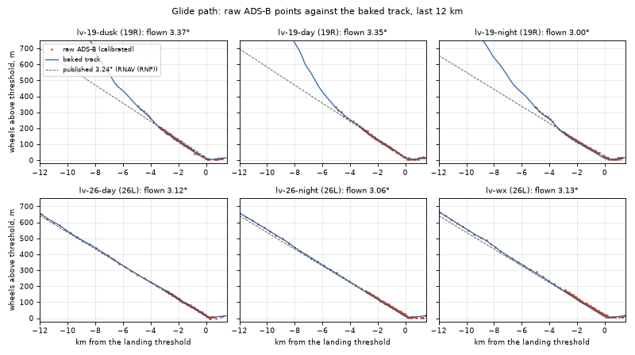
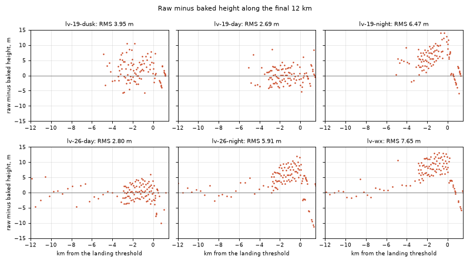
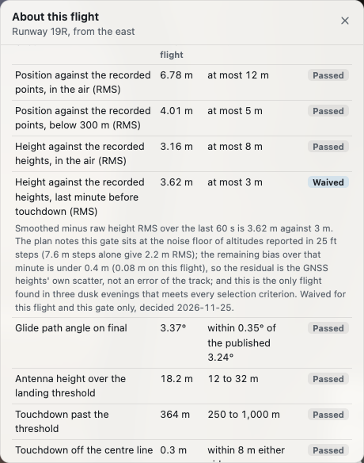

# Validation of plan 03, "Window seat and landing" (Fly mode)

Written 25 November 2026 for the repository's owner, for task F8.1 (the plan's section 8). Branch
`feat/window-seat-flight`, commit `cba1fe2`, on an Apple M4 running macOS 26.5.2. The plan names this report
`docs/validation/flight.md`; plans 01 and 02 kept no validation folder, so it is named after the plan instead.

## The finding, first

Of the 50 checks section 8 lists (12 ground truths, 27 automated tests, 11 tolerances), **35 pass, 6 pass only in
part or with a defect found, 2 fail, and 7 are not done**. The recorded flights are where the plan meant them to be:
every glide path is within 0.13° of a published approach, every touchdown is 0.0 to 2.3 m off the centre line, the Sun
and Moon are within 0.04° of an independent ephemeris, and the horizon drawn at cruise is within 0.01° of where WGS84
geodesy puts it. What fails or is not done:

- **The quality gates on height in the last minute do not measure the served track** (a defect in the bake). The
  flare fit lowers the served wheel heights by up to 10.75 m over the last 90 s, but the gates compare the recorded
  heights with the path before that shift. Measured on the served files, the last minute's height error is 4.1 to
  8.7 m RMS on four of the six flights, against a 3 m gate the QA files report as passed (section 4).
- **Mountain bearings close to the aircraft miss the tolerance**: Frenchman Mountain is 0.49° off in bearing at 17 km
  and Mount Wilson 0.63° at 23 km, against 0.2°. Elevation angles all pass (section 3, G12).
- **Not done**: everything that needs photographs, videos or plan 01's night-lights product (G8, G9, G11, the Sun
  against a video, the night luminance tolerance); the recorded roll, heading and airspeed comparison (the archive
  holds none for these flights); the reference-screenshot spec; and the software-rendered suites, goldens and budget
  files, which have not been run or recorded for this plan.

Other agents were, while this was written, working on performance and on the cabin's night look. Both are described
here as they stand at `cba1fe2`.

## Contents

1. How this was measured
2. Every check, with its outcome
3. Ground truth (section 8.1)
4. The flights: QA, the raw track against the baked, the glide path (section 8.4)
5. Automated tests (section 8.2)
6. Tolerances (section 8.3)
7. What cannot be validated: the inferred channels
8. Known open items, with the numbers at `cba1fe2`
9. Every estimate still in the build
10. Provenance, licences and attribution
11. Defects found in files this task does not own
12. Tests run

## 1. How this was measured

- **Python QA.** `uv run scripts/bake_flights.py lv --check` re-baked the six flights from the committed raw extracts,
  weather and procedure files and reproduced them byte for byte. The per-flight QA files
  (`data/flights/lv/qa/*.json`) are therefore the bake's own numbers for the files served.
- **Independent recomputation.** Where a number could be checked without the bake's own code, it was: the glide paths
  were fitted again straight from the raw ADS-B points; the served heights were compared with the raw ones from the
  served `.bin` files; the horizon, the summits and the Sun were computed with WGS84 geodesy and astropy, not with the
  app's frame functions. The scripts are kept outside the repository (working files, not part of the build).
- **The running app.** A production build of a clean export of `cba1fe2` (not this checkout, which held other
  agents' uncommitted work) was served locally and driven through `window.__skyline.flight` on this machine's GPU,
  with the WebGPU and the WebGL2 backends, at 1280 by 800 pixels on the High preset. The hooks used: `start`, `seek`
  to each flight's events, `state()`, `groundY`, `stats()`, `luminance()`, `window()`, plan 01's `env.state` (Sun and
  Moon) and `perf.throughput` and `perf.renderFrames` (frame time).
- **Timings are inflated.** Two other agents ran GPU work on the same machine throughout. Frame times below are
  marked as such, and per-layer costs could not be resolved (section 8).

Terms. *Served* means the files the app downloads (`public/data/lv/flights/`). *Raw* means the ADS-B extract the bake
reads (`data/flights/lv/raw/`). *Gate* is one of the quality checks of the plan's section 7.2 that a bake must pass.
*Grid bearing* is measured from the app's grid north, which differs from true north by up to 1.8° at cruise range.

## 2. Every check, with its outcome

| Group | Pass | Partly, or defect found | Fail | Not done |
| --- | --- | --- | --- | --- |
| Ground truth G1 to G12 | 6 | 2 | 0 | 4 |
| pytest (11) | 10 | 1 | 0 | 0 |
| Vitest (10) | 10 | 0 | 0 | 0 |
| Playwright (6) | 5 | 0 | 0 | 1 |
| Tolerances (11) | 4 | 3 | 2 | 2 |
| **All 50** | **35** | **6** | **2** | **7** |

One check was changed by a decision rather than failed: the five Playwright specs that exist run on the GPU
(`flight-gpu`), not in plan 01's software-rendered project as the plan asks (section 5).

The two failures are the near-summit bearing (G12's tolerance) and the served height near the ground (the tolerance
row "baked position against raw ADS-B" read for height, where the plan's own 3 m gate applies). The "partly" rows
are G1 (position passes, height does not), G12 (elevation passes, bearing does not), `test_baked_files` (passes, but
measures the wrong path for two gates), and three tolerances explained in section 6.

## 3. Ground truth (section 8.1)

| # | What the plan asks | What was found | Outcome |
| --- | --- | --- | --- |
| G1 | The raw ADS-B points check the baked path, speed and timing | Horizontal position: within the gates on all six (section 4). Height: the served track departs from the raw heights by 1.9 to 8.3 m on average over the last minute on four flights, because of the flare shift (section 4) | Partly |
| G2 | Recorded roll, heading and indicated airspeed check the derived ones | The six traces carry none: 0 points of each in every QA file (`recordedVersusDerived`) | Not done: no data |
| G3 | FAA runway geometry (NASR) | `airport.json` matches the plan's figures exactly: PAPI 3.00° and 84 ft on 26L and 26R, 3.04° and 80 ft on 19R, 3.00° and 75 ft on 19L. Runway lengths equal NASR's `APT_RWY.csv` of 29 October 2026 to the foot: 01L/19R 9,770 ft, 01R/19L 9,769 ft, 08L/26R 14,835 ft, 08R/26L 10,526 ft, all 150 ft wide | Pass |
| G4 | FAA procedures (CIFP) | `cifp-KLAS.json` (cycle 2611) matches the plan: ILS 26L and 26R 3.00° and 60 ft, RNAV to 19R 3.24°, to 19L 3.00°. Every flight's final is within 0.13° of a published angle for its end (section 4) | Pass |
| G5 | Published dimensions, limits, reference attitudes | Length, span and tail height within 1% (`test_aircraft_airframe.py`); window opening and pitch from `spec.py`; reference attitudes fitted (`test_attitude.py`). 109 of the 247 values in `spec.py` are estimates (section 9) | Pass |
| G6 | OpenStreetMap's mapped lights at LAS | Of 3,043 generated lights, matched mapped lights lie within 5 m: runway edge 212 matched, mean 2.07 m, worst 4.56 m; thresholds 22, 0.23 m, 1.59 m; approach lights 35 of 45, 3.68 m, 4.86 m. The 8 PAPI bars are sited from NASR and not moved; OpenStreetMap's nodes are up to 37.8 m from them (by design) | Pass |
| G7 | FAA marking and lighting standards | Unit tests hold the counts, spacing and colours (section 5). The aircraft's green and white are inside 14 CFR 25.1397's chromaticity limits; every lamp is at or above its 25.1391 or 25.1401 minimum | Pass |
| G8 | Dated window-seat photographs (Ken Lund, CC BY-SA 2.0) | Not obtained or compared. No side-by-side frame exists. What stood in: the night look was judged against the decisions' measured luminances (section 8) | Not done |
| G9 | Dated window-seat videos, logged | No video log exists (`tests/python/flight/video-log.json` is absent). Flap, gear, spoiler and flare timing rests on the rules of section 7.3 only | Not done |
| G10 | The Sun: direction and glint | Against astropy at the airport, for all six flights at cruise and at touchdown, on both backends: Sun within 0.022° in azimuth and 0.038° in altitude; Moon within 0.026° and 0.035° when up. Relative to the aircraft's own horizon 300 km east at cruise, within 0.37°. No video to compare glint with | Pass (ephemeris); video part not done |
| G11 | VIIRS radiance and astronaut photographs at night | Plan 01's night-lights model is not built here: `env.nightlights.upwardLuminance` is a stub that returns 0. The region's town lights take where they are from NASA's Black Marble but their brightness from a lumens-per-person figure, not from radiance | Not done |
| G12 | Named summits from a known track point | From four points of `lv-19-dusk` (cruise, 18,000 ft, 10,000 ft, the threshold), against surveyed positions: elevation angles within 0.10° everywhere. Bearings within 0.05° beyond 50 km, but Frenchman Mountain 0.49° off at 17 km and 0.32° at 35 km, Mount Wilson 0.63° at 23 km. The drawn summits stand 206 and 269 m from the published summit coordinates and 22 to 46 m below the surveyed heights | Partly |

### G10 in detail: the Sun and the Moon

The app's ephemeris (plan 01's) was read from `env.state` at each flight's touchdown and at its first sample, and
compared with astropy 7 (`get_sun`, `get_body('moon')`, topocentric at the airport, 665 m). The app's `trueAltDeg`
(without refraction) is compared with astropy's altitude without refraction.

| Flight | Touchdown (UTC) | Sun az / alt, astropy | Sun az / alt, app | Moon alt, astropy / app |
| --- | --- | --- | --- | --- |
| lv-19-dusk | 2026-03-10 01:48:34 | 266.288° / −1.972° | 266.277° / −1.957° | −72.312° / −72.312° |
| lv-19-day | 2026-02-16 16:04:51 | 120.236° / 17.515° | 120.230° / 17.483° | 18.921° / 18.885° |
| lv-19-night | 2026-03-10 06:42:46 | 329.910° / −54.361° | 329.902° / −54.322° | −17.153° / −17.183° |
| lv-26-day | 2026-03-10 15:20:00 | 106.788° / 15.395° | 106.783° / 15.369° | 18.145° / 18.125° |
| lv-26-night | 2026-02-16 03:56:30 | 278.034° / −31.752° | 278.042° / −31.730° | −48.450° / −48.427° |
| lv-wx | 2026-01-01 19:45:24 | 180.289° / 30.969° | 180.266° / 30.934° | −22.681° / −22.656° |

The app keeps one Sun direction for the scene and tilts each place's vertical with the Earth's curvature. Checked at
the aircraft at cruise: on `lv-19-dusk`, 300 km east of the city, the Sun stands 1.96° above the aircraft's horizon in
the app and 1.61° by astropy (0.35° apart); on `lv-26-day` 11.76° against 12.13°. That is inside the plan's 3°
for the Sun on the wing.

### The horizon at altitude (F6.2)

The plan asks for the horizon 3.07° below eye level at 35,000 ft within 0.1°. Over a sea-level horizon with the app's
refraction (an Earth radius of 7/6) the formula gives 3.070° at 35,000 ft; the recorded flights cruise near 30,700 ft
over land, so the test was made on the ground actually drawn. Along 16 bearings from `lv-19-dusk`'s first sample
(9,348 m) and from its 18,000 ft event (5,488 m), the highest elevation angle of the drawn ground (`groundY`, which
includes the curvature drop the meshes are drawn with) was compared with the elevation angle WGS84 geodesy gives to the
same terrain point, with the same refraction:

| Eye | Horizon found at | Elevation of the drawn horizon | Geodesy minus app, worst of 16 |
| --- | --- | --- | --- |
| 9,348 m (cruise) | 250 to 442 km | −2.39° to −2.79° (terrain 535 to 3,192 m) | 0.008° |
| 5,488 m (18,000 ft) | 164 to 286 km | −1.34° to −2.06° | 0.003° |

A sea-level horizon at 9,348 m would be at −2.87°; the higher ground of Arizona and Utah raises it. The drawn
horizon is where it should be to 0.01°. This measures the drawn geometry, not pixels; the depth precision that puts it
on screen is held by `farplane.gpu.spec.js`.

### G12 in detail: four summits

Summit positions and heights: Charleston Peak 36.27185° N, 115.69584° W, 3,632 m (NAVD 88, as the repository's
`test_grids.py` holds it); Mount Potosi 35.96580° N, 115.5003° W, 2,596 m; Frenchman Mountain 36.17886° N,
114.99805° W, 1,236 m; Mount Wilson, Arizona, 35.9966° N, 114.6119° W, 1,660 m. These are the Geographic Names
Information System's summit points as the public gazetteer sites give them, and Wikipedia's NAVD 88 heights
(NGS datasheets were not reached). The drawn summit is the highest drawn ground within 2 km of the published point.

| From (lv-19-dusk) | Summit | Distance | Bearing error | Elevation error | Tolerance | Outcome |
| --- | --- | --- | --- | --- | --- | --- |
| Threshold, 649 m | Charleston Peak | 52 km | −0.05° | −0.02° | 0.2° | Pass |
| | Mount Potosi | 34 km | −0.00° | −0.05° | 0.2° | Pass |
| | Frenchman Mountain | 17 km | +0.49° | −0.08° | 0.2° | **Fail (bearing)** |
| | Mount Wilson | 51 km | +0.05° | −0.06° | 0.2° | Pass |
| 10,000 ft, 3,048 m | Frenchman Mountain | 35 km | −0.32° | −0.05° | 0.2° | **Fail (bearing)** |
| | Mount Wilson | 23 km | −0.63° | −0.10° | 0.2° | **Fail (bearing)** |
| | Charleston, Potosi | 98, 84 km | −0.03°, −0.01° | −0.01°, −0.02° | 0.2° | Pass |
| 18,000 ft | all four | 65 to 167 km | −0.11° to +0.02° | −0.06° to −0.01° | 0.2° / 0.4° | Pass |
| Cruise | all four | 241 to 343 km | −0.05° to −0.02° | −0.02° to −0.01° | 0.4° | Pass |

Drawn heights: Charleston Peak 3,610 m (22 m low), Potosi 2,573 m (23 m low), Frenchman 1,207 m (29 m low), Mount
Wilson 1,614 m (46 m low). F6.1 asks only that Charleston stand within 30 m in the `approaches` grid; it does, in the
`valley` grid that is drawn too. The bearing misses come from the drawn summit standing 206 m (Frenchman) and 269 m
(Mount Wilson) from the gazetteer's point. Whether the terrain or the gazetteer is off was not settled: gazetteer
summit points were digitised from topographic maps and are often off by that much. Checking against the 3DEP 10 m
elevation model's own summit would settle it.

## 4. The flights: QA, the raw track against the baked, the glide path (section 8.4)

The six flights, as baked. All pass every gate except the waived one; the numbers are the bake's QA files, reproduced
byte for byte today.

| Gate (limit) | lv-19-dusk | lv-19-day | lv-19-night | lv-26-day | lv-26-night | lv-wx |
| --- | --- | --- | --- | --- | --- | --- |
| Recorded type | 737 MAX 8 (B38M) | 737-900 (B739) | 737-800 | 737-800 | 737-800 | 737-800 |
| Runway, light | 19R, dusk | 19R, day | 19R, night | 26L, day | 26L, night | 26L, day, overcast at 500 ft |
| Position RMS in the air (12 m) | 6.78 | 5.38 | 7.80 | 5.16 | 7.76 | 5.08 |
| Position RMS below 300 m (5 m) | 4.01 | 4.87 | 3.50 | 3.21 | 4.55 | 3.92 |
| Height RMS in the air (8 m) | 3.16 | 2.91 | 3.13 | 3.42 | 2.48 | 2.73 |
| Height RMS, last minute (3 m) | **3.62, waived** | 2.47 | 2.63 | 2.35 | 2.29 | 2.28 |
| Glide path (published ± 0.35°) | 3.37 (3.24) | 3.35 (3.24) | 3.00 (3.04) | 3.12 (3.00) | 3.06 (3.00) | 3.13 (3.00) |
| Antenna over threshold (12 to 32 m) | 18.2 | 22.6 | 25.8 | 20.5 | 23.7 | 24.1 |
| Touchdown past threshold (250 to 1,000 m) | 364 | 533 | 483 | 382 | 440 | 367 |
| Touchdown off centre line (8 m) | 0.3 | 1.3 | 2.3 | 0.0 | 0.0 | 0.7 |
| Steepest bank (35°) | 29.3 | 17.5 | 30.0 | 26.3 | 29.9 | 18.4 |
| Pitch range (−6° to 12°) | −1.6 to 6.0 | −4.5 to 5.6 | −3.6 to 4.9 | −3.7 to 4.7 | −2.0 to 5.4 | −3.4 to 5.6 |
| Hardest braking (3.5 m/s²) | 3.36 | 2.80 | 2.67 | 2.51 | 2.62 | 3.02 |
| Flap placard, flap retractions (0) | 0, 0 | 0, 0 | 0, 0 | 0, 0 | 0, 0 | 0, 0 |
| Gear before landing flap (s) | 14 | 30 | 43 | 39 | 46 | 16 |
| Landing lights by 10,000 ft | yes | yes | yes | yes | yes | yes |
| Height datum, runway calibration | ellipsoid, −29.7 m | ellipsoid, −31.5 m | ellipsoid, −30.5 m | ellipsoid, −25.5 m | ellipsoid, −30.3 m | ellipsoid, −28.0 m |
| Sun at touchdown | −2.0° | 17.5° | −54.4° | 15.4° | −31.7° | 31.0° |

**The waiver.** `lv-19-dusk`'s last-minute height RMS is 3.62 m against 3 m. The waiver in
`data/flights/lv/selection.json` (decided 25 November) argues that 25 ft altitude steps alone give 2.2 m RMS, that
the bias over that minute is 0.08 m, and that this is the only flight in three dusk evenings that meets every
selection criterion. The waiver is carried into the served header and shown as waived in "About this flight".

**The glide path from the raw points.** Fitted straight from the raw ADS-B positions and geometric heights 1 to 3 km
before the threshold, without the bake: 3.34°, 3.33°, 2.94°, 3.06°, 2.98° and 3.11° for the six flights in the order
above, within 0.07° of the bake's figures. The published approaches the finals match: on 19R the RNAV (RNP) Z and
RNAV (GPS) Y at 3.24° (and the PAPI at 3.04° for `lv-19-night`), on 26L the ILS Y and Z and the RNAV (RNP) at 3.00°.

*Glide paths.* Red: the raw points, calibrated as the bake calibrates them; blue: the served track; dashed: the
published path through its crossing height. The runway 19 finals start about 5 km out, after the turn onto final.

**The defect: the height gates do not see the served track.** The bake fits a flare that must end at the recorded
touchdown. When none fits, `smooth.flare` shifts the whole wheel-height series down, ramped in over the 90 s before
the flare, by up to 15 m (`scripts/lib/smooth.py`, called at `scripts/bake_flight.py:434`). The gates are computed
afterwards from the path *before* that shift (`ant`, `scripts/bake_flight.py:534` to `541`). So the QA files describe
a path the app does not fly. Measured on the served `.bin` files against the raw heights, over the gate's own window
(60 to 8 s before touchdown):

| Flight | Flare shift | Raw minus served, mean | RMS | Gate | Served glide path | Served antenna over threshold |
| --- | --- | --- | --- | --- | --- | --- |
| lv-19-dusk | −2.75 m | +1.9 m | 4.1 m | 3 m (waived at 3.62) | 3.39° | 15.5 m (QA 18.2) |
| lv-19-day | 0 | +0.0 m | 2.5 m | 3 m | 3.35° | 22.6 m |
| lv-19-night | −8.75 m | +6.2 m | 7.0 m | 3 m | 3.07° | 17.1 m (QA 25.8) |
| lv-26-day | 0 | +0.3 m | 2.4 m | 3 m | 3.12° | 20.5 m |
| lv-26-night | −7.25 m | +5.8 m | 6.4 m | 3 m | 3.11° | 16.4 m (QA 23.7) |
| lv-wx | −10.75 m | +8.3 m | 8.7 m | 3 m | 3.21° | 13.7 m (QA 24.1) |

The bias follows the shift on every flight; matching by position instead of time gives the same numbers, so it is not
a timing error. The served tracks still pass the glide-path gate (worst `lv-wx`, 0.21° from 3.00°, past the 0.2°
warning) and the crossing-height range (worst 13.7 m against a 12 m floor), but four of six fail the 3 m last-minute
height gate when it is measured on what is served. The fix belongs to the bake: compute the gates on the served
wheels plus the antenna offset, and either accept a flare that does not meet the recorded touchdown exactly or say in
the QA how far the path was moved. The touchdown spec still passes, because the shift exists precisely to put the
wheels on the runway at the recorded time.

*Raw minus served height.* The three flights with the largest flare shifts sit 5 to 12 m above zero from 3 km out.

## 5. Automated tests (section 8.2)

**pytest**, `tests/python/flight/` (results in section 12):

| The plan's test | Where it lives | Outcome |
| --- | --- | --- |
| `test_trace_parse` | `test_trace_parse.py` (14-element layout, ground altitudes, state objects, flags, two UTC days, the pre-2022 layout) | Pass |
| `test_gate` | `test_smoother.py::test_gate_removes_spikes_and_mlat_and_leaves_clean_data_alone`, `test_gate_drops_an_impossible_climb` | Pass |
| `test_altitude` | `test_altitude.py` | Pass |
| `test_smoother` | `test_smoother.py` (3°/s turn at 250 kt sampled every 7 s) | Pass |
| `test_touchdown` | `test_touchdown.py` | Pass |
| `test_attitude` | `test_attitude.py` | Pass |
| `test_config` | `test_config.py` | Pass |
| `test_runway_classify` | `test_runway_classify.py` | Pass |
| `test_frame` | `tests/python/test_frame.py` and `tests/unit/frame.test.js` (with `levelQuaternion`) | Pass |
| `test_baked_files` | `test_baked_files.py`, `test_bake_all.py`, `test_waivers.py`, `test_qa.py` | Partly: passes, but two of its gates measure the path before the flare shift (section 4) |
| `test_grids` | `test_grids.py` (borders, colours over overlaps, summits, sizes) | Pass |

Added beyond the plan's list: `test_aircraft_spec.py`, `test_aircraft_airframe.py`, `test_aircraft_cabin.py`,
`test_airport*.py` (5 files), `test_flight_format.py`, `test_flight_lights.py`, `test_flight_weather.py`,
`test_strip_view.py`.

**Vitest**, `tests/unit/flight/`:

| The plan's test | Where it lives | Outcome |
| --- | --- | --- |
| `track.test.js` | `track.test.js` | Pass |
| `kinematics.test.js` | `kinematics.test.js` (1.93° at 250 km, 2.25° with the true radius) | Pass |
| `journey.test.js` | `journey.test.js`, `pace.test.js` | Pass |
| `orbit.test.js` | `orbit.test.js`, `orbitFlies.test.js`, `orbitCut.test.js`, `orbitControls.test.js` | Pass |
| `lopa.test.js` | `lopa.test.js` | Pass |
| `rig.test.js` | `rig.test.js` | Pass |
| `lights.test.js` | `lights.test.js` (landing lights at 10,000 ft, three flashes a second at most, reduced motion, 14 CFR photometry and colour) | Pass |
| `paneState.test.js` | `paneState.test.js` | Pass |
| `lightLayout.test.js` | `airportLightLayout.test.js` (with OpenStreetMap's mapped lights within 5 m) | Pass |
| `terrain/grids.test.js` | `terrainNested.test.js`, `terrainIndex.test.js`, `terrainMeshes.test.js`, `terrainDecode.test.js` | Pass |

**Playwright**, `tests/e2e/flight/`:

| The plan's spec | Where it lives | Outcome |
| --- | --- | --- |
| `enter-exit.spec.js` | same name, both backends | Pass on the GPU |
| `whatif.spec.js` | same name (the Sphere hidden, undo in flight, a drag holds the clock) | Pass on the GPU |
| `touchdown.spec.js` | same name, the synthetic flight and all six baked ones | Pass on the GPU |
| `seat.spec.js` | same name (seats ahead of, over and behind the wing; a blank wall) | Pass on the GPU |
| `golden.spec.js` | not written; no reference screenshots are recorded for Fly | Not done |
| `links.spec.js` | same name, and orbit links in `orbit.spec.js` | Pass on the GPU |

**Changed by decision.** The plan asks for these specs in plan 01's software-rendered project with stable pixels. The
decisions of 23 November give them two projects, `flight-software` and `flight-gpu`; only `flight-gpu` has been run
for this plan. The GPU-only specs added (`*.gpu.spec.js`: blank frame, exposure, far plane, night, preview pictures,
weather, window) and `about.spec.js` (this task) run there too.

## 6. Tolerances (section 8.3)

| Quantity | Tolerance | Measured | Outcome |
| --- | --- | --- | --- |
| Baked position against raw ADS-B | 12 m RMS in the air, 5 m near the ground | Horizontal 5.08 to 7.80 m in the air, 3.21 to 4.87 m below 300 m. Height near the ground on the served track: 2.4 to 8.7 m RMS over the last minute (section 4) | **Fail** for height near the ground on 4 of 6 flights; horizontal passes |
| Height above the runway at touchdown | 0.3 m | The wheels are 0.12 m under the drawn surface at the touchdown sample on all six flights (`state().heightAboveGround` = −0.120 m); `touchdown.spec.js` passes | Pass |
| Glide path on an instrument or PAPI final | published ± 0.35° | 0.04° to 0.13° from the bake; 0.00° to 0.21° on the served tracks | Pass |
| Antenna over the threshold | 12 to 32 m | 18.2 to 25.8 m in the QA; 13.7 to 22.6 m on the served tracks | Pass (close to the floor on `lv-wx`) |
| Airframe length, span, tail height | 1% | Held by `test_length_span_and_tail_height_within_one_percent` (length 39.47 m in the model's report) | Pass |
| Window pitch and size | 5 mm | Held by `test_aircraft_cabin.py` against `spec.py`; the opening (0.267 by 0.365 m) is a published figure, its height above the floor (0.97 m) an estimate | Partly: holds the model to `spec.py`, and `spec.py`'s window height is itself estimated |
| Wing position against the rows | half a seat pitch | `lopa.test.js` holds the window stations to the seat map measured to scale; the 30-row, 31-inch layout is an estimate | Partly: generic layout, as the plan says |
| Sun direction on the wing against a logged video | 3° | No video log. Against the ephemeris: 0.04° at the city, 0.37° at the aircraft | Not done (video); the ephemeris part passes |
| Mountain skyline from a known position | 0.2° within 100 km, 0.4° beyond | Elevation within 0.10° everywhere; bearing 0.32° to 0.63° off for two summits within 35 km | **Fail** (bearing, near summits) |
| Generated airport lights against mapped ones | 5 m | Worst 4.86 m (approach lights), 4.56 m (edge); PAPI not moved by design | Partly: passes for every light moved; 187 of 399 mapped edge lights have no generated light within reach |
| Night luminance of the valley | within a factor of 2 of `nightlights.upwardLuminance` per km² | Not measurable: that function is a stub returning 0 in this build (plan 01's phase 4) | Not done |

## 7. What cannot be validated: the inferred channels

The archive records where the aircraft was, how high and how fast. Everything else is inferred by rule and cannot be
checked against these flights, because the traces carry no roll, heading or airspeed (G2) and no video was logged (G9):

| Channel | How it is made | Its weakest assumption |
| --- | --- | --- |
| Pitch | flight-path angle plus angle of attack from a lift model fitted to published reference attitudes | the weight, inferred from the approach speed (69.7 t on `lv-19-dusk`) |
| Bank | coordinated turn from the turn rate of the air velocity | the wind, from the GFS column (derived, not inferred) |
| Flaps, slats | selected by speed or by gate, never above a placard; travel 1 lever unit a second | the selection rule and the travel rate (estimates) |
| Gear | down with flaps 15, before the landing flap; 10 s travel | travel time (estimate) |
| Speed brakes | only where the descent is 25% steeper than clean idle explains | low confidence, said so in the header |
| Ground spoilers, reversers | 0.5 s and 2 s after touchdown until taxi speed | standard practice, not this flight's |
| Lights | the plan's section 7.8 schedule | standard practice |
| Cabin light | dimmed to 0.3 from 10,000 ft when the Sun is 6° down | the dimming level (estimate) |
| The flare | modelled over the last 3 to 6 s; the series is shifted when no flare fits (section 4) | the shift, up to 10.75 m |

"About this flight" says this to the visitor for each flight, with every channel's note from the header.

## 8. Known open items, with the numbers at `cba1fe2`

| Item | The numbers | Where |
| --- | --- | --- |
| The waived gate on `lv-19-dusk` | 3.62 m against 3 m, waived 25 November; on the served track 4.1 m (section 4) | `data/flights/lv/selection.json` |
| Two recorded types are not the 737-800 drawn | `lv-19-day` is a 737-900 (2.6 m longer, same wing and windows); `lv-19-dusk`, the default, is a 737 MAX 8 (same cabin and windows, larger engines and split winglets, not drawn) | "About this flight" says so |
| The flight draws its own minimal clouds | the shared renderer (plan 01) has no clouds yet; `src/flight/clouds.js` draws the recorded layers simply | phase 6 of plan 01 |
| The ground under an overcast is sunlit | `lv-wx` touches down under an overcast at 500 ft, yet the key light is the Sun and the exposure is 14.5 EV, brighter than the clear mornings' 13.2 and 13.5 EV | `src/flight/env.js` and plan 01's light |
| Street lamps are off on the dusk flight | photocells switch near −4.7°; at `lv-19-dusk`'s touchdown the Sun is −1.3° and 0.1% of the lamps in view are lit (56,658 in view), so the default flight shows little city light. This is correct | `src/flight/ground/` |
| The Strip's signs and façades are not lit at dusk | they follow the same switch-on as the map | plan 01 and plan 02's lights |
| The dimmed cabin goes nearly black on a night final | on `lv-19-night` the cabin wall is 1.15 cd/m² at cruise and 0.19 cd/m² from 10,000 ft down; after exposure that is 0.29 of display white at cruise and 0.012 to 0.016 on final and on the runway (about 25 in 255 in sRGB). **In progress** by the cabin agent | `src/flight/cabin/cabin.js`, `src/flight/exposure.js` |
| Regional imagery colour | the Sentinel-2 and Blue Marble images are colour-matched down the chain, but differ visibly from NAIP near the city; not measured here | `public/data/lv/ground-*.webp` |
| Lake Mead | the 2016 imagery's shoreline lies on the terrain's 2000-era lake level | `ground-valley.webp`, `terrain-valley.bin.gz` |
| Frame budgets exceeded | whole frames on High at 1280 by 800, inflated by other agents' GPU work: WebGPU 10 to 19 ms a frame (cruise to touchdown, by throughput), WebGL2 9 to 21 ms. Per-layer costs (lamp layer on WebGPU, cabin stage and glass on WebGL2) could not be resolved: the same moment measured 60.7 ms and then 20.4 ms of GPU time. The airframe takes 64 draws from outside against 40 budgeted (decisions, 24 November; not re-measured). Lamp memory: 326,466 lamps loaded (194,679 street lamps and 131,787 town lights), against section 9.2's 6 MB for `lamps-air.bin`; not measured. **In progress** by the performance agent | `src/flight/**` |
| `stats()` draw counts | `stats().drawCalls` grew with every seek in one session (1,163, 2,253, 3,348, 4,437, 5,526 ... 11,222) and `triangles` read 0 on WebGPU: the hook's counts look cumulative, not per frame | `src/flight/session.js` `stats()` |
| The repository's size | 94.2 MB tracked under `public/` (82.1 MB at the branch point; this plan's files 12.0 MB), above the plan's 90 MB guard, which is not written (`budget.spec.js`) | section 9.4 |
| Airport props and approach buildings | F4.5 (buildings under the approaches) and F4.6 (parked aircraft, airport buildings not in the set) are not built | |
| Inset grids | F4.8's `airport`, `final19` and `final26` grids are not built; the map's ground is moved under the pavement instead (`view/airportGround.js`) | |
| Phase 9 and Salt Lake City | deferred (phase 9 by the decision of 10 November; F8.3 not attempted). Stretch F8.4 (other aircraft), F8.5 (sound), F8.6 (taxi to the gate) not done | |
| Software-rendered suites, goldens and budgets | `flight-software`, the goldens and the budget files have not been run or recorded for this plan | |
| Attribution outside the app | `public/data/lv/flights/` carries no licence notice file (only `index.json`'s attribution line; `data/flights/LICENSE` exists), and the README's licence section lists none of Fly's sources | `README.md` (not this task's file) |
| Nothing pushed | 67 commits are local | |

## 9. Every estimate still in the build

| Estimate | Value at `cba1fe2` | Where |
| --- | --- | --- |
| Aircraft dimensions without a source | 109 of 247 values tagged `ESTIMATED`: lamp positions 18, cabin 15, flaps 12, lamp beams 10, lamp candela 9, engine 7, gear 6, light bake 4, performance 4, spoilers 4, budgets 3, Kruegers 3, slats 3, and 12 others | `models/aircraft/spec.py`, `models/aircraft/research/dimensions.md` |
| Aircraft lamp candela | NAV 100, NAV aft 40, beacon 1,100 (tuned from 1,500), strobe 5,000, landing 300,000, taxi 40,000, turn-off 40,000, logo 5,000, wing 5,000 (tuned from 10,000); each above its 14 CFR minimum | `src/flight/aircraft/lights.js`, `spec.py` `LIGHT_CANDELA` |
| Airport light intensities, beams and heights | from the photometric minimums of AC 150/5345-46E; edge lights 5 ft outside the edge | `src/flight/airport/lightLayout.js` |
| Apron floodlights | masts every 70 m along the aprons' outer edges, 3 m outside, 25 m high; no public record | `src/flight/airport/lightLayout.js` |
| Stand headings | along the last leg of OpenStreetMap's lead-in line; the stop end guessed where no gate is mapped | `scripts/build_airport.py` |
| Cabin light | wash 160 lux, ambient 70 lux, strip 450 cd/m², bounce 0.9, floor 0.12, glass 0.83, night full 0.15, night gamma 1.5; night scene from 400 to 4 cd/m² at the window; ground albedo 0.2 | `src/flight/cabin/cabin.js` `CABIN_LIGHT`, `NIGHT_SCENE` |
| Exposure while flying | adaptation floor 0.25 lux, ground share 0.25 faded out by 300 m, lit-terrain key sin 0.06 | `src/flight/exposure.js` |
| The ×5 light factor | each street lamp's pool stands for 5 times its own light (4.8 to 5.6 from the share of street lighting in city light); stands in for the per-cell calibration against radiance | `src/flight/ground/lamps.js` `ALL_LIGHT_FACTOR` |
| Orbit | preset radii 31, 9 and 5 km; roll rate, climb rate, bank allowance and shortest change; centre within 50 km; airspeed 150 to 340 kt | `src/flight/orbit.js` |
| Cloud tops and in-cloud visibility | tops from the GFS column or plan 01's depth for the genus; visibility inside cloud by genus (Gultepe and others, 2006) | `scripts/lib/flight_weather.py` |
| The bake's timings | antenna 5.6 m above the wheels; flaps 1 lever unit a second; gear 10 s; crab removed over 5 s; nose down over 5 s; flare from 6 to 9 m | `scripts/bake_flight.py`, `scripts/lib/{config_schedule,attitude,smooth}.py` |
| The pane | thermal resistances, film coefficient, cold soak, frost and mist rates, drops, tint, breather hole | `src/flight/window/*.js`, `scripts/build_pane_textures.py` |
| Head rig | lean back 0.20 m, lean in 0.25 m | `src/flight/cabin/headRig.js` |
| Cabin layout | 30 rows at 31 in, exit rows 15 and 16, eye 1.20 m above the floor | `spec.py` `CABIN` |

## 10. Provenance, licences and attribution

| Source | Used for | Licence | Credit line | Shown in the app |
| --- | --- | --- | --- | --- |
| adsb.lol `globe_history` | the six tracks | ODbL 1.0 | "Flight tracks: contains information from adsb.lol globe_history, made available under the Open Database License (ODbL) 1.0" | "About this flight" (each flight, with links); "About the data", Fly group; the corner label while flying ("flight tracks adsb.lol (ODbL)") |
| OpenStreetMap | buildings; taxiway lines, stands, gates, mapped lights; roads for town lights | ODbL 1.0 | "© OpenStreetMap contributors" | corner label (every mode); "About the data"; "About this flight" |
| FAA: NASR, airport mapping data, Digital Obstacle File, CIFP | runways, markings and lights; pavement outlines and buildings; the tower; approaches | US government work; "for public use" | "Federal Aviation Administration"; CIFP "not for navigation" | "About the data", Fly group; "About this flight" (with the CIFP disclaimer) |
| USGS 3DEP through AWS Terrain Tiles | the terrain to the horizon | open data, credit required | "United States 3DEP (formerly NED) and global GMTED2010 and SRTM terrain data courtesy of the U.S. Geological Survey; INEGI, Continuo de Elevaciones Mexicano 3.0; ETOPO1 courtesy of NOAA" | "About the data" (word for word, tested); "About this flight" |
| USGS 3DEP LiDAR, NAIP | building heights; imagery near the city and airport | public domain | the USGS credit | "About the data" (Map and Fly groups) |
| NASA GIBS: Blue Marble, Black Marble 2016 | the ground beyond the valley; where the towns are lit | NASA open data | "We acknowledge the use of imagery provided by services from NASA's Global Imagery Browse Services (GIBS), part of NASA's Earth Science Data and Information System (ESDIS)" | "About the data", Fly group; "About this flight" |
| EOX Sentinel-2 cloudless 2016 | the ground under the approaches and over the valley | CC BY 4.0 | "EOxCloudless https://cloudless.eox.at by EOX IT Services GmbH (Contains modified Copernicus Sentinel data 2016 & 2017)" | "About the data", Fly group; "About this flight" |
| Open-Meteo (GFS, historical forecast API) | wind, temperature and cloud by height for each flight | CC BY 4.0 | "Weather data by Open-Meteo.com" | Settings ("About" paragraph, every mode); "About the data", Fly group; "About this flight" |
| Iowa Environmental Mesonet (NOAA / NWS observations) | the airport's reports for each flight | public domain | "Iowa Environmental Mesonet of Iowa State University" | Settings paragraph; "About the data", Fly group; "About this flight" (with the reports) |
| Street lights of Clark County, Las Vegas, Henderson, Boulder City | lamps from the air | no licence stated; treated as public domain by the user's decision of 10 November | each agency named | "About the data" (Drive and Fly groups) |
| NOAA GEOID18 | the height datum | public domain | none required | not shown |
| Aircraft, cabin, pane textures | made here | MIT with the code | none | "About the data" notes they carry no trade names or logos |

**Missing before this task, and fixed.** Before this task the app credited, while flying, only what the map and the
drive use: OpenStreetMap on the corner label, USGS in "About the data", and Open-Meteo and the Iowa Environmental
Mesonet in the Settings popover. adsb.lol's ODbL credit, the FAA, NASA GIBS, EOX and the terrain tiles' required
line (with INEGI) were shown nowhere. Now "About the data" (the same dialog the corner label opens, extended rather
than duplicated) has a "Fly (Las Vegas)" group with all of them, the corner label adds "flight tracks adsb.lol (ODbL)"
while flying, and "About this flight" lists them for each flight. A unit test checks that the terrain and imagery
lines are word for word those in `public/data/lv/terrain.json`.

*"About this flight" on the default flight:* every gate with its number and limit, the waived one marked and
explained. The panel opens from each card in the picker and from the flight's bar.

**Still missing outside the app**: an ODbL notice beside the served tracks in `public/data/lv/flights/` and the README
licence section's lines for Fly's sources (section 8). Neither file is this task's.

**What is not kept.** No served file holds an airline, flight number, registration, transponder address or operator.
`about.spec.js` reads every identifier the raw extracts record (address, registration, callsigns, operator) and finds
none of them in any file under `public/data/lv/flights/` or in the panel's text for any flight.

## 11. Defects found in files this task does not own

Recorded with their evidence; not fixed here.

1. **QA gates measured before the flare shift.** `scripts/bake_flight.py:434` to `436` (the shift) and `534` to `541`
   (the gates on `ant`). Evidence in section 4. The served `lv-wx` crosses the threshold with its antenna at 13.7 m,
   while its QA says 24.1 m.
2. **`stats()` counts look cumulative.** `src/flight/session.js` `stats()`: draw calls rose from 1,163 to 11,222 over
   ten seeks in one session; triangles read 0 on WebGPU. Owned by the performance work.
3. **The sunlit ground under an overcast** (`lv-wx`, section 8). Owned by the flight's environment and plan 01.
4. **`public/` above 90 MB with no guard.** 94.2 MB tracked; `tests/e2e/flight/budget.spec.js` (section 9.4) does
   not exist.
5. **The served tracks' licence notice and the README's credits** (section 10).

## 12. Tests run

The tree as left by this task: commit `cba1fe2` with uncommitted work in the working tree, this task's and the two
other agents' (performance and cabin). The numbers below are from that tree, not from `cba1fe2` alone.

Commit `cba1fe2` plus the uncommitted tree listed by `git status` when the GPU run started (about 03:10 PST) (this task's files and the other two
agents' in-progress changes to the cabin, the window and the terrain); 25 November 2026; Apple M4, macOS 26.5.2, from
a normal shell (not sandboxed), with the other two agents running their own GPU and CPU work at the same time.

| Command | Passed | Failed | Skipped | Time |
| --- | --- | --- | --- | --- |
| `pnpm test:unit` | 2,538 | 20 | 4 | 1 min 38 s |
| `pnpm test:py` | 687 | 0 | 5 (and 1 expected failure) | 4 min 21 s |
| `pnpm build` | built | | | 2.5 s |
| `SKYLINE_DIST=dist-r1 SKYLINE_PORT=4921 pnpm exec playwright test --project=flight-gpu --workers=1 --output=test-results-r1 tests/e2e/flight/` | 51 | 2 | 0 | 11 min 1 s |
| `uv run scripts/bake_flights.py lv --check` | 6 flights reproduced byte for byte | | | 5.3 s |

Failures, by name:

- **Unit, 20**, all in the cabin agent's in-progress work, none in a file this task touched:
  `tests/unit/flight/cabinAdaptation.test.js` (16 tests; a new, uncommitted file whose module is still being written),
  `tests/unit/flight/cabinModel.test.js` › "slides the own shade round its track about the fuselage axis, up behind
  the trim", and `tests/unit/flight/windowReflection.test.js` (3 tests: the cube's capture with the lamps at full, with
  the adaptation's gain, and at dusk). At `cba1fe2` the unit suite passed 2,502 with 4 skipped.
- **GPU, 2**: `tests/e2e/flight/cabin.gpu.spec.js:59` › "webgpu: the night cabin is lifted on final and reads; the
  signs are lit; inside its budgets" and the same test on webgl2. Both fail one budget, the triangles on final:
  160,604 against fewer than 150,000. The spec is the cabin agent's, new and uncommitted; the cabin model it measures
  was rebuilt in the same uncommitted work.
- The new `about.spec.js` passed both its tests (and `tests/unit/flight/about.test.js`, 26 tests, and
  `tests/unit/credits.test.js` passed in the unit run). `timing.gpu.spec.js`, which appeared in the tree during the GPU
  run, was not part of it.

Not run: `pnpm test:e2e:gpu` (the map's and the drive's GPU specs; this task changed the map's corner label and "About
the data" only through `index.html`, `credits.js` and the flight's CSS), `pnpm test:e2e:drive` and
`pnpm test:perf:drive` (no drive code changed), and the software-rendered projects `pnpm test:e2e`,
`pnpm test:e2e:drive:software` and `flight-software`, which this task was told not to run. No golden or budget file was
recorded.
